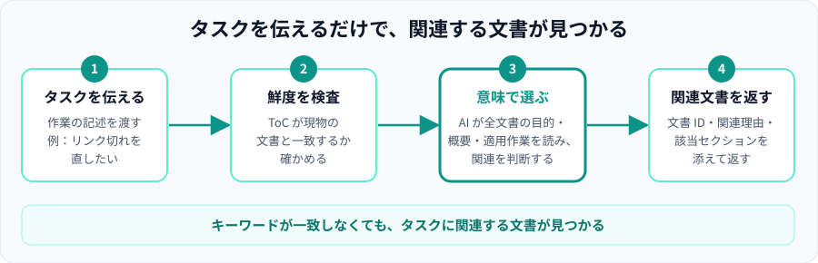
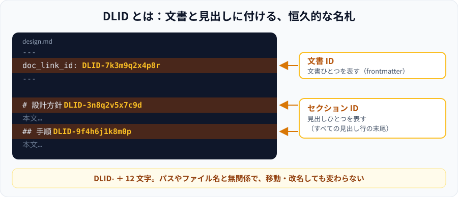
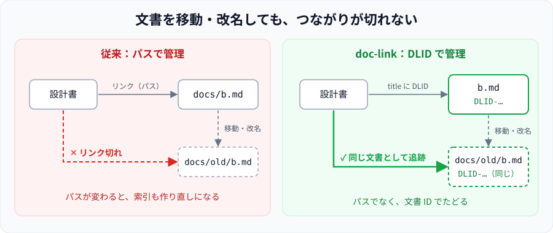
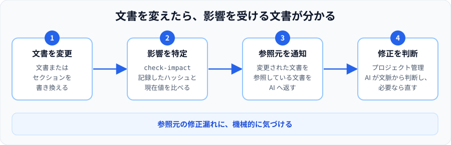

# doc-link

Claude Code 用プラグイン `doc-link` の配布リポジトリ。

doc-link は、プロジェクトの Markdown 文書の中から、タスクに関連する文書を意味で探して返す。キーワードの一致ではなく、AI が各文書の目的・概要・適用作業・キーワードを読み、タスクとの関連を判断する（セマンティック検索）。

この検索を支えるために、文書をパスではなく恒久的な文書 ID（DLID）で管理する。文書の移動・改名に影響されずに索引（ToC）を保ち、文書間の参照関係を機械的に把握して、変更された文書を参照している文書をプロジェクト管理 AI へ通知する。DocAdvisor を置き換えることを目的とする。

## 何が嬉しいか

- タスクの記述から、関連する文書を意味で探せる。キーワードが一致しなくても見つかる
- 文書を移動・改名しても、同じ文書として追跡できる。索引を作り直さずに済む
- 文書やセクションを変えたとき、それを参照している文書を機械的に特定できる
- リンク切れ・ID の重複・索引の不整合を検出できる



これらは、文書と見出しに付ける DLID を土台にしている。







## インストール

Claude Code のセッションで、このリポジトリを marketplace として登録してから、プラグインを入れる。

```text
/plugin marketplace add BlueEventHorizon/doc-link
/plugin install doc-link@doc-link
/reload-plugins
```

Claude Code v2.1.275 以降では、次の 1 行でもよい（新しい marketplace の追加は確認を経てから行われる）。

```text
/plugin install doc-link --marketplace BlueEventHorizon/doc-link
```

### インストールの範囲

| 範囲    | 有効になる場所                 | 保存先                        | git で共有されるか |
| ------- | ------------------------------ | ----------------------------- | ------------------ |
| user    | 自分の、すべてのプロジェクト   | `~/.claude/settings.json`     | されない           |
| project | このリポジトリの共同作業者全員 | `.claude/settings.json`       | 有効化の設定だけ   |
| local   | 自分の、このリポジトリだけ     | `.claude/settings.local.json` | されない           |

- セッションで `/plugin install` を実行すると、`/plugin` の画面でプラグインの詳細が開き、範囲（User / Project / Local）を選べる
- シェルの `claude plugin install` は、`--scope` を付けなければ user の範囲に入れる（すべてのプロジェクトで使える）

```bash
claude plugin install doc-link@doc-link --scope project   # user | project | local
```

- project の範囲は、git で追跡する `.claude/settings.json` に有効化の設定を書く。共有されるのは有効化の設定だけなので、共同作業者はそれぞれ一度 `claude plugin install doc-link@doc-link --scope project` を実行する

### Codex CLI など、marketplace を使わない導入

Codex CLI 向けや、marketplace を使わずにプロジェクトへ複製して導入する仕組みは、`/meta:generate-plugin-installer` で生成する。

## 動作に必要なもの

- [uv](https://docs.astral.sh/uv/)。SKILL が呼ぶ script は `uv run` で実行され、Python（3.15 以上）と依存（PyYAML・markdown-it-py）は uv が用意する

## 使い方

SKILL は `/doc-link:<名前>` で呼ぶ。対象の文書は、ToC を分ける単位の名前（`--key`）と、対象の指定（`--dirs` か `--paths`）で渡す。

```text
/doc-link:index-docs --key specs --dirs docs/specs/
```

### 文書を管理する

| SKILL          | 役割                                                                    |
| -------------- | ----------------------------------------------------------------------- |
| `check-dlid`   | 文書 ID・セクション ID が無い箇所と、重複を検査する（何も書き込まない） |
| `embed-dlid`   | 文書の frontmatter と見出し行の末尾へ DLID を付与する                   |
| `index-docs`   | ToC を構築・再構築する                                                  |
| `check-toc`    | ToC が現物の文書に対して最新かを検査する（何も書き込まない）            |
| `query-docs`   | タスクに関連する文書を、意味で探す。検索の前に、ToC が最新かを検査する  |
| `resolve-dlid` | DLID から、文書の現在のパスと内容ハッシュを得る（何も書き込まない）     |

### 参照を管理する

| SKILL          | 役割                                                                                                    |
| -------------- | ------------------------------------------------------------------------------------------------------- |
| `check-links`  | title に DLID を持つ参照を検査し、DLID の無いリンクには title に書く値を示す（何も書き込まない）        |
| `check-impact` | 変更された文書を参照している文書を返す。参照元の title に記録した内容ハッシュと、現在のハッシュを比べる |

### 基本の流れ

1. `embed-dlid` で、対象の文書に DLID を付ける
2. `index-docs` で、ToC を作る
3. `query-docs` で、作業に必要な文書を探す
4. 参照を書いたあとは `check-links` で検査する
5. 文書を変えたあとは `check-impact` で、影響を受ける参照元を確かめる

### 書き込む範囲

doc-link が利用者の文書へ書き込むのは DLID だけである（frontmatter の `doc_link_id` と、見出し行の末尾）。利用者の文書へ書き込む SKILL は `embed-dlid` だけである（`index-docs` は、ToC と管理状態を doc-link の保存先へ書く）。リンクや title は、利用者かプロジェクト管理 AI が書く。

## ライセンス

[MIT](LICENSE)
