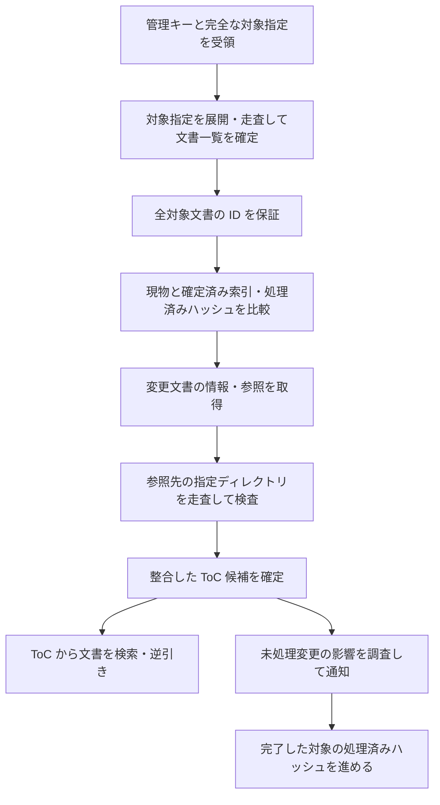

# doc-link システム設計の再検討（草案）

**状態**: 設計方針の再検討中（未承認）\
**更新日**: 2026-09-28\
**対象**: [doc-link 要件定義書](../requirement/REQ-001-overview.md)の全体構造

## 1. この草案の位置づけ

参照検査の根拠を保存済みデータから実ディレクトリの走査へ変更し、同じ文書 ID の情報を複数キー間で論理的に一つとした。この二つを前提に、部分修正ではなくデータの責務と処理順序を設計し直すための草案である。ToC は論理的な索引であり、JSON や RDB はその保存方法の候補である。保存方式を選んでも走査・確定・検索に関する要件は変わらない。

## 2. 確定済みの境界

- 初期対象は Markdown。管理対象文書は `doc_link_id` を持ち、欠けていれば doc-link が発行・記入する。同一文書の ID はパスや管理キーが変わっても維持する。
- 管理キーは対象集合と検索範囲を指定する。同一文書は複数キーに所属できる。キーへの所属は参照の有効性を決めない。
- 最初の主処理として ToC を必ず構築する。初回 ToC がない状態では検索しない。以後は走査結果から再構築要否を判定し、必要なら更新する。
- 参照の現在の存在・パス一致は、リンク定義から特定したディレクトリの走査結果で判定する。保存済みデータだけで現在の正しさを断定しない。
- doc-link が管理対象文書に行う修正は ID 管理に限る。本文・リンクの修正要否は通知し、実際の修正はプロジェクト管理 AI が行う。
- ToC への反映と影響調査の完了は別の状態である。処理済みハッシュの比較基準は、必要な調査と通知が完了するまで進めない。

## 3. 責務を分けた論理モデル

| 論理情報         | 意味                                                         | 現在の真偽を確かめる手段                                                       |
| ---------------- | ------------------------------------------------------------ | ------------------------------------------------------------------------------ |
| 文書             | `doc_link_id` による同一性、現在パス、本文ハッシュ、要約など | 管理対象指定に沿った現物の走査と文書内容の取得。要約は取得内容に基づく生成結果 |
| キー所属         | 文書 ID と管理キーの多対多関係                               | 呼び出し元の完全な管理対象指定を展開した結果                                   |
| 参照             | 参照元 ID、参照先 ID、リンク記載パス、参照元の位置           | 参照元文書の解析                                                               |
| 参照検査結果     | 指定ディレクトリ内の存在、パス一致、検査不能など             | 参照先ディレクトリの実走査                                                     |
| キー別 ToC       | 対象集合の検索・逆引きに使う、最後に正常確定した索引         | 対象集合と必要な参照先の走査を終えた後に確定                                   |
| 処理済みハッシュ | 影響調査・通知まで完了した比較基準                           | 調査と通知の成功時にだけ更新                                                   |

ここでいう「文書情報が論理的に一つ」は、キー別 ToC に同じ情報を物理的に重複保存してよいかどうかを、まだ決めない。逆引きできる参照元は、走査・登録済みの参照元文書に限られる。全世界の参照元を把握できるという意味ではない。

## 4. 構築・検索・影響調査の全体順序

1. `B` は管理対象の確定、`F` は参照先の検証である。参照先は管理対象外でもよく、二つの走査範囲を混同しない。
2. `D` の比較で、要約の更新対象と影響調査の未完了対象を別々に決める。`G` が成功しても `J` は自動的に完了しない。
3. 検索要求時はまず対象指定を再展開して `G` の要否を判定する。既存 ToC が古い場合は、更新するか古い ToC で検索するかをユーザーが選ぶ。後者は古い結果であると明示する。
4. 検査可能なディレクトリで参照先 ID が見つからない場合は、そのディレクトリ内での不在を記録する。世界全体での不存在とはしない。

## 5. 保存方式に依存しない設計条件

ToC は、キーごとに対象文書を検索・逆引きできる確定済みの論理的な索引である。JSON ファイルで実現しても、RDB のテーブル・ビューで実現してもよい。同じ文書 ID の情報が論理的に一つであることも、物理的な重複保存の禁止を意味しない。

どの保存方式を採用しても、次の条件を満たす必要がある。

1. 実ディレクトリの走査結果から、対象集合・文書情報・参照検査結果を確定する。保存済みデータの登録有無だけで現在の正しさを判定しない。
2. 複数キーに属する同一文書の情報が、矛盾した現在状態として見えないようにする。指定していないキーの ToC を更新しない場合は、そのキーの状態が古いことを区別する。
3. 更新途中の ToC を検索可能な確定済み状態として公開しない。確定の単位、失敗時の維持・再実行は保存方式に合わせて設計する。
4. 影響調査まで完了した比較基準を、ToC の更新だけで進めない。

JSON か RDB かは後続設計で、運用・性能・実装上の制約を比較して選ぶ。これは上記条件を決めるための前提ではない。

## 6. 新規レビューで確認すべき箇所

1. **保存状態の一貫性**: 文書情報・キー所属・参照検査結果・キー別 ToC のどれを同じ確定単位にするか。保存方式にかかわらず、片方だけ新しくなる状態を現在状態として公開しない規則が必要。
2. **キー間更新の波及**: 同じ ID の文書をキー A の走査で更新した時、キー B の ToC を変更しない既存要件との関係。B を古い状態と表示するのか、共有情報を参照して即時に新しい情報を見せるのかを決める必要がある。
3. **移動先の発見可能性**: 参照先がリンク記載パスのディレクトリ外へ移動した場合、そのディレクトリの走査では新パスは得られない。見つからないと通知するまでを要件とし、移動先を推測・断定しない境界を明記する必要がある。
4. **走査不能時の確定規則**: 参照先ディレクトリを走査できない場合に、検査不能を記録して ToC を確定するか、今回の確定を中止するかは未決定（要件の U-020）。どちらでも「正しい」とは記録しない。
5. **ID の重複検出範囲**: 対象集合外も参照できる一方、ID 発行時に世界全体の一意性を検証することはできない。発行範囲と検出可能範囲を分けて規定する必要がある。
6. **逆参照の網羅性**: 参照元を走査していない文書は逆引きに含まれない。影響調査結果に、調査済みの管理範囲と時点を伴わせる必要がある。

上記は新たな設計レビューの論点であり、従来の未決事項を確定済みとして読み替えない。保存方式の選択を待たずに決められる論理的な確定単位と鮮度の要件を先に詰める。
