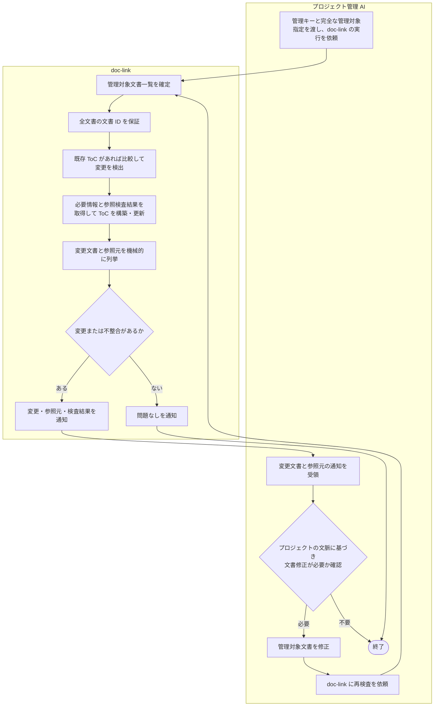
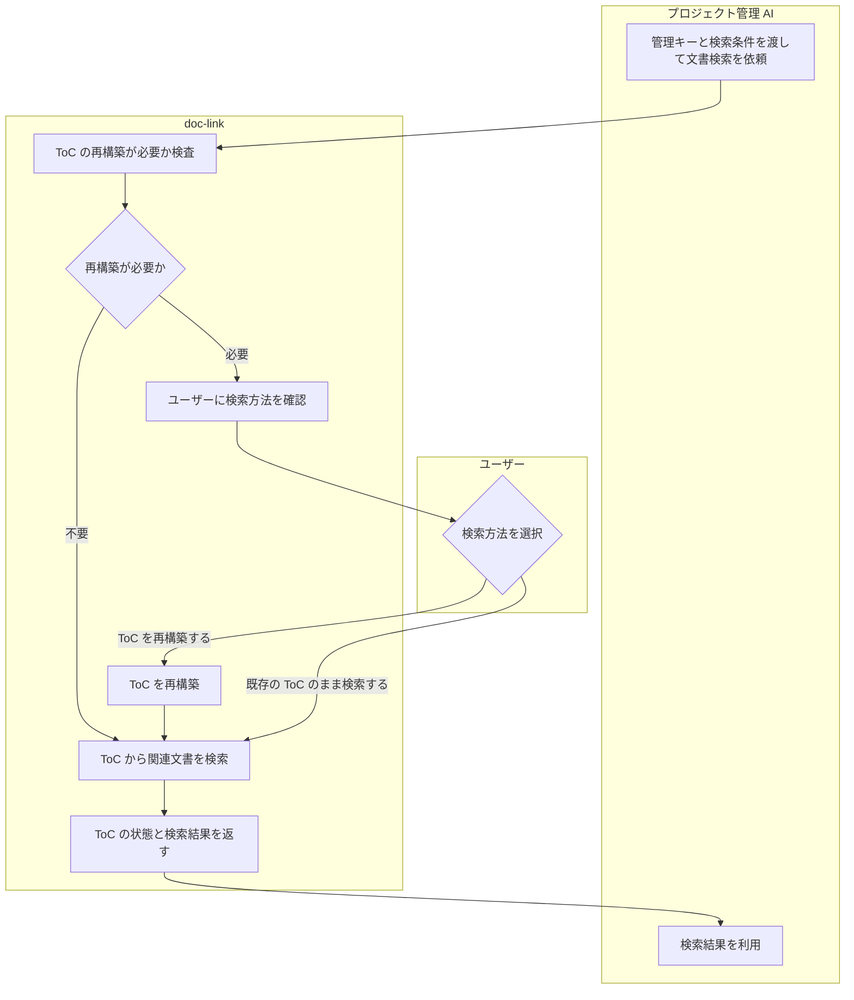

# doc-link 要件定義書 — 総論

**状態**: Draft 0.1\
**作成日**: 2026-09-18\
**更新日**: 2026-10-20\
**対象**: Claude Code 用プラグイン `doc-link`（仮称）

## 文書構成

[総論](REQ-001-overview.md) · [管理対象と文書 ID](REQ-002-document-id.md) · [ToC 管理](REQ-003-toc.md) · [文書検索](REQ-004-search.md) · [参照と変更通知](REQ-005-references.md)

本書は全体の目的、共通の非機能要件、検出事項、決定事項および未決事項を扱う。各処理の機能要件と受け入れ条件は対応する文書に記載する。

章番号と FR・AC・NFR・D・U の識別子は、分割前の番号を維持する。そのため、各ファイル内の章番号は連続しない。本文中の節番号は該当文書へのリンクとする。

## 1. 文書の目的

本要件定義書群は、既存の DocAdvisor を置き換える新しい Claude Code 用プラグイン `doc-link` の要件を定義する。doc-link は文書の検索と索引管理を引き継ぎ、文書 ID による識別、参照関係管理、変更された文書とその参照元の通知を実現する。

本要件定義では「何を実現するか」を定義する。プラグインのディレクトリ構造、SKILL / Agent / script の分担、frontmatter の詳細スキーマ、実装言語などの「どのように実装するか」は後続の設計で定義する。

## 2. 背景

既存の DocAdvisor は、プロジェクト相対パスを ToC のエントリキーとして文書を管理し、ファイル単位のハッシュ値によって変更を検出する。

この方式には次の制約がある。

- 文書を別ディレクトリへ移動または改名すると、同一文書であってもパスが変わる
- パス変更だけでも ToC の再生成や文書情報の再抽出が必要になる
- Markdown リンク、ファイル名の記載、自然言語による言及など、文書間の参照方法が統一されていない
- 参照方法が統一されていないため、文書間の関連を機械的かつ網羅的に認識できない
- 参照先文書が変更された場合、その変更を反映すべき参照元文書を追跡することが困難である
- ファイル全体のハッシュだけでは、変更されたセクションと影響範囲を十分に限定できない

## 3. 目的

本プラグインは、DocAdvisor に代わってプロジェクト内の文書検索と索引管理を担う。文書をパスではなく恒久的な文書識別子で管理し、次を可能にする。

- タスクに関連する文書の検索
- 文書移動・改名に影響されない文書追跡
- 文書間の参照関係の機械的な把握
- 文書またはセクション変更時の影響範囲の特定
- 変更された文書を参照する文書の特定と、修正が必要になる可能性のプロジェクト管理 AI への通知
- リンク切れ、識別子重複、索引不整合の検出

索引管理の基本動作は、DocAdvisor の対象確定、差分検出、変更文書だけの情報取得、ToC の検証・確定、および失敗時の再実行という流れを参考にする。doc-link はこの流れに文書 ID の保証と変更影響候補の通知を組み込む新システムであり、DocAdvisor とコードや管理データを共有することは前提としない。

### 3.1 システム全体フロー

次の図は、プラグインの初期導入から文書管理、文書変更後の通知までを含む全体フローを示す。doc-link とプロジェクト管理 AI を別の実行主体としてブロック分けし、両者の受け渡しを明示する。初期導入では、管理対象文書一覧の確定と文書 ID の保証を前提作業として行い、最初の主処理として ToC を構築する。参照の正しさは参照先として指定されたディレクトリを実際に検索して判定し、その結果を ToC に記録する。文書検索と変更影響候補の通知は、最後に正常確定した ToC を基盤に行う。

### 3.2 文書検索フロー

文書検索は、初回 ToC 構築後の独立した利用フローとして扱う。指定キーの ToC が未構築なら検索を行わず、初回構築が必要であることを返す。次の図は、既存 ToC がある場合の検索フローを示す。

「既存の ToC のまま検索する」が選択された場合、doc-link は ToC を更新せず、その ToC が現在の管理対象文書を反映していない可能性を検索結果に明示する。この検索結果を、最新の文書集合に基づく結果として扱ってはならない。

## 4. 用語

| 用語                | 定義                                                                                                                  |
| ------------------- | --------------------------------------------------------------------------------------------------------------------- |
| 文書                | 文書 ID による参照の対象となるファイル。検索・索引管理の対象となるかは管理キーと管理対象指定で決まる                  |
| 文書 ID             | パスやファイル名から独立し、管理対象文書を一意に識別する恒久的な識別子                                                |
| セクション ID       | 文書内の特定セクションを恒久的に識別するための識別子。採用可否と記法は未決定                                          |
| ToC                 | 一つの管理キーに属する対象文書の文書 ID、現在のパス、要約、ハッシュ、参照関係などを検索できる、確定済みの論理的な索引 |
| 参照元              | 別の文書またはセクションを参照している側                                                                              |
| 参照先              | 別の文書またはセクションから参照されている側                                                                          |
| 論理内容ハッシュ    | パスや機械管理情報など、本文の意味に影響しない要素を正規化または除外して計算するハッシュ。採用可否と算出規則は未決定  |
| 変更影響候補の通知  | 変更された文書と、その文書を参照する文書を列挙して依頼元へ報告する処理                                                |
| 管理キー            | 管理対象集合とその ToC を識別する、呼び出し元が決定する opaque key。文書 ID や文書分類そのものではない                |
| 管理対象指定        | ユーザーまたは呼び出し元スキルが doc-link へ渡す、指定した管理キーで管理すべき Markdown の完全な desired state        |
| 管理対象文書一覧    | 管理対象指定を解釈・検証し、除外指定を適用した後に確定する、今回処理する具体的な Markdown ファイルの一覧              |
| doc-link            | 文書 ID と ToC を管理し、文書の検索、検査、変更検出および変更影響候補の通知を行う本システム                           |
| プロジェクト管理 AI | 対象プロジェクトの目的、仕様および運用規則を理解し、doc-link の通知を受けて管理対象文書を実際に修正する外部の実行主体 |

## 5. 対象範囲

### 5.1 対象に含むもの

- Markdown 文書
- ユーザーまたは呼び出し元スキルから与えられた管理キーと管理対象指定の解釈・検証、および管理対象文書一覧の確定
- 文書 ID 管理システムによる文書 ID の発行および管理対象ファイルへの付与
- 文書 ID の存在および一意性の検査
- 文書 ID と現在のファイルパスの対応管理
- 文書の要約情報の生成および管理
- 文書 ID を使用した文書間参照
- 文書間参照の抽出および順方向・逆方向の追跡
- 文書全体またはセクション単位の変更検出
- 変更された文書を参照する文書の特定
- doc-link による参照元文書の機械的な列挙とプロジェクト管理 AI への通知
- タスクに関連する文書の検索

### 5.2 初期段階では対象に含めないもの

- 文書間の意味的な影響をスクリプトだけで確定すること
- `doc_link_id` の付与を除き、doc-link 自身が管理対象 Markdown の本文、見出しまたは参照リンクを修正すること
- Swift など、Markdown 以外のファイル形式を管理対象にすること
- ソースコード上の型・関数・モジュール依存関係を文書参照として解析すること
- 端末・ストレージ障害に対する ToC のバックアップおよび復旧
- プラグインの配布構造や Claude Code の起動経路に関する実装設計

### 5.3 責務境界

| 主体                | 行うこと                                                                                                                               | 行わないこと                                                              |
| ------------------- | -------------------------------------------------------------------------------------------------------------------------------------- | ------------------------------------------------------------------------- |
| doc-link            | 文書 ID の発行と `doc_link_id` への保存、ToC の生成・更新、文書検索、整合性検査、変更検出、参照元の列挙と通知                          | 修正要否の判断、および `doc_link_id` の付与を除く管理対象 Markdown の修正 |
| プロジェクト管理 AI | doc-link の通知と対象プロジェクトの目的・仕様・運用規則を基に修正要否を確認し、必要な文書修正を実行した後、doc-link に再検査を要求する | 文書 ID の手動採番および ToC の直接編集                                   |

doc-link は対象プロジェクトの目的、仕様および変更意図を、文書の修正要否を判断できるだけの前提知識として保持しない。このため、doc-link は変更の事実、把握した参照元、および機械的な検査結果だけを報告する。参照元の修正要否の判断と文書修正はプロジェクト管理 AI の責務とする。

doc-link が管理対象 Markdown へ書き込めるのは、文書 ID 管理のために `doc_link_id` を追加または置換する場合に限る。ToC は doc-link 自身の管理データであり、この制約の対象となる管理対象 Markdown には含まれない。

## 16. 非機能要件

### NFR-001 ToC 再構築の一貫性

同一の管理キーと管理対象文書集合から ToC を再構築した場合、文書 ID、現在パス、ハッシュおよび参照関係について論理的に同一の結果を得ること。再構築途中または失敗した状態を現在状態として扱わないこと。あるキーの再構築結果が別のキーの ToC に依存しないこと。

### NFR-002 決定性

同一の入力ファイル群に対する機械的な走査、ID 検証、参照抽出およびハッシュ計算は、実行ごとに同一の結果を返すこと。

### NFR-003 冪等性

内容が変わっていない状態で索引更新やリンク検査を複数回実行しても、管理対象文書および索引に不必要な差分を発生させないこと。

### NFR-004 管理対象文書への書き込み境界

doc-link が管理対象 Markdown へ行う書き込みは、文書 ID 管理システムが発行した `doc_link_id` の追加または置換だけに限定すること。本文、見出しおよび参照リンクについては検出した変更・不整合と参照元をプロジェクト管理 AI へ通知し、doc-link 自身は修正要否を判断せず、修正もしないこと。

### NFR-005 診断可能性

エラーまたは不整合を検出した場合、少なくとも文書 ID、パス、問題箇所および機械的に確認した原因を確認できること。

### NFR-006 中断後の再実行

要約生成または変更影響候補の報告処理が途中で失敗・中断した場合、完了済みの処理を不必要に繰り返さず再開できることを要件候補とする。

### NFR-007 スケーラビリティ

文書数の増加に対し、変更されていない全ファイルを毎回 AI に再解析しないこと。

機械的な走査とハッシュ比較によって、要約生成 AI が処理する対象を必要な文書へ限定すること。

### NFR-008 生成指示と検証基準の分離

AI 生成フィールドの生成処理へ渡すコンテキストには、記述上限 `L` だけを含めること。内部許容上限 `H`、許容係数、および許容余白の存在を含めてはならない。

検証器は内部許容上限を決定論的に計算し、生成処理とは独立して検査すること。検証エラーや再試行指示から内部許容上限を直接開示してはならない。

## 17. エラーおよび警告

### 17.1 エラー候補

処理を正常完了として扱えない状態の候補を次に示す。

- 文書 ID が重複している
- `--key` が空、または予約語 `all` を任意キーとして指定している
- `--key` を指定せずに対象指定を渡している
- `--all` と対象指定を併用している
- `--key` を指定したが管理対象指定がない、または管理対象文書一覧を確定できない
- 文書 ID の発行または frontmatter への保存に失敗した
- ToC を解析できない、または索引データ自体の整合性検査に失敗した
- ハッシュ計算または対象ファイルの読み取りに失敗した
- AI 生成フィールドが [§7.4](REQ-003-toc.md#sec-7-4) の内部許容上限を超えている

### 17.2 ToC 確定を妨げない検出事項

ToC に記録し、必要に応じて通知する状態の候補を次に示す。

- 参照先として指定されたディレクトリを正常に検索した結果、文書 ID が見つからない
- 文書 ID とリファレンスリンクの実体パスが一致しない
- 正式な ID 参照ではない既存 Markdown リンクを検出した
- ファイル名による参照らしき記述を検出した
- 文書は変更されたが参照元が存在しない
- セクション単位の追跡ができず、文書全体を影響対象とした

通知時の重要度分類は後続設計で定義する。ただし、指定ディレクトリ内での参照先不在および参照パス不一致は ToC の確定を妨げず、検査結果として保持すること。参照先ディレクトリを検索できない場合も、「検査不能」と記録して ToC を確定する（D-025）。

## 19. 決定事項

| ID    | 論点                                      | 決定内容                                                                                                                                                                                                                                      | 決定日     |
| ----- | ----------------------------------------- | --------------------------------------------------------------------------------------------------------------------------------------------------------------------------------------------------------------------------------------------- | ---------- |
| D-001 | 文書 ID を記載するキーの名称              | `doc_link_id`                                                                                                                                                                                                                                 | 2026-09-18 |
| D-002 | AI 生成フィールドの文字数検証             | 生成担当 AI には記述上限だけを提示し、検証器はその `1.3` 倍を切り捨てた内部許容上限まで受理する                                                                                                                                               | 2026-09-19 |
| D-003 | 文書 ID を取得できない状態の分類          | 欠落、空値、解析不能などを「文書 ID が存在しない」に統合し、形式不正を独立分類にしない                                                                                                                                                        | 2026-09-19 |
| D-004 | 文書 ID の発行主体と不変性                | 文書 ID 管理システムが一度だけ発行し、管理対象ファイルへ保存した値を以後変更しない                                                                                                                                                            | 2026-09-19 |
| D-005 | 文書 ID の外部表現                        | `DLID-` と固定長のハッシュ値で構成し、ハッシュ値部分に文書の意味を持たせない                                                                                                                                                                  | 2026-09-19 |
| D-006 | 初期版の管理対象                          | Markdown 文書だけを管理対象とする                                                                                                                                                                                                             | 2026-09-19 |
| D-007 | ToC の位置づけ                            | ToC は最後に正常確定した索引状態であり、現在の管理対象文書を反映しているかは構築・再構築要否の検査結果によって区別する                                                                                                                        | 2026-09-19 |
| D-008 | ToC 構築前の文書 ID 付与                  | ID のない対象文書には文書 ID 管理システムが ID を付与し、全対象文書への付与完了後に ToC を確定する                                                                                                                                            | 2026-09-19 |
| D-009 | 文書修正の実行主体                        | doc-link は変更文書と参照元を機械的に列挙・通知し、修正要否の判断と文書修正はプロジェクト管理 AI が行う。doc-link が管理対象 Markdown へ書き込めるのは `doc_link_id` の付与だけとする                                                         | 2026-09-19 |
| D-010 | 文書検索前の ToC 更新確認                 | 既存 ToC の再構築が必要な場合はユーザーに確認し、更新後に検索するか、既存の ToC のまま検索するかを選択可能にする。ToC 未構築時は初回構築を先に行う                                                                                            | 2026-09-24 |
| D-011 | 再構築処理の責務範囲                      | [§9](REQ-002-document-id.md#sec-9)〜[§11](REQ-003-toc.md#sec-11) は文書 ID の保証から ToC の構築・再構築結果返却までを扱い、文書検索と変更影響候補の通知はそれぞれ別フローとして扱う                                                          | 2026-09-20 |
| D-012 | 管理対象範囲の決定主体                    | 対象指定モードでは doc-link は管理対象を決定せず、ユーザーまたは呼び出し元スキルが管理キーごとの完全な desired state として外部から与える                                                                                                     | 2026-09-22 |
| D-013 | 管理キー                                  | DocAdvisor と同様に `--key` を導入し、管理対象集合と ToC を呼び出し元が決定する opaque key ごとに独立して管理する                                                                                                                             | 2026-09-23 |
| D-014 | 単体モード                                | `--all` と引数なしは予約管理キー `all` の単体モードとする。`--key all`、key なしの対象指定、`--all` と対象指定の併用は認めない                                                                                                                | 2026-09-23 |
| D-015 | 外部設定との責務境界                      | Forge 等の呼び出し元が `.doc_structure.yaml` などを解決して管理キーと対象指定を渡し、doc-link は外部設定を直接読まない                                                                                                                        | 2026-09-23 |
| D-016 | 文書 ID と管理キーの関係                  | `doc_link_id` は管理キーから独立した恒久的な文書識別子とし、所属キーまたは管理範囲の変更を理由に再発行しない                                                                                                                                  | 2026-09-23 |
| D-017 | ToC 構築・再構築の責務分割                | 管理対象文書一覧の確定を短い入力準備とし、その後を文書 ID の保証、変更検出、必要情報の取得と ToC 更新の三段階に分ける                                                                                                                         | 2026-09-23 |
| D-018 | 参照不整合と ToC 確定                     | 指定ディレクトリ内での参照先不在や参照パス不一致は ToC に記録して通知し、その発見を理由に ToC の構築・再構築を止めない                                                                                                                        | 2026-09-28 |
| D-019 | 管理対象からの離脱                        | 前回の ToC に存在し今回の対象一覧にない文書は、そのキーの ToC から外す。対象範囲外を探索せず、物理的な削除と対象外への移動も区別しない                                                                                                        | 2026-09-24 |
| D-020 | 検索時に使用する管理対象指定              | ToC には検索時に再解釈して現在の対象文書を列挙できる正規化済み管理対象指定を保存し、復元できない識別値だけの保存は認めない                                                                                                                    | 2026-09-28 |
| D-021 | 参照検査の根拠                            | 参照先として指定されたディレクトリの実検索結果で存在とパスを判定する。管理キーへの所属や保存済み ToC・データベースの登録有無だけでは、現在の参照の正しさを確定しない                                                                          | 2026-09-28 |
| D-022 | 同一文書の複数キー所属                    | 文書 ID と文書情報は論理的に一つとし、同じ文書が複数の管理キーに同時所属することを認める。所属キーの変化だけでは文書 ID を変更しない                                                                                                          | 2026-09-28 |
| D-023 | ToC の保存方式                            | ToC は論理的な索引として要求し、JSON ファイルか RDB かなどの物理的な保存方式は要件として固定しない。いずれの方式でも同じ走査・確定・検索の要件を満たす                                                                                        | 2026-09-28 |
| D-024 | 文書情報と ToC の版の範囲                 | 文書情報は文書 ID ごとに常に最新の一つを持ち、全キーが共有する。ToC の版が表すのはキー別の索引状態（所属、参照関係、反映済みハッシュ、検査結果）であり、既存の ToC のまま検索した場合も文書情報は最新を用いる                                 | 2026-10-10 |
| D-025 | 参照先ディレクトリの検査不能時の ToC 確定 | 参照先ディレクトリを読めない場合は存在・不在を断定せず「検査不能」と記録して通知し、ToC の確定は止めない。指定ディレクトリ自体が存在しない場合は「指定ディレクトリ内に不在」とする                                                            | 2026-10-15 |
| D-026 | 検索前検査の判定不能                      | 権限不足、読み取りエラー、保存済み管理対象指定の解釈不能、管理状態の読取不能などで再構築要否を判定できない場合は障害として検索を停止し、原因を返す。既存の ToC のまま検索する選択肢は提示しない                                               | 2026-10-15 |
| D-027 | 再構築確認時の規模提示                    | 検索前に再構築の要否を確認するときは、新規・離脱・パス変更・内容変更・ID 発行の件数と、AI による要約生成が必要な件数を示す。ユーザーは内訳から対象ディレクトリの消失などの異常にも気づける                                                    | 2026-10-15 |
| D-028 | 文書 ID の生成仕様                        | D-005 の値部分は、発行時に一度だけ生成する 60 ビットの暗号論的乱数を、小文字の Crockford Base32（`i`・`l`・`o`・`u` を除く）12 文字で表す。発行時にプロジェクト内の既存 ID と照合し、重複すれば再生成する。認識と照合は大文字小文字を区別する | 2026-10-20 |
| D-029 | 複製による重複 ID の解消                  | 同じ ID の文書が複数ある場合、管理状態に記録された現在パス、次に内容ハッシュと一致する文書を原本と判定し、他方へ新しい ID を発行して報告する。どちらとも判定できない場合は障害として構築を停止し、該当パスと照合結果を報告する                | 2026-10-20 |
| D-030 | 文書 ID の一意性の保証範囲                | プロジェクト内は、発行時に管理状態に記録された全キーの ID と今回走査した ID に照合して重複を防ぐことで保証する。リポジトリ横断と他の利用環境では、60 ビット乱数による確率的な一意性とし、持ち込みで重複した場合は D-029 で解消する            | 2026-10-20 |

`doc_link_id` は Markdown frontmatter で使用する。文書 ID の値部分の生成仕様は D-028 で定める。ToC 内部のフィールド名は、これらの決定に含めない。

## 20. 未決事項

| ID    | 論点                            | 主な選択肢                                             | 現時点の推奨                                                                  |
| ----- | ------------------------------- | ------------------------------------------------------ | ----------------------------------------------------------------------------- |
| U-001 | 文書 ID のハッシュ生成仕様      | 種の構成、ハッシュ方式、出力長、文字集合               | 決定: 60 ビット乱数・Crockford Base32 12 文字（D-028）                        |
| U-005 | 正式な参照として認識する記法    | ID 付き参照のみ、通常リンクも含む、自然言語も推定      | ID 付き参照のみ                                                               |
| U-006 | セクション識別方法              | 見出しアンカー、全セクション ID、参照対象だけ ID       | 参照対象だけ ID                                                               |
| U-007 | 論理内容ハッシュの正規化規則    | 原文全体、管理情報除外、構文解析による正規化           | 管理情報を限定的に除外                                                        |
| U-008 | 間接依存の扱い                  | 常に追跡、深さを制限、直接参照のみ                     | 未評価                                                                        |
| U-010 | 変更報告済み比較基準の記録方法  | レジストリ内、別履歴ファイル、Git 履歴のみ             | 設計で決定: (対象 ID, 参照元 ID) の組ごとに SQLite に記録（DES-003、DES-007） |
| U-011 | ToC の物理的な保存・配置方式    | JSON ファイル、RDB、その他                             | 設計で決定: SQLite（DES-002 §4）                                              |
| U-012 | 既存文書の移行方法              | 一括付与、段階移行、対象限定                           | 未評価                                                                        |
| U-013 | AI 生成フィールドごとの記述上限 | フィールド別の最大文字数                               | 未評価                                                                        |
| U-014 | 文字数の数え方                  | Unicode コードポイント、書記素クラスタ、UTF-8 バイト数 | 未評価                                                                        |
| U-016 | 文書 ID の一意性を保証する範囲  | プロジェクト内、リポジトリ横断、すべての利用環境       | 決定: プロジェクト内は照合で保証、横断は確率的（D-030）                       |
| U-017 | 文書複製時の重複 ID の扱い      | 元文書を指定して複製側へ再発行、利用者が対象を選択     | 決定: 管理状態の記録で原本を判定し、不能なら停止（D-029）                     |
| U-020 | 参照先ディレクトリの検索不能時  | ToC 確定を止める、検査不能状態を記録して確定する       | 決定: 検査不能を記録して確定する（D-025）                                     |

## 21. 後続工程

本書の未決事項を整理した後、次を行う。

1. 利用シナリオとスコープを確定する
2. 文書 ID とセクション ID の仕様を決定する
3. 参照記法とレジストリスキーマを設計する
4. ハッシュの正規化規則と状態遷移を設計する
5. Claude Code プラグインの構造と SKILL / Agent / script の責務を設計する
6. 受け入れ条件をテスト仕様へ具体化する
