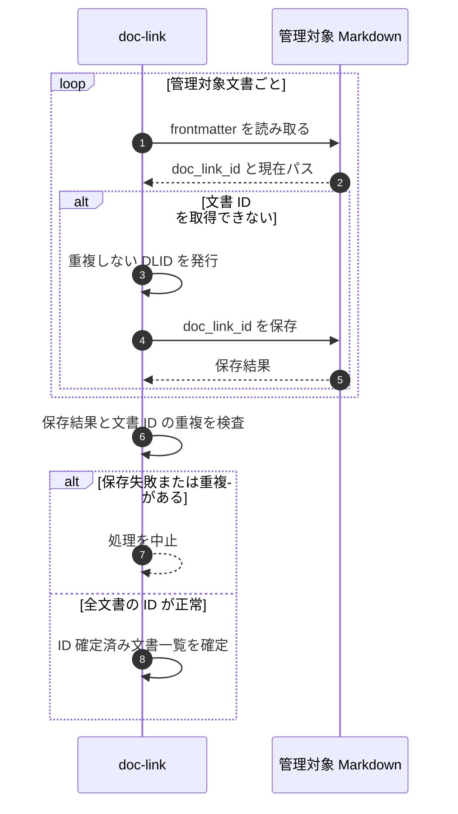

# doc-link 要件定義書 — 管理対象と文書 ID

**状態**: Draft 0.1\
**更新日**: 2026-09-28\
**対象**: Claude Code 用プラグイン `doc-link`（仮称）

[総論](REQ-001-overview.md) · [管理対象と文書 ID](REQ-002-document-id.md) · [ToC 管理](REQ-003-toc.md) · [文書検索](REQ-004-search.md) · [参照と変更通知](REQ-005-references.md)

<a id="sec-6"></a>

## 6. 管理対象ファイル

<a id="sec-6-1"></a>

### 6.1 管理対象範囲

doc-link は、置き換え時の呼び出し元との接続を維持するため、DocAdvisor と同じ基本形式で管理キーごとに独立した ToC を扱う。管理キーは、ユーザーまたは Forge などの呼び出し元スキルが決定する opaque key であり、doc-link はキー文字列から文書種別や対象パスを推測してはならない。

対象を指定するモードでは、呼び出し元が `--key <key>` と、そのキーで今回管理すべき対象の完全な desired state を管理対象指定として外部から与えること。同じ管理キーに対する後続実行は、そのキーの ToC だけを更新し、別の管理キーの ToC を変更してはならない。

管理対象指定は、少なくとも次の DocAdvisor 互換の指定方法を表現できること。各引数の厳密な組み合わせ規則は後続設計で定義する。

- `--paths` / `--paths-json`: プロジェクトルート相対の Markdown ファイルパス
- `--paths-file`: Markdown ファイルパスの配列を格納したファイル
- `--dirs` / `--dirs-json`: プロジェクトルート相対のディレクトリまたはパターン
- `--exclude` / `--exclude-json`: 対象集合から除外するパス、ディレクトリまたはパターン
- `--all`: プロジェクトルート配下の全 Markdown を対象とする単体モード

doc-link は、与えられた管理対象指定を解釈・検証し、今回処理する管理対象 Markdown の一覧を確定する。ディレクトリまたはパターンが指定された場合は、該当する Markdown を列挙して一覧へ変換する。指定されていないファイルを推測で追加したり、指定されたファイルを理由の報告なく除外したりしてはならない。

`--key <key>` とともに渡す管理対象指定は、差分ではなく、そのキーの完全な desired state とする。同じキーの以前の ToC に存在していても、今回確定した対象集合に存在しない文書は、そのキーの管理対象から外れたものとして ToC から除くこと。対象外へ移動したのか実体が削除されたのかを調べるために、指定範囲の外を探索しないこと。管理対象文書内の参照が明示するディレクトリを検査する処理は、この管理対象範囲の拡張とは別に扱う。

`--all` は予約管理キー `all` を使用する単体モードとし、対象指定と併用してはならない。引数なしの実行は `--all` と同じものとして扱う。`all` を `--key all` として任意指定することは禁止する。

`--key` を省略したまま `--dirs`、`--paths` または `--exclude` 系の対象指定を渡してはならず、doc-link はその呼び出しを曖昧な入力として拒否すること。対象を限定して管理する場合は、必ず管理キーを指定すること。

Forge と連携する場合、Forge は `.doc_structure.yaml` から `rules` または `specs` の対象ディレクトリと除外指定を解決し、それぞれ管理キー `rules` または `specs` とともに doc-link へ渡す。doc-link は `.doc_structure.yaml` を直接読み取らず、そのスキーマや配置規則にも依存しない。

文書 ID は管理キーから独立する。一つの文書は複数の管理キーに同時に所属でき、その所属キーは同じ文書 ID で識別される文書情報の属性として扱う。所属キーや管理対象範囲が変わっても、それを理由に `doc_link_id` を再発行してはならない。管理キーは参照の有効範囲を制限しない。

<a id="sec-6-2"></a>

### 6.2 Markdown への文書 ID 記載

初期版では Markdown 文書だけを管理対象とし、frontmatter に文書 ID を記載する。

キー名には `doc_link_id` を使用する。値は文書 ID 管理システムが発行し、利用者や生成担当 AI が手動で採番しない。文書 ID は固定プレフィックス `DLID-` と、システムが生成する固定長のハッシュ値から構成する。ハッシュ値の長さ、文字集合、種およびハッシュ方式は未決定であり、次の値は例示である。

```yaml
---
doc_link_id: DLID-7K3M9P2X6T8V4R1Q
---
```

<a id="sec-8"></a>

## 8. 管理対象文書一覧の確定

本段階は、後続処理で「すべての管理対象文書」と呼ぶ範囲を確定するための入力準備である。ディレクトリまたはパターンが指定された場合は、該当する Markdown を列挙し、除外指定を適用して具体的なファイル一覧へ変換する。個別のファイルパスが指定された場合は、存在と対象形式を検証する。

この段階では、文書 ID の発行、変更検出、文書情報の取得または ToC の更新を行わない。管理対象文書一覧を正常に確定できた場合だけ、[§9](REQ-002-document-id.md#sec-9) の文書 ID 保証へ進む。

### FR-017 管理キーと管理対象指定の受領

doc-link は、ユーザーまたは呼び出し元スキルから管理キーと、そのキーで今回管理すべき Markdown の完全な desired state を受け取れること。

対象指定モードでは `--key` と `--dirs`、`--dirs-json`、`--paths`、`--paths-json`、`--paths-file`、`--exclude` または `--exclude-json` を解釈できること。単体モードでは `--all` を解釈し、引数なしも `--all` として扱うこと。`--all` と対象指定の併用、`--key all`、および `--key` なしの対象指定は拒否すること。

doc-link は管理対象指定を解釈・検証して管理対象文書一覧を確定し、確定した一覧、拒否した指定、および拒否理由を呼び出し元へ返せること。管理キーは対象の選択にのみ使用し、キー名から対象文書や文書種別を推測してはならない。

同じキーの以前の ToC に存在し、今回確定した対象集合に存在しない文書を、そのキーの管理対象から外れたものとして扱えること。対象範囲外の実体の有無は調べず、別のキーの ToC に含まれる同じ文書を削除または変更してはならない。

`.doc_structure.yaml` など、対象集合を定義する外部設定の探索、読み取りおよび解釈は doc-link の責務に含めない。Forge などの呼び出し元が設定を解決し、管理キーと解決済みの対象指定を doc-link へ渡すこと。

<a id="sec-9"></a>

## 9. 全文書の文書 ID の保証

### FR-001 文書 ID の発行と読み取り

すべての管理対象 Markdown 文書は文書 ID を持つこと。ToC の構築または再構築を開始するとき、文書 ID が存在しない管理対象文書を検出した場合は、文書 ID 管理システムが新しい文書 ID を発行し、frontmatter へ保存すること。

発行する文書 ID は、固定プレフィックス `DLID-` と固定長のハッシュ値から構成する。ハッシュ値は、時刻、乱数またはそれらを含む種から発行時に一度だけ生成する。使用する種の構成、ハッシュ方式、出力長および文字集合は U-001 で決定する。

発行済みの文書 ID は、文書本文、ファイル名、パス、タイトル、分類または要約から再計算してはならない。本文や配置が変更されても、管理対象ファイルに保存された同じ文書 ID を継続して使用すること。

文書 ID のハッシュ値部分には、文書種別、分類、パス、タイトルなど、文書の意味を表す情報を持たせないこと。人間が `doc-link` の文書 ID だと識別するための情報は、固定プレフィックス `DLID-` が担う。

プラグインは新しい文書 ID を確定する前に既存の文書 ID と重複しないことを検査し、衝突した場合は別の種から再生成すること。発行済みの文書 ID を別文書へ再利用してはならない。

プラグインは、Markdown frontmatter の `doc_link_id` から文書 ID を読み取れること。

### FR-002 文書 ID の検証

プラグインは、少なくとも次の状態を機械的に検出できること。

- 文書 ID が存在しない
- 同一の文書 ID が複数ファイルに存在する

`doc_link_id` から文書 ID 管理システムが発行した文書 ID として認識できる値を取得できない状態は、記載内容にかかわらず「文書 ID が存在しない」として扱う。これには、キー自体の欠落、null、空文字列、空白だけの文字列、単一文字列として読み取れない値、および `DLID-` 付きの発行済み文書 ID として認識できない値を含む。

認識できない値に対して「形式不正」という独立したエラー分類を設けない。文書 ID の発行仕様と異なる値も「文書 ID が存在しない」として扱う。

文書 ID が存在しない状態を検出した場合は、FR-001 に従って文書 ID を発行する。文書 ID の発行または frontmatter への保存に失敗した場合は、ToC の構築または再構築を正常終了させないこと。

文書 ID の重複を検出した場合も、重複した文書の同一性を機械的に確定できないため、ToC の構築または再構築を正常終了させないこと。

<a id="sec-9-1"></a>

### 9.1 文書 ID 保証処理

本段階の責務は、[§8](REQ-002-document-id.md#sec-8) で確定したすべての管理対象文書を、パスから独立した文書 ID で識別できる状態にすることである。文書 ID が揃っていることは、既存 ToC と現在の文書を対応付けるための前提条件であり、この段階では変更検出や ToC 更新を行わない。

各管理対象文書について、Markdown frontmatter から `doc_link_id` を読み取る。文書 ID を取得できない場合は、FR-001 および FR-002 に従って重複しない文書 ID を発行し、frontmatter へ保存する。

すべての文書を確認した後、保存結果と文書 ID の重複を検査する。文書 ID の保存失敗または重複が一件でも存在する場合は本段階を失敗とし、変更検出へ進んではならない。

本段階の正常終了時に、少なくとも次を含む「ID 確定済み文書一覧」を後続処理へ渡す。

- 文書 ID
- 現在のプロジェクトルート相対パス
- ファイルの読み取りに必要な実体情報



## 受け入れ条件案

### AC-005 ID 重複

同じ文書 ID が複数ファイルに存在する場合、重複する ID とすべての該当パスを報告して処理を失敗させること。

### AC-012 文書 ID が存在しない状態の統一

`doc_link_id` のキー欠落、null、空文字列、空白だけの文字列、単一文字列として読み取れない値、および文書 ID 管理システムが発行した文書 ID として認識できない値が、すべて同じ「文書 ID が存在しない」という分類で検出され、文書 ID の発行対象になること。これらに対して、形式不正という別の分類を返さないこと。

### AC-013 文書 ID のシステム発行

ToC の構築または再構築時に、文書 ID が存在しない管理対象の Markdown 文書を検出すると、既存の文書 ID と重複しない `DLID-` 付きの文書 ID が生成され、frontmatter へ保存されること。すべての対象文書への ID 付与が完了するまで ToC を確定しないこと。

### AC-014 発行済み文書 ID の不変性

文書本文、ファイル名、パス、タイトル、分類または要約を変更しても、発行済みの文書 ID が変更されないこと。

### AC-015 文書 ID の衝突回避

文書 ID の生成結果が既存の文書 ID と重複した場合、その値を割り当てず、別の種から重複しない文書 ID を再生成すること。

### AC-016 文書 ID の非意味性

文書 ID のハッシュ値部分が、文書本文、ファイル名、パス、タイトル、分類または要約を変更する根拠として使用されず、これらの値から再計算もされないこと。

### AC-021 管理キーごとの desired state

同じ管理キーに、異なる Markdown 集合を表す管理対象指定 A と B を順に与えた場合、B がそのキーの完全な desired state として ToC に反映されること。doc-link が指定外の Markdown を推測で追加しないこと。B に含まれない同じキーの既存エントリを ToC から除去し、その実体ファイルの有無を調べるために対象範囲外を探索しないこと。

異なる管理キー A と B にそれぞれ管理対象指定を与えた場合、A の更新が B の ToC のエントリを削除または変更しないこと。

### AC-022 DocAdvisor 互換の基本インターフェース

`--key rules --dirs-json '<JSON 配列>' --exclude-json '<JSON 配列>'` および `--key specs --dirs-json '<JSON 配列>' --exclude-json '<JSON 配列>'` の形式で、Forge が解決した対象指定を受け取れること。

`--all` と引数なしの実行が、どちらも予約管理キー `all` の単体モードとしてプロジェクトルート配下の全 Markdown を対象候補にすること。`--key all`、`--key` なしの対象指定、および `--all` と対象指定の併用を拒否すること。

### AC-023 文書 ID と管理キーの独立性

同じ文書を管理キー A の対象から外して管理キー B の対象に含めても、そのことだけを理由に `doc_link_id` が変更されないこと。

### AC-024 外部設定との責務境界

Forge が `.doc_structure.yaml` から解決した管理キーと対象指定を渡した場合、doc-link が `.doc_structure.yaml` を直接読み取らずに ToC を構築できること。外部設定ファイルが存在しなくても、管理キーと有効な対象指定が直接与えられていれば処理できること。

### AC-025 文書 ID 保証の段階完了

管理対象文書に文書 ID の保存失敗または重複が一件でも存在する場合、変更検出、文書情報の取得および ToC 候補の生成へ進まないこと。すべての管理対象文書の文書 ID を正常に確認した場合だけ、ID 確定済み文書一覧を変更検出へ渡すこと。

### AC-029 同一文書の複数キー所属

同じ Markdown 文書を二つの管理キーの対象に含めた場合、どちらからも同一の `doc_link_id` で識別され、キーごとに異なる文書 ID を発行しないこと。一方のキーから外しても、他方への所属および文書 ID を変更しないこと。
