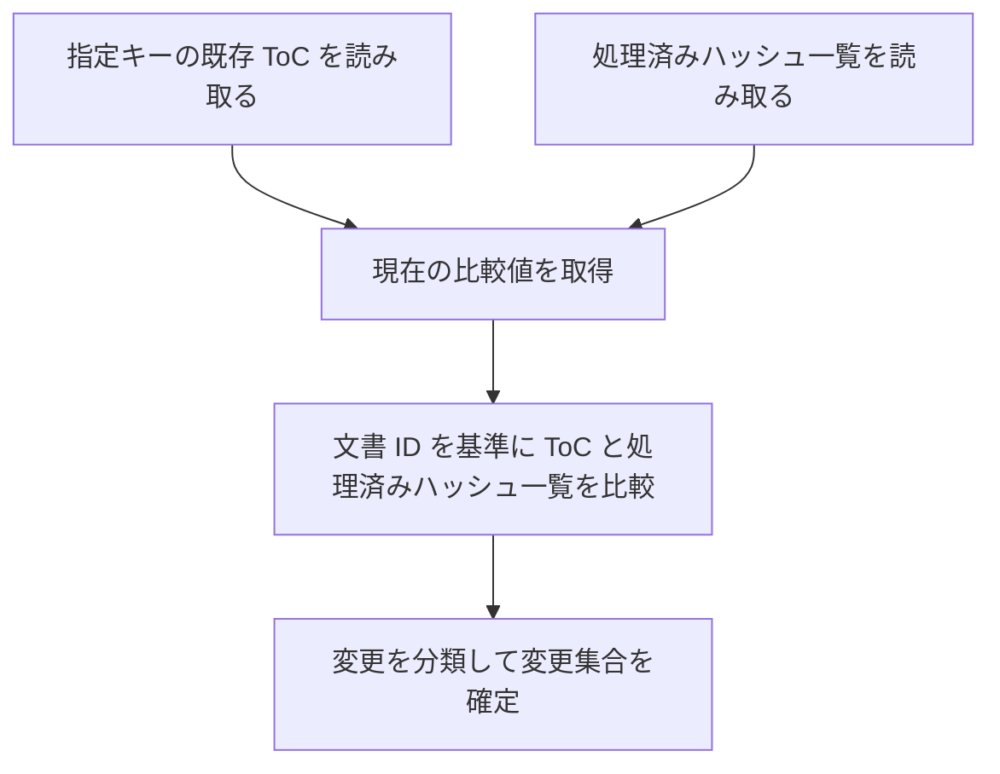
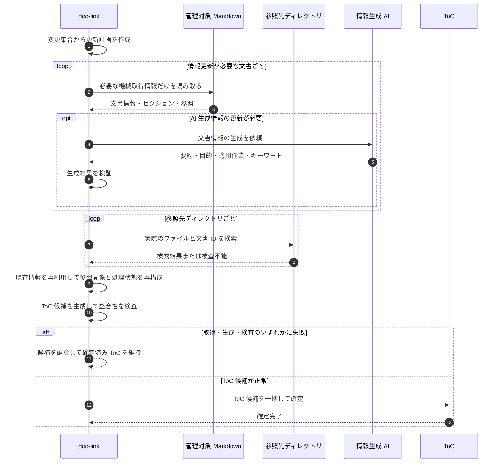

# doc-link 要件定義書 — ToC 管理

**状態**: Draft 0.1\
**更新日**: 2026-10-10\
**対象**: Claude Code 用プラグイン `doc-link`（仮称）

[総論](REQ-001-overview.md) · [管理対象と文書 ID](REQ-002-document-id.md) · [ToC 管理](REQ-003-toc.md) · [文書検索](REQ-004-search.md) · [参照と変更通知](REQ-005-references.md)

<a id="sec-7"></a>

## 7. ToC と処理済みハッシュ一覧の情報要件

本節は、**プラグインが ToC と処理済みハッシュ一覧で管理すべき情報**を定義する。ユーザーが作成する文書の必須構造や、frontmatter に手動記載するフィールドの一覧ではない。情報間の同一性・関係・版は[論理データモデル](../design/DES-003-data-model.md)で扱う。

同じ文書 ID を持つ文書の要約、参照関係および所属キーは、論理的に一つの文書情報として扱う。一つの文書が複数キーに所属しても、キーごとに別の文書 ID や別文書としての要約を生成しない。キーごとの ToC は、その文書情報を各キーの管理対象に応じて検索・検査するための索引とし、物理的な保存形式や共有方法は後続設計で定義する。

プラグインが管理対象ファイルへ記載できるメタデータは、[§6.2](REQ-002-document-id.md#sec-6-2) で定める `doc_link_id` だけである。これは doc-link が管理対象 Markdown へ行える唯一の書き込みである。利用者や生成担当 AI が文書 ID を手動採番することは要求しない。文書間の正式な参照を記載する場合は、FR-007 で定める ID 付き参照記法を使用する。タイトル、目的、要約、キーワード、パス、ハッシュ、参照元および検査状態をユーザーが文書内で重複管理することは要求しない。

各 ToC のメタデータとして、管理キーと、その ToC の構築に使用した正規化済みの管理対象指定を保存すること。保存する指定は、次回の検索時に外部から管理対象指定が渡されなくても再解釈し、現在の管理対象文書を列挙できるものでなければならない。管理対象指定のハッシュなど、指定内容を復元できない識別値だけを保存してはならない。外部から新しい管理対象指定が渡された場合は、保存済みの指定と比較して対象範囲の変更を検出できること。

ToC の情報は、次のいずれかの方法で取得または生成する。

- **ユーザー記載**: 管理対象ファイルにユーザーが明示的に記載する
- **機械取得**: ファイル走査または構文解析によってスクリプトが決定的に取得する
- **AI 生成**: 文書の内容を基に AI が生成する
- **プラグイン管理**: 処理結果や状態としてプラグインが記録する

<a id="sec-7-1"></a>

### 7.1 文書エントリ

ToC 内の各文書エントリは、少なくとも次の情報を管理する。

| 情報               | 取得・生成方法         | ユーザー文書への記載 | 説明                                                                                                                                                                                              |
| ------------------ | ---------------------- | -------------------- | ------------------------------------------------------------------------------------------------------------------------------------------------------------------------------------------------- |
| 文書 ID            | プラグイン発行         | システムが記載       | 文書 ID 管理システムが発行し、管理対象ファイルの `doc_link_id` へ保存する                                                                                                                         |
| 現在の相対パス     | 機械取得               | 不要                 | プロジェクトルートからのファイル走査によって取得する                                                                                                                                              |
| タイトル           | 機械取得または AI 生成 | 不要                 | 見出しなどから抽出し、抽出できない場合の扱いは後続設計で定義する                                                                                                                                  |
| 目的               | AI 生成                | 不要                 | 文書検索に使用する                                                                                                                                                                                |
| 内容概要           | AI 生成                | 不要                 | 文書検索に使用する                                                                                                                                                                                |
| 適用される作業     | AI 生成                | 不要                 | どのようなタスクで参照すべき文書かを表す                                                                                                                                                          |
| 検索用キーワード   | AI 生成                | 不要                 | 文書検索に使用する                                                                                                                                                                                |
| 文書単位のハッシュ | 機械取得               | 不要                 | ToC に反映した文書内容のハッシュを記録する。変更影響候補の報告まで完了した内容のハッシュは別の処理済みハッシュ一覧で管理する。算出規則は [§10.1](REQ-003-toc.md#sec-10-1) および U-007 で定義する |
| セクション情報     | 機械取得               | 原則不要             | セクション ID を採用する場合だけ、一部情報のユーザー記載を要求し得る                                                                                                                              |
| 参照先             | 機械取得               | 参照がある場合のみ   | 文書内の ID 付き参照から抽出する                                                                                                                                                                  |
| 参照元             | 機械的に逆引き生成     | 不要                 | 管理対象文書から抽出した参照先情報を基に生成する                                                                                                                                                  |
| 最終検査状態       | プラグイン管理         | 不要                 | 検査日時、成功・失敗、未処理などの状態を記録する                                                                                                                                                  |

<a id="sec-7-2"></a>

### 7.2 セクションエントリ

セクション単位の追跡を採用する場合、ToC 内の各セクションエントリは、少なくとも次の情報を管理する。

| 情報                     | 取得・生成方法 | ユーザー文書への記載 | 説明                                                                                         |
| ------------------------ | -------------- | -------------------- | -------------------------------------------------------------------------------------------- |
| 所属する文書 ID          | 機械取得       | 不要                 | セクションを含むファイルの `doc_link_id` から取得する                                        |
| セクション ID            | 未決定         | 条件付き             | 採用する識別方式と記載対象は [§13.1](REQ-005-references.md#sec-13-1) および U-006 で決定する |
| 見出し                   | 機械取得       | 追加記載不要         | ユーザーが通常の文書本文として記載した見出しから取得する                                     |
| 文書内の現在位置         | 機械取得       | 不要                 | 構文解析によって取得し、文書編集のたびに更新し得る                                           |
| セクション単位のハッシュ | 機械取得       | 不要                 | セクションの論理的な内容から算出する。具体的な算出規則は未決定とする                         |

<a id="sec-7-3"></a>

### 7.3 参照エントリ

ToC 内の各参照エントリは、管理対象ファイルに記載された ID 付き参照から生成する。ユーザーが参照関係を ToC へ別途手入力することは要求しない。

| 情報                | 取得・生成方法 | ユーザー文書への記載 | 説明                                                                                     |
| ------------------- | -------------- | -------------------- | ---------------------------------------------------------------------------------------- |
| 参照元文書 ID       | 機械取得       | 追加記載不要         | 参照を含むファイルの `doc_link_id` から取得する                                          |
| 参照元セクション ID | 機械取得       | 条件付き             | セクション単位で参照元を追跡する場合だけ使用する                                         |
| 参照先文書 ID       | ユーザー記載   | 参照がある場合は必須 | FR-007 の ID 付き参照記法から取得する                                                    |
| 参照先セクション ID | ユーザー記載   | 条件付き             | 特定セクションを参照する場合だけ使用する。記法は未決定とする                             |
| 参照の記載位置      | 機械取得       | 不要                 | 構文解析によってファイル内の位置を取得する                                               |
| 参照種別            | 機械取得       | 追加記載不要         | 文書全体参照またはセクション参照などを記法から判定する                                   |
| 検査状態            | プラグイン管理 | 不要                 | ディレクトリ検索で確認済み、指定ディレクトリ内に不在、パス不一致、検査不能などを記録する |

<a id="sec-7-4"></a>

### 7.4 AI 生成フィールドの文字数制限

文書エントリのうち、AI が生成する自然言語フィールドには、フィールドごとの最大文字数を定義する。本要件は AI が生成する要約情報を対象とし、文書本文や機械的に抽出した原文を直接制限するものではない。

対象となるフィールドは、現時点では次のとおりとする。

| フィールド       | 制限の単位                        | 記述上限 `L` |
| ---------------- | --------------------------------- | ------------ |
| タイトル         | AI が生成する場合のフィールド全体 | U-013 で決定 |
| 目的             | フィールド全体                    | U-013 で決定 |
| 内容概要         | フィールド全体                    | U-013 で決定 |
| 適用される作業   | 配列の各要素                      | U-013 で決定 |
| 検索用キーワード | 配列の各要素                      | U-013 で決定 |

文字数制限には、次の二つを区別して使用する。

| 名称         | 記号 | 用途                                                       |
| ------------ | ---- | ---------------------------------------------------------- |
| 記述上限     | `L`  | 生成担当 AI に「最大文字数」として提示する基準値           |
| 内部許容上限 | `H`  | 検証器が受理・拒否を判定するために内部で使用する実際の上限 |

内部許容上限は、フィールドごとに次の式で決定する。

```text
H = floor(L × 1.3)
```

生成結果の文字数が `L` を超えていても `H` 以下であれば受理し、`H` を超えた場合だけ再生成またはエラーの対象とする。

生成担当 AI には `L` だけを提示し、`H`、許容係数 `1.3`、および許容余白の存在を提示してはならない。これらを生成担当 AI が参照するルール、プロンプト、テンプレート、再試行メッセージまたは検証結果へ記載してはならない。`H` 超過時にも、生成担当 AI には `L` 以内へ短縮するよう指示し、実際の拒否境界を通知しない。

この分離は、生成担当 AI が実際の拒否境界を目標値として文章を生成し、出力の揺らぎによって境界を再び超過することを防ぐために行う。内部許容上限はセキュリティ上の秘密ではなく、要件・設計・テストおよび検証器の実装には記載できる。ただし、それらを生成処理の入力コンテキストへ渡してはならない。

各フィールドの `L` と文字数の数え方は未決定とし、U-013 および U-014 で管理する。

<a id="sec-7-5"></a>

### 7.5 処理済みハッシュ一覧

DocAdvisor の checksums の方式を参考に、最後まで正常に処理した内容のハッシュを ToC とは別の一覧で管理する。パスの移動・改名で比較基準を失わないよう、文書単位では文書 ID とハッシュを対応付ける。セクション単位の追跡を採用する場合は、確定したセクション識別方法に従って同様の比較基準を管理する。物理的なファイル形式と配置は後続設計で定義する。

この一覧が保持するのは処理済みの比較基準であり、今回算出した現在ハッシュを別途恒久保存することは要求しない。現在ハッシュは文書から計算し、ToC に反映した値は ToC のエントリで確認できる。新規文書は必要な処理が完了するまで一覧に登録しない。処理済みハッシュ一覧の更新条件は [§10.1.3](REQ-003-toc.md#sec-10-1-3) に従う。

文書がそのキーの管理対象から外れた場合は、対象内の文書に残る参照の確認と必要な通知が完了するまで、その文書 ID と旧ハッシュを一覧に残す。必要な処理が完了した後に、該当する比較基準を一覧から除去する。対象外にある実体文書は追跡しない。

<a id="sec-10"></a>

## 10. 既存 ToC との比較による変更検出

### FR-003 文書の移動・改名の認識

同一の文書 ID を持つファイルのパスが変わった場合、プラグインは文書の削除と新規追加ではなく、既存文書の移動または改名として認識できること。

内容が変わっていない場合は、要約の再生成や AI による内容の再解析を要求しないこと。

### FR-011 文書全体の変更検出

プラグインは、ToC に反映済みのハッシュおよび処理済みハッシュ一覧の比較基準と、現在の文書から算出したハッシュを比較し、ToC 更新の要否と未報告の変更を検出できること。

少なくとも次の変更を区別できることを要件候補とする。

- パスのみの変更
- 管理用メタデータのみの変更
- リンク定義の物理パスのみの変更
- 本文の変更
- 管理対象からの離脱

### FR-012 セクション単位の変更検出

セクション単位の管理を採用する場合、プラグインはセクションごとのハッシュ値を保存し、変更されたセクションを特定できること。

セクションの追加、削除、移動、見出し変更および本文変更をどのように区別するかは後続設計で定義する。

<a id="sec-10-1"></a>

### 10.1 変更検出に使用するハッシュ

<a id="sec-10-1-1"></a>

#### 10.1.1 ハッシュの目的

ハッシュ値は、文書またはセクションの内容が、ToC に反映した時点および変更影響候補の報告まで完了した時点から変化したかを決定論的に判定するために使用する。

<a id="sec-10-1-2"></a>

#### 10.1.2 論理内容ハッシュ

プロジェクト管理 AI によるリンク定義の物理パス修正など、本文の意味を変えない変更によって本文変更の報告が連鎖しないようにする必要がある。

そのため、意味変更の検出に用いるハッシュでは、次を除外または正規化する方式を推奨案とする。

- 文書 ID などの管理用 frontmatter
- Markdown リファレンス定義の物理パス
- 自動生成されたメタデータ
- 改行コード
- 行末空白
- 文末の空行など、意味に影響しない差異

除外対象を増やしすぎると意味のある変更を見逃すため、正規化規則は後続設計で明示し、テスト可能にする必要がある。

<a id="sec-10-1-3"></a>

#### 10.1.3 保存済みハッシュの更新時点

検出しただけの変更を処理済みとして扱わないこと。[§7.5](REQ-003-toc.md#sec-7-5) の処理済みハッシュ一覧には、必要な要約更新と変更影響候補の報告が完了するまで旧ハッシュを残す。新規文書は未登録のままとする。

ToC の構築・再構築では、現在の文書から算出したハッシュを、既存 ToC に記録されたハッシュと比較して索引の更新対象を決める。同時に処理済みハッシュ一覧の値とも比較し、未報告の変更を識別する。変更前後のハッシュと対象文書またはセクションは、後続の変更影響候補の報告が完了するまで識別できる状態を維持する。

ToC の要約更新と確定が成功した文書については、ToC に現在ハッシュを記録できる。ただし、その成功だけでは処理済みハッシュ一覧を進めない。変更と参照元の機械的な報告が正常に完了した対象についてだけ、対応する一覧のハッシュを現在の値へ更新する。途中で失敗した対象は旧値を維持し、次回の比較で再検出できること。参照元がない対象も、変更の事実を報告した後に処理済みとしてよい。

管理対象から外れた文書については、そのキーの ToC からエントリを除去しただけでは処理済みハッシュ一覧から旧値を除去しない。対象内の文書に残る参照の検査と、把握した結果の報告が正常に完了した後に除去する。

ToC には現在ハッシュが反映済みで、処理済みハッシュ一覧だけが旧値の文書を再実行する場合、要約を再生成せず、未完了の変更影響候補の報告を続行できること。文書がその間に再び変更された場合は、新たな現在ハッシュを取得して比較する。失敗後の具体的な再実行手順は後続設計で定義する。

<a id="sec-10-2"></a>

### 10.2 変更検出処理

本段階の責務は、最後に正常確定した ToC および処理済みハッシュ一覧と現在の管理対象文書を比較し、ToC へ反映すべき変更と報告が未完了の変更を区別して変更集合を確定することである。ここでは比較と分類だけを行い、要約生成、詳細情報の再取得、ToC の更新または変更影響候補の報告を行わない。

doc-link は指定された管理キーの既存 ToC と処理済みハッシュ一覧を読み取り、[§9.1](REQ-002-document-id.md#sec-9-1) の ID 確定済み文書一覧に含まれる各文書から、変更検出に必要な比較値を機械的に取得する。比較値には少なくとも次を含める。

- 文書 ID の集合
- 現在の相対パス
- 論理内容ハッシュ
- ID 付き参照の内容、または参照情報を比較できるハッシュ
- セクション単位の追跡を採用する場合はセクション情報とそのハッシュ

論理内容ハッシュからリファレンスリンクの物理パスを除外する場合でも、参照パスだけの変更や不一致を検出できるように、参照情報は論理内容ハッシュとは別に比較すること。

比較結果から、少なくとも次の変更を識別する。

| 変更種別           | 判定の基準                                                        |
| ------------------ | ----------------------------------------------------------------- |
| 新規               | 現在の一覧に文書 ID が存在し、既存 ToC に同じ文書 ID が存在しない |
| 本文変更           | 同じ文書 ID の論理内容ハッシュが異なる                            |
| 参照変更           | 同じ文書 ID の参照情報が異なる                                    |
| 移動・改名         | 同じ文書 ID の現在パスが異なる                                    |
| 管理対象からの離脱 | 既存 ToC に文書 ID が存在し、現在の対象一覧に含まれない           |
| 変更なし           | 現在の文書と既存 ToC の比較対象となる状態に差異がない             |

変更種別は必ずしも排他的ではない。同じ文書が「移動・改名」と「本文変更」の両方に該当する場合など、検出したすべての変更を保持すること。

既存 ToC が存在しない初回構築では、現在のすべての管理対象文書を新規として扱う。変更集合には、文書 ID、変更種別、ToC に反映済みか報告が未完了かの区別、比較に用いた変更前後の値、および次段階で必要となる処理の種別を含めること。ToC と現在の文書に差がなくても、処理済みハッシュ一覧との差が残る場合は、変更影響候補の報告対象から除外してはならない。



<a id="sec-11"></a>

## 11. 必要情報の取得と ToC の更新

ToC は管理キーごとに保持する論理的な索引であり、検索、逆参照、変更検出および変更影響候補の列挙が参照する、最後に正常確定した索引状態である。各 ToC は、構築または再構築時にそのキーへ外部から与えられた完全な管理対象指定に従って確定した Markdown 文書と、それらに付与された文書 ID を基に構築する。現在の管理対象指定と文書内容を反映しているかは、キーごとの ToC の構築・再構築要否の検査結果によって区別する。

すべての管理対象文書が文書 ID を持つことを ToC 構築の前提条件とする。ID がない文書を検出した場合は、文書 ID 管理システムが ID を付与して前提条件を満たした後に ToC を構築する。

### FR-004 ToC の構築と再構築

プラグインは、管理キーごとに独立した ToC を持ち、各 ToC では文書 ID を主キーとして検索・参照・変更検出に必要な情報を集中管理できること。

ToC は保存方式にかかわらず、検索、逆参照、変更検出および変更影響候補の列挙が参照する、最後に正常確定した索引状態とする。現在の管理対象文書を反映しているかは、ToC の構築・再構築要否の検査結果によって区別する。JSON ファイル、RDB などの物理的な保存方式、スキーマおよび配置場所は後続設計で定義する。いずれを採用しても、書き込み途中の文書情報や確定途中のキー別の索引状態を現在状態として公開してはならない。文書情報は文書 ID ごとに常に最新の一つを持って全キーが共有し、キー別の索引状態（所属、参照関係、反映済みハッシュ、検査結果）は各キーの ToC の版として管理する。このため、あるキーの ToC が古い版のままでも、そのキーから見える文書情報は最新の内容となる（D-024）。

プラグインは、指定された管理キーと、外部から与えられたそのキーの完全な管理対象指定を使用すること。管理対象指定に従って確定した現在の管理対象文書を走査し、文書 ID、現在のパス、内容ハッシュ、セクション情報および参照関係から、そのキーの ToC の完全な期待状態を再構築できること。

ToC の構築・再構築は、次の順序で行うこと。

1. [§9](REQ-002-document-id.md#sec-9) に従って、すべての管理対象文書について文書 ID を保証する
2. [§10](REQ-003-toc.md#sec-10) に従って、既存 ToC と現在の文書を比較して変更集合を生成する
3. 本節に従って、変更集合に基づく必要な情報だけを取得し、ToC を更新する

ToC の構築または再構築前に、すべての管理対象文書が文書 ID を持つ状態を FR-001 に従って作ること。ID付与が完了していない状態でToCを確定してはならない。

既存の ToC と現在の対象文書集合を比較し、少なくとも次を反映すること。

- 新規文書: 新しく発行または検出した文書 ID のエントリを追加する
- 更新文書: 同じ文書 ID のハッシュ、要約、セクション情報および参照関係を必要に応じて更新する
- 移動・改名文書: 同じ文書 ID の現在パスを更新し、内容が変わっていなければ要約を再生成しない
- 管理対象から外れた文書: 現在の対象文書集合に存在しない文書 ID のエントリを削除する
- 参照変更: 参照先と参照元を現在の文書内容から再計算する
- 管理対象から外れた文書への参照: キーから外れたことだけでは参照の検査状態を決めず、リンク定義が指定するディレクトリの検索結果に従って判定する

実装は指定されたキーの ToC 全体の再生成または差分更新のどちらを採用してもよい。ただし、差分更新後の結果は、そのキーの現在の全対象文書から ToC 全体を再構築した結果と論理的に同一であること。指定されていないキーの ToC を更新または削除してはならない。

ToC の再構築が完了していない、または失敗した場合は、その結果を新しい現在状態として使用してはならない。更新途中の状態を公開せず、正常に完了した時点で新しい ToC を確定すること。

### FR-005 文書情報の生成

プラグインは、管理対象文書から検索に使用する要約情報を生成できること。

要約情報には、少なくとも次を含める。

- タイトル
- 目的
- 内容概要
- 適用される作業
- 検索用キーワード

既存の要約が存在し、論理的な本文内容が変わっていない場合は再生成しないこと。

AI が生成する自然言語フィールドには、[§7.4](REQ-003-toc.md#sec-7-4) で定める記述上限 `L` を生成指示として提示すること。生成担当 AI に対して、内部許容上限 `H` またはその算出方法を提示してはならない。

### FR-008 参照関係の抽出

プラグインは、規定された参照記法から文書間の参照関係を機械的に抽出できること。

抽出した参照関係から、少なくとも次を取得できること。

- 指定文書が参照している文書
- 管理対象文書のうち、指定文書を直接参照している文書
- 必要に応じて、把握済みの参照関係から間接的に依存する文書

<a id="sec-11-1"></a>

### 11.1 情報ごとの一次情報源

| 情報                   | 一次情報源                            | ToC での扱い                                     |
| ---------------------- | ------------------------------------- | ------------------------------------------------ |
| 文書 ID                | Markdown frontmatter の `doc_link_id` | 文書 ID を主キーとして保存する                   |
| 現在のパス             | ファイルシステム上の実体              | 検出した現在パスを保存する                       |
| 文書本文               | Markdown 文書                         | 本文自体ではなく、変更検出用ハッシュを保存する   |
| 参照先                 | Markdown 文書内の ID 付き参照         | 抽出した参照を保存する                           |
| 参照元                 | 管理対象文書から抽出した参照先        | 逆参照として生成・保存する                       |
| 要約・目的・キーワード | AI による文書解析                     | 生成結果を保存する                               |
| 変更報告の処理状態     | doc-link による変更検出と報告処理     | 未報告の変更を再検出するための比較基準を管理する |

<a id="sec-11-2"></a>

### 11.2 情報取得・ToC 更新処理

本段階の責務は、[§10.2](REQ-003-toc.md#sec-10-2) で確定した変更集合に基づいて必要な文書情報だけを取得または生成し、その結果から指定された管理キーの ToC 候補を構築して確定することである。

[§10.2](REQ-003-toc.md#sec-10-2) で取得した文書 ID、現在パスおよび各種ハッシュは変更集合から引き継ぎ、同じ比較値を理由なく再計算してはならない。本段階では、それらの比較値だけでは ToC エントリを更新できない文書に限って、追加情報を取得または生成する。

変更種別ごとの基本処理は次のとおりとする。

| 変更種別           | 必要な処理                                                                                                                                                               |
| ------------------ | ------------------------------------------------------------------------------------------------------------------------------------------------------------------------ |
| 新規               | 比較値を引き継ぎ、文書情報、セクション情報および参照を取得し、要約情報を生成する                                                                                         |
| 本文変更           | 変更後の文書情報とセクション情報を取得し、必要な要約情報を再生成する                                                                                                     |
| 参照変更           | 参照先情報を再取得する。論理的な本文内容が変わっていなければ要約情報は再利用する                                                                                         |
| 移動・改名         | 現在パスを更新する。本文と参照情報が変わっていなければ、それ以外の既存情報を再利用する                                                                                   |
| 管理対象からの離脱 | 指定キーの ToC から文書エントリを除去する。残存参照の検査状態は参照先ディレクトリの検索結果で決め、キーからの離脱だけでは判定しない。実体文書や別キーの ToC は変更しない |
| 変更なし           | 既存 ToC の文書情報、要約情報および参照記述を再利用し、AI による文書解析を実行しない。参照の検査状態はディレクトリ検索の結果で更新する                                   |

複数の変更種別に該当する文書では、該当する処理を統合した更新計画を作成すること。同じ情報を重複して取得または生成してはならない。

<a id="sec-11-2-1"></a>

#### 11.2.1 更新計画の作成

変更集合から、文書ごとに再取得する情報、再生成する AI 生成情報、既存 ToC から再利用する情報、および削除する情報を決定する。更新計画は、変更されていない全文書を AI に再解析しないように作成すること。

<a id="sec-11-2-2"></a>

#### 11.2.2 文書情報の取得と生成

更新計画に従い、対象文書からタイトル、セクション情報および参照先など、変更集合に含まれない機械取得情報を取得する。AI 生成が必要な文書についてだけ、FR-005 と [§7.4](REQ-003-toc.md#sec-7-4) に従って目的、内容概要、適用される作業および検索用キーワードを生成・検証する。

既存の要約情報を再利用できる文書では再生成しない。AI 生成または検証に失敗した場合は、失敗した文書と理由を記録し、不完全な生成結果を新しい確定済み ToC に含めてはならない。

<a id="sec-11-2-3"></a>

#### 11.2.3 参照関係と処理状態の再構成

変更文書から取得した参照先と、変更されていない文書から引き継いだ参照先を統合し、指定キーの参照元と参照検査状態を再構成する。参照の正しさはリンク定義が指定するディレクトリを実際に検索して判定し、既存 ToC の記録や参照先のキー所属だけを根拠に確定しない。検索が完了した後、その結果を ToC 候補に記録する。

指定されたディレクトリ内で参照先が見つからない、またはリンク定義のパスが検索で確認した実体と一致しない場合も、その参照と検査状態を ToC 候補に含める。指定ディレクトリ内での不在を文書の世界全体での不存在と混同してはならず、参照不整合だけを理由に ToC の構築・再構築を止めてはならない。ディレクトリの検索が完了できない場合は存在・不在を断定せず、ToC 確定可否は U-020 で決定する。

新規文書または内容が変更された文書については、処理済みハッシュ一覧との差から未報告の変更を識別する。ToC の再構築だけで、プロジェクト管理 AI への変更影響候補の報告を済ませたものとして扱わない。

現在のハッシュは ToC 候補へ記録するが、[§7.5](REQ-003-toc.md#sec-7-5) の処理済みハッシュ一覧は、[§10.1.3](REQ-003-toc.md#sec-10-1-3) に従って変更影響候補の報告が完了するまで進めてはならない。ToC に同じ現在ハッシュがすでに記録されている場合は、処理済みハッシュ一覧に旧値が残っていても要約情報を再利用する。

<a id="sec-11-2-4"></a>

#### 11.2.4 ToC 候補の検査と確定

取得、生成および再利用した情報から ToC 候補を構築し、少なくとも文書 ID の一意性、対象文書との対応、参照エントリと逆参照の対応、および必要フィールドの充足を検査する。指定ディレクトリ内での参照先不在と参照先のパス不一致は ToC に記録すべき検査結果であり、ToC 候補の確定失敗として扱わない。参照先ディレクトリの検査不能時の扱いは U-020 に従って決定する。

ToC 候補の生成または整合性検査に失敗した場合は、候補を現在状態として公開せず、最後に正常確定した ToC を維持する。すべての検査に成功した場合だけ、ToC 候補を新しい現在状態として一括して確定する。



この処理の終点は、ToC の確定と構築・再構築結果および変更集合の返却である。文書検索は [§3.2](REQ-001-overview.md#sec-3-2)、変更影響候補の通知とプロジェクト管理 AI による修正要否の判断は [§3.1](REQ-001-overview.md#sec-3-1) で扱う。

## 受け入れ条件案

### AC-001 文書移動

文書を別ディレクトリへ移動しても、同じ文書 ID を持つ限り同一文書として認識されること。

### AC-002 パス変更時の再解析抑制

パスだけが変更され、論理的な内容が変わっていない場合、要約を再生成しないこと。

### AC-010 AI 生成フィールドの許容余白

記述上限を `L`、内部許容上限を `H = floor(L × 1.3)` としたとき、文字数が `L + 1` 以上 `H` 以下の生成結果を検証器が受理し、`H + 1` 以上の生成結果を拒否すること。

### AC-011 内部許容上限の非提示

生成担当 AI に渡すルール、プロンプト、テンプレートおよび再試行メッセージに、内部許容上限 `H`、許容係数 `1.3`、または許容余白の存在が含まれていないこと。

### AC-017 ToC の再構築

管理対象の Markdown 文書を追加、移動、改名、対象範囲から除外または変更した後に ToC を再構築すると、その変更が ToC へ反映されること。現在の対象一覧から外れた文書 ID のエントリが除去されても、その ID への対象内の残存参照はキーからの離脱だけを理由に無効とせず、参照先として指定されたディレクトリの検索結果を記録すること。参照先の指定ディレクトリ内での不在や参照パス不一致があっても ToC を確定し、その検査結果を保持すること。再構築完了後の検索および変更影響候補の通知が、変更前のパス、ハッシュまたは参照関係を現在状態として返さないこと。

### AC-018 再構築失敗時の現在状態確定防止

ToC の再構築が途中で失敗した場合、途中状態を新しい現在状態として確定しないこと。変更影響候補の報告を実行しようとした場合は、再構築未完了または失敗を報告し、古い ToC を現在状態として正常終了しないこと。既存 ToC がある場合の文書検索は、FR-006 に従ってユーザーがその ToC のまま検索することを明示的に選択した場合に限り実行できるが、その ToC を現在状態として扱わないこと。初回構築に失敗して ToC が存在しない場合は検索できないこと。

### AC-020 再構築後の未処理変更の保持

ToC の構築・再構築で文書またはセクションの変更を検出した場合、変更影響候補の報告が未完了の対象については、ToC 候補を正常に確定した後も、別の処理済みハッシュ一覧に旧値が残り、新規文書は未登録のままであること。比較元のハッシュまたは未登録状態、現在のハッシュおよび対象箇所を識別できること。変更と把握済みの参照元を報告する前に、再構築の完了だけを理由として比較基準を現在値へ進めないこと。

ToC に現在ハッシュが反映された後、変更影響候補の報告前に同じ処理を再実行した場合、要約を再生成せず未報告の変更を検出できること。報告に失敗した対象は旧ハッシュを維持し、正常に完了した対象だけ比較基準を進めること。

### AC-026 情報更新前の変更集合確定

既存 ToC と現在の管理対象文書を比較し、新規、本文変更、参照変更、移動・改名、管理対象からの離脱および変更なしを識別できること。同じ文書が複数の変更種別に該当する場合は、そのすべてを変更集合に保持すること。

変更集合を確定する前に、AI による要約生成または ToC の更新を開始しないこと。既存 ToC が存在しない場合は、現在の管理対象文書をすべて新規として扱うこと。

### AC-027 変更種別に応じた情報更新

変更なしの文書を AI に再解析せず、既存 ToC の情報を再利用すること。パスだけが変更された文書では現在パスだけを更新し、本文変更がない限り要約を再生成しないこと。新規または本文変更の文書に限って必要な要約情報を生成すること。

参照情報だけが変更された文書では参照関係を更新し、論理的な本文内容が変わっていなければ要約情報を再利用すること。
