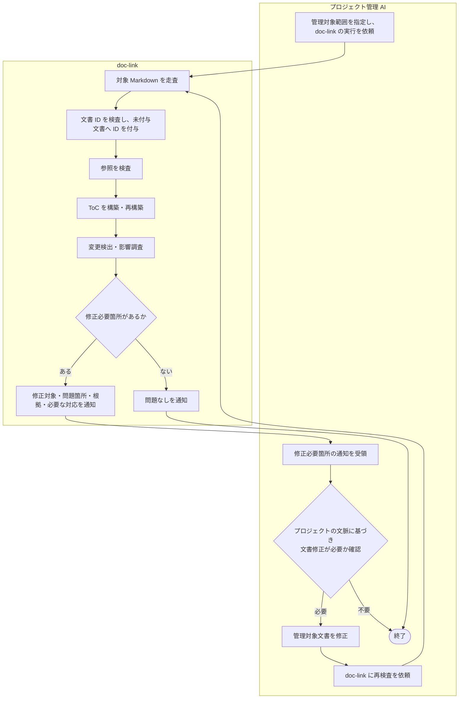
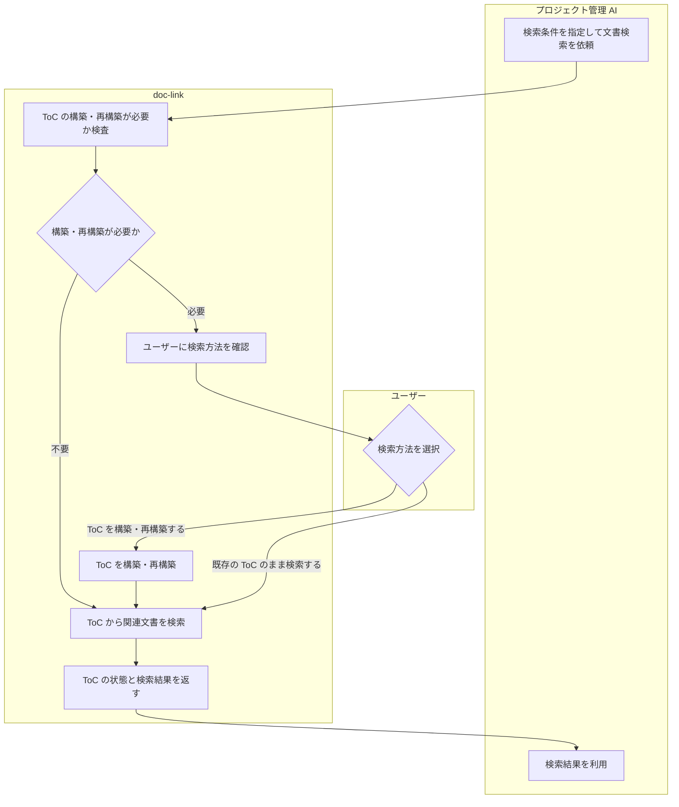
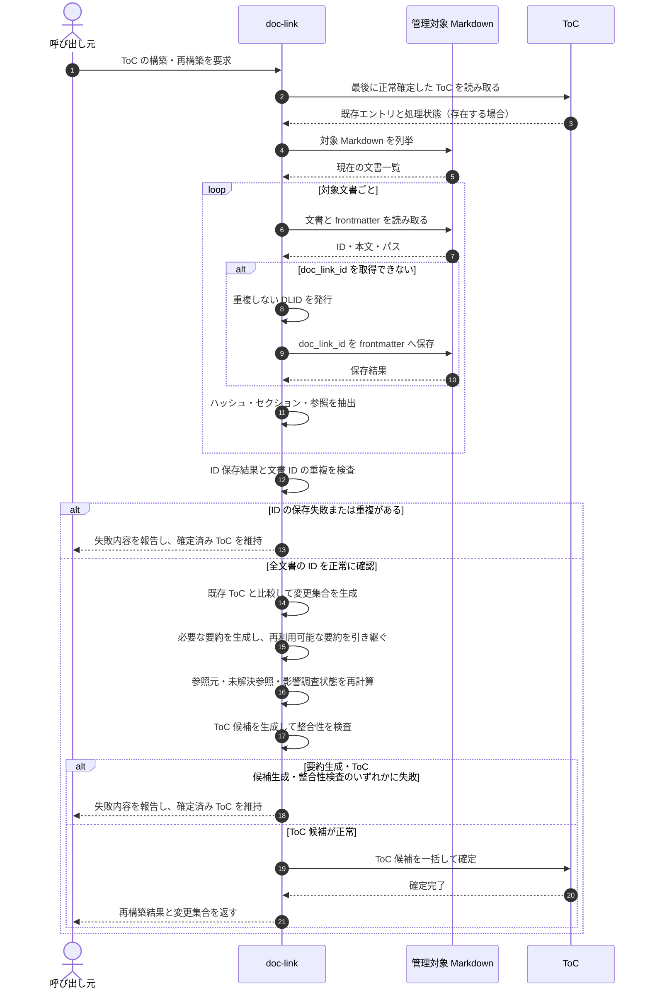

# doc-link 要件定義書

**状態**: Draft 0.1\
**作成日**: 2026-09-18\
**更新日**: 2026-09-20\
**対象**: Claude Code 用プラグイン `doc-link`（仮称）

## 1. 文書の目的

本書は、Claude Code 上で文書の検索・識別・参照関係管理・変更影響調査を行うプラグイン `doc-link` の要件を定義する。

本書では「何を実現するか」を定義する。プラグインのディレクトリ構造、SKILL / Agent / script の分担、frontmatter の詳細スキーマ、実装言語などの「どのように実装するか」は後続の設計で定義する。

## 2. 背景

既存の DocAdvisor は、プロジェクト相対パスを ToC のエントリキーとして文書を管理し、ファイル単位のハッシュ値によって変更を検出する。

この方式には次の制約がある。

- 文書を別ディレクトリへ移動または改名すると、同一文書であってもパスが変わる
- パス変更だけでも ToC の再生成や文書情報の再抽出が必要になる
- Markdown リンク、ファイル名の記載、自然言語による言及など、文書間の参照方法が統一されていない
- 参照方法が統一されていないため、文書間の関連を機械的かつ網羅的に認識できない
- 参照先文書が変更された場合、その変更を反映すべき参照元文書を追跡することが困難である
- ファイル全体のハッシュだけでは、変更されたセクションと影響範囲を十分に限定できない

## 3. 目的

本プラグインは、プロジェクト内の文書をパスではなく恒久的な文書識別子で管理し、次を可能にする。

- タスクに関連する文書の検索
- 文書移動・改名に影響されない文書追跡
- 文書間の参照関係の機械的な把握
- 文書またはセクション変更時の影響範囲の特定
- 参照先の変更を反映すべき文書の特定、修正要否の調査、およびプロジェクト管理 AI への通知
- リンク切れ、識別子重複、索引不整合の検出

### 3.1 システム全体フロー

次の図は、プラグインの初期導入から文書管理、文書変更後の影響調査までを含む全体フローを示す。doc-link とプロジェクト管理 AI を別の実行主体としてブロック分けし、両者の受け渡しを明示する。ToC の構築・再構築はこのフローの一部であり、プラグイン全体の終点ではない。



### 3.2 文書検索フロー

文書検索は、文書管理、変更検出および影響調査のフローとは独立した利用フローとして扱う。



「既存の ToC のまま検索する」が選択された場合、doc-link は ToC を更新せず、その ToC が現在の管理対象文書を反映していない可能性を検索結果に明示する。この検索結果を、最新の文書集合に基づく結果として扱ってはならない。

## 4. 用語

| 用語                | 定義                                                                                                                  |
| ------------------- | --------------------------------------------------------------------------------------------------------------------- |
| 文書                | 本プラグインによる識別・検索・参照管理の対象となるファイル                                                            |
| 文書 ID             | パスやファイル名から独立し、管理対象文書を一意に識別する恒久的な識別子                                                |
| セクション ID       | 文書内の特定セクションを恒久的に識別するための識別子。採用可否と記法は未決定                                          |
| ToC                 | 全対象文書の文書 ID、現在のパス、要約、ハッシュ、参照関係などを集中的に保持する JSON データ                           |
| 参照元              | 別の文書またはセクションを参照している側                                                                              |
| 参照先              | 別の文書またはセクションから参照されている側                                                                          |
| 論理内容ハッシュ    | パスや機械管理情報など、本文の意味に影響しない要素を正規化または除外して計算するハッシュ。採用可否と算出規則は未決定  |
| 影響調査            | 参照先の変更が参照元へ反映されるべきかを判定する処理                                                                  |
| doc-link            | 文書 ID と ToC を管理し、文書の検索、検査、変更検出、影響調査および修正必要箇所の通知を行う本システム                 |
| プロジェクト管理 AI | 対象プロジェクトの目的、仕様および運用規則を理解し、doc-link の通知を受けて管理対象文書を実際に修正する外部の実行主体 |

## 5. 対象範囲

### 5.1 対象に含むもの

- Markdown 文書
- 文書 ID 管理システムによる文書 ID の発行および管理対象ファイルへの付与
- 文書 ID の存在および一意性の検査
- 文書 ID と現在のファイルパスの対応管理
- 文書の要約情報の生成および管理
- 文書 ID を使用した文書間参照
- 文書間参照の抽出および順方向・逆方向の追跡
- 文書全体またはセクション単位の変更検出
- 変更された文書を参照する文書の特定
- doc-link による参照元文書の修正要否調査とプロジェクト管理 AI への通知
- タスクに関連する文書の検索

### 5.2 初期段階では対象に含めないもの

- 文書間の意味的な影響をスクリプトだけで確定すること
- `doc_link_id` の付与を除き、doc-link 自身が管理対象 Markdown の本文、見出しまたは参照リンクを修正すること
- Swift など、Markdown 以外のファイル形式を管理対象にすること
- ソースコード上の型・関数・モジュール依存関係を文書参照として解析すること
- 端末・ストレージ障害に対する ToC のバックアップおよび復旧
- プラグインの配布構造や Claude Code の起動経路に関する実装設計

### 5.3 責務境界

| 主体                | 行うこと                                                                                                                               | 行わないこと                                                                       |
| ------------------- | -------------------------------------------------------------------------------------------------------------------------------------- | ---------------------------------------------------------------------------------- |
| doc-link            | 文書 ID の発行と `doc_link_id` への保存、ToC の生成・更新、文書検索、整合性検査、変更検出、影響調査、および修正必要箇所の通知          | `doc_link_id` の付与を除く、管理対象 Markdown の本文、見出しおよび参照リンクの修正 |
| プロジェクト管理 AI | doc-link の通知と対象プロジェクトの目的・仕様・運用規則を基に修正要否を確認し、必要な文書修正を実行した後、doc-link に再検査を要求する | 文書 ID の手動採番および ToC の直接編集                                            |

doc-link は対象プロジェクトの目的、仕様および変更意図を、文書を正しく書き換えられるだけの前提知識として保持しない。このため、doc-link は修正対象、問題箇所、根拠および必要な対応を報告するところまでを責務とし、実際の文書修正はプロジェクト管理 AI の責務とする。

doc-link が管理対象 Markdown へ書き込めるのは、文書 ID 管理のために `doc_link_id` を追加または置換する場合に限る。ToC は doc-link 自身の管理データであり、この制約の対象となる管理対象 Markdown には含まれない。

## 6. 管理対象ファイル

初期版では Markdown 文書だけを管理対象とし、frontmatter に文書 ID を記載する。

キー名には `doc_link_id` を使用する。値は文書 ID 管理システムが発行し、利用者や生成担当 AI が手動で採番しない。文書 ID は固定プレフィックス `DLID-` と、システムが生成する固定長のハッシュ値から構成する。ハッシュ値の長さ、文字集合、種およびハッシュ方式は未決定であり、次の値は例示である。

```yaml
---
doc_link_id: DLID-7K3M9P2X6T8V4R1Q
---
```

## 7. ToC の論理データモデル

本節は、**プラグインが ToC 内で管理する論理データ**を定義する。ユーザーが作成する文書の必須構造や、frontmatter に手動記載するフィールドの一覧ではない。

プラグインが管理対象ファイルへ記載できるメタデータは、§6 で定める `doc_link_id` だけである。これは doc-link が管理対象 Markdown へ行える唯一の書き込みである。利用者や生成担当 AI が文書 ID を手動採番することは要求しない。文書間の正式な参照を記載する場合は、FR-007 で定める ID 付き参照記法を使用する。タイトル、目的、要約、キーワード、パス、ハッシュ、参照元および検査状態をユーザーが文書内で重複管理することは要求しない。

ToC の情報は、次のいずれかの方法で取得または生成する。

- **ユーザー記載**: 管理対象ファイルにユーザーが明示的に記載する
- **機械取得**: ファイル走査または構文解析によってスクリプトが決定的に取得する
- **AI 生成**: 文書の内容を基に AI が生成する
- **プラグイン管理**: 処理結果や状態としてプラグインが記録する

### 7.1 文書エントリ

ToC 内の各文書エントリは、少なくとも次の情報を管理する。

| 情報               | 取得・生成方法         | ユーザー文書への記載 | 説明                                                                                                |
| ------------------ | ---------------------- | -------------------- | --------------------------------------------------------------------------------------------------- |
| 文書 ID            | プラグイン発行         | システムが記載       | 文書 ID 管理システムが発行し、管理対象ファイルの `doc_link_id` へ保存する                           |
| 現在の相対パス     | 機械取得               | 不要                 | プロジェクトルートからのファイル走査によって取得する                                                |
| タイトル           | 機械取得または AI 生成 | 不要                 | 見出しなどから抽出し、抽出できない場合の扱いは後続設計で定義する                                    |
| 目的               | AI 生成                | 不要                 | 文書検索に使用する                                                                                  |
| 内容概要           | AI 生成                | 不要                 | 文書検索に使用する                                                                                  |
| 適用される作業     | AI 生成                | 不要                 | どのようなタスクで参照すべき文書かを表す                                                            |
| 検索用キーワード   | AI 生成                | 不要                 | 文書検索に使用する                                                                                  |
| 文書単位のハッシュ | 機械取得               | 不要                 | 現在内容と最後に処理を完了した内容を比較できる状態で管理する。算出規則は §9 および U-007 で定義する |
| セクション情報     | 機械取得               | 原則不要             | セクション ID を採用する場合だけ、一部情報のユーザー記載を要求し得る                                |
| 参照先             | 機械取得               | 参照がある場合のみ   | 文書内の ID 付き参照から抽出する                                                                    |
| 参照元             | 機械的に逆引き生成     | 不要                 | 他文書から抽出した参照先情報を基に生成する                                                          |
| 最終検査状態       | プラグイン管理         | 不要                 | 検査日時、成功・失敗、未処理などの状態を記録する                                                    |

### 7.2 セクションエントリ

セクション単位の追跡を採用する場合、ToC 内の各セクションエントリは、少なくとも次の情報を管理する。

| 情報                     | 取得・生成方法 | ユーザー文書への記載 | 説明                                                                 |
| ------------------------ | -------------- | -------------------- | -------------------------------------------------------------------- |
| 所属する文書 ID          | 機械取得       | 不要                 | セクションを含むファイルの `doc_link_id` から取得する                |
| セクション ID            | 未決定         | 条件付き             | 採用する識別方式と記載対象は §11 および U-006 で決定する             |
| 見出し                   | 機械取得       | 追加記載不要         | ユーザーが通常の文書本文として記載した見出しから取得する             |
| 文書内の現在位置         | 機械取得       | 不要                 | 構文解析によって取得し、文書編集のたびに更新し得る                   |
| セクション単位のハッシュ | 機械取得       | 不要                 | セクションの論理的な内容から算出する。具体的な算出規則は未決定とする |

### 7.3 参照エントリ

ToC 内の各参照エントリは、管理対象ファイルに記載された ID 付き参照から生成する。ユーザーが参照関係を ToC へ別途手入力することは要求しない。

| 情報                | 取得・生成方法 | ユーザー文書への記載 | 説明                                                         |
| ------------------- | -------------- | -------------------- | ------------------------------------------------------------ |
| 参照元文書 ID       | 機械取得       | 追加記載不要         | 参照を含むファイルの `doc_link_id` から取得する              |
| 参照元セクション ID | 機械取得       | 条件付き             | セクション単位で参照元を追跡する場合だけ使用する             |
| 参照先文書 ID       | ユーザー記載   | 参照がある場合は必須 | FR-007 の ID 付き参照記法から取得する                        |
| 参照先セクション ID | ユーザー記載   | 条件付き             | 特定セクションを参照する場合だけ使用する。記法は未決定とする |
| 参照の記載位置      | 機械取得       | 不要                 | 構文解析によってファイル内の位置を取得する                   |
| 参照種別            | 機械取得       | 追加記載不要         | 文書全体参照またはセクション参照などを記法から判定する       |
| 検査状態            | プラグイン管理 | 不要                 | 正常、参照先不在、パス不一致などの状態を記録する             |

### 7.4 AI 生成フィールドの文字数制限

文書エントリのうち、AI が生成する自然言語フィールドには、フィールドごとの最大文字数を定義する。本要件は AI が生成する要約情報を対象とし、文書本文や機械的に抽出した原文を直接制限するものではない。

対象となるフィールドは、現時点では次のとおりとする。

| フィールド       | 制限の単位                        | 記述上限 `L` |
| ---------------- | --------------------------------- | ------------ |
| タイトル         | AI が生成する場合のフィールド全体 | U-013 で決定 |
| 目的             | フィールド全体                    | U-013 で決定 |
| 内容概要         | フィールド全体                    | U-013 で決定 |
| 適用される作業   | 配列の各要素                      | U-013 で決定 |
| 検索用キーワード | 配列の各要素                      | U-013 で決定 |

文字数制限には、次の二つを区別して使用する。

| 名称         | 記号 | 用途                                                       |
| ------------ | ---- | ---------------------------------------------------------- |
| 記述上限     | `L`  | 生成担当 AI に「最大文字数」として提示する基準値           |
| 内部許容上限 | `H`  | 検証器が受理・拒否を判定するために内部で使用する実際の上限 |

内部許容上限は、フィールドごとに次の式で決定する。

```text
H = floor(L × 1.3)
```

生成結果の文字数が `L` を超えていても `H` 以下であれば受理し、`H` を超えた場合だけ再生成またはエラーの対象とする。

生成担当 AI には `L` だけを提示し、`H`、許容係数 `1.3`、および許容余白の存在を提示してはならない。これらを生成担当 AI が参照するルール、プロンプト、テンプレート、再試行メッセージまたは検証結果へ記載してはならない。`H` 超過時にも、生成担当 AI には `L` 以内へ短縮するよう指示し、実際の拒否境界を通知しない。

この分離は、生成担当 AI が実際の拒否境界を目標値として文章を生成し、出力の揺らぎによって境界を再び超過することを防ぐために行う。内部許容上限はセキュリティ上の秘密ではなく、要件・設計・テストおよび検証器の実装には記載できる。ただし、それらを生成処理の入力コンテキストへ渡してはならない。

各フィールドの `L` と文字数の数え方は未決定とし、U-013 および U-014 で管理する。

## 8. 機能要件

### FR-001 文書 ID の発行と読み取り

すべての管理対象 Markdown 文書は文書 ID を持つこと。ToC の構築または再構築を開始するとき、文書 ID が存在しない管理対象文書を検出した場合は、文書 ID 管理システムが新しい文書 ID を発行し、frontmatter へ保存すること。

発行する文書 ID は、固定プレフィックス `DLID-` と固定長のハッシュ値から構成する。ハッシュ値は、時刻、乱数またはそれらを含む種から発行時に一度だけ生成する。使用する種の構成、ハッシュ方式、出力長および文字集合は U-001 で決定する。

発行済みの文書 ID は、文書本文、ファイル名、パス、タイトル、分類または要約から再計算してはならない。本文や配置が変更されても、管理対象ファイルに保存された同じ文書 ID を継続して使用すること。

文書 ID のハッシュ値部分には、文書種別、分類、パス、タイトルなど、文書の意味を表す情報を持たせないこと。人間が `doc-link` の文書 ID だと識別するための情報は、固定プレフィックス `DLID-` が担う。

プラグインは新しい文書 ID を確定する前に既存の文書 ID と重複しないことを検査し、衝突した場合は別の種から再生成すること。発行済みの文書 ID を別文書へ再利用してはならない。

プラグインは、Markdown frontmatter の `doc_link_id` から文書 ID を読み取れること。

### FR-002 文書 ID の検証

プラグインは、少なくとも次の状態を機械的に検出できること。

- 文書 ID が存在しない
- 同一の文書 ID が複数ファイルに存在する
- ToC には存在するが実体ファイルが存在しない
- 実体ファイルは存在するが ToC に登録されていない

`doc_link_id` から文書 ID 管理システムが発行した文書 ID として認識できる値を取得できない状態は、記載内容にかかわらず「文書 ID が存在しない」として扱う。これには、キー自体の欠落、null、空文字列、空白だけの文字列、単一文字列として読み取れない値、および `DLID-` 付きの発行済み文書 ID として認識できない値を含む。

認識できない値に対して「形式不正」という独立したエラー分類を設けない。文書 ID の発行仕様と異なる値も「文書 ID が存在しない」として扱う。

文書 ID が存在しない状態を検出した場合は、FR-001 に従って文書 ID を発行する。文書 ID の発行または frontmatter への保存に失敗した場合は、ToC の構築または再構築を正常終了させないこと。

文書 ID の重複を検出した場合も、重複した文書の同一性を機械的に確定できないため、ToC の構築または再構築を正常終了させないこと。

### FR-003 文書の移動・改名の認識

同一の文書 ID を持つファイルのパスが変わった場合、プラグインは文書の削除と新規追加ではなく、既存文書の移動または改名として認識できること。

内容が変わっていない場合は、要約の再生成や AI による内容の再解析を要求しないこと。

### FR-004 ToC の構築と再構築

プラグインは、文書 ID を主キーとして検索・参照・変更検出に必要な情報を集中管理できること。

ToC は JSON で保存し、検索、逆参照、変更検出および影響調査が参照する、最後に正常確定した索引状態とする。現在の管理対象文書を反映しているかは、ToC の構築・再構築要否の検査結果によって区別する。具体的なファイル分割、スキーマおよび配置場所は後続設計で定義する。

プラグインは、現在存在するすべての管理対象文書を走査し、文書 ID、現在のパス、内容ハッシュ、セクション情報および参照関係から、ToC の完全な期待状態を再構築できること。

ToC の構築または再構築前に、すべての管理対象文書が文書 ID を持つ状態を FR-001 に従って作ること。ID付与が完了していない状態でToCを確定してはならない。

既存の ToC と現在の対象文書集合を比較し、少なくとも次を反映すること。

- 新規文書: 新しく発行または検出した文書 ID のエントリを追加する
- 更新文書: 同じ文書 ID のハッシュ、要約、セクション情報および参照関係を必要に応じて更新する
- 移動・改名文書: 同じ文書 ID の現在パスを更新し、内容が変わっていなければ要約を再生成しない
- 削除文書: 現在の対象文書集合に存在しない文書 ID のエントリを削除する
- 参照変更: 参照先と参照元を現在の文書内容から再計算する
- 削除文書への参照: 参照先が現在の対象文書集合に存在しない未解決参照として検出する

実装は ToC 全体の再生成または差分更新のどちらを採用してもよい。ただし、差分更新後の結果は、現在の全対象文書から ToC 全体を再構築した結果と論理的に同一であること。

ToC の再構築が完了していない、または失敗した場合は、その結果を新しい現在状態として使用してはならない。更新途中の状態を公開せず、正常に完了した時点で新しい ToC を確定すること。

### FR-005 文書情報の生成

プラグインは、管理対象文書から検索に使用する要約情報を生成できること。

要約情報には、少なくとも次を含める。

- タイトル
- 目的
- 内容概要
- 適用される作業
- 検索用キーワード

既存の要約が存在し、論理的な本文内容が変わっていない場合は再生成しないこと。

AI が生成する自然言語フィールドには、§7.4 で定める記述上限 `L` を生成指示として提示すること。生成担当 AI に対して、内部許容上限 `H` またはその算出方法を提示してはならない。

### FR-006 文書検索

プラグインは、ユーザーまたは他のスキルから与えられたタスクに関連する文書を検索できること。

検索を実行する前に、現在の管理対象文書と ToC の状態を検査し、ToC の構築または再構築が必要かを判定すること。構築または再構築が必要な場合は、ユーザーに次のいずれかを選択させること。

- ToC を構築または再構築してから検索する
- ToC を更新せず、既存の ToC のまま検索する

既存の ToC のまま検索する場合は、検索結果とともに、ToC が現在の管理対象文書を反映していない可能性を通知すること。この選択によって既存の ToC を現在状態として再確定してはならない。

検索結果には少なくとも次を含める。

- 文書 ID
- ToC に記録されているパス
- 関連すると判断した理由
- 必要に応じて該当セクション
- 検索に使用した ToC の状態

### FR-007 文書 ID を使用した参照

管理対象文書から別の管理対象文書を正式に参照する場合、文書 ID を含む規定の記法を使用すること。

Markdown では、標準のリファレンスリンクを使用する。

```markdown
詳細は[アーキテクチャ原則][DLID-7K3M9P2X6T8V4R1Q]を参照する。

[DLID-7K3M9P2X6T8V4R1Q]: ../architecture/overview.md
```

この記法では、文書 ID が参照先の論理的な同一性を表し、リンク定義のパスが現在の物理的な配置を表す。

文書 ID を含まないファイル名の記載や自然言語による言及を、正式な依存関係として扱うかは未決定とする。機械的な追跡可能性を保証するため、正式な依存関係には含めないことを推奨案とする。

### FR-008 参照関係の抽出

プラグインは、規定された参照記法から文書間の参照関係を機械的に抽出できること。

抽出した参照関係から、少なくとも次を取得できること。

- 指定文書が参照している文書
- 指定文書を直接参照している文書
- 必要に応じて間接的に依存する文書

### FR-009 リファレンスリンクの検査

プラグインは、Markdown リファレンスリンクについて少なくとも次を検査できること。

- 参照ラベルとして記載された文書 ID が存在する
- 文書 ID が示す実体とリンク先パスが一致する
- リンク先ファイルが存在する
- 相対パスが参照元文書から正しく解決できる
- 文書の移動または改名後に古いパスが残っていない

### FR-010 参照パス修正情報の通知

文書の移動または改名によりリンク定義の物理パスだけが古くなった場合、プラグインは文書 ID から現在のパスを解決し、少なくとも参照元文書 ID、参照元パス、問題箇所、記載されている古いパスおよび解決した現在パスを、修正必要箇所としてプロジェクト管理 AI へ通知できること。

doc-link はリンク定義を更新しないこと。プロジェクト管理 AI がリンク定義を修正した後、doc-link は再検査によってパスの一致を確認できること。

### FR-011 文書全体の変更検出

プラグインは、保存済みハッシュと現在のハッシュを比較し、文書内容の変更を検出できること。

少なくとも次の変更を区別できることを要件候補とする。

- パスのみの変更
- 管理用メタデータのみの変更
- リンク定義の物理パスのみの変更
- 本文の変更
- 文書の削除

### FR-012 セクション単位の変更検出

セクション単位の管理を採用する場合、プラグインはセクションごとのハッシュ値を保存し、変更されたセクションを特定できること。

セクションの追加、削除、移動、見出し変更および本文変更をどのように区別するかは後続設計で定義する。

### FR-013 変更影響の特定

文書またはセクションに意味のある変更があった場合、プラグインは変更対象を参照している文書を逆引きできること。

影響調査の候補には少なくとも次を含める。

- 変更された文書またはセクション
- 変更前後を識別するハッシュ情報
- 直接参照している文書
- 必要に応じて間接的に依存する文書
- AI による確認が必要な理由

### FR-014 doc-link による影響調査と通知

機械的に変更と参照元を特定した後、doc-link は必要に応じて影響調査担当 AI を使用し、変更箇所と参照元文書を読み、参照元文書の修正要否を調査できること。

判断結果を少なくとも次に分類できること。

- 修正不要
- 修正必要
- 人間の判断が必要
- 調査不能

影響調査結果には、少なくとも変更された文書 ID と箇所、影響候補となる参照元文書 ID と箇所、修正要否の判断、判断根拠、および必要な対応を含め、プロジェクト管理 AI へ通知すること。

参照関係が存在することだけを根拠として、修正が必要だと確定してはならない。修正が必要と判断した場合も、doc-link は参照元文書を変更せず、プロジェクト管理 AI が実際の修正を行うこと。

### FR-015 影響調査結果の管理

同じ変更に対する影響調査を不必要に繰り返さないため、次の情報を管理できることを要件候補とする。

- 調査対象となった変更のハッシュ
- 調査した参照元文書
- 調査日時
- 判断結果
- プロジェクト管理 AI から返された修正結果または対応結果
- 人間の判断が必要な場合の理由

### FR-016 不整合検査

プラグインは、プロジェクト全体を走査し、少なくとも次の不整合を一覧化できること。

- 文書 ID が存在しない
- 文書 ID の重複
- 壊れた参照
- 文書 ID と物理パスの不一致
- 存在しないセクションへの参照
- ToC と実体ファイルの不一致
- 削除された文書を参照している文書
- 更新済みだが影響調査が完了していない文書

## 9. 変更検出要件

### 9.1 ハッシュの目的

ハッシュ値は、文書またはセクションの内容が、最後に正常に処理された時点から変化したかを決定論的に判定するために使用する。

### 9.2 論理内容ハッシュ

プロジェクト管理 AI によるリンク定義の物理パス修正など、本文の意味を変えない変更によって影響調査が連鎖しないようにする必要がある。

そのため、意味変更の検出に用いるハッシュでは、次を除外または正規化する方式を推奨案とする。

- 文書 ID などの管理用 frontmatter
- Markdown リファレンス定義の物理パス
- 自動生成されたメタデータ
- 改行コード
- 行末空白
- 文末の空行など、意味に影響しない差異

除外対象を増やしすぎると意味のある変更を見逃すため、正規化規則は後続設計で明示し、テスト可能にする必要がある。

### 9.3 保存済みハッシュの更新時点

検出しただけの変更を処理済みとして扱わないこと。

ToC の構築・再構築では、最後に処理を完了した内容のハッシュと、現在の内容から算出したハッシュを比較して変更集合を生成すること。変更を検出した場合は、その変更を未処理として記録し、比較元のハッシュ、現在のハッシュおよび対象文書またはセクションを、後続の影響調査が完了するまで識別できる状態を維持すること。

ToC の再構築が正常に完了したことだけを理由に、検出した変更を処理済みとしてはならない。処理完了の基準となるハッシュを現在の値へ進めるのは、少なくとも要約更新と必要な影響調査が正常に完了した後とする。具体的なフィールド構成と失敗後の再実行方法は、後続設計で定義する。

## 10. ToC の状態と再構築

JSON 形式の ToC は、検索、逆参照、変更検出および影響調査が参照する、最後に正常確定した索引状態である。ToC は、構築または再構築した時点で存在する管理対象 Markdown 文書と、それらに付与された文書 ID を基に構築する。現在の管理対象文書を反映しているかは、ToC の構築・再構築要否の検査結果によって区別する。

すべての管理対象文書が文書 ID を持つことを ToC 構築の前提条件とする。ID がない文書を検出した場合は、文書 ID 管理システムが ID を付与して前提条件を満たした後に ToC を構築する。

### 10.1 情報ごとの一次情報源

| 情報                   | 一次情報源                                    | ToC での扱い                                         |
| ---------------------- | --------------------------------------------- | ---------------------------------------------------- |
| 文書 ID                | Markdown frontmatter の `doc_link_id`         | 文書 ID を主キーとして保存する                       |
| 現在のパス             | ファイルシステム上の実体                      | 検出した現在パスを保存する                           |
| 文書本文               | Markdown 文書                                 | 本文自体ではなく、変更検出用ハッシュを保存する       |
| 参照先                 | Markdown 文書内の ID 付き参照                 | 抽出した参照を保存する                               |
| 参照元                 | 全文書から抽出した参照先                      | 逆参照として生成・保存する                           |
| 要約・目的・キーワード | AI による文書解析                             | 生成結果を保存する                                   |
| 影響調査状態           | doc-link および影響調査担当 AI による処理結果 | 調査結果とプロジェクト管理 AI への通知状態を保存する |

### 10.2 ToC の構築・再構築シーケンス

プラグインは現在の管理対象文書集合を走査し、ToC の完全な期待状態を構築または再構築する。構築・再構築の契機には少なくとも次を含める。

- ToC の初回作成
- ユーザーまたは他のスキルからの明示的な再構築要求
- 文書の追加、移動、改名または削除
- `doc_link_id` の追加または変更
- 本文またはセクションの変更
- ID 付き参照の追加、変更または削除

変更検出後は、現在存在する文書 ID の集合を基準に ToC のエントリを追加・更新・削除する。文書が削除された場合は、その文書 ID のエントリを ToC から削除し、その ID を参照している残存文書を未解決参照として検出する。

論理的な本文内容が変わっていない文書では、既存 ToC の要約情報を再利用する。新規文書、本文が変更された文書、または再利用可能な要約情報が存在しない文書では、FR-005 に従って要約情報を生成する。

既存 ToC の影響調査状態は、その状態が対象とする内容ハッシュと現在の内容ハッシュが一致する場合だけ引き継ぐ。新規文書、内容が変更された文書、または引き継げる影響調査状態がない文書に関する状態は未処理とし、再構築後に別フローで実行する影響調査の対象として記録する。再構築処理自体は影響調査を実行しない。



このシーケンスの終点は、ToC の確定と構築・再構築結果の返却である。文書検索は §3.2、影響調査および必要な文書修正は §3.1 の別フローで実行する。

## 11. セクション参照

### 11.1 課題

Markdown の見出し文字列や自動生成アンカーだけでセクションを識別すると、見出し名の変更によって参照が壊れる。

文書 ID と同様に、パスや表示名から独立したセクション識別が必要かを検討する。

### 11.2 候補

#### 案 A: 見出し文字列から生成したアンカーを使う

- 既存 Markdown と親和性が高い
- 見出し名の変更に弱い
- Markdown 処理系によってアンカー生成規則が異なる可能性がある

#### 案 B: すべてのセクションに恒久的なセクション ID を付ける

- 追跡は強固になる
- 文書作成者の記述負担が大きい
- セクション分割・統合時の ID 管理規則が必要になる

#### 案 C: 外部から参照されるセクションだけに ID を付ける（推奨）

- 追跡が必要な箇所を安定して識別できる
- 全セクションへの ID 付与を避けられる
- 参照を追加する際に ID を付与する手順が必要になる

セクション参照の記法、セクション ID の形式および各案の採否は未決定とする。

## 12. 非機能要件

### NFR-001 ToC 再構築の一貫性

同一の管理対象文書集合から ToC を再構築した場合、文書 ID、現在パス、ハッシュおよび参照関係について論理的に同一の結果を得ること。再構築途中または失敗した状態を現在状態として扱わないこと。

### NFR-002 決定性

同一の入力ファイル群に対する機械的な走査、ID 検証、参照抽出およびハッシュ計算は、実行ごとに同一の結果を返すこと。

### NFR-003 冪等性

内容が変わっていない状態で索引更新やリンク検査を複数回実行しても、管理対象文書および索引に不必要な差分を発生させないこと。

### NFR-004 管理対象文書への書き込み境界

doc-link が管理対象 Markdown へ行う書き込みは、文書 ID 管理システムが発行した `doc_link_id` の追加または置換だけに限定すること。本文、見出しおよび参照リンクに修正が必要な場合は、対象、問題箇所、根拠および必要な対応をプロジェクト管理 AI へ通知し、doc-link 自身は修正しないこと。

### NFR-005 診断可能性

エラーまたは不整合を検出した場合、少なくとも文書 ID、パス、問題箇所、原因および必要な対応を確認できること。

### NFR-006 中断後の再実行

要約生成または AI による影響調査が途中で失敗・中断した場合、完了済みの処理を不必要に繰り返さず再開できることを要件候補とする。

### NFR-007 スケーラビリティ

文書数の増加に対し、変更されていない全ファイルを毎回 AI に再解析しないこと。

機械的な走査とハッシュ比較によって、AI が処理する対象を変更文書および影響候補へ限定すること。

### NFR-008 生成指示と検証基準の分離

AI 生成フィールドの生成処理へ渡すコンテキストには、記述上限 `L` だけを含めること。内部許容上限 `H`、許容係数、および許容余白の存在を含めてはならない。

検証器は内部許容上限を決定論的に計算し、生成処理とは独立して検査すること。検証エラーや再試行指示から内部許容上限を直接開示してはならない。

## 13. エラーおよび警告

### 13.1 エラー候補

処理を正常完了として扱えない状態の候補を次に示す。

- 文書 ID が重複している
- 文書 ID の発行または frontmatter への保存に失敗した
- 参照先の文書 ID が存在しない
- 文書 ID とリファレンスリンクの実体パスが一致しない
- ToC を解析できない、または整合性検査に失敗した
- ハッシュ計算または対象ファイルの読み取りに失敗した
- AI 生成フィールドが §7.4 の内部許容上限を超えている

### 13.2 警告候補

処理継続は可能だが確認が必要な状態の候補を次に示す。

- 正式な ID 参照ではない既存 Markdown リンクを検出した
- ファイル名による参照らしき記述を検出した
- 文書は変更されたが参照元が存在しない
- doc-link の影響調査で修正要否を判断できない
- セクション単位の追跡ができず、文書全体を影響対象とした

エラーと警告の厳密な境界は未決定とする。

## 14. 受け入れ条件案

### AC-001 文書移動

文書を別ディレクトリへ移動しても、同じ文書 ID を持つ限り同一文書として認識されること。

### AC-002 パス変更時の再解析抑制

パスだけが変更され、論理的な内容が変わっていない場合、要約を再生成しないこと。

### AC-003 参照パス不一致の検出

文書移動後、文書 ID は正しいがリンク定義のパスが古い場合、その不一致を検出できること。

### AC-004 参照パス修正情報の通知

文書 ID から現在のパスを解決し、古いリンク定義がある参照元文書と問題箇所、古いパスおよび現在パスをプロジェクト管理 AI へ通知できること。通知時点では、doc-link が管理対象 Markdown を変更していないこと。

### AC-005 ID 重複

同じ文書 ID が複数ファイルに存在する場合、重複する ID とすべての該当パスを報告して処理を失敗させること。

### AC-006 変更影響の列挙

文書の内容を変更した場合、その文書を正式な記法で参照している文書を列挙できること。

### AC-007 セクション単位の限定

セクション参照を採用した場合、参照対象外のセクションだけが変更されたとき、その参照元を影響対象に含めないこと。

### AC-008 削除された文書への参照

文書が削除された場合、その文書 ID を参照しているすべての文書を検出できること。

### AC-009 影響調査結果の記録

doc-link が参照元文書の修正を不要と判断した場合、対象となった変更、参照元、判断結果および判断根拠を記録できること。修正が必要と判断した場合は、その結果をプロジェクト管理 AI へ通知し、doc-link 自身が管理対象 Markdown を修正しないこと。

### AC-010 AI 生成フィールドの許容余白

記述上限を `L`、内部許容上限を `H = floor(L × 1.3)` としたとき、文字数が `L + 1` 以上 `H` 以下の生成結果を検証器が受理し、`H + 1` 以上の生成結果を拒否すること。

### AC-011 内部許容上限の非提示

生成担当 AI に渡すルール、プロンプト、テンプレートおよび再試行メッセージに、内部許容上限 `H`、許容係数 `1.3`、または許容余白の存在が含まれていないこと。

### AC-012 文書 ID が存在しない状態の統一

`doc_link_id` のキー欠落、null、空文字列、空白だけの文字列、単一文字列として読み取れない値、および文書 ID 管理システムが発行した文書 ID として認識できない値が、すべて同じ「文書 ID が存在しない」という分類で検出され、文書 ID の発行対象になること。これらに対して、形式不正という別の分類を返さないこと。

### AC-013 文書 ID のシステム発行

ToC の構築または再構築時に、文書 ID が存在しない管理対象の Markdown 文書を検出すると、既存の文書 ID と重複しない `DLID-` 付きの文書 ID が生成され、frontmatter へ保存されること。すべての対象文書への ID 付与が完了するまで ToC を確定しないこと。

### AC-014 発行済み文書 ID の不変性

文書本文、ファイル名、パス、タイトル、分類または要約を変更しても、発行済みの文書 ID が変更されないこと。

### AC-015 文書 ID の衝突回避

文書 ID の生成結果が既存の文書 ID と重複した場合、その値を割り当てず、別の種から重複しない文書 ID を再生成すること。

### AC-016 文書 ID の非意味性

文書 ID のハッシュ値部分が、文書本文、ファイル名、パス、タイトル、分類または要約を変更する根拠として使用されず、これらの値から再計算もされないこと。

### AC-017 ToC の再構築

管理対象の Markdown 文書を追加、移動、改名、削除または変更した後に ToC を再構築すると、その変更が ToC へ反映されること。削除された文書 ID のエントリが除去され、その ID への残存参照が未解決参照として検出されること。再構築完了後の検索および影響調査が、変更前のパス、ハッシュまたは参照関係を現在状態として返さないこと。

### AC-018 再構築失敗時の現在状態確定防止

ToC の再構築が途中で失敗した場合、途中状態を新しい現在状態として確定しないこと。影響調査を実行しようとした場合は、再構築未完了または失敗を報告し、古い ToC を現在状態として正常終了しないこと。文書検索は、FR-006 に従ってユーザーが既存の ToC のまま検索することを明示的に選択した場合に限り実行できるが、その ToC を現在状態として扱わないこと。

### AC-019 検索前の ToC 再構築確認

文書検索前の検査で ToC の構築または再構築が不要と判定された場合は、そのまま検索を実行すること。必要と判定された場合は、検索前にユーザーへ確認し、「ToC を構築・再構築してから検索する」または「既存の ToC のまま検索する」を選択できること。後者を選択した場合は ToC を更新せず、検索結果に ToC の状態と、現在の管理対象文書を反映していない可能性を含めること。

### AC-020 再構築後の未処理変更の保持

ToC の構築・再構築で文書またはセクションの変更を検出した場合、ToC 候補を正常に確定した後も、その変更が未処理であること、比較元のハッシュ、現在のハッシュおよび対象箇所を識別できること。必要な影響調査が完了する前に、再構築の完了だけを理由として変更を処理済みにしないこと。

## 15. 決定事項

| ID    | 論点                             | 決定内容                                                                                                                                                        | 決定日     |
| ----- | -------------------------------- | --------------------------------------------------------------------------------------------------------------------------------------------------------------- | ---------- |
| D-001 | 文書 ID を記載するキーの名称     | `doc_link_id`                                                                                                                                                   | 2026-09-18 |
| D-002 | AI 生成フィールドの文字数検証    | 生成担当 AI には記述上限だけを提示し、検証器はその `1.3` 倍を切り捨てた内部許容上限まで受理する                                                                 | 2026-09-19 |
| D-003 | 文書 ID を取得できない状態の分類 | 欠落、空値、解析不能などを「文書 ID が存在しない」に統合し、形式不正を独立分類にしない                                                                          | 2026-09-19 |
| D-004 | 文書 ID の発行主体と不変性       | 文書 ID 管理システムが一度だけ発行し、管理対象ファイルへ保存した値を以後変更しない                                                                              | 2026-09-19 |
| D-005 | 文書 ID の外部表現               | `DLID-` と固定長のハッシュ値で構成し、ハッシュ値部分に文書の意味を持たせない                                                                                    | 2026-09-19 |
| D-006 | 初期版の管理対象                 | Markdown 文書だけを管理対象とする                                                                                                                               | 2026-09-19 |
| D-007 | ToC の位置づけ                   | JSON ToC は最後に正常確定した索引状態であり、現在の管理対象文書を反映しているかは構築・再構築要否の検査結果によって区別する                                     | 2026-09-19 |
| D-008 | ToC 構築前の文書 ID 付与         | ID のない対象文書には文書 ID 管理システムが ID を付与し、全対象文書への付与完了後に ToC を確定する                                                              | 2026-09-19 |
| D-009 | 文書修正の実行主体               | doc-link は修正必要箇所を調査・通知し、実際の文書修正はプロジェクト管理 AI が行う。doc-link が管理対象 Markdown へ書き込めるのは `doc_link_id` の付与だけとする | 2026-09-19 |
| D-010 | 文書検索前の ToC 更新確認        | ToC の構築・再構築が必要な場合はユーザーに確認し、更新後に検索するか、既存の ToC のまま検索するかを選択可能にする                                               | 2026-09-19 |
| D-011 | 再構築シーケンスの責務範囲       | §10.2 は ToC の構築・再構築要求から結果返却までを詳細化し、文書検索と影響調査はそれぞれ別フローとして扱う                                                       | 2026-09-20 |

`doc_link_id` は Markdown frontmatter で使用する。文書 ID のハッシュ値部分に使用する種、ハッシュ方式、長さ、文字集合および ToC 内部のフィールド名は、これらの決定に含めない。

## 16. 未決事項

| ID    | 論点                            | 主な選択肢                                             | 現時点の推奨                     |
| ----- | ------------------------------- | ------------------------------------------------------ | -------------------------------- |
| U-001 | 文書 ID のハッシュ生成仕様      | 種の構成、ハッシュ方式、出力長、文字集合               | 固定長かつ十分な一意性を持つ値   |
| U-005 | 正式な参照として認識する記法    | ID 付き参照のみ、通常リンクも含む、自然言語も推定      | ID 付き参照のみ                  |
| U-006 | セクション識別方法              | 見出しアンカー、全セクション ID、参照対象だけ ID       | 参照対象だけ ID                  |
| U-007 | 論理内容ハッシュの正規化規則    | 原文全体、管理情報除外、構文解析による正規化           | 管理情報を限定的に除外           |
| U-008 | 間接依存の扱い                  | 常に追跡、深さを制限、直接参照のみ                     | 未評価                           |
| U-010 | 影響調査完了の記録方法          | レジストリ内、別履歴ファイル、Git 履歴のみ             | レジストリまたは専用状態ファイル |
| U-011 | JSON の分割単位                 | 単一ファイル、文書単位、用途別                         | 未評価                           |
| U-012 | 既存文書の移行方法              | 一括付与、段階移行、対象限定                           | 未評価                           |
| U-013 | AI 生成フィールドごとの記述上限 | フィールド別の最大文字数                               | 未評価                           |
| U-014 | 文字数の数え方                  | Unicode コードポイント、書記素クラスタ、UTF-8 バイト数 | 未評価                           |
| U-016 | 文書 ID の一意性を保証する範囲  | プロジェクト内、リポジトリ横断、すべての利用環境       | 未評価                           |
| U-017 | 文書複製時の重複 ID の扱い      | 元文書を指定して複製側へ再発行、利用者が対象を選択     | 未評価                           |

## 17. 後続工程

本書の未決事項を整理した後、次を行う。

1. 利用シナリオとスコープを確定する
2. 文書 ID とセクション ID の仕様を決定する
3. 参照記法とレジストリスキーマを設計する
4. ハッシュの正規化規則と状態遷移を設計する
5. Claude Code プラグインの構造と SKILL / Agent / script の責務を設計する
6. 受け入れ条件をテスト仕様へ具体化する
