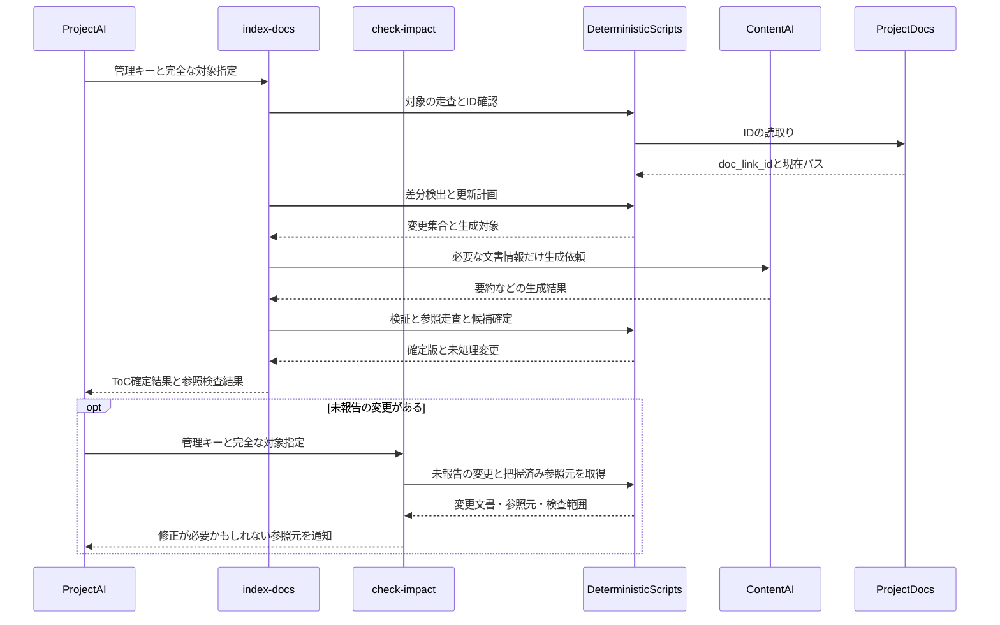

# DES-001 システム全体設計

**状態**: Draft 0.1・未承認\
**更新日**: 2026-10-27\
**根拠**: [要件総論][req-001]、[設計書の構成][readme]

## 1. システム境界

doc-link は DocAdvisor を置き換え、管理対象 Markdown の文書 ID、ToC、検索、参照検査、変更影響候補の通知を担う。対象集合は呼び出し元が完全な desired state として渡す。Forge の設定ファイルは呼び出し元が解釈し、doc-link は直接読まない。管理キーは対象集合を指定するが、参照の有効範囲は限定しない。

doc-link が管理対象 Markdown に書き込めるのは DLID だけであり、位置は frontmatter の `doc_link_id`、見出し直前のアンカー行、参照リンクの title 属性に限る（要件 D-031）。DLID の書き込みは明示的に起動する ID 付与操作だけが行い、ToC の構築と検索は管理対象 Markdown を書き換えない（要件 D-035）。それ以外の本文・見出し・リンクの修正は、通知を受けたプロジェクト管理 AI が行う。Skill、script、AI の内部責務は [DES-002][des-002] に定める。

## 2. 全体の操作と接続

| 操作             | 主な入力                                         | 後続へ渡す結果                                                           | 書き込み境界                                                                        |
| ---------------- | ------------------------------------------------ | ------------------------------------------------------------------------ | ----------------------------------------------------------------------------------- |
| ID 付与          | 対象の指定、現物、管理状態の ID                  | 発行・書き込みした DLID、重複の原本候補                                  | DLID だけを書く（要件 D-031）。重複の原本は利用者が確定する                         |
| ToC 構築・再構築 | 管理キー、完全な管理対象指定、現物、既存の確定版 | 確定済み ToC の版、変更集合、参照検査結果、ID 未付与・重複で除外した文書 | 管理対象 Markdown を書き換えない。doc-link 管理状態の確定                           |
| 文書検索         | キー、検索条件、確定済み ToC                     | 文書 ID、パス、関連理由、使用版・鮮度                                    | 古い版での検索を選んでも ToC は変更しない                                           |
| 参照検査         | 参照記述と、記載パスが示すディレクトリ           | 検査範囲・時点を伴う一致／不一致／不在とフラグメントの到達               | 管理対象 Markdown のリンクは変更しない                                              |
| 変更候補の通知   | 未報告の変更と把握済みの逆参照                   | 変更文書、参照元、検査範囲                                               | 報告する対象の比較基準だけ進める                                                    |
| 不整合検査       | 管理対象指定と現物                               | 不整合一覧                                                               | 管理対象 Markdown を書き換えない。ID の付与・修復は ID 付与操作が行う（要件 D-035） |

ToC 構築・再構築は、対象確定、ID 確認、変更検出、必要情報の取得、参照検査、候補検査、確定の順に行う。ID 確認では ID 未付与・重複の文書を除外して報告し、構築を止めない（要件 D-036）。初回 ToC がないキーでは検索できない。検索と変更影響候補の通知は、ToC 確定後の別操作である。報告の成功は、ToC 更新の成功と同義ではない。

## 3. 全体シーケンスの概要

次の図は ToC 構築（`index-docs`）と、その後に別操作として行う変更影響候補の通知（`check-impact`）の正常系を示す。SKILL の構成と各 SKILL のシーケンスは [DES-010][des-010] に置く。修正要否は doc-link では判定しない。失敗分岐、検索時の確認、状態遷移の許可条件は処理別文書と [DES-004][des-004] に置く。

処理済み比較基準は図中の ToC 確定時には進めない。変更と参照元の報告後に比較基準を更新する条件は [DES-007][des-007] で扱う。

参照先ディレクトリを読めない場合は不在として記録し、確定を妨げない（要件 D-025）。

## 4. 共通不変条件

1. 文書 ID はパス、本文、管理キーと独立し、発行済みの値を変更理由だけで再発行しない。
2. 現在の参照の存在・パス一致は、記載パスが示すディレクトリの実走査なしに断定しない。
3. 新しい ToC 候補の一部を、確定済みの現在状態として公開しない。
4. 確定した ToC の内容ハッシュと、変更影響候補の報告まで処理済みの比較基準は別の状態として保つ。
5. 逆参照と変更影響候補の報告範囲は、走査して登録した参照元の範囲を超えない。
6. あるキーの更新は、指定されていないキーの ToC を更新・削除しない。

## 5. 本書で確定しないこと

保存方式（SQLite）、同一 ID の複数キー間での見え方、変更報告の比較基準の単位、参照先を読めない場合の確定可否は個別設計で決定済みである（[DES-002][des-002]、[DES-003][des-003]、[DES-005][des-005]、[DES-006][des-006]、[DES-007][des-007]）。これらの選択は対応する個別設計に理由と帰結を記録し、要件変更が必要なら要件書にも反映する。

[req-001]: ../requirement/REQ-001-overview.md
[readme]: README.md
[des-002]: DES-002-execution-responsibilities.md
[des-010]: DES-010-skill-composition.md
[des-004]: DES-004-state-machines.md
[des-007]: DES-007-references-impact.md
[des-005]: DES-005-indexing.md
[des-003]: DES-003-data-model.md
[des-006]: DES-006-search.md
