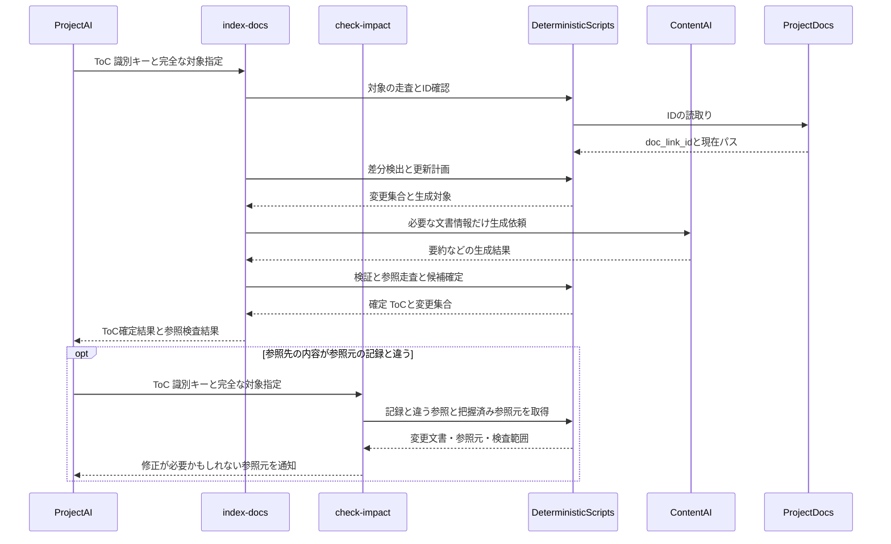

# DES-001 システム全体設計 DLID-he599f4215xq

**状態**: 承認済み\
**更新日**: 2026-11-02\
**根拠**: [要件総論][req-001]、[設計書の構成][readme]

## 1. システム境界 DLID-gzrbkxrazr3s

doc-link は DocAdvisor を置き換え、[Index 対象文書]の[文書 ID]、[ToC]、検索、[DLID]の解決、参照検査、[変更影響候補の通知]を担う。[Index 対象指定]は呼び出し元が完全な desired state として渡す。Forge の設定ファイルは呼び出し元が解釈し、doc-link は直接読まない。[ToC 識別キー]は[ToC]を識別するが、参照の有効範囲は限定しない。

doc-link が[Index 対象文書]に書き込めるのは[DLID]だけであり、位置は frontmatter の `doc_link_id` と、見出しの行の末尾の[セクション ID]に限る（要件 D-031）。リンクとその title は書き込まない（要件 D-042）。[DLID]の書き込みは明示的に起動する DLID 付与操作だけが行い、[ToC]の構築、検索、[DLID]の解決は[Index 対象文書]を書き換えない（要件 D-035、FR-018）。それ以外の本文・見出し・リンクの修正は、通知を受けた[プロジェクト管理 AI]が行う。Skill、script、AI の内部責務は[DES-002][des-002]に定める。

## 2. 全体の操作と接続 DLID-xw8rpzytg31z

| 操作                 | 主な入力                                                                          | 後続へ渡す結果                                                                                                     | 書き込み境界                                                                        |
| -------------------- | --------------------------------------------------------------------------------- | ------------------------------------------------------------------------------------------------------------------ | ----------------------------------------------------------------------------------- |
| DLID 付与            | 対象の指定、現物、管理状態の ID                                                   | 発行・書き込みした[DLID]、重複の原本候補                                                                           | [DLID]だけを書く（要件 D-031）。重複の原本は利用者が確定する                        |
| [ToC]構築・再構築    | [ToC 識別キー]、完全な[Index 対象指定]、現物、既存の[確定 ToC]                    | [確定 ToC]の版、変更集合、参照検査結果、ID 未付与・重複で除外した文書                                              | [Index 対象文書]を書き換えない。doc-link 管理状態の確定                             |
| 文書検索             | キー、検索条件、[確定 ToC]                                                        | [文書 ID]、パス、関連理由、使用版・鮮度                                                                            | 古い版での検索を選んでも[ToC]は変更しない                                           |
| [DLID]の解決         | [DLID]の並び、管理状態の記録、記録されたパスの現物                                | [DLID]ごとのパスと記録した[内容ハッシュ]（セクションは見出しとアンカー）、記録されたパスに無いこと、記録が無いこと | 何も書き換えない（要件 FR-018）                                                     |
| 参照検査             | 参照記述と、記載パスが示すディレクトリ                                            | 検査範囲・時点を伴う一致／不一致／不在とフラグメントの到達                                                         | [Index 対象文書]のリンクは変更しない                                                |
| [変更影響候補の通知] | 参照元の title に記録した[内容ハッシュ]、参照先の[現在ハッシュ]、把握済みの逆参照 | 変更文書、参照元、検査範囲                                                                                         | 何も書き換えない（要件 D-038）                                                      |
| 不整合検査           | [Index 対象指定]、現物、[確定 ToC]                                                | 不整合一覧                                                                                                         | [Index 対象文書]を書き換えない。ID の付与・修復は DLID 付与操作が行う（要件 D-035） |

[ToC]構築・再構築は、対象確定、ID 確認、変更検出、必要情報の取得、参照検査、候補検査、確定の順に行う。ID 確認では ID 未付与・重複の文書を除外して報告し、構築を止めない（要件 D-036）。初回[ToC]がないキーでは検索できない。検索、[DLID]の解決、[変更影響候補の通知]は、[ToC]確定後の別操作である。通知の成功は、[ToC]更新の成功と同義ではない。

## 3. 全体シーケンスの概要 DLID-wa3zfxxced6j

次の図は[ToC]構築（`index-docs`）と、その後に別操作として行う[変更影響候補の通知]（`check-impact`）の正常系を示す。SKILL の構成と各 SKILL のシーケンスは[DES-010][des-010]に置く。修正要否は doc-link では判定しない。失敗分岐、検索時の確認、状態遷移の許可条件は処理別文書と[DES-004][des-004]に置く。

[変更影響候補の通知]は、何も書き換えない。参照元の title の[内容ハッシュ]を書き換えるのは[プロジェクト管理 AI]である。条件は[DES-007][des-007]で扱う。

参照先ディレクトリを読めない場合は不在として記録し、確定を妨げない（要件 D-025）。

## 4. 共通不変条件 DLID-9wx7mkwga40b

1. [文書 ID]はパス、本文、[ToC 識別キー]と独立し、発行済みの値を変更理由だけで再発行しない。
2. 現在の参照の存在・パス一致は、記載パスが示すディレクトリの実走査なしに断定しない。
3. 新しい[ToC 候補]の一部を、確定済みの現在状態として公開しない。
4. doc-link は、通知の状態を保存しない。通知の基準は、参照元の title に記録した[内容ハッシュ]だけである。
5. 逆参照と[変更影響候補の通知]範囲は、走査して登録した参照元の範囲を超えない。
6. あるキーの更新は、指定されていないキーの[ToC]を更新・削除しない。

## 5. 本書で確定しないこと DLID-mzr6cep22ym1

保存方式（JSON ファイル）、同一 ID の複数キー間での見え方は個別設計で決定済みである（[DES-002][des-002]、[DES-003][des-003]、[DES-005][des-005]、[DES-006][des-006]、[DES-007][des-007]）。これらの選択は対応する個別設計に理由と帰結を記録する。参照先を読めない場合も[ToC]の確定を止めないことは、要件 D-025 が定める。

[req-001]: ../requirement/REQ-001_overview.md "e039c117ad0b DLID-veg2nsjk8zw1"
[readme]: README.md "46122592dd45 DLID-zvepba87h7zk"
[des-002]: DES-002_execution-responsibilities.md "90be2ac68a19 DLID-anz9vack2xzt"
[des-010]: DES-010_skill-composition.md "cc47b18bbb6a DLID-7e90gq3sdncc"
[des-004]: DES-004_state-machines.md "53b4f7321987 DLID-3f92k3tz4rew"
[des-007]: DES-007_references-impact.md "f5cea4052598 DLID-pr3jp4hzb8js"
[des-005]: DES-005_indexing.md "1cecc49a17b2 DLID-dgphqw70rkpz"
[des-003]: DES-003_data-model.md "4708f535908f DLID-yqqrwtycr379"
[des-006]: DES-006_search.md "5e6990692aaa DLID-nnbgpzkkm5vq"
