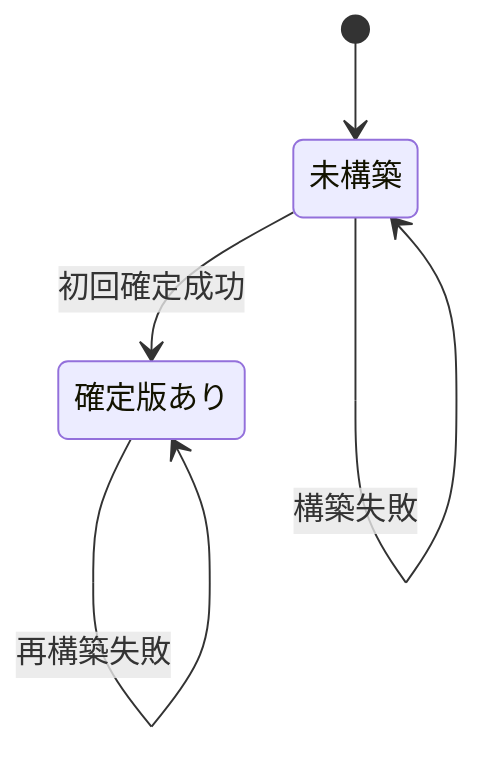
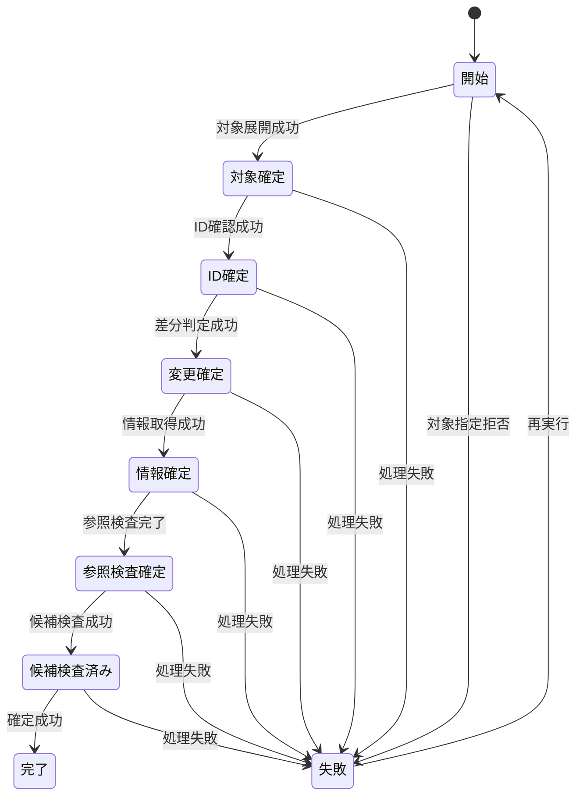

# DES-004 状態モデルと許可遷移

**状態**: Draft 0.1\
**更新日**: 2026-10-26\
**根拠**: [ToC 管理要件][req-003]、[変更通知要件][req-005-sec-14]

## 1. 状態の分離と規範

ToC の公開状態と構築実行の進捗は別々に変化する。「再構築要」は現在の文書と確定版を比較した**判定結果**であり、ToC の永続的な状態名ではない。「参照先不在」もディレクトリ走査の**検査結果**であり、構築実行の失敗状態とは別である。

本書の遷移表は許可される遷移の規範である。図は表の可視化であり、表にない状態・イベント・ガードの組合せによる遷移を script は拒否する。図の `[*]` は新しいキー・実行を作成するときの初期値を示し、作成済み対象に対する実行中の遷移ではない。拒否時に新しい確定版や処理済み比較基準を変更しない。未決のガードを満たしたと推測して遷移させない。

## 2. ToC 公開版

公開状態はキーごとに `未構築` または `確定版あり` のいずれかである。構築実行中も旧確定版は保持される。確定版があることは、その版を作成したときに候補検査が成功したことを意味し、現在のファイルが不変という意味ではない。

| 遷移 | 元                 | イベント・ガード                         | 次         | 効果                     |
| ---- | ------------------ | ---------------------------------------- | ---------- | ------------------------ |
| P-01 | 未構築             | 初回候補が検査済みで構築実行の確定が成功 | 確定版あり | 新版を公開する           |
| P-02 | 確定版あり         | 再構築候補が検査済みで確定が成功         | 確定版あり | 公開版を新版へ切り替える |
| P-03 | 未構築／確定版あり | 候補作成・検査・確定のいずれかが失敗     | 元のまま   | 新候補を公開しない       |

初回構築前に検索する遷移はない。確定版ありのキーで古い版を検索するかどうかは検索操作の利用者選択であり、公開版を再確定する遷移ではない。

## 3. ToC 構築・再構築の実行

実行ごとの状態は次の通り。成功した段階から次へ進む。AI への生成依頼は `変更確定` 以降に限る。構築は管理対象 Markdown を書き換えない。ID の付与は構築とは別の ID 付与操作が行う（要件 D-035）。

| 遷移 | 元                                                                      | イベント・ガード                         | 次           | 効果・失敗時の意味                                                                 |
| ---- | ----------------------------------------------------------------------- | ---------------------------------------- | ------------ | ---------------------------------------------------------------------------------- |
| B-01 | 開始                                                                    | 完全な対象指定を検証・展開した           | 対象確定     | 対象一覧を固定する                                                                 |
| B-02 | 対象確定                                                                | 全対象の frontmatter を読み取れた        | ID 確定      | ID 未付与・重複の文書を除外して報告する（要件 D-036）                              |
| B-03 | ID 確定                                                                 | 旧確定版と現物、処理済み基準の比較が成功 | 変更確定     | 変更集合を確定する                                                                 |
| B-04 | 変更確定                                                                | 必要情報の取得・AI 出力検証が成功        | 情報確定     | 未変更文書の要約は再利用する。文書情報行は文書単位のロックの下で文書ごとに確定する |
| B-05 | 情報確定                                                                | 参照先の必要な実走査と結果分類が完了     | 参照検査確定 | 不在・パス不一致は結果として保持する                                               |
| B-06 | 参照検査確定                                                            | 必須情報と整合条件が満たされた           | 候補検査済み | 走査不能は検査不能として記録し、確定を妨げない（決定: U-020）                      |
| B-07 | 候補検査済み                                                            | 一括確定が成功                           | 完了         | 公開版を P-01 または P-02 で切り替える                                             |
| B-08 | 開始／対象確定／ID 確定／変更確定／情報確定／参照検査確定／候補検査済み | 当該段階の処理が失敗                     | 失敗         | 候補を公開せず、旧確定版を維持して報告する                                         |
| B-09 | 失敗                                                                    | 再実行を明示的に開始                     | 開始         | 未完了処理を再評価する                                                             |

`開始` で対象指定を拒否した場合も B-08 の失敗結果を返す。

文書単位のロック待ちは状態ではなく、B-02（ID 発行）と B-04（文書情報行の確定）の処理内の待機である（[DES-005 §5][des-005-sec-5]）。強制解除によってロックを失った構築は、書き込み時に保持者の確認で拒否され、B-08 で失敗する。B-08 で失敗しても、それまでに確定した文書情報行は戻さない（決定: 旧 R-004）。

## 4. 検査結果と鮮度

参照の検査結果は `一致／パス不一致／指定ディレクトリ内不在／検査不能` のいずれかと、検査したディレクトリ・時点を持つ。後の現物変更だけでは保存済み結果が自動的に更新されない。検索は、検索結果に含まれる文書の参照先を都度再走査して鮮度を更新する（決定: 旧 R-003）。

状態遷移のテストは [DES-009][des-009] に定める。表にある全許可遷移、ガード不成立、表にないイベント、失敗・再実行を検査する。Markdown 解析とハッシュ計算のテストは、状態遷移ではなく [DES-008][des-008] の規則から導く。

[req-003]: ../requirement/REQ-003-toc.md
[req-005-sec-14]: ../requirement/REQ-005-references.md#sec-14
[des-009]: DES-009-verification.md
[des-008]: DES-008-content-rules.md
[des-005-sec-5]: DES-005-indexing.md#sec-5
