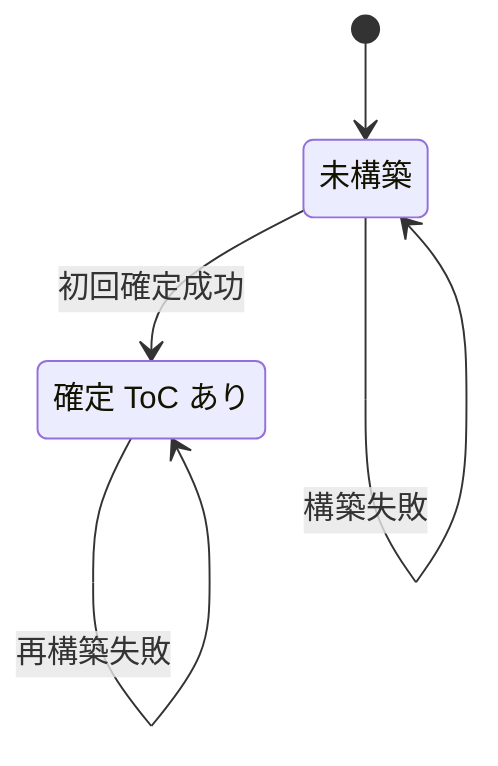
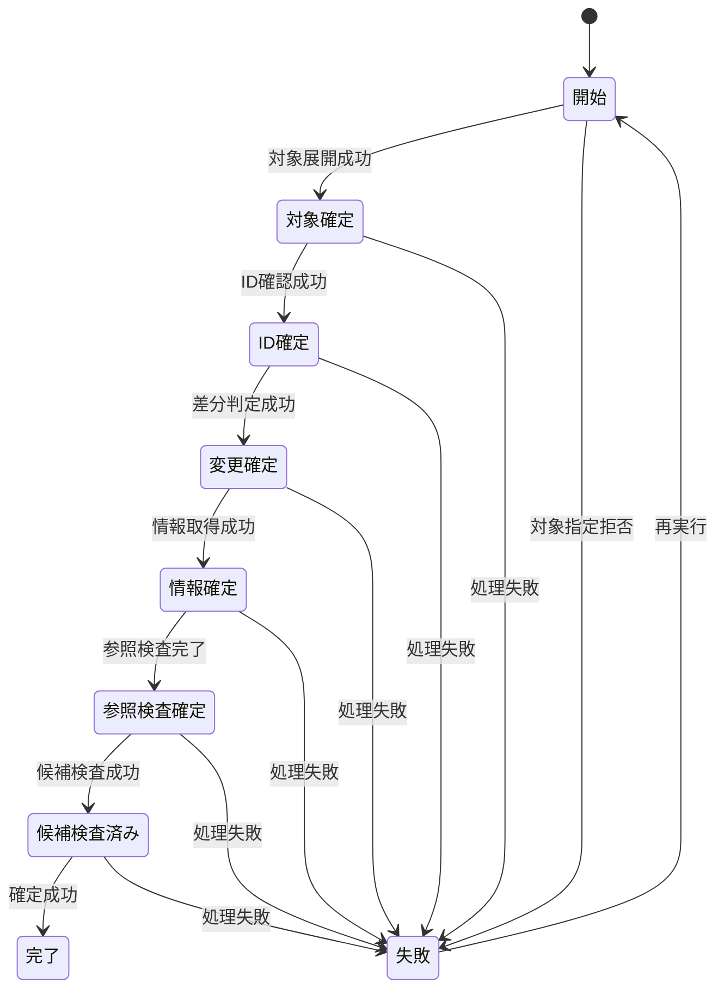

# DES-004 状態モデルと許可遷移 DLID-h1mqw7dj0w2a

**根拠**: [ToC 管理要件][req-003]

## 1. 状態の分離と規範 DLID-avhjbcr0q865

[ToC]の公開状態と構築実行の進捗は別々に変化する。「再構築要」は現在の文書と[確定 ToC]を比較した**判定結果**であり、[ToC]の永続的な状態名ではない。「参照先不在」もディレクトリ走査の**検査結果**であり、構築実行の失敗状態とは別である。

本書は、状態を持つ 2 つの処理（[ToC]の構築・再構築、DLID 付与操作）と[確定 ToC]の遷移を定める。検索、[DLID]の解決、検査（`check-impact` を含む）は管理状態を変えないので、状態を持たない（要件 [D-038][req-001-d]）。本書の遷移表は許可される遷移の規範である。図は表の可視化であり、表にない状態・イベント・ガードの組合せによる遷移を script は拒否する。図の `[*]` は新しいキー・実行を作成するときの初期値を示し、作成済み対象に対する実行中の遷移ではない。拒否時に新しい[確定 ToC]を作らない。未決のガードを満たしたと推測して遷移させない。

## 2. [確定 ToC] DLID-yn0j8tdebdah

公開状態はキーごとに `未構築` または `確定 ToC あり` のいずれかである。構築実行中も旧[確定 ToC]は保持される。[確定 ToC]があることは、その版を作成したときに候補検査が成功したことを意味し、現在のファイルが不変という意味ではない。

| 遷移 | 元                     | イベント・ガード                         | 次             | 効果                         |
| ---- | ---------------------- | ---------------------------------------- | -------------- | ---------------------------- |
| P-01 | 未構築                 | 初回候補が検査済みで構築実行の確定が成功 | [確定 ToC]あり | 新版を公開する               |
| P-02 | [確定 ToC]あり         | 再構築候補が検査済みで確定が成功         | [確定 ToC]あり | [確定 ToC]を新版へ切り替える |
| P-03 | 未構築／[確定 ToC]あり | 候補作成・検査・確定のいずれかが失敗     | 元のまま       | 新候補を公開しない           |

初回構築前に検索する遷移はない。[確定 ToC]ありのキーで古い版を検索するかどうかは検索操作の利用者選択であり、[確定 ToC]を再確定する遷移ではない。

## 3. [ToC]構築・再構築の実行 DLID-kz06g0w7tsvs

実行ごとの状態は次の通り。成功した段階から次へ進む。AI への生成依頼は `変更確定` 以降に限る。構築は[Index 対象文書]を書き換えない。ID の付与は構築とは別の DLID 付与操作が行う（要件 [D-035][req-001-d]）。

| 遷移 | 元                                                                      | イベント・ガード                     | 次           | 効果・失敗時の意味                                                                                                                   |
| ---- | ----------------------------------------------------------------------- | ------------------------------------ | ------------ | ------------------------------------------------------------------------------------------------------------------------------------ |
| B-01 | 開始                                                                    | 完全な対象指定を検証・展開した       | 対象確定     | [Index 対象リスト]を固定する                                                                                                         |
| B-02 | 対象確定                                                                | 全対象の frontmatter を読み取れた    | ID 確定      | ID 未付与・重複の文書を除外して報告する（要件 [D-036][req-001-d]）                                                                   |
| B-03 | ID 確定                                                                 | 旧[確定 ToC]と現物の比較が成功       | 変更確定     | 変更集合を確定する                                                                                                                   |
| B-04 | 変更確定                                                                | 必要情報の取得・AI 出力検証が成功    | 情報確定     | 未変更文書の要約は再利用する。[文書情報]は文書ごとに確定する                                                                         |
| B-05 | 情報確定                                                                | 参照先の必要な実走査と結果分類が完了 | 参照検査確定 | 不在・パス不一致は結果として保持する                                                                                                 |
| B-06 | 参照検査確定                                                            | 必須情報と整合条件が満たされた       | 候補検査済み | 指定ディレクトリ内不在・パス不一致は結果として記録し、確定を妨げない（決定: [U-020][req-001-u]）                                     |
| B-07 | 候補検査済み                                                            | 一括確定が成功                       | 完了         | [確定 ToC]を P-01 または P-02 で切り替える                                                                                           |
| B-08 | 開始／対象確定／ID 確定／変更確定／情報確定／参照検査確定／候補検査済み | 当該段階の処理が失敗                 | 失敗         | 候補を公開せず、旧[確定 ToC]を維持して報告する。報告には、失敗した文書・フィールド・理由を含める（要件 §11.2）。自動では再試行しない |
| B-09 | 失敗                                                                    | 再実行を明示的に開始                 | 開始         | 未完了処理を再評価する                                                                                                               |

`開始` で対象指定を拒否した場合も B-08 の失敗結果を返す。

B-08 で失敗しても、それまでに確定した[文書情報]は戻さない（要件 [D-024][req-001-d]）。

## 4. 検査結果と鮮度 DLID-dq5y0vdrzhbk

参照の検査結果は `一致／パス不一致／指定ディレクトリ内不在` のいずれかと、一致の場合のフラグメントの到達の可否と、検査したディレクトリ・時点を持つ。後の現物変更だけでは保存済み結果が自動的に更新されない。

状態遷移のテストは[DES-009][des-009]に定める。表にある全許可遷移、ガード不成立、表にないイベント、失敗・再実行を検査する。Markdown 解析とハッシュ計算のテストは、状態遷移ではなく[DES-008][des-008]の規則から導く。

## 5. DLID 付与操作の実行 DLID-evgp45p8prf7

DLID 付与操作（`embed-dlid`）の実行ごとの状態は次の通り。[Index 対象文書]に書き込むのは計画確定から出る遷移（E-05、または計画確定からの E-06）だけである（要件 [D-035][req-001-d]）。

| 遷移 | 元                                     | イベント・ガード                                                                                                | 次           | 効果・失敗時の意味                                                                                                                                                                              |
| ---- | -------------------------------------- | --------------------------------------------------------------------------------------------------------------- | ------------ | ----------------------------------------------------------------------------------------------------------------------------------------------------------------------------------------------- |
| E-01 | 開始                                   | [Index 対象指定]を検証し、展開した                                                                              | 対象確定     | 書き込む対象を固定する（要件 [D-041][req-001-d]）                                                                                                                                               |
| E-02 | 対象確定                               | 全対象の[DLID]と見出しを読み、既存の[DLID]と照合した。重複が無い                                                | 計画確定     | 発行する[DLID]と書き込む位置を確定する                                                                                                                                                          |
| E-03 | 対象確定                               | 照合した結果、重複がある                                                                                        | 原本確認待ち | 原本の候補を利用者へ示す（要件 [D-029][req-001-d]）                                                                                                                                             |
| E-04 | 原本確認待ち                           | 利用者が原本を確定した                                                                                          | 計画確定     | 原本以外へ発行する[DLID]を計画に加える                                                                                                                                                          |
| E-05 | 計画確定                               | 全対象に[DLID]を書き込み、再解析で差分が[DLID]だけと確かめた                                                    | 完了         | 書き込んだ件数を返す（要件 [D-040][req-001-d]）                                                                                                                                                 |
| E-06 | 開始／対象確定／原本確認待ち／計画確定 | 当該段階の処理が失敗した（書き込めなかった文書が 1 件でもある場合を含む）、または利用者が原本を確定せずに終えた | 失敗         | 検証を通って書き込んだ[DLID]は戻さない。書き込んだ件数と、書き込めなかった文書ごとのパス・問題箇所・原因を返す（要件 [FR-002][req-002-fr-002]、[D-040][req-001-d]、[NFR-005][req-001-nfr-005]） |
| E-07 | 失敗                                   | 再実行を明示的に開始                                                                                            | 開始         | 書き込み済みの[DLID]を既存の[DLID]として照合し直す                                                                                                                                              |

[req-003]: ../requirement/REQ-003_toc.md "191fbc0b3993 DLID-kxe3nxfgk491"
[des-009]: DES-009_verification.md "0a7ae9d0cd79 DLID-xmg0jcmep2h2"
[des-008]: DES-008_content-rules.md "5abc0b499da6 DLID-ywa6htx8vq09"
[req-001-d]: ../requirement/REQ-001_overview.md#19-決定事項-dlid-phx3m5ynd4s4 "e6b9897d2771 DLID-phx3m5ynd4s4"
[req-001-nfr-005]: ../requirement/REQ-001_overview.md#nfr-005-診断可能性-dlid-89jss0ty2c7m "3e5b0619aa70 DLID-89jss0ty2c7m"
[req-001-u]: ../requirement/REQ-001_overview.md#20-未決事項-dlid-p7frptr4vztx "f3b671adcef4 DLID-p7frptr4vztx"
[req-002-fr-002]: ../requirement/REQ-002_document-id.md#fr-002-文書-idの検証-dlid-edwjjf150svm "4a3aa7696bd9 DLID-edwjjf150svm"
