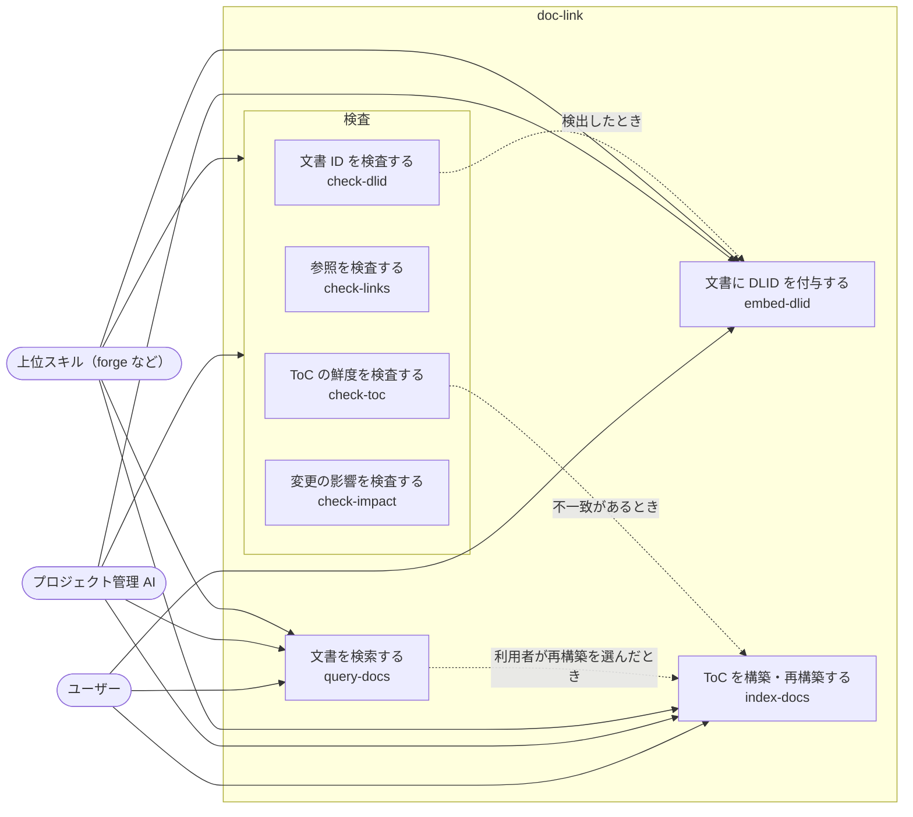
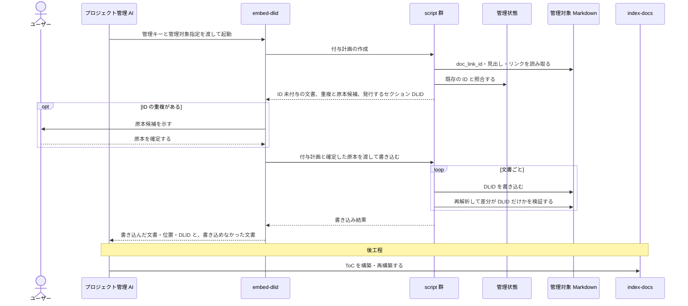
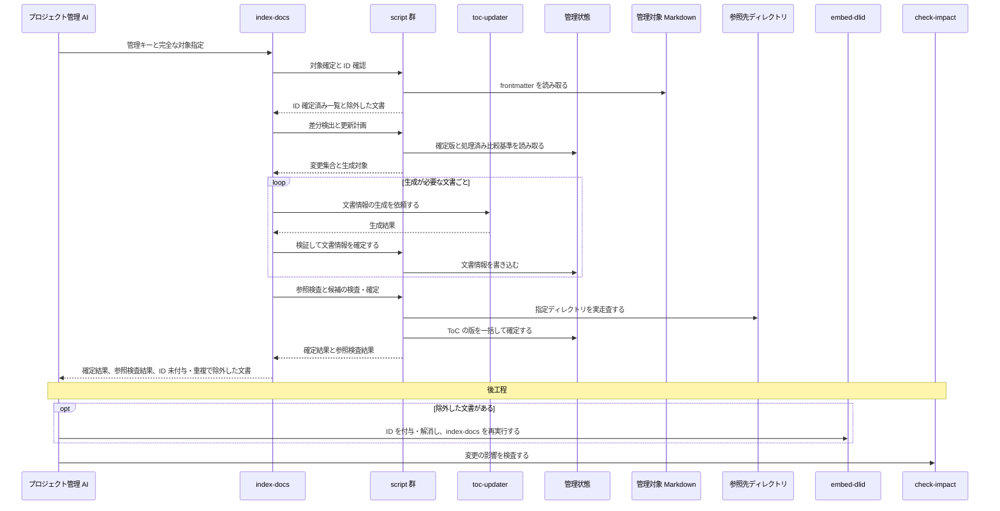
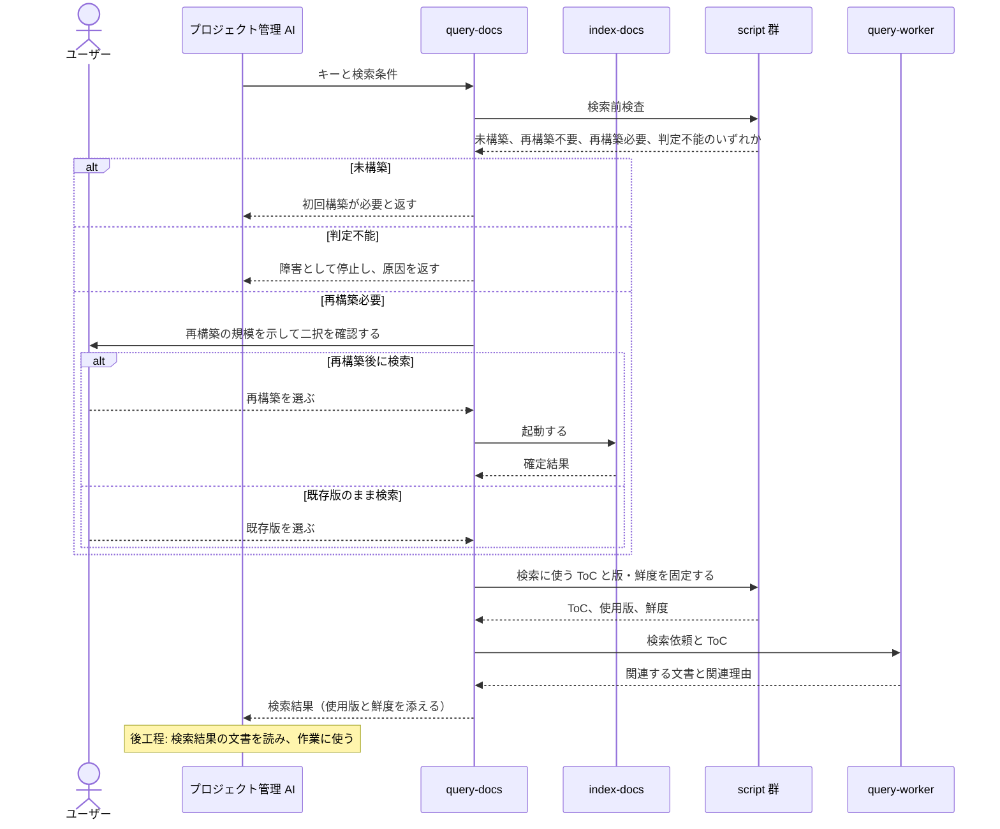
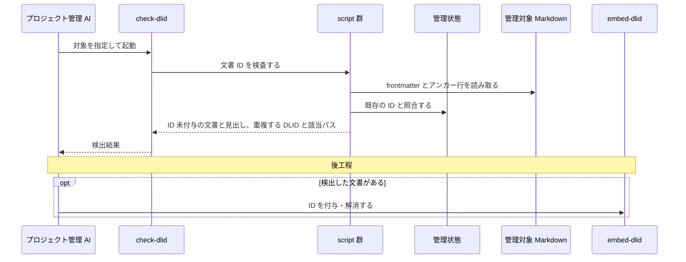
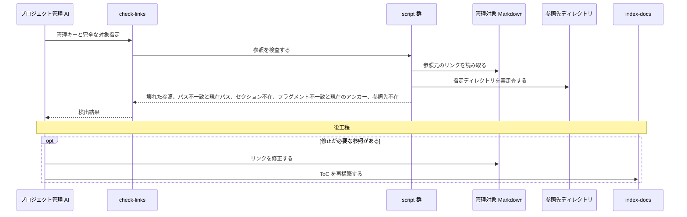
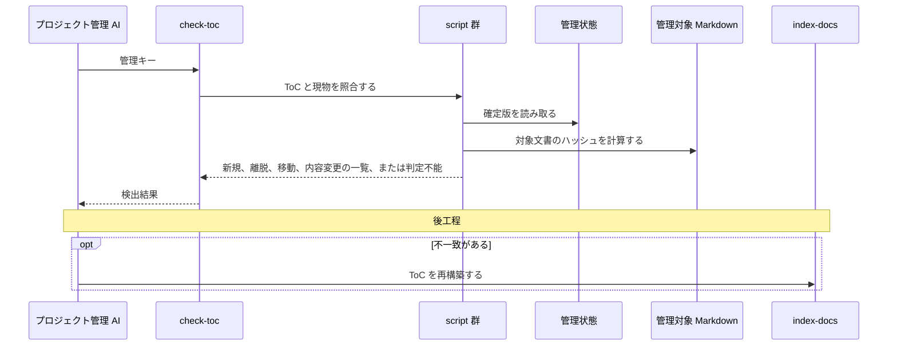
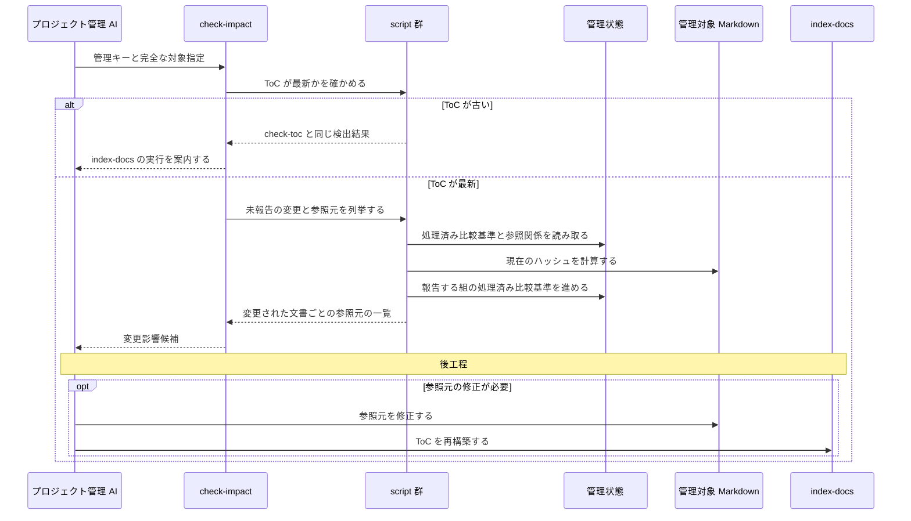

# DES-010 SKILL と Agent の構成

**状態**: 承認済み\
**更新日**: 2026-10-30\
**根拠**: [要件総論][req-001]、[実行主体][des-002]

## 1. 構成

doc-link は次の 7 つの SKILL と 2 つのカスタム Agent で構成する。SKILL はいずれも呼び出し元（プロジェクト管理 AI）のコンテキストで実行する継承型とする（[DES-002 §3][des-002-sec-3]）。各 SKILL は処理を script に委ね、SKILL.md にロジックを書かない。

| SKILL          | 種類 | 管理対象 Markdown への書き込み | 管理状態の書き換え                   | 対応する要件                                                                                   |
| -------------- | ---- | ------------------------------ | ------------------------------------ | ---------------------------------------------------------------------------------------------- |
| `embed-dlid`   | 操作 | あり（DLID だけ、要件 D-031）  | なし                                 | [REQ-002 §9.2][req-002-sec-9-2]、FR-001、FR-002、D-029、D-033〜D-035                           |
| `index-docs`   | 操作 | なし（要件 D-035）             | あり（文書情報、ToC の版）           | FR-017、[REQ-002 §9.1][req-002-sec-9-1]、FR-003〜FR-005、FR-009、FR-010、FR-011、FR-012、D-036 |
| `query-docs`   | 照会 | なし                           | なし                                 | [REQ-004 §12][req-004-sec-12] FR-006                                                           |
| `check-dlid`   | 検査 | なし                           | なし                                 | [REQ-005 §15][req-005-sec-15] FR-016、[REQ-002 §9][req-002-sec-9] FR-002                       |
| `check-links`  | 検査 | なし                           | なし                                 | [REQ-005 §15][req-005-sec-15] FR-016、[REQ-005 §13][req-005-sec-13] FR-009                     |
| `check-toc`    | 検査 | なし                           | なし                                 | [REQ-005 §15][req-005-sec-15] FR-016、[REQ-003 §10][req-003-sec-10] FR-011                     |
| `check-impact` | 検査 | なし                           | あり（処理済み比較基準、要件 D-038） | [REQ-005 §14][req-005-sec-14] FR-013〜FR-015、[REQ-005 §15][req-005-sec-15] FR-016、D-038      |

検査の SKILL は検出して返し、管理状態を書き換えない。例外は `check-impact` で、変更影響候補を返すときに、返す (変更された文書, 参照元) の組の処理済み比較基準を進める（要件 D-038、[DES-007 §3][des-007-sec-3]）。プロジェクト管理 AI の判断や修正の結果は、処理済みの条件にしない（要件 FR-015）。

| カスタム Agent            | 責務                                                                                                                                                                                                                                                    | 起動元       |
| ------------------------- | ------------------------------------------------------------------------------------------------------------------------------------------------------------------------------------------------------------------------------------------------------- | ------------ |
| `toc-updater`（情報生成） | 1 文書ずつ、目的・内容概要・適用作業・検索用キーワードを生成する。記述上限 `L` 以外の検証情報を持たない（要件: [REQ-003 §7.4][req-003-sec-7-4]、[REQ-003 §11.2.2][req-003-sec-11-2-2]／設計: [DES-002 §3][des-002-sec-3]、[DES-008 §4][des-008-sec-4]） | `index-docs` |
| `query-worker`（検索）    | 確定版の ToC 全体を読み、タスクに関連する文書と関連理由を返す。読み取り専用で、存在しない ID を補わず、ToC と管理状態を変更しない（要件: [REQ-004 §12][req-004-sec-12] FR-006／設計: [DES-006 §2][des-006-sec-2]）                                      | `query-docs` |

### 1.1 操作と照会の SKILL の責務

`embed-dlid`

- 文書 ID の無い文書へ DLID を発行し、frontmatter に書き込む（要件: [REQ-002 §9.2][req-002-sec-9-2]／設計: [DES-005 §2.1][des-005-sec-2-1]、[DES-008 §1][des-008-sec-1]）
- セクションの DLID を持たないすべての見出しへセクションの DLID を発行し、アンカー行を書き込む（要件: [REQ-005 §13.1][req-005-sec-13-1]／設計: [DES-005 §2.1][des-005-sec-2-1]、[DES-008 §1][des-008-sec-1]）
- 同じ ID を持つ文書が複数あるとき、原本の候補を利用者に示し、利用者が原本を確定した後、複製側に新しい ID を発行して書き込む（要件: [REQ-002 §9][req-002-sec-9] FR-002／設計: [DES-005 §2.1][des-005-sec-2-1]）
- title に DLID の無いリンクへ参照先の DLID を加える。既存文書の移行（全対象への ID 付与、セクションの DLID の発行、既存リンクへの DLID の追加）も、移行後に書かれたリンクも同じ処理で扱う（要件: [REQ-002 §9.2][req-002-sec-9-2]、[REQ-001 §19][req-001-sec-19] D-034・D-042／設計: [DES-005 §2.1][des-005-sec-2-1]）

`index-docs`

- 対象を確定し、文書 ID を確認する。ID の無い文書と ID が重複する文書は ToC に入れずに報告する（要件: [REQ-002 §8][req-002-sec-8]、[REQ-002 §9.1][req-002-sec-9-1]／設計: [DES-005 §2][des-005-sec-2]）
- 確定版と現物の差分を検出する（要件: [REQ-003 §10][req-003-sec-10]／設計: [DES-005 §3][des-005-sec-3]）
- 生成が必要な文書だけ `toc-updater` に依頼し、結果を検証する（要件: [REQ-003 §11.2.2][req-003-sec-11-2-2]、[REQ-003 §7.4][req-003-sec-7-4]／設計: [DES-005 §4・§5][des-005-sec-4]、[DES-008 §4][des-008-sec-4]）
- 参照先ディレクトリを実走査して参照を検査する（要件: [REQ-005 §13][req-005-sec-13]／設計: [DES-007 §1][des-007-sec-1]）
- ToC の候補を検査し、一括して確定する（要件: [REQ-003 §11.2.4][req-003-sec-11-2-4]／設計: [DES-005 §4][des-005-sec-4]、[DES-004 §3][des-004-sec-3]）

`query-docs`

- 検索前に再構築の要否を検査し、必要なら再構築の規模を示して利用者に二択を確認する（要件: [REQ-004 §12][req-004-sec-12]／設計: [DES-006 §1][des-006-sec-1]）
- 確定版から文書を検索し、使用した版と鮮度を添えて返す（要件: [REQ-004 §12][req-004-sec-12]／設計: [DES-006 §2][des-006-sec-2]）

### 1.2 検査の SKILL の責務

| SKILL          | 検出する状態                                                                                                                                                                                                                      | 検出後にすべきこと（誰が、何で）                                                                                                                                                                                                                                                                                                                                                             |
| -------------- | --------------------------------------------------------------------------------------------------------------------------------------------------------------------------------------------------------------------------------- | -------------------------------------------------------------------------------------------------------------------------------------------------------------------------------------------------------------------------------------------------------------------------------------------------------------------------------------------------------------------------------------------- |
| `check-dlid`   | 文書 ID が無い。セクションの DLID の無い見出しがある。文書 ID またはセクションの DLID が重複している（セクションの DLID は同じ文書の中を含む）                                                                                    | ユーザーまたはプロジェクト管理 AI が `embed-dlid` を実行する。重複は、示された候補から利用者が原本を確定する                                                                                                                                                                                                                                                                                 |
| `check-links`  | 壊れた参照。ID とパスの不一致。存在しないセクションへの参照。フラグメントが参照先のセクションへ解決しないリンク。参照先ディレクトリに見つからない。`doc_link_id` を持つ Markdown を指しているが title に DLID の無いリンク        | title に DLID の無いリンクには、ユーザーまたはプロジェクト管理 AI が `embed-dlid` を実行する。プロジェクト管理 AI がリンクを直す。パスの不一致には確認できた現在のパスが添えられる（FR-010）。フラグメント不一致には、そのセクションへ届く現在のアンカーが添えられる（FR-009）。参照先が見つからない場合は、移動か削除かをプロジェクト管理 AI が判断する。直した後は `index-docs` を実行する |
| `check-toc`    | ToC と実体ファイルの不一致（新規、離脱、移動、ToC に反映したハッシュと現在のハッシュの違い）                                                                                                                                      | `index-docs` を実行する                                                                                                                                                                                                                                                                                                                                                                      |
| `check-impact` | 処理済み比較基準と内容ハッシュが違う文書とセクション、および追加されたセクション（未報告の変更）と、ToC から把握できるその直接の参照元。ToC が最新であることが前提で、古ければ変更影響候補を返さずに `check-toc` と同じ結果を返す | プロジェクト管理 AI が、参照元の修正が必要かを判断し、必要なら直して `index-docs` を実行する。返した変更は処理済みになるので、同じ変更は次の `check-impact` で再び返らない。修正した参照元は、次の `check-impact` で新しい変更として現れる                                                                                                                                                   |

検査ごとの根拠は次のとおり。

- `check-dlid`: 要件 [REQ-005 §15][req-005-sec-15] FR-016、[REQ-002 §9][req-002-sec-9] FR-002／設計 [DES-005 §2][des-005-sec-2]、[DES-008 §1][des-008-sec-1]
- `check-links`: 要件 [REQ-005 §13][req-005-sec-13] FR-009・FR-010、[REQ-001 §19][req-001-sec-19] D-042、[REQ-005 §15][req-005-sec-15] FR-016／設計 [DES-007 §1][des-007-sec-1]
- `check-toc`: 要件 [REQ-003 §10][req-003-sec-10] FR-011、[REQ-005 §15][req-005-sec-15] FR-016／設計 [DES-005 §3][des-005-sec-3]、[DES-006 §1][des-006-sec-1]。`query-docs` の検索前検査と同じ script を使う
- `check-impact`: 要件 [REQ-005 §14][req-005-sec-14] FR-013〜FR-015、[REQ-003 §10.1.3][req-003-sec-10-1-3]／設計 [DES-007 §2・§3][des-007-sec-2]

`check-impact` は、変更された文書の配列を返し、その要素ごとに直接の参照元の配列を持つ。セクションの DLID を指す参照元は、そのセクションが変わった場合だけ含める（要件 D-033）。参照元が無い変更は、参照元を空の配列にして返す（FR-014）。処理済みの単位は (変更された文書, 参照元) の組である（[DES-007 §3][des-007-sec-3]）。間接の参照元は含めない。参照元を直すと、その参照元が次の `check-impact` で変更として現れるので、間接的な影響は 1 段ずつ検出される（要件 D-043）。

## 2. ユースケース

ユーザーは `embed-dlid` で重複する ID の原本を確定し、`query-docs` で再構築の二択を選ぶ。検査の SKILL は、プロジェクト管理 AI と上位スキルのどちらからも呼び出せる。上位スキルは呼び出し元のコンテキストで実行されるので、検査の結果は同じプロジェクト管理 AI に届く。たとえば上位スキルは、検索の前に再構築が必要かを `check-toc` で判断できる。

## 3. SKILL ごとのシーケンス

各図の「後工程」は、SKILL の結果を受けてプロジェクト管理 AI が続けて行う作業を示す。

### 3.1 embed-dlid

起動を書き込みの承認とし、重複する ID の原本の確定以外では利用者に確認しない（要件 D-040）。対象は `index-docs` と同じ管理キーと管理対象指定で決める（要件 D-041）。

### 3.2 index-docs

### 3.3 query-docs

### 3.4 check-dlid

### 3.5 check-links

### 3.6 check-toc

### 3.7 check-impact

## 4. カスタム Agent との受け渡し

SKILL とカスタム Agent の間の依頼と結果は、[Agent とのデータ受け渡し規約][exchange-rules] に従う。運ぶのは script が生成した識別値だけで、置き場は `.temp/doc-link/<skill>/` の下で、識別値から script が決める（[DES-002 §4][des-002-sec-4]）。依頼と結果は script が書き、書き終えてから公開する。結果は Agent が値を script へ渡し、script が書く。読む側は script から絶対パスを受け取って直接読む。終了の値は文字列で、正常は `"0"` とする。成否は script が判定する。処理が終わったら、依頼と結果を削除する。

| 項目                               | `toc-updater`（情報生成）                                                                                   | `query-worker`（検索）                                                                            |
| ---------------------------------- | ----------------------------------------------------------------------------------------------------------- | ------------------------------------------------------------------------------------------------- |
| 識別値                             | 構築 ID と文書 ID                                                                                           | 検索 ID                                                                                           |
| 依頼                               | 対象文書の絶対パス、フィールドごとの記述上限 `L`（要件 D-044）。内部許容上限 `H` は含めない（要件 NFR-008） | 検索のタスク、管理キー、検索に使う版で固定した ToC の写しの絶対パス                               |
| 結果                               | 目的、内容概要、適用される作業、検索用キーワード。見出しから取得できない場合はタイトル                      | 関連する文書の文書 ID、関連理由、必要ならセクションの DLID の並び                                 |
| エラー値                           | `"source_unreadable"`（対象文書を読めなかった）                                                             | なし（空集合）                                                                                    |
| script の検査                      | `L`・`H` による長さの検証（[DES-008 §4][des-008-sec-4]）                                                    | 返った文書 ID とセクションの DLID が、固定した ToC の版にあること。無い ID を含む結果は異常とする |
| 終了の値が無い、または定義外のとき | その文書の生成を失敗とし、B-04 の失敗として扱う（[DES-004 §3][des-004-sec-3]）                              | 検索を失敗として返す                                                                              |
| 削除する時点                       | 文書情報を確定した後、または構築の終了時                                                                    | `query-docs` が結果を返した後                                                                     |

[req-001]: ../requirement/REQ-001-overview.md
[des-002]: DES-002-execution-responsibilities.md
[req-002-sec-9-2]: ../requirement/REQ-002-document-id.md#sec-9-2
[req-002-sec-9-1]: ../requirement/REQ-002-document-id.md#sec-9-1
[req-004-sec-12]: ../requirement/REQ-004-search.md#sec-12
[req-005-sec-13]: ../requirement/REQ-005-references.md#sec-13
[req-005-sec-15]: ../requirement/REQ-005-references.md#sec-15
[req-002-sec-9]: ../requirement/REQ-002-document-id.md#sec-9
[req-003-sec-10]: ../requirement/REQ-003-toc.md#sec-10
[req-005-sec-14]: ../requirement/REQ-005-references.md#sec-14
[req-003-sec-7-4]: ../requirement/REQ-003-toc.md#sec-7-4
[req-003-sec-11-2-2]: ../requirement/REQ-003-toc.md#sec-11-2-2
[req-005-sec-13-1]: ../requirement/REQ-005-references.md#sec-13-1
[req-001-sec-19]: ../requirement/REQ-001-overview.md#sec-19
[req-002-sec-8]: ../requirement/REQ-002-document-id.md#sec-8
[req-003-sec-11-2-4]: ../requirement/REQ-003-toc.md#sec-11-2-4
[req-003-sec-10-1-3]: ../requirement/REQ-003-toc.md#sec-10-1-3
[des-002-sec-3]: DES-002-execution-responsibilities.md#sec-3
[des-008-sec-4]: DES-008-content-rules.md#sec-4
[des-006-sec-2]: DES-006-search.md#sec-2
[des-005-sec-2-1]: DES-005-indexing.md#sec-2-1
[des-008-sec-1]: DES-008-content-rules.md#sec-1
[des-005-sec-2]: DES-005-indexing.md#sec-2
[des-005-sec-3]: DES-005-indexing.md#sec-3
[des-005-sec-4]: DES-005-indexing.md#sec-4
[des-007-sec-1]: DES-007-references-impact.md#sec-1
[des-004-sec-3]: DES-004-state-machines.md#sec-3
[des-006-sec-1]: DES-006-search.md#sec-1
[des-007-sec-2]: DES-007-references-impact.md#sec-2
[des-007-sec-3]: DES-007-references-impact.md#sec-3
[exchange-rules]: ../../rules/agent_data_exchange_rules.md
[des-002-sec-4]: DES-002-execution-responsibilities.md#sec-4
