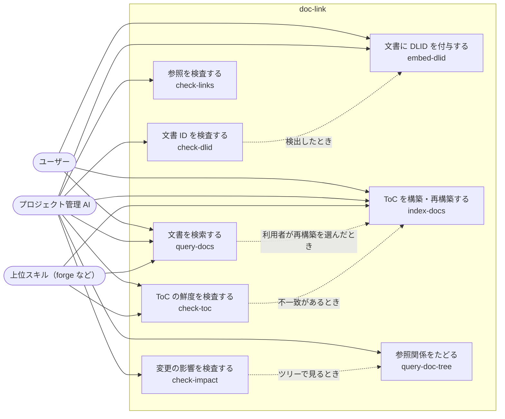
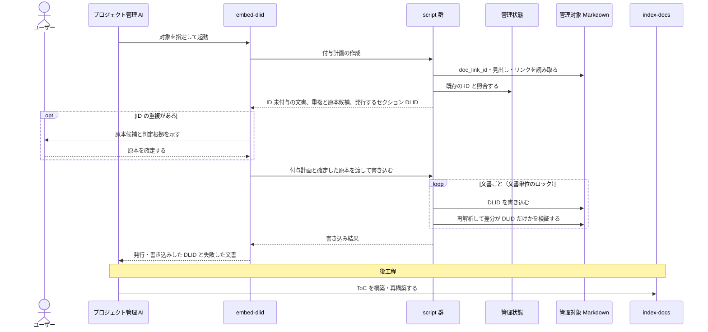
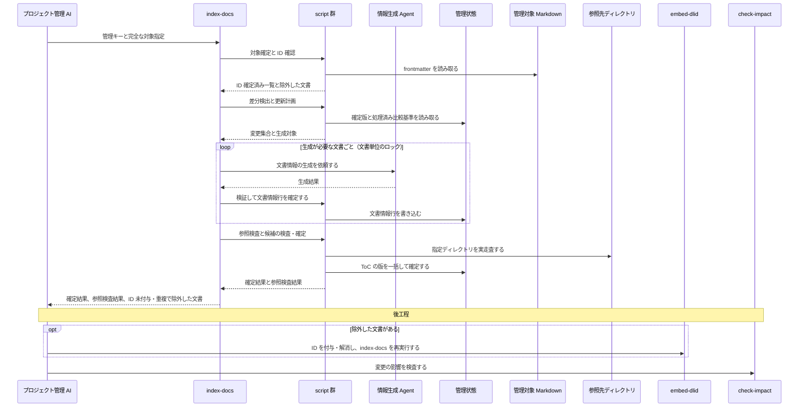
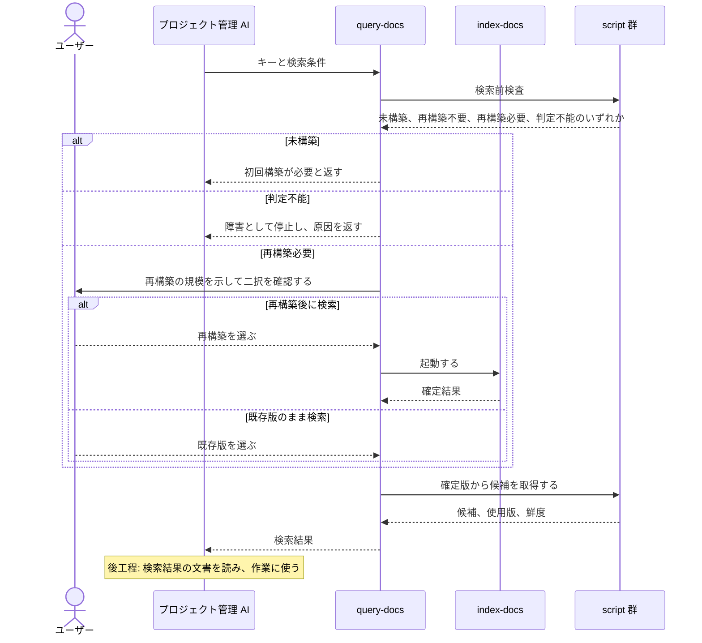
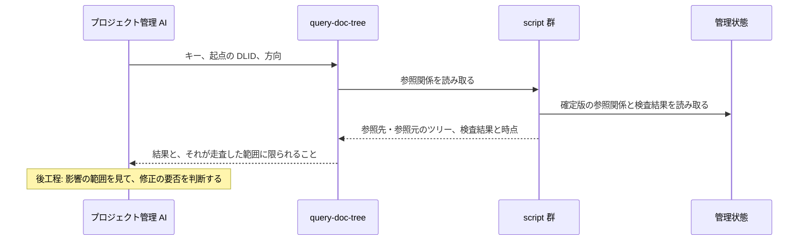
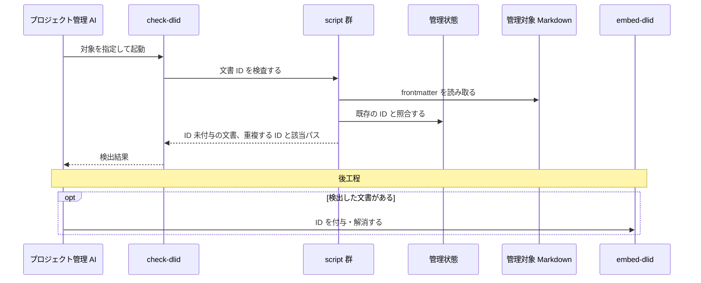
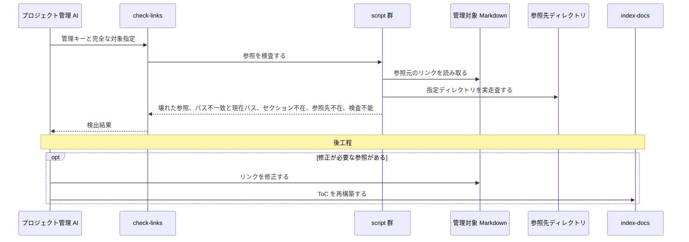
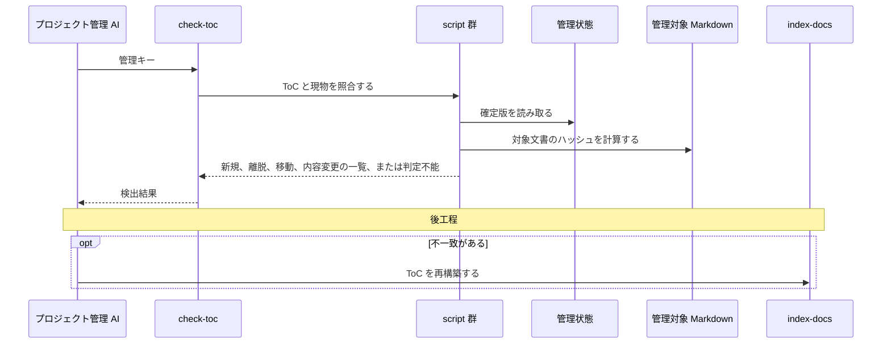
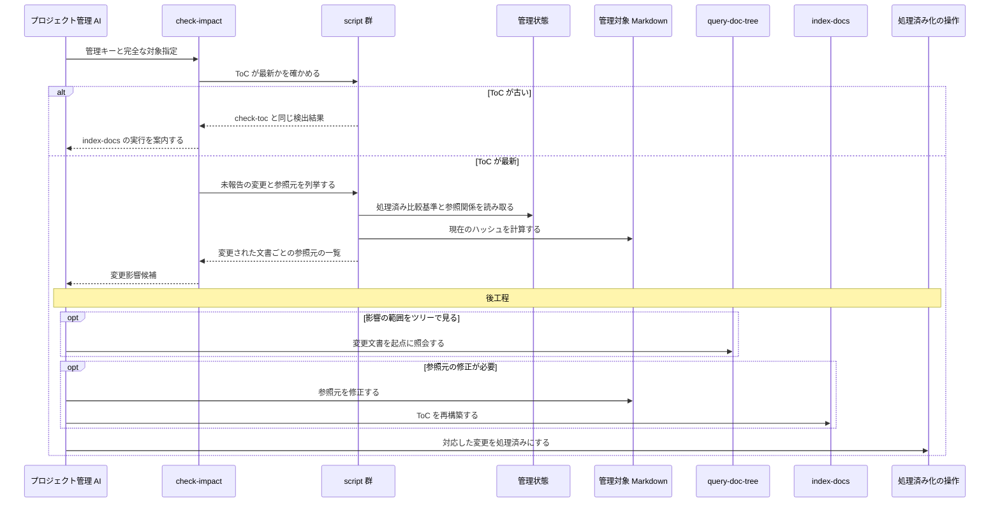

# DES-010 SKILL と Agent の構成

**状態**: Draft 0.1・未承認\
**更新日**: 2026-10-26\
**根拠**: [要件総論](../requirement/REQ-001-overview.md)、[実行主体](DES-002-execution-responsibilities.md)

## 1. 構成

doc-link は次の 8 つの SKILL と 1 つのカスタム Agent で構成する。SKILL はいずれも呼び出し元（プロジェクト管理 AI）のコンテキストで実行する継承型とする（[DES-002 §3](DES-002-execution-responsibilities.md)）。各 SKILL は処理を script に委ね、SKILL.md にロジックを書かない。

| SKILL            | 種類 | 管理対象 Markdown への書き込み | 管理状態の書き換え                     | 対応する要件                                                                                                                                 |
| ---------------- | ---- | ------------------------------ | -------------------------------------- | -------------------------------------------------------------------------------------------------------------------------------------------- |
| `embed-dlid`     | 操作 | あり（DLID だけ、要件 D-031）  | あり（ロック行）                       | [REQ-002 §9.2](../requirement/REQ-002-document-id.md#sec-9-2)、FR-001、FR-002、D-029、D-033〜D-035                                           |
| `index-docs`     | 操作 | なし（要件 D-035）             | あり（文書情報行、ToC の版、ロック行） | FR-017、[REQ-002 §9.1](../requirement/REQ-002-document-id.md#sec-9-1)、FR-003〜FR-005、FR-009、FR-010、FR-011、FR-012、D-036                 |
| `query-docs`     | 照会 | なし                           | なし                                   | [REQ-004 §12](../requirement/REQ-004-search.md#sec-12) FR-006                                                                                |
| `query-doc-tree` | 照会 | なし                           | なし                                   | [REQ-005 §13](../requirement/REQ-005-references.md#sec-13) FR-018                                                                            |
| `check-dlid`     | 検査 | なし                           | なし                                   | [REQ-005 §15](../requirement/REQ-005-references.md#sec-15) FR-016、[REQ-002 §9](../requirement/REQ-002-document-id.md#sec-9) FR-002          |
| `check-links`    | 検査 | なし                           | なし                                   | [REQ-005 §15](../requirement/REQ-005-references.md#sec-15) FR-016、[REQ-005 §13](../requirement/REQ-005-references.md#sec-13) FR-009         |
| `check-toc`      | 検査 | なし                           | なし                                   | [REQ-005 §15](../requirement/REQ-005-references.md#sec-15) FR-016、[REQ-003 §10](../requirement/REQ-003-toc.md#sec-10) FR-011                |
| `check-impact`   | 検査 | なし                           | なし                                   | [REQ-005 §14](../requirement/REQ-005-references.md#sec-14) FR-013〜FR-015、[REQ-005 §15](../requirement/REQ-005-references.md#sec-15) FR-016 |

検査の SKILL は検出して返すだけで、管理状態を書き換えない。変更影響候補を処理済みにする（処理済み比較基準を進める）操作をどこに置くかは U-024 で決める（§4）。

| カスタム Agent（名前は未定） | 責務                                                                                                                                                                                                                                                                                                                                   | 起動元       |
| ---------------------------- | -------------------------------------------------------------------------------------------------------------------------------------------------------------------------------------------------------------------------------------------------------------------------------------------------------------------------------------- | ------------ |
| 情報生成                     | 1 文書ずつ、目的・内容概要・適用作業・検索用キーワードを生成する。記述上限 `L` 以外の検証情報を持たない（要件: [REQ-003 §7.4](../requirement/REQ-003-toc.md#sec-7-4)、[REQ-003 §11.2.2](../requirement/REQ-003-toc.md#sec-11-2-2)／設計: [DES-002 §3](DES-002-execution-responsibilities.md)、[DES-008 §4](DES-008-content-rules.md)） | `index-docs` |

意味的な関連度を AI が判定する場合の検索 worker は、判定主体が未決のため置くかを決めていない（[DES-006 §2](DES-006-search.md)）。

### 1.1 操作と照会の SKILL の責務

`embed-dlid`

- 文書 ID の無い文書へ DLID を発行し、frontmatter に書き込む（要件: [REQ-002 §9.2](../requirement/REQ-002-document-id.md#sec-9-2)／設計: [DES-005 §2.1](DES-005-indexing.md)、[DES-008 §1](DES-008-content-rules.md)）
- 参照されている見出しと依頼された見出しへセクションの DLID を発行し、アンカー行を書き込む（要件: [REQ-005 §13.1](../requirement/REQ-005-references.md#sec-13-1)／設計: [DES-005 §2.1](DES-005-indexing.md)、[DES-008 §1](DES-008-content-rules.md)）
- 同じ ID を持つ文書が複数あるとき、原本の候補と判定根拠を利用者に示し、利用者が原本を確定した後、複製側に新しい ID を発行して書き込む（要件: [REQ-002 §9](../requirement/REQ-002-document-id.md#sec-9) FR-002／設計: [DES-005 §2.1](DES-005-indexing.md)）
- 既存文書の移行（全対象への ID 付与、セクションの DLID の発行、既存リンクの title への DLID の追加）（要件: [REQ-002 §9.2](../requirement/REQ-002-document-id.md#sec-9-2)、[REQ-001 §19](../requirement/REQ-001-overview.md#sec-19) D-034／設計: [DES-005 §2.1](DES-005-indexing.md)）

`index-docs`

- 対象を確定し、文書 ID を確認する。ID の無い文書と ID が重複する文書は ToC に入れずに報告する（要件: [REQ-002 §8](../requirement/REQ-002-document-id.md#sec-8)、[REQ-002 §9.1](../requirement/REQ-002-document-id.md#sec-9-1)／設計: [DES-005 §2](DES-005-indexing.md)）
- 確定版と現物の差分を検出する（要件: [REQ-003 §10](../requirement/REQ-003-toc.md#sec-10)／設計: [DES-005 §3](DES-005-indexing.md)）
- 生成が必要な文書だけ情報生成 Agent に依頼し、結果を検証する（要件: [REQ-003 §11.2.2](../requirement/REQ-003-toc.md#sec-11-2-2)、[REQ-003 §7.4](../requirement/REQ-003-toc.md#sec-7-4)／設計: [DES-005 §4・§5](DES-005-indexing.md)、[DES-008 §4](DES-008-content-rules.md)）
- 参照先ディレクトリを実走査して参照を検査する（要件: [REQ-005 §13](../requirement/REQ-005-references.md#sec-13)／設計: [DES-007 §1](DES-007-references-impact.md)）
- ToC の候補を検査し、一括して確定する（要件: [REQ-003 §11.2.4](../requirement/REQ-003-toc.md#sec-11-2-4)／設計: [DES-005 §4](DES-005-indexing.md)、[DES-004 §3](DES-004-state-machines.md)）

`query-docs`

- 検索前に再構築の要否を検査し、必要なら再構築の規模を示して利用者に二択を確認する（要件: [REQ-004 §12](../requirement/REQ-004-search.md#sec-12)／設計: [DES-006 §1](DES-006-search.md)）
- 確定版から文書を検索し、使用した版と鮮度を添えて返す（要件: [REQ-004 §12](../requirement/REQ-004-search.md#sec-12)／設計: [DES-006 §2・§3](DES-006-search.md)）

`query-doc-tree`

- 確定版の参照関係を、起点の文書またはセクションから順方向・逆方向にたどって返す。起点は任意の文書でも、`check-impact` が返した変更文書でもよい（要件: [REQ-005 §13](../requirement/REQ-005-references.md#sec-13) FR-018／設計: [DES-007 §2](DES-007-references-impact.md)）

### 1.2 検査の SKILL の責務

| SKILL          | 検出する状態                                                                                                                                                                                | 検出後にすべきこと（誰が、何で）                                                                                                                                                                                                                                       |
| -------------- | ------------------------------------------------------------------------------------------------------------------------------------------------------------------------------------------- | ---------------------------------------------------------------------------------------------------------------------------------------------------------------------------------------------------------------------------------------------------------------------- |
| `check-dlid`   | 文書 ID が無い。文書 ID が重複している                                                                                                                                                      | ユーザーまたはプロジェクト管理 AI が `embed-dlid` を実行する。重複は、示された候補から利用者が原本を確定する                                                                                                                                                           |
| `check-links`  | 壊れた参照。ID とパスの不一致。存在しないセクションへの参照。参照先ディレクトリに見つからない。参照先ディレクトリを検索できない                                                             | プロジェクト管理 AI がリンクを直す。パスの不一致には確認できた現在のパスが添えられる（FR-010）。参照先が見つからない場合は、移動か削除かをプロジェクト管理 AI が判断する。検索できない場合は、原因（権限など）を解消して再検査する。直した後は `index-docs` を実行する |
| `check-toc`    | ToC と実体ファイルの不一致（新規、離脱、移動、ToC に反映したハッシュと現在のハッシュの違い）                                                                                                | `index-docs` を実行する                                                                                                                                                                                                                                                |
| `check-impact` | 処理済みハッシュと現在のハッシュが違う文書（未報告の変更）と、ToC から把握できるその直接の参照元。ToC が最新であることが前提で、古ければ変更影響候補を返さずに `check-toc` と同じ結果を返す | プロジェクト管理 AI が、参照元の修正が必要かを判断し、必要なら直して `index-docs` を実行する。対応した変更を処理済みにする（U-024）。修正した参照元は、次の `check-impact` で新しい変更として現れる                                                                    |

検査ごとの根拠は次のとおり。

- `check-dlid`: 要件 [REQ-005 §15](../requirement/REQ-005-references.md#sec-15) FR-016、[REQ-002 §9](../requirement/REQ-002-document-id.md#sec-9) FR-002／設計 [DES-005 §2](DES-005-indexing.md)、[DES-008 §1](DES-008-content-rules.md)
- `check-links`: 要件 [REQ-005 §13](../requirement/REQ-005-references.md#sec-13) FR-009・FR-010、[REQ-005 §15](../requirement/REQ-005-references.md#sec-15) FR-016／設計 [DES-007 §1](DES-007-references-impact.md)
- `check-toc`: 要件 [REQ-003 §10](../requirement/REQ-003-toc.md#sec-10) FR-011、[REQ-005 §15](../requirement/REQ-005-references.md#sec-15) FR-016／設計 [DES-005 §3](DES-005-indexing.md)、[DES-006 §1](DES-006-search.md)。`query-docs` の検索前検査と同じ script を使う
- `check-impact`: 要件 [REQ-005 §14](../requirement/REQ-005-references.md#sec-14) FR-013〜FR-015、[REQ-003 §10.1.3](../requirement/REQ-003-toc.md#sec-10-1-3)／設計 [DES-007 §2・§3](DES-007-references-impact.md)

`check-impact` は、変更された文書の配列を返し、その要素ごとに直接の参照元の配列を持つ。セクションの DLID を指す参照元は、そのセクションが変わった場合だけ含める（要件 D-033）。参照元が無い変更は、参照元を空の配列にして返す（FR-014）。処理済みの単位は (変更された文書, 参照元) の組である（[DES-007 §3](DES-007-references-impact.md)）。間接の参照元を含めるかは U-008 で決める。

## 2. ユースケース

ユーザーは `embed-dlid` で重複する ID の原本を確定し、`query-docs` で再構築の二択を選ぶ。上位スキルは、検索の前に再構築が必要かを `check-toc` で判断できる。

## 3. SKILL ごとのシーケンス

各図の「後工程」は、SKILL の結果を受けてプロジェクト管理 AI が続けて行う作業を示す。

### 3.1 embed-dlid

対象の指定方法は U-022、書き込み前の承認は U-021、移行後に書かれたリンクへの title の DLID の追加は U-023 で決める。

### 3.2 index-docs

### 3.3 query-docs

検索の意味的な関連度を script と AI のどちらが判定するかは未決である（[DES-006 §2](DES-006-search.md)）。

### 3.4 query-doc-tree

### 3.5 check-dlid

### 3.6 check-links

### 3.7 check-toc

### 3.8 check-impact

「処理済み化の操作」をどの SKILL に置くかは U-024 で決める。

## 4. 未決事項

- U-024: 変更影響候補を処理済みにする操作の置き場所。現在の [DES-007 §3](DES-007-references-impact.md) は報告を返した時点で比較基準を進める設計であり、検査を読み取りだけにする本書の構成と食い違う。決定後に DES-007 §3 を直す
- `embed-dlid` の対象指定（U-022）、書き込み前の承認（U-021）、移行後に書かれたリンクへの title の DLID の追加（U-023）
- 間接依存をたどる深さ（U-008）。`query-doc-tree` と `check-impact` の両方に影響する
- 情報生成 Agent の名前
