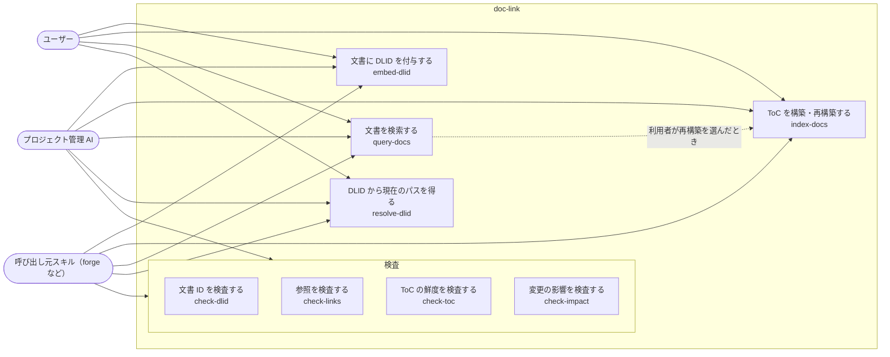
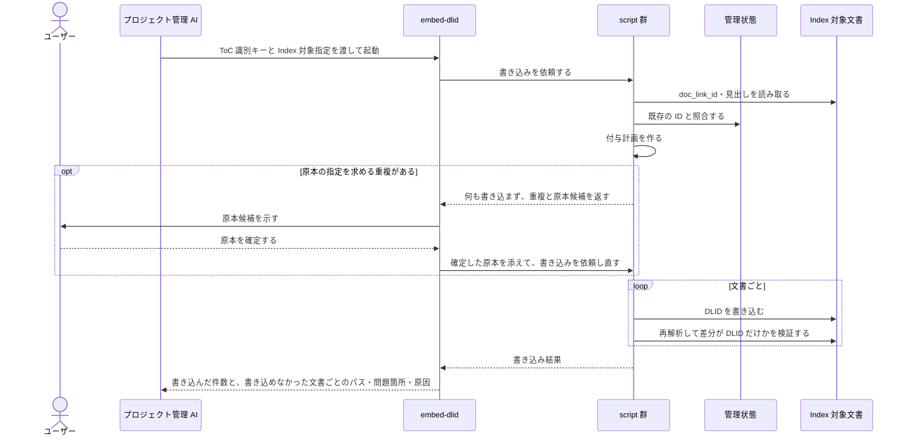
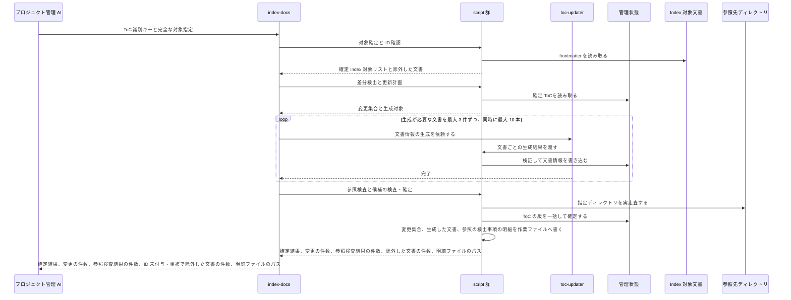
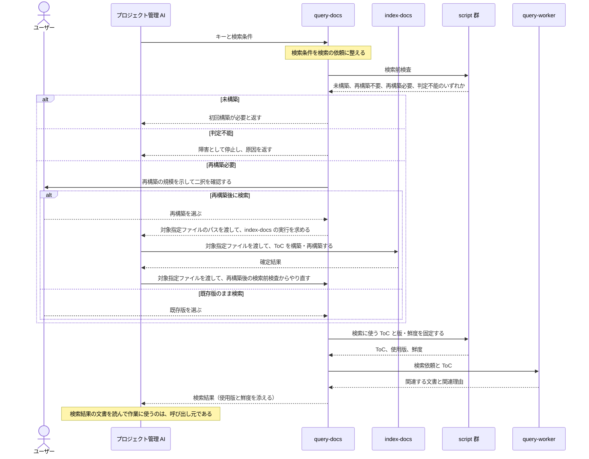
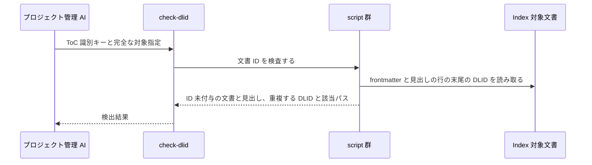
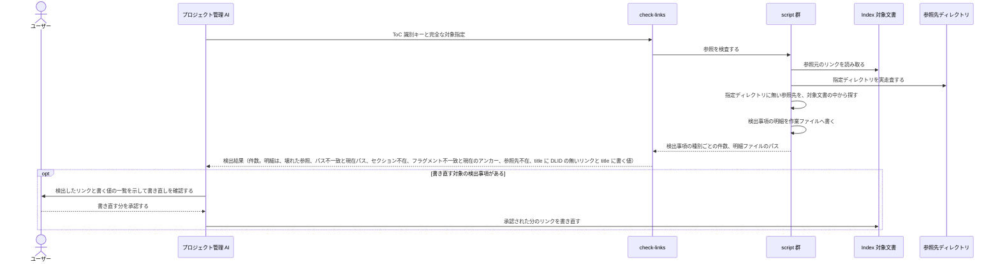
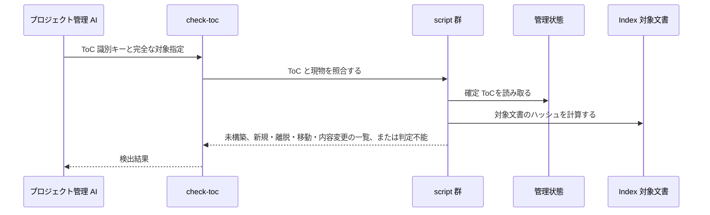
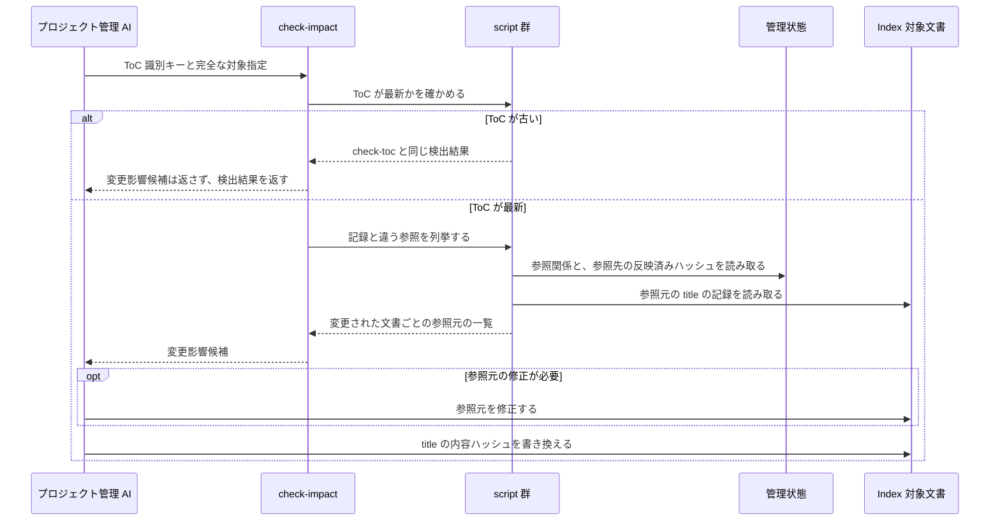
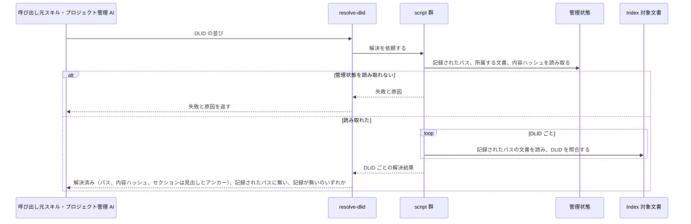

# DES-010 SKILL と Agent の構成 DLID-gf7dehdq4tpd

<a id="sec-1"></a>

## 1. 構成 DLID-154xfxg7rkzy

doc-link は次の 8 つの SKILL と 2 つのカスタム Agent で構成する。SKILL はいずれも呼び出し元（[プロジェクト管理 AI]）のコンテキストで実行する継承型とする（[DES-002 §3][des-002-sec-3]）。各 SKILL は処理を script に委ね、SKILL.md にロジックを書かない。

| SKILL          | 種類 | [Index 対象文書]への書き込み                      | 管理状態の書き換え            | 対応する要件                                                                                                                                                                                                          |
| -------------- | ---- | ------------------------------------------------- | ----------------------------- | --------------------------------------------------------------------------------------------------------------------------------------------------------------------------------------------------------------------- |
| `embed-dlid`   | 操作 | あり（[DLID]だけ、要件 [D-031][req-001-nfr-004]） | なし                          | [REQ-002 §9.2][req-002-sec-9-2]、[FR-001][req-002-fr-001]、[FR-002][req-002-fr-002]、[D-033][req-005-sec-13-1]                                                                                                        |
| `index-docs`   | 操作 | なし（要件 [D-035][req-002-fr-001]）              | あり（[文書情報]、[ToC]の版） | [FR-017][req-002-fr-017]、[REQ-002 §9.1][req-002-sec-9-1]、[FR-003][req-003-fr-003]〜[FR-005][req-003-fr-005]、[FR-009][req-005-fr-009]、[FR-010][req-005-fr-010]、[FR-011][req-003-fr-011]、[FR-012][req-003-fr-012] |
| `query-docs`   | 照会 | なし                                              | なし                          | [FR-006][req-004-fr-006]                                                                                                                                                                                              |
| `resolve-dlid` | 照会 | なし                                              | なし                          | [FR-018][req-002-fr-018]                                                                                                                                                                                              |
| `check-dlid`   | 検査 | なし                                              | なし                          | [FR-016][req-005-fr-016]、[FR-002][req-002-fr-002]                                                                                                                                                                    |
| `check-links`  | 検査 | なし                                              | なし                          | [FR-016][req-005-fr-016]、[FR-009][req-005-fr-009]                                                                                                                                                                    |
| `check-toc`    | 検査 | なし                                              | なし                          | [FR-016][req-005-fr-016]、[FR-011][req-003-fr-011]                                                                                                                                                                    |
| `check-impact` | 検査 | なし                                              | なし                          | [FR-013][req-005-fr-013]〜[FR-015][req-005-fr-015]、[FR-016][req-005-fr-016]                                                                                                                                          |

検査の SKILL は検出して返し、管理状態を書き換える SKILL はない。`check-impact` も書き換えない（要件 [D-038][req-005-fr-015]、[DES-007 §3][des-007-sec-3]）。

| カスタム Agent            | 責務                                                                                                                                                                                                                                                                                                                                                                                                                                  | 起動元       |
| ------------------------- | ------------------------------------------------------------------------------------------------------------------------------------------------------------------------------------------------------------------------------------------------------------------------------------------------------------------------------------------------------------------------------------------------------------------------------------- | ------------ |
| `toc-updater`（情報生成） | 1 回の起動で同じディレクトリの最大 3 文書を受け持ち（同じディレクトリの文書は内容が関連していることが多く、関連する文書をまとめて読むほうが Agent の効率が高いため）、文書ごとに独立して、目的・内容概要・適用作業・検索用キーワードを生成する。記述上限 `L` 以外の検証情報を持たない（要件: [REQ-003 §7.4][req-003-sec-7-4]、[REQ-003 §11.2.2][req-003-sec-11-2-2]／設計: [DES-002 §3][des-002-sec-3]、[DES-008 §4][des-008-sec-4]） | `index-docs` |
| `query-worker`（検索）    | [確定 ToC]の[ToC]全体を読んで、タスクに関連する文書を選び、関連理由とともに返す。読み取り専用で、存在しない ID を補わず、[ToC]と管理状態を変更しない（要件: [FR-006][req-004-fr-006]／設計: [DES-006 §2][des-006-sec-2]）                                                                                                                                                                                                             | `query-docs` |

<a id="sec-1-1"></a>

### 1.1 操作と照会の SKILL の責務 DLID-qd4t2gvpvqfw

`embed-dlid`

- [文書 ID]の無い文書へ[DLID]を発行し、frontmatter に書き込む（要件: [REQ-002 §9.2][req-002-sec-9-2]／設計: [DES-005 §2.1][des-005-sec-2-1]、[DES-008 §1][des-008-sec-1]）
- [セクション ID]を持たないすべての見出しへ[セクション ID]を発行し、見出しの行の末尾に書き込む（要件: [REQ-005 §13.1][req-005-sec-13-1]／設計: [DES-005 §2.1][des-005-sec-2-1]、[DES-008 §1][des-008-sec-1]）
- 同じ ID を持つ文書が複数あるとき、原本の候補を利用者に示し、利用者が原本を確定した後、複製側に新しい ID を発行して書き込む（要件: [FR-002][req-002-fr-002]／設計: [DES-005 §2.1][des-005-sec-2-1]）
- リンクとその title は書き換えない。既存文書の移行も、全対象への[文書 ID]の付与と[セクション ID]の発行だけで行う（要件: [REQ-002 §9.2][req-002-sec-9-2]、[D-042][req-005-fr-016]／設計: [DES-005 §2.1][des-005-sec-2-1]）

`index-docs`

- 対象を確定し、[文書 ID]を確認する。ID の無い文書と ID が重複する文書は[ToC]に入れずに報告する（要件: [REQ-002 §8][req-002-sec-8]、[REQ-002 §9.1][req-002-sec-9-1]／設計: [DES-005 §2][des-005-sec-2]）
- [確定 ToC]と現物の差分を検出する（要件: [REQ-003 §10][req-003-sec-10]／設計: [DES-005 §3][des-005-sec-3]）
- 生成が必要な文書だけ `toc-updater` に依頼し、結果を検証する（要件: [REQ-003 §11.2.2][req-003-sec-11-2-2]、[REQ-003 §7.4][req-003-sec-7-4]／設計: [DES-005 §4][des-005-sec-4]・[§5][des-005-sec-5]、[DES-008 §4][des-008-sec-4]）
- 参照先ディレクトリを実走査して参照を検査する（要件: [REQ-005 §13][req-005-sec-13]／設計: [DES-007 §1][des-007-sec-1]）
- [ToC]の候補を検査し、一括して確定する（要件: [REQ-003 §11.2.4][req-003-sec-11-2-4]／設計: [DES-005 §4][des-005-sec-4]、[DES-004 §3][des-004-sec-3]）

`query-docs`

- 検索前に再構築の要否を検査し、必要なら再構築の規模を示して利用者に二択を確認する（要件: [REQ-004 §12][req-004-sec-12]／設計: [DES-006 §1][des-006-sec-1]）
- [確定 ToC]から文書を検索し、使用した版と鮮度を添えて返す（要件: [REQ-004 §12][req-004-sec-12]／設計: [DES-006 §2][des-006-sec-2]）

`resolve-dlid`

- 渡された[DLID]ごとに、管理状態に記録されたパスを、その文書が今もその[DLID]を持つことを確かめてから返す。[セクション ID]には見出しとアンカーを添える。確かめられない[DLID]には記録されたパスに無いことを、記録の無い[DLID]にはそのことを返す。解決済みには、記録した[内容ハッシュ]を添える（要件: [FR-018][req-002-fr-018]／設計: [DES-006 §3][des-006-sec-3]）

<a id="sec-1-2"></a>

### 1.2 検査の SKILL の責務 DLID-h9bg56gdypm5

| SKILL          | 検出する状態                                                                                                                                                                                                                                                                                  | 検出事項の扱い（誰が、何で）                                                                                                                                                                                                                                                                                                                                                                                                                                                                                                                                                                                                                                                                                                                                                                                                                                                                                                             |
| -------------- | --------------------------------------------------------------------------------------------------------------------------------------------------------------------------------------------------------------------------------------------------------------------------------------------- | ---------------------------------------------------------------------------------------------------------------------------------------------------------------------------------------------------------------------------------------------------------------------------------------------------------------------------------------------------------------------------------------------------------------------------------------------------------------------------------------------------------------------------------------------------------------------------------------------------------------------------------------------------------------------------------------------------------------------------------------------------------------------------------------------------------------------------------------------------------------------------------------------------------------------------------------- |
| `check-dlid`   | [文書 ID]が無い。[セクション ID]の無い見出しがある。[文書 ID]または[セクション ID]が重複している（[セクション ID]は同じ文書の中を含む）                                                                                                                                                       | 検出して返すだけで、付与は行わない。付与は `embed-dlid` が行う（要件 [D-040][req-002-sec-9-2]、[D-057][req-001-sec-3-1]）                                                                                                                                                                                                                                                                                                                                                                                                                                                                                                                                                                                                                                                                                                                                                                                                                |
| `check-links`  | 壊れた参照。ID とパスの不一致。存在しないセクションへの参照。フラグメントが参照先のセクションへ解決しないリンク。参照先ディレクトリに見つからない。`doc_link_id` を持つ Markdown を指しているが title に[DLID]の無いリンク。[DLID]入りの title を持つが、リファレンスリンクの定義でないリンク | [プロジェクト管理 AI]は、書き直す前に、一覧（文書・行・書く値）を利用者に示して、書き直すかを確認する（要件 [D-057][req-001-sec-3-1]）。承認された分について、title に[DLID]の無いリンクには、検出事項に添えられた値（参照先の[内容ハッシュ]と[DLID]。[DES-007 §1][des-007-sec-1]）を、[プロジェクト管理 AI]が title に書く。インラインリンクは、リファレンスリンクの定義に書き換える。[プロジェクト管理 AI]がリンクを直す。パスの不一致には確認できた現在のパスが添えられる。別のディレクトリへ移動した文書も、今回の対象文書の中にあれば、パスの不一致として現在のパスが添えられる（[FR-010][req-005-fr-010]）。フラグメント不一致には、そのセクションへ届く現在のアンカーが添えられる（[FR-009][req-005-fr-009]）。参照先が見つからない場合は、今回の対象文書の中に無い。対象の外へ移動したのか、削除したのかを[プロジェクト管理 AI]が判断する。対象に[文書 ID]の無い文書があるときは、参照の検査が不完全であることを、警告として返す |
| `check-toc`    | [ToC]が無い（未構築）。[ToC]と実体ファイルの不一致（新規、離脱、移動、参照の違い、[ToC]に反映したハッシュと[現在ハッシュ]の違い。参照の違いは、参照元の位置・参照先の[DLID]・リンク先のパスで比べ、title の[内容ハッシュ]は比べない）                                                         | 検出して返すだけで、再構築は行わない                                                                                                                                                                                                                                                                                                                                                                                                                                                                                                                                                                                                                                                                                                                                                                                                                                                                                                     |
| `check-impact` | 参照元の title に記録した[内容ハッシュ]が、参照先の[現在ハッシュ]と異なる参照（記録が無い参照を含む）と、[ToC]から把握できるその参照元。[ToC]が最新であることが前提で、古ければ変更影響候補を返さずに `check-toc` と同じ結果を返す                                                            | [プロジェクト管理 AI]が、参照元の修正が必要かを判断し、必要なら直す。確かめたあと、参照元の title の[内容ハッシュ]を書き換える。書き換えるまで、同じ参照が次の `check-impact` でも返る。修正した参照元を参照する文書は、次の `check-impact` で新しい変更として現れる                                                                                                                                                                                                                                                                                                                                                                                                                                                                                                                                                                                                                                                                     |

検査の SKILL は、標準出力に件数までを返し、検出事項・変更のある文書とセクション・変更影響候補の全件は、作業ファイル（`.temp/doc-link/<SKILL の名前>/`）へ書いて、その絶対パスを返す。SKILL は、報告と修正に要る分だけ、そのファイルを読む（要件 [D-061][req-005-fr-016]、[DES-007 §4][des-007-sec-4]）。検査の SKILL が書くのは、この作業ファイルだけである。

検査ごとの根拠は次のとおり。

- `check-dlid`: 要件[FR-016][req-005-fr-016]、[FR-002][req-002-fr-002]／設計[DES-005 §2][des-005-sec-2]、[DES-008 §1][des-008-sec-1]
- `check-links`: 要件[FR-009][req-005-fr-009]・[FR-010][req-005-fr-010]、[FR-016][req-005-fr-016]／設計[DES-007 §1][des-007-sec-1]
- `check-toc`: 要件[FR-011][req-003-fr-011]、[FR-016][req-005-fr-016]／設計[DES-005 §3][des-005-sec-3]、[DES-006 §1][des-006-sec-1]。`query-docs` の検索前検査と同じ script を使い、渡された完全な対象指定を保存済みの指定より優先する（要件 [FR-006][req-004-fr-006]、[FR-016][req-005-fr-016]）
- `check-impact`: 要件[FR-013][req-005-fr-013]〜[FR-015][req-005-fr-015]／設計[DES-007 §2][des-007-sec-2]・[§3][des-007-sec-3]

`check-impact` は、title の記録と参照先の[現在ハッシュ]が異なる参照を、変更された文書ごとにまとめて返す。

- 変更された文書の配列を返し、その要素ごとに直接の参照元の配列を持つ。
- 各参照元に、title に記録した[内容ハッシュ]（記録なしを含む）と、参照先の[現在ハッシュ]を添える。
- [セクション ID]を指す参照元は、そのセクションの範囲の[現在ハッシュ]と比べる（要件 [D-033][req-005-sec-13-1]）。
- 異なる参照が無いときは、空の配列と検査範囲を返す（[FR-014][req-005-fr-014]）。
- 間接の参照元は含めない。参照元を直すと、その参照元が次の `check-impact` で変更として現れるので、間接的な影響は 1 段ずつ検出される（要件 [D-043][req-005-fr-013]）。
- 通知の状態は持たない。比べる基準は、参照元の title の記録だけである（[DES-007 §3][des-007-sec-3]）。

<a id="sec-2"></a>

## 2. ユースケース DLID-6tfvncts0q8x



ユーザーは `embed-dlid` で重複する ID の原本を確定し、`query-docs` で再構築の二択を選ぶ。検査の SKILL は、[プロジェクト管理 AI]と呼び出し元スキルのどちらからも呼び出せる。呼び出し元スキルは呼び出し元のコンテキストで実行されるので、検査の結果は同じ[プロジェクト管理 AI]に届く。たとえば呼び出し元スキルは、検索の前に再構築が必要かを `check-toc` で判断できる。呼び出し元スキルは文書を[DLID]で記録しておき、読む時点で `resolve-dlid` から現在のパスを得る。

<a id="sec-3"></a>

## 3. SKILL ごとのシーケンス DLID-av4127n5ws5j

各 SKILL は自分の処理だけを行い、次の SKILL の実行を促さない（要件 [D-057][req-001-sec-3-1]）。SKILL をどの順に使うかは、§3.9 の流れが定める。

<a id="sec-3-1"></a>

### 3.1 embed-dlid DLID-z9j2ys29jx12

起動を書き込みの承認とし、重複する ID の原本の確定以外では利用者に確認しない（要件 [D-040][req-002-sec-9-2]）。対象は `index-docs` と同じ[ToC 識別キー]と[Index 対象指定]で決める（要件 [D-041][req-002-sec-9-2]）。



書き込むか、原本の確定を求めて止まるかは、script が決める。SKILL は、script の終了コードに従い、付与計画の内容を読んで書き込みへ進むかを判断しない。原本の指定を求める重複があるとき、script は何も書き込まずに終え（[DES-004 §5][des-004-sec-5] の E-06）、SKILL が原本を添えて依頼し直す（同 E-07）。

<a id="sec-3-2"></a>

### 3.2 index-docs DLID-ryhengxjsv39

SKILL は入口の script を 1 本だけ呼ぶ。入口の script は段階を進め、次に SKILL が行うこと（`toc-updater` の起動、起動した Agent の完了の待機、完了、エラー）を返す。SKILL はそれに従って動き、終えたら入口の script を再び呼ぶ。図の「script 群」は入口の script とその下の script を指す。`toc-updater` は、1 回の起動で最大 3 文書を受け持たせ、同時に最大 10 本を走らせる。この SKILL の前に行う工程（`check-dlid`・`embed-dlid`・`check-links`）は、§3.9 のとおり、[プロジェクト管理 AI]が `index-docs` の手順 0 として行う。



完了結果は、標準出力に判断に要る項目と件数だけを持ち、変更集合（除外した文書を含む）、生成した文書、一致以外の参照の検出事項の全件は、作業ファイル（`.temp/doc-link/index-docs/`）に置く。SKILL は、明細が要るときだけ、そのファイルを読む（要件 [D-059][req-003-sec-11-2-4]、[DES-005 §4][des-005-sec-4]）。

<a id="sec-3-3"></a>

### 3.3 query-docs DLID-88bfc282eve1

SKILL は、親の作業の指示をそのまま `query-worker` に渡さず、検索のタスクと考慮する観点に整えて渡す。親の指示に実装や編集の依頼が含まれていても、検索の依頼としてだけ渡す。



<a id="sec-3-4"></a>

### 3.4 check-dlid DLID-sxtd5pf1atkb



検査できなかった対象（読めないディレクトリ、存在しない指定、固定除外の名前のディレクトリの指定）があるときは、検出事項が無くても、検査できなかった対象を報告し、結果の `clean` を偽にする（要件 [D-054][req-002-fr-002]）。

<a id="sec-3-5"></a>

### 3.5 check-links DLID-nwn04tk644ex



<a id="sec-3-6"></a>

### 3.6 check-toc DLID-20xt1fpqm1k7



<a id="sec-3-7"></a>

### 3.7 check-impact DLID-1nny3y551m4v



`check-impact` は、変更影響候補を返したあとの動きを、[プロジェクト管理 AI]に次のとおり指示する。判断・修正・title の[内容ハッシュ]の書き換えは[プロジェクト管理 AI]が行い、script は行わない（要件 [FR-014][req-005-fr-014]、[D-031][req-001-nfr-004]）。

- 参照元ごとに、変更箇所と参照元の該当記述を読み、参照元の修正が必要かを判断する。
- 必要なら、参照元を直す。
- 判断の結果（参照元ごとの、修正の要否と根拠）を、報告に残す。
- 確かめた参照の title に、参照先の[現在ハッシュ]を書く。値は `check-impact` が返したものを使う。
- 確かめていない参照の title は、書き換えない。読まずに一括で書き換えない。読まずに書き換えると、その参照の通知が消え、変更の検出が意味を失う。
- 書いたあとは、`check-impact` をもう一度実行する。
- 報告が空になるまで、これを繰り返す。

<a id="sec-3-8"></a>

### 3.8 resolve-dlid DLID-venmkyh8532z



[プロジェクト管理 AI]が参照を書くときは、次の順で行う。

- 参照先を含む[ToC 識別キー]で `check-toc` を実行する。古ければ、`index-docs` を実行する。
- `resolve-dlid` で、参照先の[DLID]のパスと[内容ハッシュ]を得る。
- リファレンスリンクの定義の title に、`"<内容ハッシュ> DLID-…"` を書く。
- 参照の行を足したときは、参照元の本文が変わるので、`index-docs` を実行する。
- title の[内容ハッシュ]だけを書き換えたときは、参照元の[内容ハッシュ]が変わらないので、`index-docs` は要らない。

<a id="sec-3-9"></a>

### 3.9 運用の流れ（導入と変更後で共通） DLID-7abvxracbbba

要件 [D-057][req-001-sec-3-1] の流れを、通しの図で示す。この流れは `index-docs` を起点とし、[プロジェクト管理 AI]が `index-docs` の手順 0 として行う。各 SKILL の動きは §3.1〜§3.8 に従い、各 SKILL は次の SKILL の実行を促さない。導入は、この流れの初回である。変更後も、毎回 `check-dlid` から行う。[DLID]の無い文書は[ToC]に入らず、検索と参照の対象から外れるためである。

```mermaid
sequenceDiagram
    actor User as ユーザー
    participant PM as プロジェクト管理 AI
    participant Check as check-dlid
    participant Embed as embed-dlid
    participant Links as check-links
    participant Docs as Index 対象文書
    participant Index as index-docs
    participant Impact as check-impact

    PM->>Check: DLID を検査する
    Check-->>PM: ID 未付与の文書と見出し、重複
    opt 検出がある
        PM->>Embed: 起動する（起動が書き込みの承認）
        Embed-->>PM: 書き込んだ件数
    end
    PM->>Links: 参照を検査する
    Links-->>PM: 検出事項と、title に書く値
    opt 書き直す対象の検出事項がある
        PM->>User: 検出したリンクと書く値の一覧を示して書き直しを確認する
        User-->>PM: 書き直す分を承認する
        PM->>Docs: 承認された分のリンクを書き直す
    end
    PM->>Index: ToC を構築・更新する
    Index-->>PM: 確定結果、変更の件数、参照検査結果の件数、除外した文書の件数、明細ファイルのパス
    PM->>Impact: 変更の影響を検査する
    Impact-->>PM: 変更影響候補
    opt 参照元の本文を直す
        PM->>Docs: 参照元を修正する
        Note over PM: DLID の検査からやり直す
    end
```

`check-links` を `index-docs` の前に置くのは、title に書く値が参照先の現物から決まり、`check-links` が[ToC]を読まないためである。`check-impact` を `index-docs` の後に置くのは、最新の[ToC]を前提とするためである。参照元の本文を直すと[ToC]が古くなるので、DLID の検査からやり直す。title の[内容ハッシュ]だけを書いたときは、参照元の[内容ハッシュ]が変わらないので、やり直さない。検出が無いときは、`embed-dlid` と書き直しは行わない。

<a id="sec-4"></a>

## 4. カスタム Agent との受け渡し DLID-ytajmhsv2p1t

SKILL とカスタム Agent の間の依頼と結果は、[Agent とのデータ受け渡し規約][exchange-rules]に従う。運ぶのは script が生成した識別値だけで、置き場は `.temp/doc-link/<skill>/` の下で、識別値から script が決める（[DES-002 §4][des-002-sec-4]）。依頼と結果は script が書き、書き終えてから公開する。結果は Agent が値を script へ渡し、script が書く。読む側は script から絶対パスを受け取って直接読む。終了の値は文字列で、正常は `"0"` とする。成否は script が判定する。処理が終わったら、依頼と結果を削除する。

| 項目                               | `toc-updater`（情報生成）                                                                                                                         | `query-worker`（検索）                                                                                         |
| ---------------------------------- | ------------------------------------------------------------------------------------------------------------------------------------------------- | -------------------------------------------------------------------------------------------------------------- |
| 識別値                             | 構築 ID と[文書 ID]の並び（最大 3）                                                                                                               | 検索 ID                                                                                                        |
| 依頼                               | 対象文書の絶対パス、フィールドごとの記述上限 `L`（要件 [D-044][req-003-sec-7-4]）。内部許容上限 `H` は含めない（要件 [NFR-008][req-001-nfr-008]） | 検索のタスク、[ToC 識別キー]、検索に使う版で固定した[ToC]の写しの絶対パス（中身は[DES-006 §2][des-006-sec-2]） |
| 結果                               | 目的、内容概要、適用される作業、検索用キーワード。見出しから取得できない場合はタイトル                                                            | 関連する文書の[文書 ID]、関連理由、必要なら[セクション ID]の並び                                               |
| エラー値                           | `"source_unreadable"`（対象文書を読めなかった）                                                                                                   | なし（空集合）                                                                                                 |
| script の検査                      | `L`・`H` による長さの検証（[DES-008 §4][des-008-sec-4]）                                                                                          | 返った[文書 ID]と[セクション ID]が、固定した[ToC]の版にあること。無い ID を含む結果は異常とする                |
| 終了の値が無い、または定義外のとき | その文書の生成を失敗とし、B-04 の失敗として扱う（[DES-004 §3][des-004-sec-3]）                                                                    | 検索を失敗として返す                                                                                           |
| 削除する時点                       | [文書情報]を確定した後、または構築の終了時                                                                                                        | `query-docs` が結果を返した後                                                                                  |

[req-002-sec-9-2]: ../requirement/REQ-002_document-id.md#92-dlid-付与操作-dlid-mkcvqte59nvc "72f09c754e09 DLID-mkcvqte59nvc"
[req-002-sec-9-1]: ../requirement/REQ-002_document-id.md#91-文書-id確認処理-dlid-5ht9ebyeq2m3 "b6c21c9348ef DLID-5ht9ebyeq2m3"
[req-004-sec-12]: ../requirement/REQ-004_search.md#12-文書検索-dlid-r6j09pswcpzg "a08a148593ee DLID-r6j09pswcpzg"
[req-005-sec-13]: ../requirement/REQ-005_references.md#13-文書参照とリンク検査-dlid-9nc60w1jj966 "01fe597df344 DLID-9nc60w1jj966"
[req-003-sec-10]: ../requirement/REQ-003_toc.md#10-既存tocとの比較による変更検出-dlid-djxbs1zd8bwk "53e14e5297d5 DLID-djxbs1zd8bwk"
[req-003-sec-7-4]: ../requirement/REQ-003_toc.md#74-ai-生成フィールドの上限-dlid-afs68x15mq0n "2cdcc9befbb7 DLID-afs68x15mq0n"
[req-003-sec-11-2-2]: ../requirement/REQ-003_toc.md#1122-文書情報の取得と生成-dlid-6vjpqdstr90y "e4f7a9b2bfde DLID-6vjpqdstr90y"
[req-005-sec-13-1]: ../requirement/REQ-005_references.md#131-セクション参照-dlid-5p5ms6a74w73 "275305521655 DLID-5p5ms6a74w73"
[req-002-sec-8]: ../requirement/REQ-002_document-id.md#8-index-対象リストの確定-dlid-ephpayqvh78w "f461017b2e2b DLID-ephpayqvh78w"
[req-003-sec-11-2-4]: ../requirement/REQ-003_toc.md#1124-toc-候補の検査と確定-dlid-3mhrvbx44c87 "51b57b11c1e5 DLID-3mhrvbx44c87"
[des-002-sec-3]: DES-002_execution-responsibilities.md#3-skill-と-script-の接続規則-dlid-gjwba2n3mq4v "02a83129fff4 DLID-gjwba2n3mq4v"
[des-008-sec-4]: DES-008_content-rules.md#4-ai-生成フィールド-dlid-7et3ryybpbag "f67ca1c840f3 DLID-7et3ryybpbag"
[des-006-sec-2]: DES-006_search.md#2-検索結果の契約-dlid-p07g3hc4e4xd "35de75ac8391 DLID-p07g3hc4e4xd"
[des-006-sec-3]: DES-006_search.md#3-dlidの解決-dlid-m0xegzfyhc3k "fb28459057a6 DLID-m0xegzfyhc3k"
[des-005-sec-2-1]: DES-005_indexing.md#21-dlid-付与操作-dlid-kxx8fczbwref "ece4ef428c71 DLID-kxx8fczbwref"
[des-008-sec-1]: DES-008_content-rules.md#1-文書-idの読取りと書込み-dlid-cf1n0ndmf0fe "e07d05aa8a87 DLID-cf1n0ndmf0fe"
[des-005-sec-2]: DES-005_indexing.md#2-対象確定id-確認と-dlid-付与-dlid-6b3d2nqzpw75 "2ff63793a51e DLID-6b3d2nqzpw75"
[des-005-sec-3]: DES-005_indexing.md#3-変更集合の確定-dlid-ext9ze054hbx "e029f74cd706 DLID-ext9ze054hbx"
[des-005-sec-4]: DES-005_indexing.md#4-必要情報の取得と候補確定-dlid-dfsegbf7p2q9 "66dfc8d142d0 DLID-dfsegbf7p2q9"
[des-005-sec-5]: DES-005_indexing.md#5-書き込みの単位-dlid-hs82xgzwkpyz "4603909aaf60 DLID-hs82xgzwkpyz"
[des-007-sec-1]: DES-007_references-impact.md#1-正式な参照と検査根拠-dlid-pnrn5dyy7z05 "d84f6c33a9b5 DLID-pnrn5dyy7z05"
[des-004-sec-3]: DES-004_state-machines.md#3-toc構築再構築の実行-dlid-kz06g0w7tsvs "91ae910ea5fe DLID-kz06g0w7tsvs"
[des-004-sec-5]: DES-004_state-machines.md#5-dlid-付与操作の実行-dlid-evgp45p8prf7 "5d6774d493ed DLID-evgp45p8prf7"
[des-006-sec-1]: DES-006_search.md#1-検索前の判定-dlid-ksmh21dbz9zv "d132e95cb3bd DLID-ksmh21dbz9zv"
[des-007-sec-2]: DES-007_references-impact.md#2-逆参照と影響候補-dlid-9chw5bzdm8zm "d3a292622d95 DLID-9chw5bzdm8zm"
[des-007-sec-3]: DES-007_references-impact.md#3-変更影響候補の通知-dlid-mjeyc85ak4w3 "c3fe2a03c6cb DLID-mjeyc85ak4w3"
[exchange-rules]: ../../rules/agent_data_exchange_rules.md "590998804bef DLID-2g3cgnnry3bm"
[des-002-sec-4]: DES-002_execution-responsibilities.md#4-保留と後続設計-dlid-8ck587eq1qnd "758e6778944d DLID-8ck587eq1qnd"
[req-001-nfr-008]: ../requirement/REQ-001_overview.md#nfr-008-生成指示と検証基準の分離-dlid-fc5e4s6nctp9 "7c7778285762 DLID-fc5e4s6nctp9"
[req-002-fr-001]: ../requirement/REQ-002_document-id.md#fr-001-文書-idの発行と読み取り-dlid-z0g4zx0wr0cn "594d2964b515 DLID-z0g4zx0wr0cn"
[req-002-fr-002]: ../requirement/REQ-002_document-id.md#fr-002-文書-idの検証-dlid-edwjjf150svm "6de27aa96e79 DLID-edwjjf150svm"
[req-002-fr-017]: ../requirement/REQ-002_document-id.md#fr-017-toc-識別キーとindex-対象指定の受領-dlid-3wc02prwb6x7 "0292868ab4b5 DLID-3wc02prwb6x7"
[req-002-fr-018]: ../requirement/REQ-002_document-id.md#fr-018-dlidの解決-dlid-8vajyevfatkv "cf5307ccef85 DLID-8vajyevfatkv"
[req-003-fr-003]: ../requirement/REQ-003_toc.md#fr-003-文書の移動改名の認識-dlid-grzqdx81bakh "5e0072a4ce7a DLID-grzqdx81bakh"
[req-003-fr-005]: ../requirement/REQ-003_toc.md#fr-005-文書情報の生成-dlid-65nf6n2jax82 "47be50aa7f05 DLID-65nf6n2jax82"
[req-003-fr-011]: ../requirement/REQ-003_toc.md#fr-011-文書全体の変更検出-dlid-a7nqc4aq8zwb "c8d953d1fad0 DLID-a7nqc4aq8zwb"
[req-003-fr-012]: ../requirement/REQ-003_toc.md#fr-012-セクション単位の変更検出-dlid-8kfhte6q4ywd "d342c3bdcb5c DLID-8kfhte6q4ywd"
[req-004-fr-006]: ../requirement/REQ-004_search.md#fr-006-文書検索-dlid-481cwc8365a3 "5b1ed8d54266 DLID-481cwc8365a3"
[req-005-fr-009]: ../requirement/REQ-005_references.md#fr-009-id-付きリンクの検査-dlid-zacf5tmy6x4x "2351b357da12 DLID-zacf5tmy6x4x"
[req-005-fr-010]: ../requirement/REQ-005_references.md#fr-010-参照パス修正情報の通知-dlid-ev07yszprm9m "52b105d38cac DLID-ev07yszprm9m"
[req-005-fr-013]: ../requirement/REQ-005_references.md#fr-013-変更影響候補の特定-dlid-cnw6h5pzv3wz "6af5f019bff6 DLID-cnw6h5pzv3wz"
[req-005-fr-014]: ../requirement/REQ-005_references.md#fr-014-変更影響候補の通知-dlid-j0z4w1wm0g4p "6a036ff75fc1 DLID-j0z4w1wm0g4p"
[req-005-fr-015]: ../requirement/REQ-005_references.md#fr-015-変更報告の管理-dlid-8btcs80840gr "c1135544f245 DLID-8btcs80840gr"
[req-005-fr-016]: ../requirement/REQ-005_references.md#fr-016-不整合検査-dlid-jhkngqtfdnhn "0cbc9091ee0f DLID-jhkngqtfdnhn"
[req-001-nfr-004]: ../requirement/REQ-001_overview.md#nfr-004-index-対象文書への書き込み境界-dlid-kp2w32mbpdb8 "4ca9ecf3d971 DLID-kp2w32mbpdb8"
[req-001-sec-3-1]: ../requirement/REQ-001_overview.md#31-システム全体フロー-dlid-5e8mpztyp4me "a1500a8117ce DLID-5e8mpztyp4me"
[des-007-sec-4]: DES-007_references-impact.md#4-不整合検査-dlid-wpjybjaee1df "7c3252c49e87 DLID-wpjybjaee1df"
