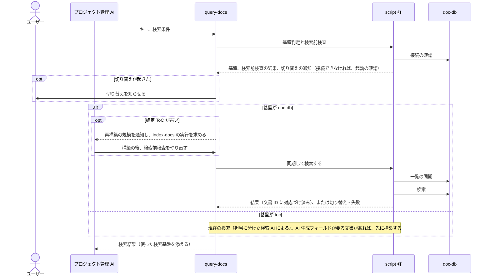

# DES-011 検索基盤の切り替え設計 DLID-xvm8ab2ag0te

## 1. 境界と構成 DLID-313cqdcx2dhv

本書は、要件 [REQ-006][req-006] を実現する設計である。既存の設計書（DES-001〜DES-010）は、[検索基盤]が[ToC]のときの設計であり、[検索基盤]に依存する記述との関係は §11 に示す。

[検索基盤]によらず変わらないものと、基盤に依存するものを、次のとおり分ける。

| 区分             | 内容                                                                                                                                                                                         |
| ---------------- | -------------------------------------------------------------------------------------------------------------------------------------------------------------------------------------------- |
| 基盤によらない   | [DLID]の発行・書き込み（`embed-dlid`）、検査（`check-dlid`・`check-links`・`check-toc`・`check-impact`）、[DLID]の解決（`resolve-dlid`）、[確定 ToC]の機械取得の情報、[Index 対象指定]の展開 |
| 基盤に依存する   | [AI 生成フィールド]の生成と保持、文書検索の実体、[doc-db]の更新                                                                                                                              |
| 新設する論理操作 | 基盤判定（設定の読取り・[doc-db]への接続と起動。§2）、[doc-db]の同期（§5）、[doc-db]の検索と対応づけ（§7）                                                                                   |

[doc-db]は、本文を読んで検索するだけの外部の主体であり、[DLID]・[ToC 識別キー]・参照関係・パスの変更を知らない（要件 [D-070][req-006]）。[DLID]を[doc-db]の KEY・パスに使わない。[doc-db]が返す結果は、doc-link の script が管理状態を用いて[DLID]へ対応づける。[doc-db]に求める契約は、要件 [FR-028][req-006] に定める。本書は、その契約に依拠し、写さない。

## 2. 基盤判定 DLID-1m0mz21ac6eg

基盤判定は、構築（`index-docs`）と検索（`query-docs`）の入口で、その実行の[検索基盤]を決める決定論的な操作である。入力は、設定ファイルの[強制スイッチ]の値と、[doc-db]への接続の可否、接続できないときの利用者の回答（起動してよいか。§2.2）である。出力は、[検索基盤]（`doc-db` か `toc`）と切り替えたときの理由、または、利用者の回答を待って止まること（起動の確認、起動の失敗）である。利用者の許可を得て[doc-db]を起動する以外に、何も書き込まない。

### 2.1 強制スイッチの設定ファイル DLID-mrgdxghyajjc

[強制スイッチ]は、設定ファイルで指定する（要件 [D-065][req-006]）。

| 項目         | 設計                                                                                                                                                                                                                                                                        |
| ------------ | --------------------------------------------------------------------------------------------------------------------------------------------------------------------------------------------------------------------------------------------------------------------------- |
| 置き場・名前 | プロジェクトルート直下の `.doc-link/config.json`                                                                                                                                                                                                                            |
| 形式         | JSON のオブジェクト 1 つ。キーは `backend` だけで、値は `"auto"` か `"toc"`                                                                                                                                                                                                 |
| 未指定       | ファイルが無い、またはキー `backend` が無いときは、`auto`（[doc-db]を先に試す）                                                                                                                                                                                             |
| 不正な値     | ファイルを読めない、JSON として解釈できない、オブジェクトでない、未知のキーがある、`backend` の値が定義外のときは、基盤判定の失敗とする（終了コード 1）。構築・検索を行わず、原因（ファイルと箇所）を返す。既定へ黙って戻さない。誤記のまま[doc-db]へ接続することを防ぐため |
| 読む主体     | 基盤判定の script だけ。ほかの script は読まない。各実行が、そのつど読み直す                                                                                                                                                                                                |
| 書く主体     | 利用者（または利用者の指示を受けた AI）。doc-link は書かない                                                                                                                                                                                                                |

`toc` は、[doc-db]へ接続せず、起動もしない。`auto` は、§2.2 に従う。

置き場と形式の理由は、次のとおり。

- `.doc-link/` は、doc-link が管理状態を置くディレクトリであり、git で追跡する。[ToC]を使う方針を、プロジェクトの方針として共有できる。[doc-db]が未導入の端末は、設定によらず、[自動切り替え]で[ToC]を使うので、端末ごとの設定は要らない。
- JSON は、管理状態と同じ形式であり、標準ライブラリだけで読める。
- 設定の項目を `backend` だけにするのは、現時点で利用者が選ぶ必要のある項目が、これだけであるためである。

[強制スイッチ]の呼び出しごとの上書き（引数）は、設けない。理由は次のとおり。

- 設定と引数の 2 経路を持つと、優先順位の規則と、対象指定ファイル（[DES-006 §1][des-006]）への基盤の持ち回りが要る。AI が値を書き写すと、検査した基盤と、再構築する基盤が違いうる。
- 1 回だけ切り替えたいときは、設定を書き換えれば足りる。
- 利用者が、毎回の指定を求めていない。

再検討する条件は、設定を書き換えずに 1 回だけ切り替える要望が、実際に出たときである。なお、[doc-db]に接続できないときの利用者の回答（`--docdb-startup`。§2.2）は、[強制スイッチ]の上書きではない。その呼び出しの、接続できない場面にだけ作用し、`auto` の設定のままである。

検索前検査の後、再構築の前に設定を書き換えたときは、再構築と、その後にやり直す検索前検査が、書き換えた設定に従う。設定の値を、対象指定ファイルに持たせない。

### 2.2 [doc-db]への接続と起動 DLID-c065g6m6p3zk

`auto` のとき、次の順に行う（要件 [D-071][req-006]、[FR-027][req-006]）。

1. 接続の確認：[doc-db]の MCP の `initialize` の成否で、接続の可否を決める。プロセスの有無・ポートの待受は、判定の根拠にしない。複数の呼び出しが同時に[doc-db]を起動すると、後から起動したプロセスは、稼働中として自ら終了しうる。プロセスの生死を根拠にすると、実際には接続できる[doc-db]を、使えないと誤判定するためである。
   - 接続の先は、[doc-db]の設定ファイルの `port` の、localhost の MCP の URL である。読むのは `port` だけである。
   - [doc-db]は、設定ファイルが無いと起動できない（[doc-db]の実装の確認結果）。`port` を読めないときは、接続も起動も試みず、許可も求めず、接続できない (a) とする。原因は `config_unreadable` とする。
   - 接続の待ち時間の上限は TBD とする（script の定数。実測で決める）。
2. 実行ファイルの解決：接続できなければ、実行ファイル `doc-db` を、実行ファイルの検索パスから解決する。無ければ、起動できないので、許可を求めず、(a)（原因 `executable_missing`）とする。
3. 利用者の許可：実行ファイルがあるとき、起動の許可（呼び出しの引数 `--docdb-startup`）で分かれる。
   - 回答が無い：起動せずに止まる。結果の `action` は `confirm_docdb_startup`（終了コード 0）で、起動してよいかの質問、起動の command（`doc-db`。引数なし）、選択肢（起動する、今回は[ToC]で続ける）と、それぞれを選んだときの再実行の引数を持つ。構築・検索前検査・検索をせず、何も書き込まない。AI は、質問と選択肢を、そのまま利用者へ伝える
   - `start`（起動してよい）：手順 4 へ進む
   - `toc`（今回は[ToC]で続ける）：[doc-db]へ接続せず、起動もせず、基盤は `toc`、理由の分類は `docdb_startup_declined` とする
   - 回答は、その呼び出しにだけ作用する。保存しない。次の実行で接続できなければ、再び回答を求める。構築では、`build_id` を付けない最初の呼び出しだけで指定でき、続きの呼び出しは、作業状態に記録した基盤で続ける
4. 起動：新しいセッションで、引数なしで起動する。標準入力・標準出力・標準エラーは切り離して破棄する。起動に失敗したときは、原因 `spawn_failed` として、手順 6 へ進む。
   - 引数なしにするのは、ポート・ログの出力先を、[doc-db]自身の設定に任せるためである。doc-link が上書きすると、直後に接続するポートが、利用者の設定と食い違う。
   - 新しいセッションにするのは、doc-link の終了に伴う信号で、起動した[doc-db]が止まらないようにするためである。標準出力・標準エラーを切り離すのは、起動のログが、doc-link の出力に混ざらないようにするためである。
   - doc-link は、ログのファイルを作らない。[doc-db]のデータとログは、[doc-db]が作るものであり、doc-link が作るファイルではない。
   - 起動したプロセスは、doc-link の実行の後も動き続けうる。doc-link は、停止・再起動・監視をせず、OS の自動起動・サービスへの登録をしない（要件 [FR-027][req-006]）。
   - 起動したプロセスは、呼び出し元の環境を引き継ぐ。doc-link は、環境変数を読まず、変更しない。
5. 期限付きの再接続：起動の直後は、まだ待受を始めていない。一定の間隔で `initialize` を繰り返し、期限内に接続できれば、使う。期限と間隔は TBD とする（script の定数。実測で決める）。
   - 起動したプロセスが、接続の前に終了していたときは、1 回だけ再接続を試す。別の呼び出しが先に[doc-db]を起動していて、そちらが待受を始めるのが、僅かに遅れることがあるためである。なお接続できなければ、原因 `exited_early` として、手順 6 へ進む。自分のプロセスが無いので、期限まで待たない。
   - 期限を過ぎても接続できなければ、原因 `reconnect_failed` として、手順 6 へ進む。無期限に再試行しない。
6. 起動の失敗：許可を得て起動したのに接続できなかったとき（原因 `spawn_failed`・`exited_early`・`reconnect_failed`）は、切り替えずに止まる。結果の `action` は `docdb_startup_failed`（終了コード 0）で、起動できなかったこと、原因の分類（`cause`）と接続の失敗の要約（`detail`）、起動の command、選択肢（起動してやり直す、今回は[ToC]で続ける）を持つ。構築・検索をせず、何も書き込まない。
   - 「起動してやり直す」は、利用者が command で[doc-db]を起動した後、`--docdb-startup` を付けずに、同じ呼び出しをやり直すことである。接続できれば、[doc-db]で続ける。接続できなければ、手順 3 の回答の無い場合に戻る。
   - 「今回は[ToC]で続ける」は、`--docdb-startup toc` で、同じ呼び出しをやり直すことである（手順 3）。
   - 特定の原因（サンドボックスなど）を断定しない。結果が示すのは、原因の分類（終了コードなど）だけである。[doc-db]が接続の前に終了する原因は、複数ありうる（実行ファイルが起動できない、設定が無い、OpenAI の認証情報が無いなど）。

接続の確認で使う値は、失敗の分類・終了コード・HTTP の状態コードだけである。例外の文言は、利用者向けの出力に載せない（要件 [NFR-009][req-006]）。

### 2.3 失敗の分類 DLID-2fn0zmfkgx72

[doc-db]の機能の失敗は、次のとおり分類する。この表が、自動切り替えの対象（要件 [D-066][req-006]）の規範である。エラーの識別子の意味は、要件 [FR-028][req-006] が定める。

| 事象                                                                                                                                                                     | 分類              | 動作                                                                                                   |
| ------------------------------------------------------------------------------------------------------------------------------------------------------------------------ | ----------------- | ------------------------------------------------------------------------------------------------------ |
| 実行ファイルが無い、または設定から `port` を得られず `initialize` が失敗した（§2.2）。操作の途中の接続の断（TransportError）                                             | 接続できない (a)  | `toc` へ切り替える。理由 `docdb_unreachable`                                                           |
| 許可を得て起動したのに `initialize` が失敗した（§2.2 手順 6）                                                                                                            | 起動の失敗        | 切り替えず、止まる。利用者に、続け方（起動してやり直す・今回は `toc`）を選んでもらう                   |
| 識別子 `EMBEDDING_FAILED`（検索、または同期ジョブの文書ごとの失敗）                                                                                                      | OpenAI の失敗 (b) | `toc` へ切り替える。理由 `docdb_openai_failed`                                                         |
| 識別子 `INTERNAL_ERROR`・`KEY_TRASHED`、同期の直後の `KEY_NOT_FOUND`、識別子の無いエラー（識別子に対応した版）、HTTP の 4xx・5xx、MCP の形式の誤り、同期の完了待ちの超過 | 障害              | 切り替えず、失敗として返す（原因と、利用者の次の操作を含む）                                           |
| 契約を満たさない doc-db で、識別子の無い検索の内部エラー（JSON-RPC の `-32603`）                                                                                         | OpenAI の失敗 (b) | `toc` へ切り替える（当面の扱い。原因は推定。結果の警告に、契約を満たさない doc-db であることを含める） |
| 契約を満たさない doc-db で、同期ジョブのエラーの文言が `embed:` で始まる                                                                                                 | OpenAI の失敗 (b) | 同上                                                                                                   |

- 契約を満たす[doc-db]かは、同期ジョブの応答（`get_sync_status`）に `document_errors` があるかで判断する（要件 [FR-028][req-006]）。版の番号では判断しない（契約を満たす最初の[doc-db]の版は 0.4.1。記録するだけである）。doc-link は、検索の前に必ず同期するので、同じ実行の同期の応答を、検索の判断にも使う。目印が無いときは、満たさない[doc-db]として扱う。
- 識別子の置き場は、検索の失敗が JSON-RPC のエラーの `error.data.code`、同期ジョブの文書ごとの失敗が `document_errors[].code`、失敗したジョブが最上位の `code` である。同期の投入と状態の取得は、Embedding を行わないので、識別子の無い内部エラーを OpenAI の失敗とみなさない（検索の内部エラーだけが、当面の扱いの対象）。
- 契約を満たさない[doc-db]の扱い（最後の 2 行）は、当面の扱いである。[doc-db]が契約を満たすものだけになった後に、削除する。
- [doc-db]が返したエラーの文言・HTTP の本文は、利用者向けの出力に載せない。載せるのは、失敗の分類・HTTP の状態コード・識別子だけである（要件 [NFR-009][req-006]）。

## 3. 管理状態 DLID-k163mb7mp4bt

[確定 ToC]は、[検索基盤]によらず、機械取得の情報（[文書 ID]・現在のパス・[内容ハッシュ]・[反映済みハッシュ]・セクション・参照・逆参照）を持つ。[doc-db]に関する状態は、管理状態に持たない。設定ファイル（§2.1）は、管理状態ではなく、利用者が書く入力である。

- [文書情報]の[AI 生成フィールド]は、「未生成」を表せる状態を持つ。`doc-db` で構築した文書は、[AI 生成フィールド]を持たない（未生成）。[ToC]で生成した値は、そのまま残る（[DES-003 §2][des-003]。[内容ハッシュ]は生成した時点の値）。
- 「[AI 生成フィールド]が要る文書」は、未生成の文書、または生成した時点の[内容ハッシュ]が[現在ハッシュ]と違う文書である。`doc-db` で構築した間に変わった文書は、後者に当たる。このうち、[確定 ToC]に含まれる、未生成の[文書情報]を持つ文書を、「未生成の文書」と数える（まだ[文書情報]が無い新規の文書は、未生成に数えない）。
- [doc-db]の同期の記録を持たない理由は、次のとおり。
  - 管理状態は git で追跡する。[doc-db]の内容は、利用者の端末ごとの状態である。記録を追跡すると、別の端末・[doc-db]を作り直した後で、同期済みと誤る。
  - [doc-db]から同期の状態を読む手段が無い（`list_indexes` は KEY の件数と更新時刻だけを返す）。
  - そのため、検索の前に毎回、同期を行う（§5・§7）。同期は、同じ内容の文書を再処理せず（契約により、Embedding の欠けていない、内容が同じ文書は skip される）、冪等である。

## 4. [doc-db]での識別 DLID-h0y83t7mgczc

| [doc-db]の項目 | doc-link が使う値                                                                                                                                                                                                                                                                                                         |
| -------------- | ------------------------------------------------------------------------------------------------------------------------------------------------------------------------------------------------------------------------------------------------------------------------------------------------------------------------- |
| KEY            | `doc-link.<プロジェクト名>.<8 桁>.<符号化した ToC 識別キー>`。プロジェクト名は、共通の git ディレクトリの親ディレクトリ名（git でなければプロジェクトルート名）。8 桁は、共通の git ディレクトリ（git でなければプロジェクトルート）の絶対パスの SHA-256 の先頭。[ToC 識別キー]の符号化は、管理状態のファイル名と同じ規則 |
| series         | `<ワークツリーのディレクトリ名>.<8 桁>`。8 桁は、プロジェクトルートの絶対パスの SHA-256 の先頭                                                                                                                                                                                                                            |
| パス           | プロジェクトルートからの相対パス（[文書情報]の現在のパス。POSIX 区切り）                                                                                                                                                                                                                                                  |
| 本文の取得元   | 文書の絶対パス（`local_path`）                                                                                                                                                                                                                                                                                            |

- KEY にプロジェクトの識別を含めるのは、[doc-db]が端末で共有され、同名の別プロジェクトと KEY が衝突するためである。KEY に使える文字の制限は[doc-db]の実装で確認していない（未確認）。
- series をワークツリー単位にするのは、同じプロジェクトの複数のワークツリーが、別の内容を同時に持ちうるためである。ブランチを切り替えたときは、検索の前の同期（§7）が series を現在の内容に合わせる。同じ内容の文書は再処理されない。
- 本文を `local_path` で渡すのは、すべての文書の本文を 1 回の呼び出しに載せると、呼び出しの大きさの上限（64 MiB）に達しうるためである。
- 不要になった series（削除したワークツリーのもの）の掃除は、doc-link が行わない（§12）。

## 5. [doc-db]の同期 DLID-d7rhtwt0669r

[doc-db]の同期は、[確定 ToC]から作った文書の一覧を[doc-db]へ渡し、[doc-db]の内容を一覧に合わせる操作である（要件 [D-069][req-006]）。

### 5.1 一覧の作成 DLID-xr38wnx30z05

1. 対象は、[確定 ToC]に所属するすべての[文書 ID]である。パスは、各[文書 ID]の[文書情報]の現在のパスを使う。
2. 一覧の各文書について、ファイルが存在し読めることを確かめる。存在しない文書は、一覧から除き、パスを報告する（[doc-db]の検索で、削除された文書を返さないためである）。
3. 一覧は、現在の完全な状態として渡す。[doc-db]は、一覧に無いパスを series から切り離す。文書が移動・削除されたとき、変更前のパスは、この切り離しで検索の対象から外れる。
4. 一覧が 0 件のときも、空の一覧を渡す。

### 5.2 同期の実行 DLID-gtfn20gdckza

同期の投入（`sync_documents`）は、ジョブの識別値を即時に返す。doc-link は、ジョブの状態（`get_sync_status`）を、完了まで繰り返し取得する。完了待ちの上限と間隔は TBD とする（script の定数。実測で決める）。上限を超えたときは、障害として返す（§2.3）。

### 5.3 完了の判定 DLID-ta6dd1atk12j

ジョブが `done` のとき、報告された件数（処理・skip・失敗）と、失敗を読む。

- 契約を満たす[doc-db]（応答に `document_errors` がある）：`document_errors` の識別子を読む。
  - 失敗が無ければ、成功とする。
  - `EMBEDDING_FAILED` を含めば、OpenAI の失敗 (b) とする。
  - それ以外の識別子（`INTERNAL_ERROR` など）、または識別子の無い失敗があれば、障害とする。
- 契約を満たさない[doc-db]（当面の扱い）：エラーの一覧を読む。文言が `embed:` で始まるエラーがあれば、(b) とする。それ以外のエラーがあれば、障害とする。
- ジョブが `failed` のときは、障害とする。

Embedding が欠けた文書は、契約により、次の同期が補う（要件 [FR-028][req-006]）。doc-link は、[doc-db]の内容を削除せず、失敗を記録しない。

### 5.4 同期の状態遷移 DLID-4ejebw3d2t3m

同期の状態遷移（S-01〜S-07）は、[DES-004 §6][des-004-sec-6]に定める。同期は、管理状態と[Index 対象文書]へ書き込まない。

## 6. 構築（`index-docs`） DLID-bxb28mdy9mv6

構築は、基盤判定の後、次の順に行う。

1. 基盤判定（§2）。`toc` のときは、現在の構築（[DES-005][des-005]）のとおり行い、[doc-db]へ触れない。
2. `doc-db` のとき、機械取得の構築（対象確定・ID 確認・変更集合・参照検査・候補検査・確定。[DES-004 §3][des-004]の B-01〜B-07）を行う。[AI 生成フィールド]は作らない。B-04 は機械取得だけを行い、B-06 の必須の情報から、[AI 生成フィールド]を除く。
3. [確定 ToC]を確定した後、[doc-db]の同期（§5）を行う。成功したら、構築は完了である。
4. 同期が S-04 または S-05 で切り替わったとき、構築は[ToC]へ切り替わる。[確定 ToC]は既に確定している（機械取得の情報は、基盤によらない）。続けて、「[AI 生成フィールド]が要る文書」（§3）を `toc-updater` に生成させ、[文書情報]を文書ごとに確定する（要件 [D-067][req-006]）。構築は、[ToC]として完了する。
5. 同期が S-06 で失敗したとき、構築は、[確定 ToC]を確定したことと、[doc-db]の同期に失敗したことを、別々に返す。

完了結果は、現在の項目に加えて、使った[検索基盤]、切り替えの有無と通知（§8）、`doc-db` のときの同期の結果（一覧の件数・除いた文書の件数）を持つ。`toc` のときの生成の件数は、`doc-db` のとき 0 である。

## 7. 検索（`query-docs`） DLID-2g8yj5b314bg

### 7.1 検索前検査 DLID-h87td10ebpf7

検索前検査（[DES-006 §1][des-006]）は、基盤によらず、機械取得の情報で[確定 ToC]を現物と比べる。未構築・判定不能・再構築必要・再構築不要の区別と、再構築の規模の件数は、基盤によらず変わらない。その後の扱いが、基盤で異なる。

- `doc-db` のとき、二択を示さず、自動で更新する（要件 [D-072][req-006]）。
  - 再構築必要のとき、script は、再構築の規模を結果に含め、利用者の選択なしに、再構築を求める。「AI による要約生成が必要な文書の件数」は 0 である。SKILL は、規模を利用者へ知らせ、呼び出し元（[プロジェクト管理 AI]）に `index-docs` の実行を求める。SKILL 自身は `index-docs` を実行しない（現在と同じ）。
  - 対象指定ファイルを `index-docs` へ渡し、構築の後に、同じファイルで検索前検査をやり直す流れは、現在と同じである（[DES-006 §1][des-006]）。構築が別の対象で行われたときは、障害とする。
  - 「既存の[ToC]のまま検索する」は、提供しない。`freshness` は、常に `current` である。
  - 未構築のときは、検索せず、初回の構築が必要と返す（現在と同じ）。[Index 対象指定]が無いと、対象を決められないためである。判定不能のときは、障害として停止する（現在と同じ）。
  - `index-docs` は、機械取得の構築の後に、[doc-db]の同期を行う（§6）。そのため、直後の検索の前の同期（§7.2）は、通常、何も更新しない。
- `toc` のとき、次のどちらかであれば、二択を示さず、構築を求める（要件 [D-067][req-006]）。構築の規模は、利用者へ知らせる。
  - [確定 ToC]に含まれる文書に、[AI 生成フィールド]が未生成の文書（§3）がある。
  - 機械取得の情報は最新（再構築が不要）なのに、[AI 生成フィールド]が古い文書がある。既存の[ToC]のままだと、古い値を最新として検索してしまう。
  - 上記以外（機械取得の情報が古い）は、[AI 生成フィールド]が古い文書があっても、既存の二択を示す。この規則は、変えない（要件 REQ-004 の二択）。
- 自動切り替え・利用者の選択で `toc` へ切り替えたときも、`toc` の規則に従う。[確定 ToC]が無いときは、初回の構築から行う。

### 7.2 [doc-db]の検索 DLID-kgetcnfk06tn

検索前検査が再構築不要になった後（自動更新の後を含む）、次の順に行う。

1. 同期（§5）を行う。一覧は[確定 ToC]から作る。
2. 検索（`query`）を行う。検索の文は、検索のタスクをそのまま渡す。モードは `all`（Embedding・語彙・全文一致の併用）とする。`rerank` は使わない。rerank の失敗は[doc-db]の内部で順序の保持に縮退し、失敗として届かないためである。上位の件数は TBD とする（script の定数。実測で決める）。
3. 検索が失敗したときは、§2.3 の分類に従う。`EMBEDDING_FAILED` は (b) として切り替える。同期の直後の `KEY_NOT_FOUND`、`KEY_TRASHED`、`INTERNAL_ERROR` は、障害とする。契約を満たさない版では、識別子の無い内部エラーを (b) とみなす（当面の扱い）。

### 7.3 結果の対応づけ DLID-4w03dr7n3397

[doc-db]の結果は、チャンクごとの `path`・`heading_path`・`text`・`score` である。次の順で、文書とセクションへ対応づける。

1. 文書：`path` を、§5.1 の一覧のパスと照合する。一致した[文書 ID]を、その結果の文書とする。一致しない結果は、文書に含めず、`unmapped` として件数を報告する。
2. セクション：`heading_path` の末尾の[DLID]（見出しの行の末尾に置いた[セクション ID]）を取り出し、その[文書 ID]のセクションエントリにあるかを確かめる。あれば、そのセクションを該当セクションとする。無ければ、文書だけを返す。
   - [doc-db]の分割は、コードブロックの内側の `#` の行も見出しとして扱う。そのため、`heading_path` は実際の見出しと食い違いうる。管理状態との照合が、食い違いを文書だけの結果に落とす。
   - 見出しの無い先頭のチャンク（`heading_path` が空）は、文書だけの結果とする。
3. 同じ文書の複数のチャンクは、1 件にまとめる。順位は、その文書の最上位のチャンクの順位とし、該当セクションは、順位の順に重複なく集める。

### 7.4 検索結果の契約 DLID-tg62wwpqbmsy

[doc-db]を使うときの結果は、[DES-006 §2][des-006]の項目を、次のとおり満たす。

| 項目                                  | 値                                                                                                                 |
| ------------------------------------- | ------------------------------------------------------------------------------------------------------------------ |
| `doc_link_id`・`recorded_path`        | §7.3 の対応づけ。パスは一覧のパスで、現在の実体パスとは限らない注意を添える（現在と同じ）                          |
| `relevance`                           | `maybe` の固定（要件 [FR-025][req-006]）。`yes` を付けない                                                         |
| `reason`                              | script が事実から組み立てる定型の文（[doc-db]の検索の上位に入ったこと、順位、一致したチャンクの数）。AI は書かない |
| `sections`                            | §7.3 の該当セクション                                                                                              |
| `toc_key`・`toc_version`・`freshness` | 一覧の元にした[確定 ToC]の版と、鮮度（`doc-db` では常に `current`）                                                |
| `backend`                             | `doc-db`                                                                                                           |
| `sync`                                | 一覧の件数、ファイルが無くて除いた文書の件数                                                                       |
| `unmapped`                            | 対応づけられなかった結果の件数                                                                                     |
| `order_notice`                        | `documents` の並びは、[doc-db]が返した順位の順である                                                               |
| `limit_notice`                        | 上位の結果に限られ、関連する文書を取りこぼしうる                                                                   |
| `warnings`                            | 契約を満たさない[doc-db]を使ったときの、その旨（§2.3）                                                             |

`toc` のときの結果は、現在の契約に `backend`（`toc`）を加える。切り替えが起きたときは、両方の結果に、切り替えの情報（§8）を加える。

## 8. 自動切り替えと通知 DLID-dgcb7xq6remn

切り替えは、script が判定し、通知の文も script が組み立てる。AI は、script が返した通知を利用者へ伝える（要件 [D-068][req-006]）。AI が通知の文を自分で書かないのは、理由・原因を推測で補うことを防ぐためである。

通知は、次の項目を持つ。

| 項目       | 内容                                                                                                                                                                                                                                                                |
| ---------- | ------------------------------------------------------------------------------------------------------------------------------------------------------------------------------------------------------------------------------------------------------------------- |
| 切り替え   | `doc-db` から `toc` へ                                                                                                                                                                                                                                              |
| 理由の分類 | `docdb_unreachable`（接続できない。原因として `config_unreadable`・`executable_missing` のいずれかを添える。起動の失敗は、切り替えず止まるので、通知にならない）、`docdb_startup_declined`（利用者が今回は `toc` を選んだ）、`docdb_openai_failed`（OpenAI の失敗） |
| 原因       | 失敗の分類・終了コード・HTTP の状態コード・識別子に限る。契約を満たさない doc-db で、(b) が検索の内部エラーのときは、「OpenAI の失敗と推定している（原因は[doc-db]のログで確認する）」と明記する                                                                    |
| 影響       | [AI 生成フィールド]を作る文書の件数、結果の性質（`relevance` が[検索 AI]の判定になること、取りこぼしの限界が無くなること）                                                                                                                                          |
| 次の実行   | 次の実行でも、[doc-db]を先に試すこと。[ToC]を使い続けるには、設定ファイル（`.doc-link/config.json`）の `backend` を `toc` にすること                                                                                                                                |

- 通知は、`index-docs` では完了結果の報告に、`query-docs` では検索の結果の前に、AI が利用者へ伝える。
- 切り替えを保存しないので、次の実行で[doc-db]が復旧していれば、`doc-db` に戻る。戻ったとき、[ToC]で生成した[AI 生成フィールド]は残る。
- 通知は、切り替えの事実を伝えるだけで、利用者の判断を求めない（要件 [FR-023][req-006]）。
- 通知に、[doc-db]を起動したことは含めない。起動して接続できたときは、切り替えが起きていないためである。起動の有無は、`index-docs` の完了結果と検索結果の `backend` の情報に、`startup`（`not_attempted`・`succeeded`）として含める。

## 9. 検査・解決の SKILL DLID-fa8b68px7c38

基盤によらず、変更しない（要件 [D-070][req-006]）。

| SKILL                      | `doc-db` を使っている間の扱い                                                                                                                                                                                                                                             |
| -------------------------- | ------------------------------------------------------------------------------------------------------------------------------------------------------------------------------------------------------------------------------------------------------------------------- |
| `check-dlid`・`embed-dlid` | 変更しない                                                                                                                                                                                                                                                                |
| `check-links`              | 変更しない（[確定 ToC]を読まない）                                                                                                                                                                                                                                        |
| `check-toc`                | [確定 ToC]の機械取得の情報の鮮度を返す。あわせて「[AI 生成フィールド]が要る文書」の件数（`ai_fields_needed`）と、そのうち未生成の文書の件数（`ai_fields_unfilled`）を返す。基盤は問わず、[doc-db]へ接続せず、設定も読まない。件数の扱いは、呼び出し側が基盤に応じて決める |
| `check-impact`             | 変更しない。[確定 ToC]の参照と[反映済みハッシュ]だけを使う                                                                                                                                                                                                                |
| `resolve-dlid`             | 変更しない。管理状態の記録と現物だけで解決する                                                                                                                                                                                                                            |

[doc-db]を使っている間も、`index-docs` が機械取得の情報を構築するので、これらの SKILL の前提（最新の[確定 ToC]）が保たれる。

## 10. 導入・起動・OpenAI の認証情報 DLID-qw5hyw9agt2s

- 利用者への注意: [doc-db]は、サンドボックスの外で起動し、常駐させる。サンドボックスの下の Claude Code から使うと、[doc-db]の OpenAI への通信が失敗し（通信の代理による TLS の書き換えなど）、(b) として[ToC]へ切り替わる。サンドボックスの下で[doc-db]を起動すると、接続の前に終了することもある（この作業の環境で観察した。終了の原因は未確認。その場合は、§2.2 手順 6 の止まり方になる）。doc-link は、サンドボックスを調べず、サンドボックスの有無で動作を変えず、サンドボックスの設定を変えない。この注意は、利用者向けの文書（README）に書き、AI の手順（SKILL.md）には書かない。
- doc-link は、[doc-db]を導入しない。接続できなければ、利用者の許可を得て起動し（§2.2）、停止せず、常駐させない。
- [doc-db]が未導入（実行ファイルが検索パスに無い）のとき、起動できないので、許可を求めずに、(a)（原因 `executable_missing`）として[ToC]へ切り替える。通知に、[doc-db]を導入すれば既定で使うことを添える。
- [doc-db]は、起動時に OpenAI の認証情報（環境変数）が無いと、起動できずに終了する（[doc-db]の実装の確認結果。実機では未確認）。doc-link から見ると、起動したプロセスが接続の前に終了した（原因 `exited_early`）である。起動の失敗として止まり（§2.2 手順 6）、原因の要約には、「接続の前に終了した（OpenAI の認証情報が無いときも、この形になる。[doc-db]のログで確認する）」と書く。doc-link は、認証情報の有無を調べず、読まない。
- 認証情報が無効・期限切れで[doc-db]が動いているときは、Embedding が失敗し、(b) になる。
- Claude Code のサンドボックスなどで、プロセスの起動や localhost への接続が制限される環境は、確認していない（未確認）。制限されて、起動できない・接続できないときは、起動の失敗として止まる（§2.2 手順 6）。
- doc-link は、OpenAI の認証情報を読まず、[doc-db]へ渡さず、出力・作業ファイル・管理状態に含めない（要件 [NFR-009][req-006]）。起動した[doc-db]が、呼び出し元の環境から自分で読む。

## 11. 既存の設計との関係 DLID-6j0cdp7b5cs4

[検索基盤]に依存する既存の設計は、[検索基盤]が[ToC]のときの設計であり、[検索基盤]が[doc-db]のときは、次のとおり本書に従う。

| 既存の設計                        | [検索基盤]が[doc-db]のとき                                                                                                                                              |
| --------------------------------- | ----------------------------------------------------------------------------------------------------------------------------------------------------------------------- |
| [DES-001 §1][des-001]             | doc-link は、呼び出し元の設定ファイル（Forge の設定など）を直接読まない。自身の設定ファイル `.doc-link/config.json`（§2.1）だけを読む                                   |
| [DES-002 §4][des-002]             | 「doc-link が作るファイルは、すべてプロジェクトの中に置く」は、[検索基盤]によらない。起動した[doc-db]のデータ・ログは、[doc-db]が作るものであり、対象に含めない（§2.2） |
| [DES-003 §2][des-003] [文書情報]  | [AI 生成フィールド]は「未生成」の状態を持つ                                                                                                                             |
| [DES-004 §3][des-004] B-04・B-06  | `doc-db` の構築では、[AI 生成フィールド]を作らず、必須の情報から除く。同期の遷移 S-01〜S-07 は [DES-004 §6][des-004-sec-6]                                              |
| [DES-005 §4][des-005]             | [検索基盤]による生成の有無。切り替え後の生成（§6 の 4）                                                                                                                 |
| [DES-006 §1・§2][des-006]         | `doc-db` のときの二択の廃止と自動更新（§7.1）、`doc-db` の結果の契約（§7.4）                                                                                            |
| [DES-010 §1・§3.2・§3.3][des-010] | 通知の伝達、`index-docs` と `query-docs` の手順（基盤判定・起動の確認・自動更新）                                                                                       |

## 12. 未決事項と未確認 DLID-qjv0z5ns32e2

利用者が承認した事項（要件 [REQ-006 §18.9][req-006]・本書 §2.1〜§10。設定ファイル `.doc-link/config.json`・呼び出しごとの上書きを設けないこと・[doc-db]を起動すること・契約・要件 FR-022 と本書 §3・§7.1 の二択を示さない条件）は、本文に反映した。実装で確定した点（契約を満たす[doc-db]の目印、識別子の置き場）も、本文に反映した。残る未決事項と、確かめていない事項である。

未決:

1. 不要になった series（削除したワークツリーのもの）の掃除。doc-link は行わない。[doc-db]が持つ削除の予約の機能を、利用者が使う。
2. 暫定値の確定。接続の待ち時間（1 秒）、再接続の期限（10 秒）と間隔（0.25 秒）、同期の完了待ちの上限（600 秒）と間隔（2 秒）、検索の上位の件数（20）は、実装の定数で、実測で決める値の暫定である。

確認済み（実機。契約を実装した[doc-db]のブランチのビルドと、導入済みの旧版 0.3.4 を、隔離した HOME・別のポートで動かした）:

- 起動していない[doc-db]を、doc-link が起動して接続し、構築・同期・検索できること。同期で OpenAI の Embedding が実際に行われ、検索が文書とセクションへ対応づけられること
- 文書の移動・削除が、次の同期で[doc-db]へ反映され、変更前のパスを返さないこと
- 設定ファイルでの強制スイッチ、不正な設定の拒否
- 無効な鍵（OpenAI の HTTP 401）で、`document_errors` の `EMBEDDING_FAILED` により切り替わること。鍵を直して再同期すると、Embedding が補われること
- 鍵が無いときの[doc-db]が、接続の前に終了すること（終了コード 1）。実行ファイルが無いときの切り替え
- 契約を満たさない旧版（0.3.4）で、同期は動き、警告が付き、無効な鍵のエラーの文言（`embed:`）で切り替わること
- KEY に、英数字・`.`・`-` を含む名前が使えること

未確認:

- [doc-db]の KEY・series に使える文字の、上記以外の制限
- [doc-db]が、設定ファイルが無いと起動できないこと（実装の読解のみ）
- サンドボックスなどの制限が、この作業のセッション以外の環境にあるとき、プロセスの起動・localhost への接続ができること
- 利用者の許可を得て起動した[doc-db]が、サンドボックスの外の環境で、接続でき、OpenAI を呼べること（この作業の環境はサンドボックスの下で、確かめられない。起動の許可・起動の失敗・回答による切り替えは、テストでだけ確かめた）
- SKILL を通した、AI（`toc-updater`・`query-worker`）を含む一連の動作（script の入口は実機で確かめたが、AI の起動は確かめていない）
- 契約を実装した[doc-db]の、リリース版での動作（確かめたのは、未 merge のブランチのビルド）

[req-004]: ../requirement/REQ-004_search.md "3dee26a7c09a DLID-h96208rqr773"
[req-006]: ../requirement/REQ-006_backend-switch.md "3a6cc3bcee23 DLID-emxm9mx5a4d2"
[des-001]: DES-001_system-overview.md "1468229e4b8e DLID-3da82gspdp44"
[des-002]: DES-002_execution-responsibilities.md "3a9861334737 DLID-anz9vack2xzt"
[des-003]: DES-003_data-model.md "aebbc925440f DLID-yqqrwtycr379"
[des-004]: DES-004_state-machines.md "d3b39867775c DLID-3f92k3tz4rew"
[des-005]: DES-005_indexing.md "189c8ffcc88b DLID-dgphqw70rkpz"
[des-006]: DES-006_search.md "10973b6b4341 DLID-nnbgpzkkm5vq"
[des-010]: DES-010_skill-composition.md "e6cd2ff8b7ec DLID-7e90gq3sdncc"
[des-004-sec-6]: DES-004_state-machines.md#6-doc-dbの同期の実行-dlid-qxveh3z6rq85 "a0d91293f3dd DLID-qxveh3z6rq85"
