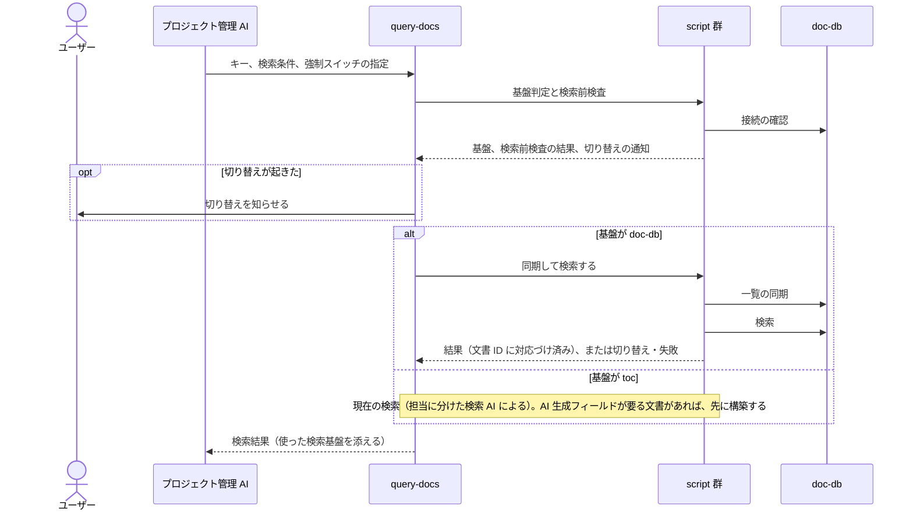

# DES-011 検索基盤の切り替え設計 DLID-xvm8ab2ag0te

## 1. 境界と構成 DLID-313cqdcx2dhv

本書は、要件 [REQ-006][req-006] を実現する設計である。差分開発型であり、既存の設計書（DES-001〜DES-010）の本文は、実装が終わるまで書き換えない。既存の設計書は、[検索基盤]が[ToC]のときの設計として読む。本書が既存の設計の意味を変える点は §11 に挙げる。

[検索基盤]によらず変わらないものと、基盤に依存するものを、次のとおり分ける。

| 区分             | 内容                                                                                                                                                                                         |
| ---------------- | -------------------------------------------------------------------------------------------------------------------------------------------------------------------------------------------- |
| 基盤によらない   | [DLID]の発行・書き込み（`embed-dlid`）、検査（`check-dlid`・`check-links`・`check-toc`・`check-impact`）、[DLID]の解決（`resolve-dlid`）、[確定 ToC]の機械取得の情報、[Index 対象指定]の展開 |
| 基盤に依存する   | [AI 生成フィールド]の生成と保持、文書検索の実体、[doc-db]の更新                                                                                                                              |
| 新設する論理操作 | 基盤判定（§2）、[doc-db]の同期（§5）、[doc-db]の検索と対応づけ（§7）                                                                                                                         |

[doc-db]は、本文を読んで検索するだけの外部の主体であり、[DLID]・[ToC 識別キー]・参照関係・パスの変更を知らない（要件 [D-070][req-006]）。[DLID]を[doc-db]の KEY・パスに使わない。[doc-db]が返す結果は、doc-link の script が管理状態を用いて[DLID]へ対応づける。

## 2. 基盤判定 DLID-1m0mz21ac6eg

基盤判定は、構築（`index-docs`）と検索（`query-docs`）の入口で、その実行の[検索基盤]を決める決定論的な操作である。入力は、強制スイッチの指定と、[doc-db]への接続の可否である。出力は、[検索基盤]（`doc-db` か `toc`）と、切り替えたときの理由である。何も書き込まない。

### 2.1 強制スイッチの指定方法 DLID-mrgdxghyajjc

強制スイッチは、呼び出しごとの引数 `--backend` で指定する（要件 [D-065][req-006]）。値は `auto`（既定）と `toc` である。

- 引数にするのは、doc-link が設定ファイルを直接読まず、呼び出し元が決めた値を受け取る方針（[DES-001 §1][des-001]）に合わせるためである。永続の設定は、呼び出し元（[プロジェクト管理 AI]や呼び出し元スキル）が持ち、毎回この引数へ渡す。
- `--backend` は、`index-docs` と `query-docs` が受け取る。検査・解決の SKILL は、基盤によらないので受け取らない。
- 検索前検査が書く対象指定ファイル（[DES-006 §1][des-006]）は、`--backend` の値も持つ。再構築（`index-docs`）は、そのファイルを `--target-file` で受け取り、同じ値で構築する。`--target-file` と `--backend` の併用は拒否する。検査した基盤と、再構築する基盤が違うことを、AI の書き写しの誤りで起こさないためである。

### 2.2 [doc-db]への接続 DLID-c065g6m6p3zk

`--backend toc` のときは、[doc-db]へ接続しない。`auto` のときは、[doc-db]の MCP の `initialize` の成否で、接続の可否を決める。プロセスの有無・ポートの待受は、判定の根拠にしない。

- doc-link は[doc-db]を起動しない（§10）。接続の先は、[doc-db]の設定ファイルの `port`（無ければ既定のポート）の、localhost の MCP の URL である。設定ファイルから読むのは `port` だけである。
- 接続の待ち時間の上限は TBD とする（script の定数。実測で決める）。
- 接続できなかったとき、基盤は `toc`、理由の分類は `docdb_unreachable` とする。

### 2.3 失敗の分類 DLID-2fn0zmfkgx72

[doc-db]の機能の失敗は、次のとおり分類する。この表が、自動切り替えの対象（要件 [D-066][req-006]）の規範である。

| 事象                                                                                                                           | 分類              | 動作                                                         |
| ------------------------------------------------------------------------------------------------------------------------------ | ----------------- | ------------------------------------------------------------ |
| `initialize` の失敗。操作の途中の接続の断（TransportError）                                                                    | 接続できない (a)  | `toc` へ切り替える。理由 `docdb_unreachable`                 |
| 同期のジョブが完了し、Embedding の失敗を報告した（§5.3）                                                                       | OpenAI の失敗 (b) | `toc` へ切り替える。理由 `docdb_openai_failed`               |
| 検索が内部エラー（JSON-RPC の `-32603`）で失敗した                                                                             | OpenAI の失敗 (b) | 同上。ただし原因は推定である（§8）                           |
| KEY のゴミ箱状態（`KEY_TRASHED`）、HTTP の 4xx・5xx、MCP の形式の誤り、同期ジョブの Embedding 以外の失敗、同期の完了待ちの超過 | 障害              | 切り替えず、失敗として返す（原因と、利用者の次の操作を含む） |

doc-db が返した JSON-RPC のエラーの文言・HTTP の本文は、利用者向けの出力に載せない。載せるのは、失敗の分類・HTTP の状態コード・[doc-db]が返した識別子（`error.data.code`）だけである（要件 [NFR-009][req-006]）。

## 3. 管理状態 DLID-k163mb7mp4bt

[確定 ToC]は、[検索基盤]によらず、機械取得の情報（[文書 ID]・現在のパス・[内容ハッシュ]・[反映済みハッシュ]・セクション・参照・逆参照）を持つ。[doc-db]に関する状態は、管理状態に持たない。

- [文書情報]の[AI 生成フィールド]は、「未生成」を表せる状態を持つ。`doc-db` で構築した文書は、[AI 生成フィールド]を持たない（未生成）。[ToC]で生成した値は、そのまま残る（[DES-003 §2][des-003]。[内容ハッシュ]は生成した時点の値）。
- 「[AI 生成フィールド]が要る文書」は、未生成の文書、または生成した時点の[内容ハッシュ]が[現在ハッシュ]と違う文書である。`doc-db` で構築した間に変わった文書は、後者に当たる。
- [doc-db]の同期の記録を持たない理由は、次のとおり。
  - 管理状態は git で追跡する。[doc-db]の内容は、利用者の端末ごとの状態である。記録を追跡すると、別の端末・[doc-db]を作り直した後で、同期済みと誤る。
  - [doc-db]から同期の状態を読む手段が無い（`list_indexes` は KEY の件数と更新時刻だけを返す）。
  - そのため、検索の前に毎回、同期を行う（§5・§7）。同期は、同じ内容の文書を再処理せず（内容が同じ文書は skip される）、冪等である。

## 4. [doc-db]での識別 DLID-h0y83t7mgczc

| [doc-db]の項目 | doc-link が使う値                                                                                                                                                                                                                                                                                                         |
| -------------- | ------------------------------------------------------------------------------------------------------------------------------------------------------------------------------------------------------------------------------------------------------------------------------------------------------------------------- |
| KEY            | `doc-link.<プロジェクト名>.<8 桁>.<符号化した ToC 識別キー>`。プロジェクト名は、共通の git ディレクトリの親ディレクトリ名（git でなければプロジェクトルート名）。8 桁は、共通の git ディレクトリ（git でなければプロジェクトルート）の絶対パスの SHA-256 の先頭。[ToC 識別キー]の符号化は、管理状態のファイル名と同じ規則 |
| series         | `<ワークツリーのディレクトリ名>.<8 桁>`。8 桁は、プロジェクトルートの絶対パスの SHA-256 の先頭                                                                                                                                                                                                                            |
| パス           | プロジェクトルートからの相対パス（[文書情報]の現在のパス。POSIX 区切り）                                                                                                                                                                                                                                                  |
| 本文の取得元   | 文書の絶対パス（`local_path`）                                                                                                                                                                                                                                                                                            |

- KEY にプロジェクトの識別を含めるのは、[doc-db]が端末で共有され、同名の別プロジェクトと KEY が衝突するためである。KEY に使える文字の制限は[doc-db]の実装で確認していない（未確認）。
- series をワークツリー単位にするのは、同じプロジェクトの複数のワークツリーが、別の内容を同時に持ちうるためである。ブランチを切り替えたときは、検索の前の同期（§7）が series を現在の内容に合わせる。同じ内容の文書は再処理されない。
- 本文を `local_path` で渡すのは、すべての文書の本文を 1 回の呼び出しに載せると、呼び出しの大きさの上限（64 MiB）に達しうるためである。
- 不要になった series（削除したワークツリーのもの）の掃除は、doc-link が行わない（§12）。

## 5. [doc-db]の同期 DLID-d7rhtwt0669r

[doc-db]の同期は、[確定 ToC]から作った文書の一覧を[doc-db]へ渡し、[doc-db]の内容を一覧に合わせる操作である（要件 [D-069][req-006]）。

### 5.1 一覧の作成 DLID-xr38wnx30z05

1. 対象は、[確定 ToC]に所属するすべての[文書 ID]である。パスは、各[文書 ID]の[文書情報]の現在のパスを使う。
2. 一覧の各文書について、ファイルが存在し読めることを確かめる。存在しない文書は、一覧から除き、パスを報告する（[doc-db]の検索で、削除された文書を返さないためである）。
3. 一覧は、現在の完全な状態として渡す。[doc-db]は、一覧に無いパスを series から切り離す。文書が移動・削除されたとき、変更前のパスは、この切り離しで検索の対象から外れる。
4. 一覧が 0 件のときも、空の一覧を渡す。

### 5.2 同期の実行 DLID-gtfn20gdckza

同期の投入（`sync_documents`）は、ジョブの識別値を即時に返す。doc-link は、ジョブの状態（`get_sync_status`）を、完了まで繰り返し取得する。完了待ちの上限と間隔は TBD とする（script の定数。実測で決める）。上限を超えたときは、障害として返す（§2.3）。

### 5.3 完了の判定 DLID-ta6dd1atk12j

ジョブが `done` のとき、報告された件数（処理・skip・失敗）とエラーを読む。

- エラーが無ければ、成功とする。
- Embedding の失敗を示すエラーがあれば、OpenAI の失敗 (b) とする。[doc-db]は、Embedding に失敗した文書の本文だけを保存し、ジョブを `done` として完了させる。失敗は、ジョブのエラーの一覧にだけ現れる。エラーの文言（`embed:` で始まる）で判別する。この判別は文言に依存する（§12）。
- それ以外のエラーがあれば、障害とする。
- ジョブが `failed` のときは、障害とする。

### 5.4 同期の状態遷移 DLID-4ejebw3d2t3m

| 遷移 | 元                       | イベント・ガード                       | 次                   | 効果                                                     |
| ---- | ------------------------ | -------------------------------------- | -------------------- | -------------------------------------------------------- |
| S-01 | 開始                     | [確定 ToC]があり、一覧を作れた         | 一覧確定             | 存在しない文書を除いて報告する                           |
| S-02 | 一覧確定                 | 投入が受理された                       | 完了待ち             | ジョブの識別値を持つ                                     |
| S-03 | 完了待ち                 | ジョブが完了し、エラーが無い           | 同期済み             | [doc-db]が一覧に一致する                                 |
| S-04 | 完了待ち                 | ジョブが完了し、Embedding の失敗を含む | 切り替え（理由 (b)） | [ToC]へ切り替える（§6）                                  |
| S-05 | 開始／一覧確定／完了待ち | 接続できない                           | 切り替え（理由 (a)） | [ToC]へ切り替える                                        |
| S-06 | 開始／一覧確定／完了待ち | S-04・S-05 以外の失敗、完了待ちの超過  | 失敗                 | 切り替えず、原因を返す                                   |
| S-07 | 開始                     | [確定 ToC]が無い                       | 失敗                 | 初回の構築が必要と返す（[REQ-004][req-004]。同期しない） |

同期は、管理状態と[Index 対象文書]へ書き込まない。

## 6. 構築（`index-docs`） DLID-bxb28mdy9mv6

構築は、基盤判定の後、次の順に行う。

1. 基盤判定（§2）。`toc` のときは、現在の構築（[DES-005][des-005]）のとおり行い、[doc-db]へ触れない。
2. `doc-db` のとき、機械取得の構築（対象確定・ID 確認・変更集合・参照検査・候補検査・確定。[DES-004 §3][des-004]の B-01〜B-07）を行う。[AI 生成フィールド]は作らない。B-04 は機械取得だけを行い、B-06 の必須の情報から、[AI 生成フィールド]を除く。
3. [確定 ToC]を確定した後、[doc-db]の同期（§5）を行う。成功したら、構築は完了である。
4. 同期が S-04 または S-05 で切り替わったとき、構築は[ToC]へ切り替わる。[確定 ToC]は既に確定している（機械取得の情報は、基盤によらない）。続けて、「[AI 生成フィールド]が要る文書」（§3）を `toc-updater` に生成させ、[文書情報]を文書ごとに確定する（要件 [D-067][req-006]）。構築は、[ToC]として完了する。
5. 同期が S-06 で失敗したとき、構築は、[確定 ToC]を確定したことと、[doc-db]の同期に失敗したことを、別々に返す。

完了結果は、現在の項目に加えて、使った[検索基盤]、切り替えの有無と通知（§8）、`doc-db` のときの同期の結果（一覧の件数・除いた文書の件数）を持つ。`toc` のときの生成の件数は、`doc-db` のとき 0 である。

## 7. 検索（`query-docs`） DLID-2g8yj5b314bg

### 7.1 検索前検査 DLID-h87td10ebpf7

検索前検査（[DES-006 §1][des-006]）は、基盤によらず、機械取得の情報で[確定 ToC]を現物と比べる。未構築・判定不能・再構築必要・再構築不要の区別、再構築の規模の件数、二択の確認は、`doc-db` のときも変わらない（承認待ち。§12）。

- `doc-db` のとき、「AI による要約生成が必要な文書の件数」は 0 である。再構築は、機械取得の構築と[doc-db]の同期である。
- `toc` のとき、「[AI 生成フィールド]が要る文書」（§3）が 1 件でもあれば、二択を示さず、構築を求める（要件 [D-067][req-006]）。二択を示すのは、すべての文書が最新の[AI 生成フィールド]を持つときの、機械取得の情報の古さだけである。構築の規模は、利用者へ知らせる。
- 自動切り替えで`toc` へ切り替えたときも、同じ規則に従う。[確定 ToC]が無いときは、初回の構築から行う（`index-docs --backend toc`）。

### 7.2 [doc-db]の検索 DLID-kgetcnfk06tn

検索前検査が再構築不要、または利用者が「既存の[ToC]のまま」を選んだとき、次の順に行う。

1. 同期（§5）を行う。一覧は[確定 ToC]から作る。「既存の[ToC]のまま」では、その版の所属の一覧になる。文書の本文は、現在のファイルが読まれる。
2. 検索（`query`）を行う。検索の文は、検索のタスクをそのまま渡す。モードは `all`（Embedding・語彙・全文一致の併用）とする。`rerank` は使わない。rerank の失敗は[doc-db]の内部で順序の保持に縮退し、失敗として届かないためである。上位の件数は TBD とする（script の定数。実測で決める）。
3. 検索が内部エラーで失敗したときは、(b) として切り替える（§2.3）。`KEY_NOT_FOUND`・`KEY_TRASHED` は、同期の直後には起きないはずであり、起きたときは障害とする。

### 7.3 結果の対応づけ DLID-4w03dr7n3397

[doc-db]の結果は、チャンクごとの `path`・`heading_path`・`text`・`score` である。次の順で、文書とセクションへ対応づける。

1. 文書：`path` を、§5.1 の一覧のパスと照合する。一致した[文書 ID]を、その結果の文書とする。一致しない結果は、文書に含めず、`unmapped` として件数を報告する。
2. セクション：`heading_path` の末尾の[DLID]（見出しの行の末尾に置いた[セクション ID]）を取り出し、その[文書 ID]のセクションエントリにあるかを確かめる。あれば、そのセクションを該当セクションとする。無ければ、文書だけを返す。
   - [doc-db]の分割は、コードブロックの内側の `#` の行も見出しとして扱う。そのため、`heading_path` は実際の見出しと食い違いうる。管理状態との照合が、食い違いを文書だけの結果に落とす。
   - 見出しの無い先頭のチャンク（`heading_path` が空）は、文書だけの結果とする。
3. 同じ文書の複数のチャンクは、1 件にまとめる。順位は、その文書の最上位のチャンクの順位とし、該当セクションは、順位の順に重複なく集める。

### 7.4 検索結果の契約 DLID-tg62wwpqbmsy

[doc-db]を使うときの結果は、[DES-006 §2][des-006]の項目を、次のとおり満たす。

| 項目                                  | 値                                                                                                                 |
| ------------------------------------- | ------------------------------------------------------------------------------------------------------------------ |
| `doc_link_id`・`recorded_path`        | §7.3 の対応づけ。パスは一覧のパスで、現在の実体パスとは限らない注意を添える（現在と同じ）                          |
| `relevance`                           | `maybe` の固定（要件 [FR-025][req-006]）。`yes` を付けない                                                         |
| `reason`                              | script が事実から組み立てる定型の文（[doc-db]の検索の上位に入ったこと、順位、一致したチャンクの数）。AI は書かない |
| `sections`                            | §7.3 の該当セクション                                                                                              |
| `toc_key`・`toc_version`・`freshness` | 一覧の元にした[確定 ToC]の版と、検索前検査の鮮度（現在と同じ）                                                     |
| `backend`                             | `doc-db`                                                                                                           |
| `sync`                                | 一覧の件数、ファイルが無くて除いた文書の件数                                                                       |
| `unmapped`                            | 対応づけられなかった結果の件数                                                                                     |
| `order_notice`                        | `documents` の並びは、[doc-db]が返した順位の順である                                                               |
| `limit_notice`                        | 上位の結果に限られ、関連する文書を取りこぼしうる                                                                   |

`toc` のときの結果は、現在の契約に `backend`（`toc`）を加える。切り替えが起きたときは、両方の結果に、切り替えの情報（§8）を加える。

## 8. 自動切り替えと通知 DLID-dgcb7xq6remn

切り替えは、script が判定し、通知の文も script が組み立てる。AI は、script が返した通知を利用者へ伝える（要件 [D-068][req-006]）。AI が通知の文を自分で書かないのは、理由・原因を推測で補うことを防ぐためである。

通知は、次の項目を持つ。

| 項目       | 内容                                                                                                                                                               |
| ---------- | ------------------------------------------------------------------------------------------------------------------------------------------------------------------ |
| 切り替え   | `doc-db` から `toc` へ                                                                                                                                             |
| 理由の分類 | `docdb_unreachable`（接続できない）、`docdb_openai_failed`（OpenAI の失敗）                                                                                        |
| 原因       | 失敗の分類・HTTP の状態コード・[doc-db]の識別子に限る。(b) が検索の内部エラーのときは、「OpenAI の失敗と推定している（原因は[doc-db]のログで確認する）」と明記する |
| 影響       | [AI 生成フィールド]を作る文書の件数、結果の性質（`relevance` が[検索 AI]の判定になること、取りこぼしの限界が無くなること）                                         |
| 次の実行   | 次の実行でも、[doc-db]を先に試すこと。[ToC]を使い続けるには、`--backend toc` を指定すること                                                                        |

- 通知は、`index-docs` では完了結果の報告に、`query-docs` では検索の結果の前に、AI が利用者へ伝える。
- 切り替えを保存しないので、次の実行で[doc-db]が復旧していれば、`doc-db` に戻る。戻ったとき、[ToC]で生成した[AI 生成フィールド]は残る。
- 通知は、切り替えの事実を伝えるだけで、利用者の判断を求めない（要件 [FR-023][req-006]）。

## 9. 検査・解決の SKILL DLID-fa8b68px7c38

基盤によらず、変更しない（要件 [D-070][req-006]）。

| SKILL                      | `doc-db` を使っている間の扱い                                                                                                                                                   |
| -------------------------- | ------------------------------------------------------------------------------------------------------------------------------------------------------------------------------- |
| `check-dlid`・`embed-dlid` | 変更しない                                                                                                                                                                      |
| `check-links`              | 変更しない（[確定 ToC]を読まない）                                                                                                                                              |
| `check-toc`                | [確定 ToC]の機械取得の情報の鮮度を返す。あわせて「[AI 生成フィールド]が要る文書」の件数を返す。基盤は問わず、[doc-db]へ接続しない。件数の扱いは、呼び出し側が基盤に応じて決める |
| `check-impact`             | 変更しない。[確定 ToC]の参照と[反映済みハッシュ]だけを使う                                                                                                                      |
| `resolve-dlid`             | 変更しない。管理状態の記録と現物だけで解決する                                                                                                                                  |

[doc-db]を使っている間も、`index-docs` が機械取得の情報を構築するので、これらの SKILL の前提（最新の[確定 ToC]）が保たれる。

## 10. 導入・起動・OpenAI の認証情報 DLID-qw5hyw9agt2s

- doc-link は、[doc-db]を導入せず、起動せず、停止しない（承認待ち。§12）。[doc-db]が未導入・未起動のとき、接続できない (a) として[ToC]へ切り替え、通知に、[doc-db]を導入して起動すれば既定で使うことを添える。
- [doc-db]は、起動時に OpenAI の認証情報（環境変数）が無いと、起動できずに終了する（[doc-db]の実装の確認結果。実機では未確認）。doc-link から見ると、接続できない (a) と同じである。doc-link は、認証情報の有無を調べず、読まない。原因は、通知の「確認できた原因」にある範囲（接続できない）に限る。
- 認証情報が無効・期限切れで[doc-db]が動いているときは、Embedding が失敗し、(b) になる。
- doc-link は、OpenAI の認証情報を読まず、[doc-db]へ渡さず、出力・作業ファイル・管理状態に含めない（要件 [NFR-009][req-006]）。

## 11. 既存の設計への影響 DLID-6j0cdp7b5cs4

本書が、既存の設計の意味を変える点は次のとおり。統合は、実装の後、利用者の承認を得て行う。

| 既存の設計                        | 変更の内容                                                                                         |
| --------------------------------- | -------------------------------------------------------------------------------------------------- |
| [DES-003 §2][des-003] [文書情報]  | [AI 生成フィールド]の「未生成」の状態                                                              |
| [DES-004 §3][des-004] B-04・B-06  | `doc-db` の構築では、[AI 生成フィールド]を作らず、必須の情報から除く。同期の遷移 S-01〜S-07 を追加 |
| [DES-005 §4][des-005]             | 基盤による生成の有無。切り替え後の生成（§6 の 4）                                                  |
| [DES-006 §1・§2][des-006]         | 検索前検査の二択の条件（§7.1）、`doc-db` の結果の契約（§7.4）                                      |
| [DES-010 §1・§3.2・§3.3][des-010] | `--backend` 引数、通知の伝達、`index-docs` と `query-docs` の手順                                  |

## 12. 未決事項と未確認 DLID-qjv0z5ns32e2

承認待ちの事項と、確かめていない事項である。承認・確認の後に、この節を更新する。

承認待ち（利用者の判断が要る）:

1. [doc-db]を使うときの検索が、取りこぼし厳禁を満たさないこと（要件 FR-025）
2. [ToC]の定義を、機械取得の情報と[AI 生成フィールド]に分けること（要件 §18.1）
3. [AI 生成フィールド]が未生成の文書があるとき、二択を示さないこと（要件 FR-022）
4. 強制スイッチを呼び出しごとの引数とすること（§2.1）
5. doc-link が[doc-db]を起動しないこと（§10）
6. 検索の内部エラーを、原因を確かめずに (b) として扱うこと（§2.3）
7. `doc-db` を使うときも、検索前検査と二択を残すこと（§7.1）
8. Embedding に失敗した文書を、次の同期で完全にする方法（下記）

Embedding の失敗の後の[doc-db]の状態: [doc-db]の実装を読んだ結果、同じ KEY・パス・内容の文書は、Embedding の有無によらず、再同期で skip される。失敗した文書は、内容が変わるまで、Embedding が欠けたままになりうる（実機では未確認）。そのとき、次の実行で[doc-db]が完全に見えるのに、検索の再現率が下がる。選択肢は、(A) [doc-db]に、Embedding の欠けた文書を skip しない変更と、構造化したエラーの識別子を依頼する（根本の解決）、(B) doc-link が、Embedding の失敗の後に、その series を削除する（暫定。破壊的な操作であり、次の同期ですべてを再処理する）、(C) 対処しない。

未確認:

- [doc-db]の KEY・series に使える文字の制限
- 接続の待ち時間・完了待ちの上限と間隔・検索の上位の件数の値（TBD）
- [doc-db]が、OpenAI の認証情報が無いとき、実際に起動できずに終了すること（実装の読解のみ）
- Embedding の失敗を示すエラーの文言（`embed:`）が、[doc-db]の版によらず安定すること
- 検索の内部エラーが、OpenAI の失敗以外の原因でも起きうる範囲
- 本設計の実機での検証（未実施）

[req-004]: ../requirement/REQ-004_search.md "3dee26a7c09a DLID-h96208rqr773"
[req-006]: ../requirement/REQ-006_backend-switch.md "5e67c2819a74 DLID-emxm9mx5a4d2"
[des-001]: DES-001_system-overview.md "1468229e4b8e DLID-3da82gspdp44"
[des-003]: DES-003_data-model.md "aebbc925440f DLID-yqqrwtycr379"
[des-004]: DES-004_state-machines.md "d3b39867775c DLID-3f92k3tz4rew"
[des-005]: DES-005_indexing.md "189c8ffcc88b DLID-dgphqw70rkpz"
[des-006]: DES-006_search.md "10973b6b4341 DLID-nnbgpzkkm5vq"
[des-010]: DES-010_skill-composition.md "e6cd2ff8b7ec DLID-7e90gq3sdncc"
