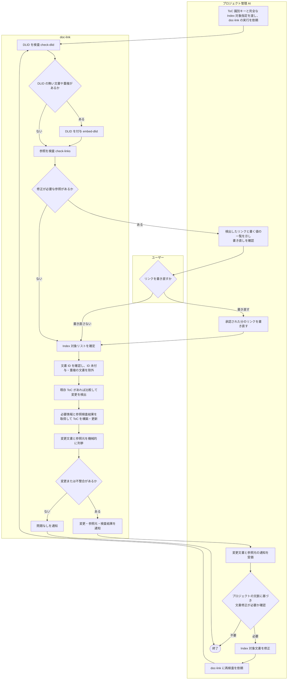
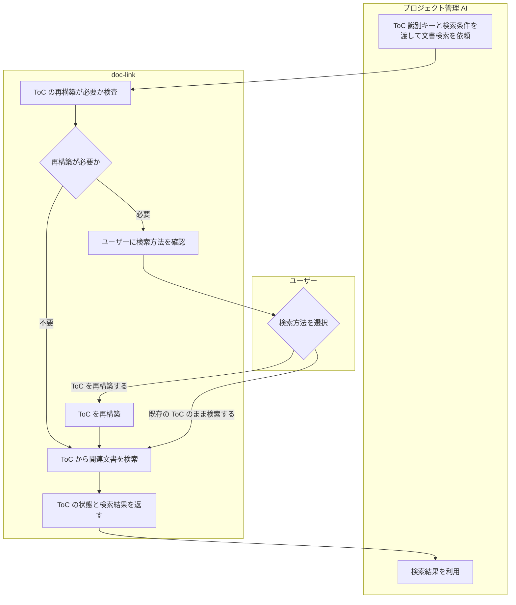

# doc-link 要件定義書 — 総論 DLID-75ja6a0cja5m

## 文書構成 DLID-mf1pxc9fkj0k

[総論][req-001] · [Index 対象と文書 ID][req-002] · [ToC 管理][req-003] · [文書検索][req-004] · [参照と変更通知][req-005] · [検索基盤の切り替え][req-006]

本書は全体の目的、共通の非機能要件および検出事項を扱う。各処理の機能要件と受け入れ条件は対応する文書に記載する。

章番号と FR・AC・NFR・D の識別子は、分割前の番号を維持する。そのため、各ファイル内の章番号は連続しない。本文中の節番号は該当文書へのリンクとする。

決定事項（D）の内容は、その決定を定める節の本文に書く。その節では、該当する記述に「（D-nnn）」の形で識別子を付ける。ほかの節と文書からは、定める節への[正式な参照]で引く。

## 1. 文書の目的 DLID-rfk4m7ftwvmr

本要件定義書群は、既存の DocAdvisor を置き換える新しい Claude Code 用プラグイン `doc-link` の要件を定義する。doc-link は文書の検索と索引管理を引き継ぎ、[文書 ID]による識別、参照関係管理、変更された文書とその参照元の通知を実現する。

本要件定義では「何を実現するか」を定義する。プラグインのディレクトリ構造、SKILL / Agent / script の分担、frontmatter の詳細スキーマ、実装言語などの「どのように実装するか」は後続の設計で定義する。

## 2. 背景 DLID-y8grft64a0qp

既存の DocAdvisor は、プロジェクト相対パスを[ToC]のエントリキーとして文書を管理し、ファイル単位のハッシュ値によって変更を検出する。

この方式には次の制約がある。

- 文書を別ディレクトリへ移動または改名すると、同一文書であってもパスが変わる
- パス変更だけでも[ToC]の再生成や[文書情報]の再抽出が必要になる
- Markdown リンク、ファイル名の記載、自然言語による言及など、文書間の参照方法が統一されていない
- 参照方法が統一されていないため、文書間の関連を機械的かつ網羅的に認識できない
- 参照先文書が変更された場合、その変更を反映すべき参照元文書を追跡することが困難である
- ファイル全体のハッシュだけでは、変更されたセクションと影響範囲を十分に限定できない

## 3. 目的 DLID-60kcbxa4yzy6

本プラグインは、DocAdvisor に代わってプロジェクト内の文書検索と索引管理を担う。文書をパスではなく恒久的な文書識別子で管理し、次を可能にする。

- タスクに関連する文書の検索
- 文書移動・改名に影響されない文書追跡
- 文書間の参照関係の機械的な把握
- 文書またはセクション変更時の影響範囲の特定
- 変更された文書を参照する文書の特定と、修正が必要になる可能性の[プロジェクト管理 AI]への通知
- リンク切れ、識別子重複、索引不整合の検出

索引管理の基本動作は、DocAdvisor の対象確定、差分検出、変更文書だけの情報取得、[ToC]の検証・確定、および失敗時の再実行という流れを参考にする。doc-link はこの流れに[文書 ID]の保証と[変更影響候補の通知]を組み込む新システムであり、DocAdvisor とコードや管理データを共有することは前提としない。

### 3.1 システム全体フロー DLID-5e8mpztyp4me

次の図は、プラグインの初期導入から文書管理、文書変更後の通知までを含む全体フローを示す。doc-link と[プロジェクト管理 AI]を別の実行主体としてブロック分けし、両者の受け渡しを明示する。初期導入では、明示的に起動する DLID 付与操作で[Index 対象文書]に[文書 ID]を付与してから、最初の主処理として[ToC]を構築する（[D-035][req-002-fr-001]）。導入と変更後は、同じ流れ（D-057）で、リンクの書き直しでは利用者の確認を挟みながら、DLID の検査、DLID の付与、参照の検査、[ToC]の構築、変更影響の検査の順に行う。[ToC]の構築は[Index 対象文書]を書き換えず、[文書 ID]が無い文書と[文書 ID]が重複する文書を[ToC]に入れずに報告する（[D-036][req-002-sec-9-1]）。参照の正しさは参照先として指定されたディレクトリを実際に検索して判定し、その結果を[ToC]に記録する。文書検索と[変更影響候補の通知]は、最後に正常確定した[ToC]を基盤に行う。

導入と、変更後の運用は、同じ流れで行う（D-057）。流れは `index-docs` を起点とし、その手順が持つ。

1. `check-dlid` で[DLID]の無い文書・見出しと、重複を検出する。
2. 検出があれば、DLID 付与操作で[DLID]を付与する。利用者には確認しない。[プロジェクト管理 AI]が起動することが承認である（[D-040][req-002-sec-9-2]）。付与した件数は、報告に含める。
3. `check-links` で参照を検査する。title に[DLID]の無いリンクなど、修正が必要な参照があれば、[プロジェクト管理 AI]が一覧（文書・行・書く値）を利用者に示し、書き直すかを確認する。承認された分だけ、[プロジェクト管理 AI]が書き直す（[D-031][req-001-nfr-004]・[D-042][req-005-fr-016]）。利用者に確認できない文脈（forge の SKILL に包まれた呼び出しなど）では、書き直さず、書き直す対象の一覧を報告する。
4. `index-docs` で[ToC]を構築・更新する。
5. `check-impact` で変更の影響を検査する。参照元の本文を直したときは、1 からやり直す。

- 導入は、この流れの初回である。検出が無いときは、2 と 3 の書き込みを行わない。
- 変更のたびに 1 から行うのは、[DLID]の無い文書が[ToC]に入らず、検索と参照の対象から外れる（[D-036][req-002-sec-9-1]）ためである。
- 3 を 4 の前に置くのは、title に書く値が参照先の現物から決まり、`check-links` が[ToC]を読まないためである。
- 5 を 4 の後に置くのは、`check-impact` が最新の[ToC]を前提とするためである。
- 各 SKILL は自分の処理だけを行い、次の SKILL の実行を促さない。流れを進めるのは[プロジェクト管理 AI]である。

### 3.2 文書検索フロー DLID-eeaqehrykrje

文書検索は、初回[ToC]構築後の独立した利用フローとして扱う。指定キーの[ToC]が未構築なら検索を行わず、初回構築が必要であることを返す。次の図は、既存[ToC]がある場合の検索フローを示す。

「既存の[ToC]のまま検索する」が選択された場合、doc-link は[ToC]を更新せず、その[ToC]が現在の[Index 対象文書]を反映していない可能性を検索結果に明示する。この検索結果を、最新の文書集合に基づく結果として扱ってはならない。

## 4. 用語 DLID-4g10ekjssxdx

本文では、次の表の用語を `[用語]` の形で書く。コードブロック・図・インラインコード・リンクの表示文字列では括弧を付けない。

| 用語                    | 定義                                                                                                                                                                                                |
| ----------------------- | --------------------------------------------------------------------------------------------------------------------------------------------------------------------------------------------------- |
| [DLID]                  | doc-link が発行する恒久的な識別子。固定プレフィックス `DLID-` と、小文字の Crockford Base32 で 12 文字の値部分からなる（[D-028][req-002-fr-001]）。[文書 ID]と[セクション ID]はどちらも[DLID]である |
| [文書 ID]               | パスやファイル名から独立し、[Index 対象文書]を一意に識別する恒久的な識別子。[DLID]で表す                                                                                                            |
| [セクション ID]         | セクションを恒久的に識別する[DLID]。すべての見出しの行の末尾に置く（[D-033][req-005-sec-13-1]）                                                                                                     |
| [正式な参照]            | リファレンスリンクの定義のうち、title の最後の語が[DLID]であるもの（[D-032][req-005-fr-007]）                                                                                                       |
| [ToC]                   | 一つの[ToC 識別キー]ごとの論理的な索引。[文書 ID]、現在のパス、要約、ハッシュ、参照関係などを持つ。構築中は候補であり、検査に通って確定したものだけを検索と検査に使う                               |
| [ToC 候補]              | 構築中の[ToC]。検査に通るまで検索と検査に使わない                                                                                                                                                   |
| [確定 ToC]              | 検査に通って確定した最新の[ToC]。検索と検査が使う                                                                                                                                                   |
| [文書情報]              | 文書ごとに一つ持つ情報（タイトル、目的、概要、適用作業、キーワード、[内容ハッシュ]など）。[ToC 識別キー]から独立し、全[ToC]が共有する                                                               |
| [AI 生成フィールド]     | [文書情報]のうち、[情報生成 AI]が文書を読んで作る項目（目的、概要、適用作業、キーワード、見出しから取れないタイトル）                                                                               |
| [現在ハッシュ]          | 現在の文書から計算した[内容ハッシュ]                                                                                                                                                                |
| [反映済みハッシュ]      | [確定 ToC]に記録した[内容ハッシュ]                                                                                                                                                                  |
| [情報生成 AI]           | [AI 生成フィールド]を作る AI                                                                                                                                                                        |
| [検索 AI]               | [確定 ToC]を読んで、タスクに関連する文書を選ぶ AI                                                                                                                                                   |
| [内容ハッシュ]          | 文書またはセクションの原文のハッシュ。算出規則は [D-039][req-003-sec-10-1-2]                                                                                                                        |
| [変更影響候補の通知]    | 変更された文書と、その文書を参照する文書を列挙して呼び出し元へ通知する処理                                                                                                                          |
| [ToC 識別キー]          | [Index 対象リスト]とその[ToC]を識別する、呼び出し元が決定する opaque key。[文書 ID]や文書分類そのものではない                                                                                       |
| [Index 対象指定]        | ユーザーまたは呼び出し元スキルが doc-link へ渡す、指定した[ToC 識別キー]の[ToC]に入れるべき Markdown の完全な desired state                                                                         |
| [Index 対象リスト]      | [Index 対象指定]を解釈・検証して展開し、除外指定を適用した、今回処理する具体的な Markdown ファイルの一覧                                                                                            |
| [確定 Index 対象リスト] | [Index 対象リスト]から、[文書 ID]が無い文書と[文書 ID]が重複する文書を除いた一覧。[ToC]の構築が[ToC]に入れる文書                                                                                    |
| [Index 済みリスト]      | 最後に確定した[ToC]に入っている文書の一覧                                                                                                                                                           |
| [Index 対象文書]        | [Index 対象リスト]に含まれる Markdown 文書。[ToC]の構築と DLID 付与操作の対象になる                                                                                                                 |
| [プロジェクト管理 AI]   | 対象プロジェクトの目的、仕様および運用規則を理解し、doc-link の通知を受けて[Index 対象文書]を実際に修正する外部の実行主体                                                                           |
| [doc-db]                | 文書の本文を分割して Embedding し、検索する外部のサービス（doc-db-mcp-server）。[DLID]を識別子として扱わず、文書のパスの変更・移動・削除を知らない（[REQ-006][req-006]）                            |
| [検索基盤]              | [ToC]の構築と文書検索の裏側。[doc-db]と[ToC]の 2 つがある（[REQ-006][req-006]）                                                                                                                     |
| [強制スイッチ]          | [doc-db]が動作するときでも、[ToC]を[検索基盤]に使うことを、利用者が明示する指定（[REQ-006][req-006]）                                                                                               |
| [自動切り替え]          | [doc-db]に接続できないとき、または OpenAI が失敗したときに、その実行の[検索基盤]を[ToC]へ切り替える仕組み。[強制スイッチ]とは別である（[REQ-006][req-006]）                                         |

## 5. 対象範囲 DLID-wsdmwtxdbjv8

### 5.1 対象に含むもの DLID-mhwc8t5mn230

- Markdown 文書
- ユーザーまたは呼び出し元スキルから与えられた[ToC 識別キー]と[Index 対象指定]の解釈・検証、および[Index 対象リスト]の確定
- 明示的に起動する DLID 付与操作による[DLID]の発行および[Index 対象文書]への書き込み
- [文書 ID]の存在および一意性の検査
- [文書 ID]と現在のファイルパスの対応管理
- 呼び出し元が指定した[DLID]から現在のパスを返す解決
- 文書の[AI 生成フィールド]の生成および管理
- [文書 ID]を使用した文書間参照
- 文書間参照の抽出および順方向・逆方向の追跡
- 文書全体またはセクション単位の変更検出
- 変更された文書を参照する文書の特定
- doc-link による参照元文書の機械的な列挙と[プロジェクト管理 AI]への通知
- タスクに関連する文書の検索

### 5.2 初期段階では対象に含めないもの DLID-as804n622psf

- 文書間の意味的な影響をスクリプトだけで確定すること
- [DLID]の書き込みを除き、doc-link 自身が[Index 対象文書]の本文、見出しまたは参照リンクを修正すること
- Swift など、Markdown 以外のファイル形式を Index 対象にすること
- ソースコード上の型・関数・モジュール依存関係を文書参照として解析すること
- 端末・ストレージ障害に対する[ToC]のバックアップおよび復旧
- プラグインの配布構造や Claude Code の起動経路に関する実装設計

### 5.3 責務境界 DLID-1eq5zz8q9cnd

| 主体                  | 行うこと                                                                                                                               | 行わないこと                                                       |
| --------------------- | -------------------------------------------------------------------------------------------------------------------------------------- | ------------------------------------------------------------------ |
| doc-link              | DLID 付与操作による[DLID]の発行と書き込み、[ToC]の生成・更新、文書検索、[DLID]の解決、整合性検査、変更検出、参照元の列挙と通知         | 修正要否の判断、および[DLID]の書き込みを除く[Index 対象文書]の修正 |
| [プロジェクト管理 AI] | doc-link の通知と対象プロジェクトの目的・仕様・運用規則を基に修正要否を確認し、必要な文書修正を実行した後、doc-link に再検査を要求する | [文書 ID]の手動採番および[ToC]の直接編集                           |

doc-link は対象プロジェクトの目的、仕様および変更意図を、文書の修正要否を判断できるだけの前提知識として保持しない。このため、doc-link は変更の事実、把握した参照元、および機械的な検査結果だけを報告する。参照元の修正要否の判断と文書修正は[プロジェクト管理 AI]の責務とする（D-009）。

doc-link が[Index 対象文書]へ書き込めるのは、[文書 ID]管理システムが発行した[DLID]を書き込む場合に限る（[D-031][req-001-nfr-004]）。[ToC]は doc-link 自身の管理データであり、この制約の対象となる[Index 対象文書]には含まれない。

## 16. 非機能要件 DLID-hbbgn0ntymfb

### NFR-001 [ToC]再構築の一貫性 DLID-j4xry3ca5rsb

同一の[ToC 識別キー]と[Index 対象文書]集合から[ToC]を再構築した場合、[文書 ID]、現在パス、ハッシュおよび参照関係について論理的に同一の結果を得ること。再構築途中または失敗した状態を現在状態として扱わないこと。あるキーの再構築結果が別のキーの[ToC]に依存しないこと。

### NFR-002 決定性 DLID-a15zpxfdm683

同一の入力ファイル群に対する機械的な走査、ID 検証、参照抽出およびハッシュ計算は、実行ごとに同一の結果を返すこと。

### NFR-003 冪等性 DLID-vwg7kb3g5efa

内容が変わっていない状態で索引更新やリンク検査を複数回実行しても、[Index 対象文書]および索引に不必要な差分を発生させないこと。

### NFR-004 [Index 対象文書]への書き込み境界 DLID-kp2w32mbpdb8

doc-link が[Index 対象文書]へ行う書き込みは、[文書 ID]管理システムが発行した[DLID]の書き込みだけに限定すること。書き込める位置は、frontmatter の `doc_link_id` と、見出しの行の末尾（見出しのテキストの後に空白で区切って置く[セクション ID]）の 2 つとする。HTML、リンク、リンクの title、見出しのテキスト、本文は書き込まず、書き換えないこと。書き込み後に再解析し、差分が[DLID]の追加・置換だけであることを検証し、それ以外の差分があれば書き込みを取り消して報告すること（D-031。frontmatter を新設するときの空行は [D-051][req-002-sec-6-2]）。[DLID]以外の本文、見出しのテキストおよび参照リンクの表示文字列・リンク先・title については検出した変更・不整合と参照元を[プロジェクト管理 AI]へ通知し、doc-link 自身は修正要否を判断せず、修正もしないこと。

### NFR-005 診断可能性 DLID-89jss0ty2c7m

エラーまたは不整合を検出した場合、少なくとも[文書 ID]、パス、問題箇所および機械的に確認した原因を確認できること。

### NFR-006 中断後の再実行 DLID-wwhfthxzv8pv

要約生成または[変更影響候補の通知]処理が途中で失敗・中断した場合、完了済みの処理を不必要に繰り返さず再開できること。

### NFR-007 スケーラビリティ DLID-8t5e2ddjq3b3

文書数の増加に対し、変更されていない全ファイルを毎回 AI に再解析しないこと。

機械的な走査とハッシュ比較によって、[情報生成 AI]が処理する対象を必要な文書へ限定すること。

### NFR-008 生成指示と検証基準の分離 DLID-fc5e4s6nctp9

[AI 生成フィールド]の生成処理へ渡すコンテキストには、記述上限 `L` だけを含めること。内部許容上限 `H`、許容係数、および許容余白の存在を含めてはならない。

検証器は内部許容上限を決定論的に計算し、生成処理とは独立して検査すること。検証エラーや再試行指示から内部許容上限を直接開示してはならない。

## 17. エラーおよび警告 DLID-g9dhzhr5v566

### 17.1 エラー候補 DLID-8crwqpf21hbe

処理を正常完了として扱えない状態の候補を次に示す。

- `--key` が空、または予約語 `all` を任意キーとして指定している
- `--key` を指定せずに対象指定を渡している
- `--all` と対象指定を併用している
- `--key` を指定したが[Index 対象指定]がない、または[Index 対象リスト]を確定できない
- DLID 付与操作で[DLID]の発行または書き込みに失敗した
- [ToC]を解析できない、または索引データ自体の整合性検査に失敗した
- ハッシュ計算または対象ファイルの読み取りに失敗した
- [AI 生成フィールド]が[§7.4][req-003-sec-7-4]の内部許容上限を超えている

### 17.2 [ToC]確定を妨げない検出事項 DLID-qjvks8663ycf

[ToC]に記録し、必要に応じて通知する状態の候補を次に示す。

- 参照先として指定されたディレクトリを正常に検索した結果、[文書 ID]が見つからない
- [文書 ID]と参照リンクの実体パスが一致しない
- 参照リンクのフラグメントが参照先のセクションへ解決しない
- 正式な ID 参照ではない既存 Markdown リンクを検出した
- ファイル名による参照らしき記述を検出した
- 文書は変更されたが参照元が存在しない
- セクション単位の追跡ができず、文書全体を影響対象とした
- [文書 ID]が無い文書、または同じ[文書 ID]を持つ複数の文書を[ToC]から除外した

通知に重要度の分類は設けない。指定ディレクトリ内での参照先不在および参照パス不一致は[ToC]の確定を妨げず、検査結果として保持すること。参照先ディレクトリを検索できない場合も、「指定ディレクトリ内に不在」と記録して[ToC]を確定する（[D-025][req-005-fr-009]）。[文書 ID]が無い文書と[文書 ID]が重複する文書は[ToC]に入れずに報告し、[ToC]の確定を妨げない（[D-036][req-002-sec-9-1]）。

[req-001]: REQ-001_overview.md "93356ddc0c6c DLID-veg2nsjk8zw1"
[req-002]: REQ-002_document-id.md "d4eb78414c6e DLID-bk29x4s8tadq"
[req-003]: REQ-003_toc.md "c065536a773d DLID-kxe3nxfgk491"
[req-004]: REQ-004_search.md "3dee26a7c09a DLID-h96208rqr773"
[req-005]: REQ-005_references.md "762ad095b964 DLID-pc44gkb54821"
[req-006]: REQ-006_backend-switch.md "396317c2ec8a DLID-emxm9mx5a4d2"
[req-003-sec-7-4]: REQ-003_toc.md#74-ai-生成フィールドの上限-dlid-afs68x15mq0n "2cdcc9befbb7 DLID-afs68x15mq0n"
[req-001-nfr-004]: REQ-001_overview.md#nfr-004-index-対象文書への書き込み境界-dlid-kp2w32mbpdb8 "4ca9ecf3d971 DLID-kp2w32mbpdb8"
[req-002-fr-001]: REQ-002_document-id.md#fr-001-文書-idの発行と読み取り-dlid-z0g4zx0wr0cn "594d2964b515 DLID-z0g4zx0wr0cn"
[req-002-sec-6-2]: REQ-002_document-id.md#62-markdown-への文書-id記載-dlid-5h2et5v540gs "5c219073abcb DLID-5h2et5v540gs"
[req-002-sec-9-1]: REQ-002_document-id.md#91-文書-id確認処理-dlid-5ht9ebyeq2m3 "b6c21c9348ef DLID-5ht9ebyeq2m3"
[req-002-sec-9-2]: REQ-002_document-id.md#92-dlid-付与操作-dlid-mkcvqte59nvc "72f09c754e09 DLID-mkcvqte59nvc"
[req-003-sec-10-1-2]: REQ-003_toc.md#1012-内容ハッシュ-dlid-c3prh9y4nbzw "dfb119ed393a DLID-c3prh9y4nbzw"
[req-005-fr-007]: REQ-005_references.md#fr-007-文書-idを使用した参照-dlid-p7t2pht6h17a "cebfeb0e3b60 DLID-p7t2pht6h17a"
[req-005-fr-009]: REQ-005_references.md#fr-009-id-付きリンクの検査-dlid-zacf5tmy6x4x "2351b357da12 DLID-zacf5tmy6x4x"
[req-005-fr-016]: REQ-005_references.md#fr-016-不整合検査-dlid-jhkngqtfdnhn "0cbc9091ee0f DLID-jhkngqtfdnhn"
[req-005-sec-13-1]: REQ-005_references.md#131-セクション参照-dlid-5p5ms6a74w73 "275305521655 DLID-5p5ms6a74w73"
