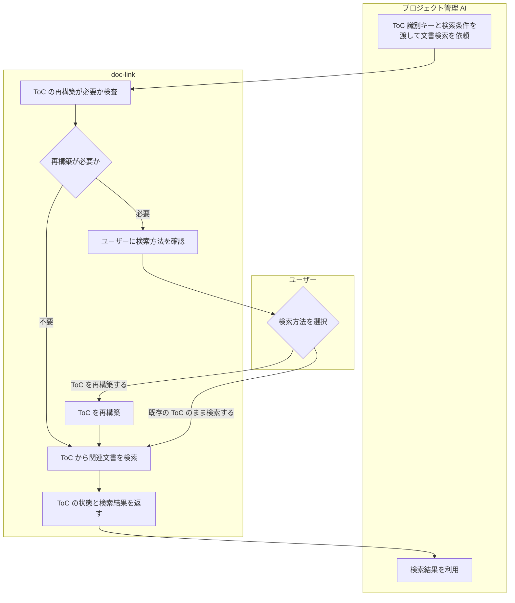

# doc-link 要件定義書 — 総論 DLID-75ja6a0cja5m

**作成日**: 2026-09-18\
**対象**: Claude Code 用プラグイン `doc-link`（仮称）

## 文書構成 DLID-mf1pxc9fkj0k

[総論][req-001] · [Index 対象と文書 ID][req-002] · [ToC 管理][req-003] · [文書検索][req-004] · [参照と変更通知][req-005]

本書は全体の目的、共通の非機能要件、検出事項および決定事項を扱う。各処理の機能要件と受け入れ条件は対応する文書に記載する。

章番号と FR・AC・NFR・D の識別子は、分割前の番号を維持する。そのため、各ファイル内の章番号は連続しない。本文中の節番号は該当文書へのリンクとする。

## 1. 文書の目的 DLID-rfk4m7ftwvmr

本要件定義書群は、既存の DocAdvisor を置き換える新しい Claude Code 用プラグイン `doc-link` の要件を定義する。doc-link は文書の検索と索引管理を引き継ぎ、[文書 ID]による識別、参照関係管理、変更された文書とその参照元の通知を実現する。

本要件定義では「何を実現するか」を定義する。プラグインのディレクトリ構造、SKILL / Agent / script の分担、frontmatter の詳細スキーマ、実装言語などの「どのように実装するか」は後続の設計で定義する。

## 2. 背景 DLID-y8grft64a0qp

既存の DocAdvisor は、プロジェクト相対パスを[ToC]のエントリキーとして文書を管理し、ファイル単位のハッシュ値によって変更を検出する。

この方式には次の制約がある。

- 文書を別ディレクトリへ移動または改名すると、同一文書であってもパスが変わる
- パス変更だけでも[ToC]の再生成や[文書情報]の再抽出が必要になる
- Markdown リンク、ファイル名の記載、自然言語による言及など、文書間の参照方法が統一されていない
- 参照方法が統一されていないため、文書間の関連を機械的かつ網羅的に認識できない
- 参照先文書が変更された場合、その変更を反映すべき参照元文書を追跡することが困難である
- ファイル全体のハッシュだけでは、変更されたセクションと影響範囲を十分に限定できない

## 3. 目的 DLID-60kcbxa4yzy6

本プラグインは、DocAdvisor に代わってプロジェクト内の文書検索と索引管理を担う。文書をパスではなく恒久的な文書識別子で管理し、次を可能にする。

- タスクに関連する文書の検索
- 文書移動・改名に影響されない文書追跡
- 文書間の参照関係の機械的な把握
- 文書またはセクション変更時の影響範囲の特定
- 変更された文書を参照する文書の特定と、修正が必要になる可能性の[プロジェクト管理 AI]への通知
- リンク切れ、識別子重複、索引不整合の検出

索引管理の基本動作は、DocAdvisor の対象確定、差分検出、変更文書だけの情報取得、[ToC]の検証・確定、および失敗時の再実行という流れを参考にする。doc-link はこの流れに[文書 ID]の保証と[変更影響候補の通知]を組み込む新システムであり、DocAdvisor とコードや管理データを共有することは前提としない。

### 3.1 システム全体フロー DLID-5e8mpztyp4me

次の図は、プラグインの初期導入から文書管理、文書変更後の通知までを含む全体フローを示す。doc-link と[プロジェクト管理 AI]を別の実行主体としてブロック分けし、両者の受け渡しを明示する。初期導入では、明示的に起動する DLID 付与操作で[Index 対象文書]に[文書 ID]を付与してから、最初の主処理として[ToC]を構築する（D-035）。導入と変更後は、同じ流れ（D-057）で、リンクの書き直しでは利用者の確認を挟みながら、DLID の検査、DLID の付与、参照の検査、[ToC]の構築、変更影響の検査の順に行う。[ToC]の構築は[Index 対象文書]を書き換えず、[文書 ID]が無い文書と[文書 ID]が重複する文書を[ToC]に入れずに報告する（D-036）。参照の正しさは参照先として指定されたディレクトリを実際に検索して判定し、その結果を[ToC]に記録する。文書検索と[変更影響候補の通知]は、最後に正常確定した[ToC]を基盤に行う。

### 3.2 文書検索フロー DLID-eeaqehrykrje

文書検索は、初回[ToC]構築後の独立した利用フローとして扱う。指定キーの[ToC]が未構築なら検索を行わず、初回構築が必要であることを返す。次の図は、既存[ToC]がある場合の検索フローを示す。

「既存の[ToC]のまま検索する」が選択された場合、doc-link は[ToC]を更新せず、その[ToC]が現在の[Index 対象文書]を反映していない可能性を検索結果に明示する。この検索結果を、最新の文書集合に基づく結果として扱ってはならない。

## 4. 用語 DLID-4g10ekjssxdx

本文では、次の表の用語を `[用語]` の形で書く。コードブロック・図・インラインコード・リンクの表示文字列では括弧を付けない。

| 用語                    | 定義                                                                                                                                                                              |
| ----------------------- | --------------------------------------------------------------------------------------------------------------------------------------------------------------------------------- |
| [DLID]                  | doc-link が発行する恒久的な識別子。固定プレフィックス `DLID-` と、小文字の Crockford Base32 で 12 文字の値部分からなる（D-028）。[文書 ID]と[セクション ID]はどちらも[DLID]である |
| [文書 ID]               | パスやファイル名から独立し、[Index 対象文書]を一意に識別する恒久的な識別子。[DLID]で表す                                                                                          |
| [セクション ID]         | セクションを恒久的に識別する[DLID]。すべての見出しの行の末尾に置く（D-033）                                                                                                       |
| [正式な参照]            | リファレンスリンクの定義のうち、title の最後の語が[DLID]であるもの（D-032）                                                                                                       |
| [ToC]                   | 一つの[ToC 識別キー]ごとの論理的な索引。[文書 ID]、現在のパス、要約、ハッシュ、参照関係などを持つ。構築中は候補であり、検査に通って確定したものだけを検索と検査に使う             |
| [ToC 候補]              | 構築中の[ToC]。検査に通るまで検索と検査に使わない                                                                                                                                 |
| [確定 ToC]              | 検査に通って確定した最新の[ToC]。検索と検査が使う                                                                                                                                 |
| [文書情報]              | 文書ごとに一つ持つ情報（タイトル、目的、概要、適用作業、キーワード、[内容ハッシュ]など）。[ToC 識別キー]から独立し、全[ToC]が共有する                                             |
| [AI 生成フィールド]     | [文書情報]のうち、[情報生成 AI]が文書を読んで作る項目（目的、概要、適用作業、キーワード、見出しから取れないタイトル）                                                             |
| [現在ハッシュ]          | 現在の文書から計算した[内容ハッシュ]                                                                                                                                              |
| [反映済みハッシュ]      | [確定 ToC]に記録した[内容ハッシュ]                                                                                                                                                |
| [情報生成 AI]           | [AI 生成フィールド]を作る AI                                                                                                                                                      |
| [検索 AI]               | [確定 ToC]を読んで、タスクに関連する文書を選ぶ AI                                                                                                                                 |
| [内容ハッシュ]          | 文書またはセクションの原文のハッシュ。算出規則は D-039                                                                                                                            |
| [変更影響候補の通知]    | 変更された文書と、その文書を参照する文書を列挙して呼び出し元へ通知する処理                                                                                                        |
| [ToC 識別キー]          | [Index 対象リスト]とその[ToC]を識別する、呼び出し元が決定する opaque key。[文書 ID]や文書分類そのものではない                                                                     |
| [Index 対象指定]        | ユーザーまたは呼び出し元スキルが doc-link へ渡す、指定した[ToC 識別キー]の[ToC]に入れるべき Markdown の完全な desired state                                                       |
| [Index 対象リスト]      | [Index 対象指定]を解釈・検証して展開し、除外指定を適用した、今回処理する具体的な Markdown ファイルの一覧                                                                          |
| [確定 Index 対象リスト] | [Index 対象リスト]から、[文書 ID]が無い文書と[文書 ID]が重複する文書を除いた一覧。[ToC]の構築が[ToC]に入れる文書                                                                  |
| [Index 済みリスト]      | 最後に確定した[ToC]に入っている文書の一覧                                                                                                                                         |
| [Index 対象文書]        | [Index 対象リスト]に含まれる Markdown 文書。[ToC]の構築と DLID 付与操作の対象になる                                                                                               |
| [プロジェクト管理 AI]   | 対象プロジェクトの目的、仕様および運用規則を理解し、doc-link の通知を受けて[Index 対象文書]を実際に修正する外部の実行主体                                                         |

## 5. 対象範囲 DLID-wsdmwtxdbjv8

### 5.1 対象に含むもの DLID-mhwc8t5mn230

- Markdown 文書
- ユーザーまたは呼び出し元スキルから与えられた[ToC 識別キー]と[Index 対象指定]の解釈・検証、および[Index 対象リスト]の確定
- 明示的に起動する DLID 付与操作による[DLID]の発行および[Index 対象文書]への書き込み
- [文書 ID]の存在および一意性の検査
- [文書 ID]と現在のファイルパスの対応管理
- 呼び出し元が指定した[DLID]から現在のパスを返す解決
- 文書の[AI 生成フィールド]の生成および管理
- [文書 ID]を使用した文書間参照
- 文書間参照の抽出および順方向・逆方向の追跡
- 文書全体またはセクション単位の変更検出
- 変更された文書を参照する文書の特定
- doc-link による参照元文書の機械的な列挙と[プロジェクト管理 AI]への通知
- タスクに関連する文書の検索

### 5.2 初期段階では対象に含めないもの DLID-as804n622psf

- 文書間の意味的な影響をスクリプトだけで確定すること
- [DLID]の書き込みを除き、doc-link 自身が[Index 対象文書]の本文、見出しまたは参照リンクを修正すること
- Swift など、Markdown 以外のファイル形式を Index 対象にすること
- ソースコード上の型・関数・モジュール依存関係を文書参照として解析すること
- 端末・ストレージ障害に対する[ToC]のバックアップおよび復旧
- プラグインの配布構造や Claude Code の起動経路に関する実装設計

### 5.3 責務境界 DLID-1eq5zz8q9cnd

| 主体                  | 行うこと                                                                                                                               | 行わないこと                                                       |
| --------------------- | -------------------------------------------------------------------------------------------------------------------------------------- | ------------------------------------------------------------------ |
| doc-link              | DLID 付与操作による[DLID]の発行と書き込み、[ToC]の生成・更新、文書検索、[DLID]の解決、整合性検査、変更検出、参照元の列挙と通知         | 修正要否の判断、および[DLID]の書き込みを除く[Index 対象文書]の修正 |
| [プロジェクト管理 AI] | doc-link の通知と対象プロジェクトの目的・仕様・運用規則を基に修正要否を確認し、必要な文書修正を実行した後、doc-link に再検査を要求する | [文書 ID]の手動採番および[ToC]の直接編集                           |

doc-link は対象プロジェクトの目的、仕様および変更意図を、文書の修正要否を判断できるだけの前提知識として保持しない。このため、doc-link は変更の事実、把握した参照元、および機械的な検査結果だけを報告する。参照元の修正要否の判断と文書修正は[プロジェクト管理 AI]の責務とする。

doc-link が[Index 対象文書]へ書き込めるのは、[文書 ID]管理システムが発行した[DLID]を書き込む場合に限る（D-031）。[ToC]は doc-link 自身の管理データであり、この制約の対象となる[Index 対象文書]には含まれない。

## 16. 非機能要件 DLID-hbbgn0ntymfb

### NFR-001 [ToC]再構築の一貫性 DLID-j4xry3ca5rsb

同一の[ToC 識別キー]と[Index 対象文書]集合から[ToC]を再構築した場合、[文書 ID]、現在パス、ハッシュおよび参照関係について論理的に同一の結果を得ること。再構築途中または失敗した状態を現在状態として扱わないこと。あるキーの再構築結果が別のキーの[ToC]に依存しないこと。

### NFR-002 決定性 DLID-a15zpxfdm683

同一の入力ファイル群に対する機械的な走査、ID 検証、参照抽出およびハッシュ計算は、実行ごとに同一の結果を返すこと。

### NFR-003 冪等性 DLID-vwg7kb3g5efa

内容が変わっていない状態で索引更新やリンク検査を複数回実行しても、[Index 対象文書]および索引に不必要な差分を発生させないこと。

### NFR-004 [Index 対象文書]への書き込み境界 DLID-kp2w32mbpdb8

doc-link が[Index 対象文書]へ行う書き込みは、[文書 ID]管理システムが発行した[DLID]の書き込みだけに限定すること。書き込める位置は、frontmatter の `doc_link_id` と、見出しの行の末尾（見出しのテキストの後に空白で区切って置く[セクション ID]）の 2 つとする。HTML、リンク、リンクの title、見出しのテキスト、本文は書き込まず、書き換えないこと。書き込み後に再解析し、差分が[DLID]の追加・置換だけであることを検証し、それ以外の差分があれば書き込みを取り消して報告すること（D-031。frontmatter を新設するときの空行は D-051）。[DLID]以外の本文、見出しのテキストおよび参照リンクの表示文字列・リンク先・title については検出した変更・不整合と参照元を[プロジェクト管理 AI]へ通知し、doc-link 自身は修正要否を判断せず、修正もしないこと。

### NFR-005 診断可能性 DLID-89jss0ty2c7m

エラーまたは不整合を検出した場合、少なくとも[文書 ID]、パス、問題箇所および機械的に確認した原因を確認できること。

### NFR-006 中断後の再実行 DLID-wwhfthxzv8pv

要約生成または[変更影響候補の通知]処理が途中で失敗・中断した場合、完了済みの処理を不必要に繰り返さず再開できること。

### NFR-007 スケーラビリティ DLID-8t5e2ddjq3b3

文書数の増加に対し、変更されていない全ファイルを毎回 AI に再解析しないこと。

機械的な走査とハッシュ比較によって、[情報生成 AI]が処理する対象を必要な文書へ限定すること。

### NFR-008 生成指示と検証基準の分離 DLID-fc5e4s6nctp9

[AI 生成フィールド]の生成処理へ渡すコンテキストには、記述上限 `L` だけを含めること。内部許容上限 `H`、許容係数、および許容余白の存在を含めてはならない。

検証器は内部許容上限を決定論的に計算し、生成処理とは独立して検査すること。検証エラーや再試行指示から内部許容上限を直接開示してはならない。

## 17. エラーおよび警告 DLID-g9dhzhr5v566

### 17.1 エラー候補 DLID-8crwqpf21hbe

処理を正常完了として扱えない状態の候補を次に示す。

- `--key` が空、または予約語 `all` を任意キーとして指定している
- `--key` を指定せずに対象指定を渡している
- `--all` と対象指定を併用している
- `--key` を指定したが[Index 対象指定]がない、または[Index 対象リスト]を確定できない
- DLID 付与操作で[DLID]の発行または書き込みに失敗した
- [ToC]を解析できない、または索引データ自体の整合性検査に失敗した
- ハッシュ計算または対象ファイルの読み取りに失敗した
- [AI 生成フィールド]が[§7.4][req-003-sec-7-4]の内部許容上限を超えている

### 17.2 [ToC]確定を妨げない検出事項 DLID-qjvks8663ycf

[ToC]に記録し、必要に応じて通知する状態の候補を次に示す。

- 参照先として指定されたディレクトリを正常に検索した結果、[文書 ID]が見つからない
- [文書 ID]と参照リンクの実体パスが一致しない
- 参照リンクのフラグメントが参照先のセクションへ解決しない
- 正式な ID 参照ではない既存 Markdown リンクを検出した
- ファイル名による参照らしき記述を検出した
- 文書は変更されたが参照元が存在しない
- セクション単位の追跡ができず、文書全体を影響対象とした
- [文書 ID]が無い文書、または同じ[文書 ID]を持つ複数の文書を[ToC]から除外した

通知に重要度の分類は設けない。指定ディレクトリ内での参照先不在および参照パス不一致は[ToC]の確定を妨げず、検査結果として保持すること。参照先ディレクトリを検索できない場合も、「指定ディレクトリ内に不在」と記録して[ToC]を確定する（D-025）。[文書 ID]が無い文書と[文書 ID]が重複する文書は[ToC]に入れずに報告し、[ToC]の確定を妨げない（D-036）。

## 19. 決定事項 DLID-phx3m5ynd4s4

| ID    | 論点                                        | 決定内容                                                                                                                                                                                                                                                                                                                                                                                                                                                                                                                                                                                                                                                                                                                                                                                                                                                                                                                                                                                                                                                                                                                                                                                                                                                                                                                             |
| ----- | ------------------------------------------- | ------------------------------------------------------------------------------------------------------------------------------------------------------------------------------------------------------------------------------------------------------------------------------------------------------------------------------------------------------------------------------------------------------------------------------------------------------------------------------------------------------------------------------------------------------------------------------------------------------------------------------------------------------------------------------------------------------------------------------------------------------------------------------------------------------------------------------------------------------------------------------------------------------------------------------------------------------------------------------------------------------------------------------------------------------------------------------------------------------------------------------------------------------------------------------------------------------------------------------------------------------------------------------------------------------------------------------------ |
| D-001 | [文書 ID]を記載するキーの名称               | `doc_link_id`                                                                                                                                                                                                                                                                                                                                                                                                                                                                                                                                                                                                                                                                                                                                                                                                                                                                                                                                                                                                                                                                                                                                                                                                                                                                                                                        |
| D-002 | [AI 生成フィールド]の文字数検証             | [情報生成 AI]には記述上限だけを提示し、検証器はその `1.3` 倍を切り捨てた内部許容上限まで受理する                                                                                                                                                                                                                                                                                                                                                                                                                                                                                                                                                                                                                                                                                                                                                                                                                                                                                                                                                                                                                                                                                                                                                                                                                                     |
| D-003 | [文書 ID]を取得できない状態の分類           | 欠落、空値、解析不能などを「[文書 ID]が存在しない」に統合し、形式不正を独立分類にしない                                                                                                                                                                                                                                                                                                                                                                                                                                                                                                                                                                                                                                                                                                                                                                                                                                                                                                                                                                                                                                                                                                                                                                                                                                              |
| D-004 | [文書 ID]の発行主体と不変性                 | [文書 ID]管理システムが一度だけ発行し、[Index 対象文書]へ保存した値を以後変更しない                                                                                                                                                                                                                                                                                                                                                                                                                                                                                                                                                                                                                                                                                                                                                                                                                                                                                                                                                                                                                                                                                                                                                                                                                                                  |
| D-005 | [文書 ID]の外部表現                         | `DLID-` と固定長のハッシュ値で構成し、ハッシュ値部分に文書の意味を持たせない                                                                                                                                                                                                                                                                                                                                                                                                                                                                                                                                                                                                                                                                                                                                                                                                                                                                                                                                                                                                                                                                                                                                                                                                                                                         |
| D-006 | 初期版の Index 対象                         | Markdown 文書だけを Index 対象とする                                                                                                                                                                                                                                                                                                                                                                                                                                                                                                                                                                                                                                                                                                                                                                                                                                                                                                                                                                                                                                                                                                                                                                                                                                                                                                 |
| D-007 | [ToC]の位置づけ                             | [ToC]は最後に正常確定した索引状態であり、現在の[Index 対象文書]を反映しているかは構築・再構築要否の検査結果によって区別する                                                                                                                                                                                                                                                                                                                                                                                                                                                                                                                                                                                                                                                                                                                                                                                                                                                                                                                                                                                                                                                                                                                                                                                                          |
| D-008 | [ToC]構築前の[文書 ID]付与                  | [文書 ID]は、[ToC]の構築の前に、DLID 付与操作（D-035）で[Index 対象文書]へ付与する。[文書 ID]が無い文書の[ToC]構築での扱いは、D-036 に従う                                                                                                                                                                                                                                                                                                                                                                                                                                                                                                                                                                                                                                                                                                                                                                                                                                                                                                                                                                                                                                                                                                                                                                                           |
| D-009 | 文書修正の実行主体                          | doc-link は変更文書と参照元を機械的に列挙・通知し、修正要否の判断と文書修正は[プロジェクト管理 AI]が行う。doc-link が[Index 対象文書]へ書き込める範囲は、D-031 に従う                                                                                                                                                                                                                                                                                                                                                                                                                                                                                                                                                                                                                                                                                                                                                                                                                                                                                                                                                                                                                                                                                                                                                                |
| D-010 | 文書検索前の[ToC]更新確認                   | 既存[ToC]の再構築が必要な場合はユーザーに確認し、更新後に検索するか、既存の[ToC]のまま検索するかを選択可能にする。[ToC]未構築時は初回構築を先に行う                                                                                                                                                                                                                                                                                                                                                                                                                                                                                                                                                                                                                                                                                                                                                                                                                                                                                                                                                                                                                                                                                                                                                                                  |
| D-011 | 再構築処理の責務範囲                        | [§9][req-002-sec-9]〜[§11][req-003-sec-11]は[文書 ID]の保証から[ToC]の構築・再構築結果返却までを扱い、文書検索と[変更影響候補の通知]はそれぞれ別フローとして扱う（ID の付与は D-035 で構築から分離し、構築では[文書 ID]の確認だけを行う）                                                                                                                                                                                                                                                                                                                                                                                                                                                                                                                                                                                                                                                                                                                                                                                                                                                                                                                                                                                                                                                                                            |
| D-012 | Index 対象範囲の決定主体                    | 対象指定モードでは doc-link は Index 対象を決定せず、ユーザーまたは呼び出し元スキルが[ToC 識別キー]ごとの完全な desired state として外部から与える                                                                                                                                                                                                                                                                                                                                                                                                                                                                                                                                                                                                                                                                                                                                                                                                                                                                                                                                                                                                                                                                                                                                                                                   |
| D-013 | [ToC 識別キー]                              | `--key` を導入し、[Index 対象リスト]と[ToC]を呼び出し元が決定する opaque key ごとに独立して管理する                                                                                                                                                                                                                                                                                                                                                                                                                                                                                                                                                                                                                                                                                                                                                                                                                                                                                                                                                                                                                                                                                                                                                                                                                                  |
| D-014 | 単体モード                                  | `--all` と引数なしは予約[ToC 識別キー] `all` の単体モードとする。`--key all`、key なしの対象指定、`--all` と対象指定の併用は認めない                                                                                                                                                                                                                                                                                                                                                                                                                                                                                                                                                                                                                                                                                                                                                                                                                                                                                                                                                                                                                                                                                                                                                                                                 |
| D-015 | 外部設定との責務境界                        | Forge 等の呼び出し元が `.doc_structure.yaml` などを解決して[ToC 識別キー]と対象指定を渡し、doc-link は外部設定を直接読まない                                                                                                                                                                                                                                                                                                                                                                                                                                                                                                                                                                                                                                                                                                                                                                                                                                                                                                                                                                                                                                                                                                                                                                                                         |
| D-016 | [文書 ID]と[ToC 識別キー]の関係             | `doc_link_id` は[ToC 識別キー]から独立した恒久的な文書識別子とし、所属する[ToC 識別キー]または Index 対象範囲の変更を理由に再発行しない                                                                                                                                                                                                                                                                                                                                                                                                                                                                                                                                                                                                                                                                                                                                                                                                                                                                                                                                                                                                                                                                                                                                                                                              |
| D-017 | [ToC]構築・再構築の責務分割                 | [Index 対象リスト]の確定を短い入力準備とし、その後を[文書 ID]の確認、変更検出、必要情報の取得と[ToC]更新の三段階に分ける                                                                                                                                                                                                                                                                                                                                                                                                                                                                                                                                                                                                                                                                                                                                                                                                                                                                                                                                                                                                                                                                                                                                                                                                             |
| D-018 | 参照不整合と[ToC]確定                       | 指定ディレクトリ内での参照先不在や参照パス不一致は[ToC]に記録して通知し、その発見を理由に[ToC]の構築・再構築を止めない                                                                                                                                                                                                                                                                                                                                                                                                                                                                                                                                                                                                                                                                                                                                                                                                                                                                                                                                                                                                                                                                                                                                                                                                               |
| D-019 | Index 対象からの離脱                        | 前回の[ToC]に存在し今回の[Index 対象リスト]にない文書は、そのキーの[ToC]から外す。対象範囲外を探索せず、物理的な削除と対象外への移動も区別しない                                                                                                                                                                                                                                                                                                                                                                                                                                                                                                                                                                                                                                                                                                                                                                                                                                                                                                                                                                                                                                                                                                                                                                                     |
| D-020 | 検索時に使用する[Index 対象指定]            | [ToC]には検索時に再解釈して現在の対象文書を列挙できる正規化済み[Index 対象指定]を保存し、復元できない識別値だけの保存は認めない                                                                                                                                                                                                                                                                                                                                                                                                                                                                                                                                                                                                                                                                                                                                                                                                                                                                                                                                                                                                                                                                                                                                                                                                      |
| D-021 | 参照検査の根拠                              | 参照先として指定されたディレクトリの実検索結果で存在とパスを判定する。[ToC 識別キー]への所属や保存済み[ToC]・データベースの登録有無だけでは、現在の参照の正しさを確定しない                                                                                                                                                                                                                                                                                                                                                                                                                                                                                                                                                                                                                                                                                                                                                                                                                                                                                                                                                                                                                                                                                                                                                          |
| D-022 | 同一文書の複数キー所属                      | [文書 ID]と[文書情報]は論理的に一つとし、同じ文書が複数の[ToC 識別キー]に同時所属することを認める。所属する[ToC 識別キー]の変化だけでは[文書 ID]を変更しない                                                                                                                                                                                                                                                                                                                                                                                                                                                                                                                                                                                                                                                                                                                                                                                                                                                                                                                                                                                                                                                                                                                                                                         |
| D-023 | [ToC]の保存方式                             | [ToC]は論理的な索引として要求し、JSON ファイルか RDB かなどの物理的な保存方式は要件として固定しない。いずれの方式でも同じ走査・確定・検索の要件を満たす                                                                                                                                                                                                                                                                                                                                                                                                                                                                                                                                                                                                                                                                                                                                                                                                                                                                                                                                                                                                                                                                                                                                                                              |
| D-024 | [文書情報]と[ToC]の版の範囲                 | [文書情報]は[文書 ID]ごとに常に最新の一つを持ち、全キーが共有する。[ToC]の版が表すのは[ToC]（所属、参照関係、[反映済みハッシュ]、検査結果）であり、既存の[ToC]のまま検索した場合も[文書情報]は最新を用いる。過去の内容の履歴は持たないので、文書を元の内容に戻した場合も、[AI 生成フィールド]は再生成する（履歴の保存を増やさないため）                                                                                                                                                                                                                                                                                                                                                                                                                                                                                                                                                                                                                                                                                                                                                                                                                                                                                                                                                                                              |
| D-025 | 参照先ディレクトリを読めない場合の[ToC]確定 | 参照先ディレクトリを読めない場合と、指定ディレクトリ自体が存在しない場合も「指定ディレクトリ内に不在」と記録して通知し、[ToC]の確定は止めない                                                                                                                                                                                                                                                                                                                                                                                                                                                                                                                                                                                                                                                                                                                                                                                                                                                                                                                                                                                                                                                                                                                                                                                        |
| D-026 | 検索前検査の判定不能                        | 権限不足、読み取りエラー、保存済み[Index 対象指定]の解釈不能、管理状態の読取不能などで再構築要否を判定できない場合は障害として検索を停止し、原因を返す。既存の[ToC]のまま検索する選択肢は提示しない                                                                                                                                                                                                                                                                                                                                                                                                                                                                                                                                                                                                                                                                                                                                                                                                                                                                                                                                                                                                                                                                                                                                  |
| D-027 | 再構築確認時の規模提示                      | 検索前に再構築の要否を確認するときは、新規・離脱・パス変更・内容変更・ID 未付与・ID 重複の件数と、AI による要約生成が必要な件数を示す。ユーザーは内訳から対象ディレクトリの消失などの異常にも気づける                                                                                                                                                                                                                                                                                                                                                                                                                                                                                                                                                                                                                                                                                                                                                                                                                                                                                                                                                                                                                                                                                                                                |
| D-028 | [文書 ID]の生成仕様                         | D-005 の値部分は、発行時に一度だけ生成する 60 ビットの暗号論的乱数を、小文字の Crockford Base32（`i`・`l`・`o`・`u` を除く）12 文字で表す。認識と照合は大文字小文字を区別する                                                                                                                                                                                                                                                                                                                                                                                                                                                                                                                                                                                                                                                                                                                                                                                                                                                                                                                                                                                                                                                                                                                                                        |
| D-029 | 複製による重複 ID の解消                    | 同じ[DLID]（文書の ID またはセクションの ID）が複数の箇所（セクションの ID は同じ文書の中を含む）にある場合、DLID 付与操作が、管理状態に記録されたその[DLID]のパスと一致するものを原本の候補として利用者へ示す。利用者が原本を確定した後、原本以外へ新しい[DLID]を発行する。文書の ID を再発行する複製では、その文書の[セクション ID]もあわせて再発行する。候補を一つに絞れない場合は利用者が原本を指定する。[ToC]の構築で見つけた[文書 ID]の重複は D-036 に従う                                                                                                                                                                                                                                                                                                                                                                                                                                                                                                                                                                                                                                                                                                                                                                                                                                                                     |
| D-030 | [文書 ID]の一意性の保証範囲                 | [DLID]の一意性は 60 ビット乱数による確率的な一意性とし、発行時に既存の ID と照合しない。複製で生じた重複は、DLID 付与操作が今回走査した[DLID]どうしを照合して検出し、D-029 で解消する（照合の範囲は D-050）                                                                                                                                                                                                                                                                                                                                                                                                                                                                                                                                                                                                                                                                                                                                                                                                                                                                                                                                                                                                                                                                                                                          |
| D-031 | [Index 対象文書]への書き込み範囲            | doc-link が[Index 対象文書]へ書き込めるのは[DLID]だけとする。書き込める位置は、frontmatter の `doc_link_id` と、見出しの行の末尾（見出しのテキストの後に空白で区切って置く）の 2 つとする。HTML、リンク、リンクの title、見出しのテキスト、本文は書き込まず、書き換えない。書き込み後に再解析し、差分が[DLID]の追加・置換だけであることを検証し、それ以外の差分があれば書き込みを取り消して報告する。frontmatter を新設するときの形は D-051 に従う                                                                                                                                                                                                                                                                                                                                                                                                                                                                                                                                                                                                                                                                                                                                                                                                                                                                                   |
| D-032 | [正式な参照]の記法                          | 参照は、リファレンスリンクの定義で書く。定義の title は `"<内容ハッシュ> DLID-…"` の形とし、最後の語を参照先の[DLID]とする。その前の語が D-058 の記録語の形であれば、参照先の[内容ハッシュ]の記録とする。title が[DLID]だけの定義と、前の語が 64 桁の小文字 16 進でない定義も[正式な参照]とし、記録が無いものとして扱う。表示文字列とリンク先は人間のために残す。インラインリンク、title に[DLID]のないリンク、ファイル名、自然言語は[正式な参照]としない                                                                                                                                                                                                                                                                                                                                                                                                                                                                                                                                                                                                                                                                                                                                                                                                                                                                            |
| D-033 | セクションの識別                            | すべての見出しの行の末尾に、見出しのテキストの後へ空白で区切って[セクション ID]を置く（例: `## 見出し DLID-…`）。DLID 付与操作は起動されるたびに、対象文書の中で[セクション ID]を持たない見出しすべてに発行する。参照される前に置いておくので、どの見出しも後から[DLID]で参照できる。範囲は同じ階層以上の次の見出しの直前まで                                                                                                                                                                                                                                                                                                                                                                                                                                                                                                                                                                                                                                                                                                                                                                                                                                                                                                                                                                                                        |
| D-034 | 既存文書の移行                              | DLID 付与操作で、全対象に[文書 ID]を付与し、すべての見出しに[セクション ID]を発行した後、初回の[ToC]を構築する。既存のリンクは書き換えない。title に[DLID]の無い既存のリンクは不整合検査が報告し、[プロジェクト管理 AI]が参照先の[DLID]を title に書く（D-042）                                                                                                                                                                                                                                                                                                                                                                                                                                                                                                                                                                                                                                                                                                                                                                                                                                                                                                                                                                                                                                                                      |
| D-035 | [文書 ID]の付与操作                         | [DLID]の発行と[Index 対象文書]への書き込みは、ユーザーまたは[プロジェクト管理 AI]が明示的に起動する DLID 付与操作だけが行う。DLID 付与操作は `doc_link_id` と、見出しの行の末尾の[セクション ID]を書き込む（D-031）。[ToC]の構築・再構築と文書検索は[Index 対象文書]を書き換えない                                                                                                                                                                                                                                                                                                                                                                                                                                                                                                                                                                                                                                                                                                                                                                                                                                                                                                                                                                                                                                                   |
| D-036 | [ToC]構築での ID 未付与・重複文書の扱い     | [ToC]の構築・再構築は、[文書 ID]が無い文書と、同じ[文書 ID]を持つ複数の文書を[ToC]に入れず、パスとともに報告する。これらの検出を理由に構築を止めない。重複する文書は、原本の候補を判定できる場合も利用者が確定するまで[ToC]に入れない                                                                                                                                                                                                                                                                                                                                                                                                                                                                                                                                                                                                                                                                                                                                                                                                                                                                                                                                                                                                                                                                                                |
| D-038 | [変更影響候補の通知]の条件                  | [変更影響候補の通知]は、[正式な参照]の title に記録した[内容ハッシュ]が参照先の[現在ハッシュ]と異なるものを返す。title に記録した[内容ハッシュ]が無いものも返す。doc-link は通知の状態を持たず、文書にも書かない。title の[内容ハッシュ]は[プロジェクト管理 AI]が書く。[プロジェクト管理 AI]が参照元を確かめて直し、title の[内容ハッシュ]を参照先の[現在ハッシュ]へ書き換えるまで、同じ参照を毎回返す（[FR-015][req-005-fr-015]）                                                                                                                                                                                                                                                                                                                                                                                                                                                                                                                                                                                                                                                                                                                                                                                                                                                                                                   |
| D-039 | [内容ハッシュ]の算出規則                    | 文書またはセクションの原文の SHA-256 とし、正規化はしない。ただし、[正式な参照]の title は、除いて計算する。除くのは、リンク先と title の間の空白から、title の閉じまでである。title の無い定義と、除いたあとの文字列は同じになる。これにより、[プロジェクト管理 AI]が title に[内容ハッシュ]や[DLID]を書いても、書き換えても、参照元の[内容ハッシュ]は変わらず、相互参照の文書が互いを更新し続けない。title に書いた参照先の[DLID]の変更（参照の付け替え）は、[内容ハッシュ]ではなく、参照記述の違いとして検出する。frontmatter は固定値の `doc_link_id` だけを持ち、[DLID]は DLID 付与操作が最初の[ToC]の前に書き込む。最初の[ToC]の後に見出しを書き足して[DLID]が加わった場合や、文書の移動に伴ってリンク先パスを直した場合は、ハッシュが変わり、変更として報告する。これは重複・過剰な報告として許す                                                                                                                                                                                                                                                                                                                                                                                                                                                                                                                             |
| D-040 | DLID 付与操作の承認                         | DLID 付与操作の起動を、[DLID]の書き込みの承認とする。書き込みは[DLID]だけに限られ（D-031）、本文の意味を変えないので、書き込み前に改めて承認を求めない。重複する ID の原本は利用者が確定する（D-029）。DLID 付与操作は、書き込んだ件数（文書の ID・セクションの ID・置き換えた[DLID]の件数）と、書き込めなかった文書を結果として返す。書き込んだ文書・位置・[DLID]の明細は返さない。`git` の差分で確かめられるためである                                                                                                                                                                                                                                                                                                                                                                                                                                                                                                                                                                                                                                                                                                                                                                                                                                                                                                             |
| D-041 | DLID 付与操作の対象指定                     | DLID 付与操作は[ToC]の構築と同じ文書を処理するので、対象は[ToC]の構築と同じ形式の[ToC 識別キー]と[Index 対象指定]で決める（[FR-017][req-002-fr-017]）。[ToC 識別キー]は対象の選択にだけ使い、DLID 付与操作はキーごとの状態を持たない。重複 ID の照合は対象の指定に関係なく D-030 の範囲で行う                                                                                                                                                                                                                                                                                                                                                                                                                                                                                                                                                                                                                                                                                                                                                                                                                                                                                                                                                                                                                                        |
| D-042 | title に[DLID]の無いリンクの扱い            | doc-link はリンクの title に[DLID]を加えない。`doc_link_id` を持つ Markdown を指し、title に[DLID]の無いリンクは、不整合検査が報告する。参照先の[DLID]を title に書くのは[プロジェクト管理 AI]である                                                                                                                                                                                                                                                                                                                                                                                                                                                                                                                                                                                                                                                                                                                                                                                                                                                                                                                                                                                                                                                                                                                                 |
| D-043 | 間接依存の扱い                              | 変更影響候補には直接の参照元だけを列挙する。参照元が修正されるとその参照元が変更された文書になり、次の検出でその参照元を参照する文書が列挙されるので、間接的な影響は 1 段ずつ検出できる。参照関係をたどる照会は設けない                                                                                                                                                                                                                                                                                                                                                                                                                                                                                                                                                                                                                                                                                                                                                                                                                                                                                                                                                                                                                                                                                                              |
| D-044 | [AI 生成フィールド]の上限                   | 目的は記述上限 `L` を 200 文字とする。内容概要・適用される作業・検索用キーワードは配列とし、`L` を 10 要素とする。配列の各要素とタイトルの文字数は制限しない。文字数は Unicode のコードポイント数で数える                                                                                                                                                                                                                                                                                                                                                                                                                                                                                                                                                                                                                                                                                                                                                                                                                                                                                                                                                                                                                                                                                                                            |
| D-047 | [DLID]の解決                                | 呼び出し元は文書を[DLID]で記録し、必要な時点で doc-link に現在のパスを照会する。呼び出し元がファイル名やパスの命名規則から文書を探す必要をなくすためである。解決は管理状態の記録を使い、記録されたパスの文書がその[DLID]を持つことを確かめてから返す。確かめられない場合は記録の外を探索せず、記録されたパスに無いことを返す。[ToC 識別キー]は受け取らない（[FR-018][req-002-fr-018]）                                                                                                                                                                                                                                                                                                                                                                                                                                                                                                                                                                                                                                                                                                                                                                                                                                                                                                                                               |
| D-048 | 見出しから生成されるアンカーの規則          | リンクのフラグメント（`#…`）が見出しへ届くかは、見出しから生成されるアンカーで判定する。CommonMark はこの規則を定めないので、GitHub の規則（github-slugger v2.0.0）だけを採る。VS Code の Markdown プレビューの規則は用いない。アンカーを作る見出しのテキストは、行末の[セクション ID]を含む                                                                                                                                                                                                                                                                                                                                                                                                                                                                                                                                                                                                                                                                                                                                                                                                                                                                                                                                                                                                                                         |
| D-049 | シンボリックリンクの扱い                    | シンボリックリンクはたどり、リンクのあるプロジェクト内のパスで扱う。実体がプロジェクトの外にあってもよい。[DLID]の付与はリンクの実体へ書き込み（書き込む範囲は[DLID]だけで変わらない）、[DLID]の解決は実体を読んで照合する。実体の位置で扱いを分けると、構築が記録した文書を解決が確かめられなくなる。共有文書をリンクで取り込む使い方も妨げない。ただし、記録されたパスそのものが、字面でプロジェクトの外へ出るときは、不正な記録として読まない                                                                                                                                                                                                                                                                                                                                                                                                                                                                                                                                                                                                                                                                                                                                                                                                                                                                                     |
| D-050 | 重複する[DLID]の検出の範囲                  | 同じ[DLID]が走査した範囲に 2 つ以上あれば、必ず利用者に 1 つを原本として決めてもらい、残りへ新しい[DLID]を発行する。同じ[DLID]を 2 つ残さない。走査した範囲に 1 つしかない[DLID]は、移動か複製かによらず、それを正しいとみなし、重複として報告しない。移動と複製を区別する基準が無く、正常な移動を重複と誤報しないためである。管理状態は、原本の候補（記録されたパス）を得るためにだけ読む。別のキーの文書を複製した場合は、重複する 2 つが同じ走査に入るまで重複にならない                                                                                                                                                                                                                                                                                                                                                                                                                                                                                                                                                                                                                                                                                                                                                                                                                                                          |
| D-051 | frontmatter を新設するときの形              | [DLID]を書き込むために文書へ frontmatter を新設するときは、`---`・`doc_link_id: <DLID>`・`---` の 3 行に加えて、文書の先頭の行が空行でなければ、その後に空行を 1 行足す。frontmatter の直後に本文を置くと、整形ツール（dprint など）が空行を求め、doc-link が書き込んだ文書が整形の検査に通らなくなるためである。この空行は[DLID]を置くための frontmatter の一部とみなし、D-031 の「差分が[DLID]の追加・置換だけ」の検証はこの空行を許す。既存の frontmatter へ `doc_link_id` を足す、または置き換えるときは、空行を足さない                                                                                                                                                                                                                                                                                                                                                                                                                                                                                                                                                                                                                                                                                                                                                                                                         |
| D-052 | 対象指定のパターンの `**`                   | パターンの要素 `**` は、0 階層以上のディレクトリに一致する。`docs/specs/**/design/` は `docs/specs/design` にも、`docs/specs/a/b/design` にも一致する。`--dirs` のパターンと `--exclude` のパターンは同じ規則で照合する。Forge は `docs/specs/**/design/` の形で対象を渡すので、0 階層と深い階層の文書が黙って落ちることを避けるためである。それ以外のワイルドカード（`*`・`?`・`[`）は、1 階層の名前に一致する                                                                                                                                                                                                                                                                                                                                                                                                                                                                                                                                                                                                                                                                                                                                                                                                                                                                                                                      |
| D-053 | 渡された対象指定と保存済みの指定の違い      | 渡された対象指定が、[確定 ToC]に保存した指定と違うときは、文書に差が無くても、再構築が必要と判定する。再構築すると新しい指定が保存される。違いを検出しないと、対象を増やしたが中が空のとき、保存済みの指定が古いまま残り、あとで文書を足しても、指定を渡さない検索が古い指定で走査して見落とすためである。保存した指定を解釈できないときは、違うものとして扱う。再構築の規模の件数は、すべて 0 でありうる                                                                                                                                                                                                                                                                                                                                                                                                                                                                                                                                                                                                                                                                                                                                                                                                                                                                                                                            |
| D-054 | 検査できなかった対象の扱い                  | `check-dlid` は、読めないディレクトリ、存在しない指定、固定除外の名前のディレクトリの指定など、検査できなかった対象があるとき、検出事項が無くても、問題なしと答えない。検査できなかった対象を報告し、`clean` を偽にする。呼び出し側が `clean` だけを見て、[文書 ID]が揃っていると判断しないためである。利用者が `--exclude` で自分で除外したものは、検査の失敗として扱わない。固定除外の名前のディレクトリ（またはその配下）を指定したときは、黙って 0 件にせず、固定除外の対象であることを報告する                                                                                                                                                                                                                                                                                                                                                                                                                                                                                                                                                                                                                                                                                                                                                                                                                                  |
| D-055 | 参照の検査と固定除外                        | 固定除外は、[Index 対象リスト]を作る走査と展開に適用するもので、参照の検査には適用しない。参照の検査は、参照が明示するディレクトリを走査する。そのディレクトリの名前が固定除外の名前（`build`・`vendor` など）、またはその配下でも走査し、その配下にある固定除外の名前のディレクトリは走査しない。リンク先パスに文書が実在し[DLID]が一致するのに、ディレクトリの名前だけで「不在」と報告すると、正しい参照を壊れた参照として[プロジェクト管理 AI]に報告し、移動か削除かの誤った判断を促すためである。D-054 の固定除外の報告は、`--dirs` などの[Index 対象指定]に限る                                                                                                                                                                                                                                                                                                                                                                                                                                                                                                                                                                                                                                                                                                                                                                 |
| D-056 | 検索の選び方の方針                          | 検索は、取りこぼしを出さないことを優先する。タスクに関連するかどうか迷う文書は、結果に含める。関連の薄さを理由に落とさず、明らかに無関係な文書だけを外す。結果から実際に何を読むかは、タスクを知っている検索の依頼側が判断する。作業の前に読むべき文書を 1 件逃すと、その文書の規則に反したまま作業が進むためである。余分な文書が返っても、依頼側の読む手間が増えるだけである。関連する文書が無いときに、結果が 0 件になることは妨げない                                                                                                                                                                                                                                                                                                                                                                                                                                                                                                                                                                                                                                                                                                                                                                                                                                                                                             |
| D-057 | 運用の流れ（導入と変更後で共通）            | 導入と、変更後の運用は、同じ流れで行う。流れは `index-docs` を起点とし、その手順が持つ。(1) `check-dlid` で[DLID]の無い文書・見出しと、重複を検出する。(2) 検出があれば、DLID 付与操作で[DLID]を付与する。利用者には確認しない。[プロジェクト管理 AI]が起動することが承認である（D-040）。付与した件数は、報告に含める。(3) `check-links` で参照を検査する。title に[DLID]の無いリンクなど、修正が必要な参照があれば、[プロジェクト管理 AI]が一覧（文書・行・書く値）を利用者に示し、書き直すかを確認する。承認された分だけ、[プロジェクト管理 AI]が書き直す（D-031・D-042）。利用者に確認できない文脈（forge の SKILL に包まれた呼び出しなど）では、書き直さず、書き直す対象の一覧を報告する。(4) `index-docs` で[ToC]を構築・更新する。(5) `check-impact` で変更の影響を検査する。参照元の本文を直したときは、(1) からやり直す。導入は、この流れの初回である。検出が無いときは、(2)(3) の書き込みを行わない。変更のたびに (1) から行うのは、[DLID]の無い文書が[ToC]に入らず、検索と参照の対象から外れる（D-036）ためである。(3) を (4) の前に置くのは、title に書く値が参照先の現物から決まり、`check-links` が[ToC]を読まないためである。(5) を (4) の後に置くのは、`check-impact` が最新の[ToC]を前提とするためである。各 SKILL は自分の処理だけを行い、次の SKILL の実行を促さない。流れを進めるのは[プロジェクト管理 AI]である |
| D-058 | title に記録する[内容ハッシュ]の桁数        | title に記録する[内容ハッシュ]は、SHA-256 の先頭 12 桁（小文字 16 進）とする。記録と[現在ハッシュ]の比較は、[現在ハッシュ]の先頭 12 桁で行う。[ToC]に反映する[内容ハッシュ]は、64 桁のままとする。記録は、内容が変わったかを知るための値で、衝突への耐性は要らず、12 桁（48 ビット）で足りる。参照 1 件ごとに title へ書くので、短いほど文書が読みやすい（[DLID]の本体と同じ長さにそろえる）。[ToC]の値を変えないのは、既存の[ToC]の[反映済みハッシュ]を無効にせず、文書情報を作り直さないためである                                                                                                                                                                                                                                                                                                                                                                                                                                                                                                                                                                                                                                                                                                                                                                                                                                 |
| D-059 | 構築・再構築の完了結果の大きさ              | 構築・再構築の完了結果は、[プロジェクト管理 AI]の判断に要る項目だけを標準出力に返し、全件の明細は作業ファイルへ書いて、そのパスを返す。標準出力に返すのは、確定結果（版・[確定 ToC]を書き換えたか）、変更の種別ごとの件数（文書・セクション）、生成した文書の件数、参照検査結果（分類ごとの件数と、一致以外の検出事項）、ID 未付与・重複で除外した文書、報告すべき問題と警告、明細ファイルのパスである。明細ファイルには、変更集合（文書・セクションごとの変更前後の値を含む）と、生成した文書の一覧を、全件書く。変更なしの文書の変更前後の値のように、呼び出し元が判断に使わない明細が、文書数に比例して大きくなり、呼び出し元の文脈を消費するためである。明細ファイルは `.temp/doc-link/index-docs/` に置き、同じ[ToC 識別キー]の次の構築で置き換える。[確定 ToC]を公開する前に書き、書けないときは公開せずに構築の失敗として報告する。構築が失敗したときは、明細ファイルのパスを返さない。DLID 付与操作が明細を返さない理由（D-040）は、書き込んだ内容を `git` の差分で確かめられることであり、変更集合は `git` の差分で代えられないので、返さずに捨てず、ファイルに残す                                                                                                                                                                                                                                                         |
| D-060 | [DLID]の一意性を求める範囲                  | [DLID]の一意性は、1 つの走査の範囲（DLID 付与操作・構築・検査に渡された[Index 対象指定]が示す範囲）の中で求める。範囲の外にある文書の[DLID]（別のリポジトリ、別の[ToC 識別キー]の範囲、プラグインが持つ文書など）とは照合しない。同じ[DLID]が別の範囲に存在してもよい。それは文書の複製や取り込みで生じるもので、doc-link は作り出さず、保証もしない。同じ[DLID]が 1 つの走査の範囲に入ったときだけ、D-050 に従って重複として扱う。内容が同じかは[内容ハッシュ]が示し、同じ[DLID]でも[内容ハッシュ]が違えば、別の内容として扱う（取り込んだ文書は内容変更として検出する）。複製や取り込みの手順（どこで先に[DLID]を付与し、どう配るか）は利用者の運用に委ね、doc-link は定めない。別々に付与された[DLID]を持つ同じ文書を取り込むと、旧い[DLID]の文書の離脱と新しい[DLID]の文書の新規として扱い、旧い[DLID]を指す参照は検査で報告される（参照の title は[プロジェクト管理 AI]が書き直す、D-042）。[DLID]は乱数で、内容から決まる値ではないので、別のリポジトリの[DLID]を一致させる手段は doc-link に持たせない（D-028）。根拠は D-030・D-050                                                                                                                                                                                                                                                                                          |

`doc_link_id` は Markdown frontmatter で使用する。[文書 ID]の値部分の生成仕様は D-028 で定める。[ToC]内部のフィールド名は、これらの決定に含めない。

## 21. 後続工程 DLID-ft47mh6nphyg

要件の未決事項はすべて決定済みであり、設計書は承認済みである。

[req-001]: REQ-001_overview.md "8e3f2ae8779b DLID-veg2nsjk8zw1"
[req-002]: REQ-002_document-id.md "db100f7cc796 DLID-bk29x4s8tadq"
[req-003]: REQ-003_toc.md "9b17a415c403 DLID-kxe3nxfgk491"
[req-004]: REQ-004_search.md "1380e03c79c5 DLID-h96208rqr773"
[req-005]: REQ-005_references.md "413c4c0e5fae DLID-pc44gkb54821"
[req-003-sec-7-4]: REQ-003_toc.md#sec-7-4 "9b17a415c403 DLID-kxe3nxfgk491"
[req-002-sec-9]: REQ-002_document-id.md#sec-9 "db100f7cc796 DLID-bk29x4s8tadq"
[req-003-sec-11]: REQ-003_toc.md#sec-11 "9b17a415c403 DLID-kxe3nxfgk491"
[req-002-fr-017]: REQ-002_document-id.md#fr-017-toc-識別キーとindex-対象指定の受領-dlid-3wc02prwb6x7 "3a428cdc5ccf DLID-3wc02prwb6x7"
[req-002-fr-018]: REQ-002_document-id.md#fr-018-dlidの解決-dlid-8vajyevfatkv "ba12fbc70601 DLID-8vajyevfatkv"
[req-005-fr-015]: REQ-005_references.md#fr-015-変更報告の管理-dlid-8btcs80840gr "6b6384beeb32 DLID-8btcs80840gr"
