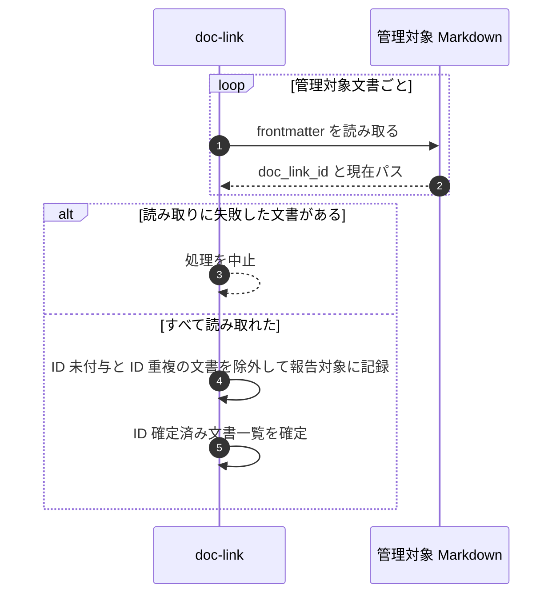

# doc-link 要件定義書 — 管理対象と文書 ID

**状態**: 承認済み\
**更新日**: 2026-10-31\
**対象**: Claude Code 用プラグイン `doc-link`（仮称）

[総論][req-001] · [管理対象と文書 ID][req-002] · [ToC 管理][req-003] · [文書検索][req-004] · [参照と変更通知][req-005]

<a id="sec-6"></a>

## 6. 管理対象ファイル

<a id="sec-6-1"></a>

### 6.1 管理対象範囲

doc-link は、置き換え時の呼び出し元との接続を維持するため、DocAdvisor と同じ基本形式で管理キーごとに独立した ToC を扱う。管理キーは、ユーザーまたは Forge などの呼び出し元スキルが決定する opaque key であり、doc-link はキー文字列から文書種別や対象パスを推測してはならない。

対象を指定するモードでは、呼び出し元が `--key <key>` と、そのキーで今回管理すべき対象の完全な desired state を管理対象指定として外部から与えること。同じ管理キーに対する後続実行は、そのキーの ToC だけを更新し、別の管理キーの ToC を変更してはならない。

管理対象指定は、少なくとも次の DocAdvisor 互換の指定方法を表現できること。各引数の厳密な組み合わせ規則は後続設計で定義する。

- `--paths` / `--paths-json`: プロジェクトルート相対の Markdown ファイルパス
- `--paths-file`: Markdown ファイルパスの配列を格納したファイル
- `--dirs` / `--dirs-json`: プロジェクトルート相対のディレクトリまたはパターン
- `--exclude` / `--exclude-json`: 対象集合から除外するパス、ディレクトリまたはパターン
- `--all`: プロジェクトルート配下の全 Markdown を対象とする単体モード

doc-link は、与えられた管理対象指定を解釈・検証し、今回処理する管理対象 Markdown の一覧を確定する。ディレクトリまたはパターンが指定された場合は、該当する Markdown を列挙して一覧へ変換する。指定されていないファイルを推測で追加したり、指定されたファイルを理由の報告なく除外したりしてはならない。

`--key <key>` とともに渡す管理対象指定は、差分ではなく、そのキーの完全な desired state とする。同じキーの以前の ToC に存在していても、今回確定した対象集合に存在しない文書は、そのキーの管理対象から外れたものとして ToC から除くこと。対象外へ移動したのか実体が削除されたのかを調べるために、指定範囲の外を探索しないこと。管理対象文書内の参照が明示するディレクトリを検査する処理は、この管理対象範囲の拡張とは別に扱う。

`--all` は予約管理キー `all` を使用する単体モードとし、対象指定と併用してはならない。引数なしの実行は `--all` と同じものとして扱う。`all` を `--key all` として任意指定することは禁止する。

`--key` を省略したまま `--dirs`、`--paths` または `--exclude` 系の対象指定を渡してはならず、doc-link はその呼び出しを曖昧な入力として拒否すること。対象を限定して管理する場合は、必ず管理キーを指定すること。

Forge と連携する場合、Forge は `.doc_structure.yaml` から `rules` または `specs` の対象ディレクトリと除外指定を解決し、それぞれ管理キー `rules` または `specs` とともに doc-link へ渡す。doc-link は `.doc_structure.yaml` を直接読み取らず、そのスキーマや配置規則にも依存しない。

文書 ID は管理キーから独立する。一つの文書は複数の管理キーに同時に所属でき、その所属キーは同じ文書 ID で識別される文書情報の属性として扱う。所属キーや管理対象範囲が変わっても、それを理由に `doc_link_id` を再発行してはならない。管理キーは参照の有効範囲を制限しない。

<a id="sec-6-2"></a>

### 6.2 Markdown への文書 ID 記載

初期版では Markdown 文書だけを管理対象とし、frontmatter に文書 ID を記載する。

キー名には `doc_link_id` を使用する。値は文書 ID 管理システムが発行し、利用者や生成担当 AI が手動で採番しない。文書 ID は固定プレフィックス `DLID-` と、システムが生成する 12 文字の値部分から構成する（D-028）。次の値は例示である。

```yaml
---
doc_link_id: DLID-7k3m9q2x4p8r
---
```

<a id="sec-8"></a>

## 8. 管理対象文書一覧の確定

本段階は、後続処理で「すべての管理対象文書」と呼ぶ範囲を確定するための入力準備である。ディレクトリまたはパターンが指定された場合は、該当する Markdown を列挙し、除外指定を適用して具体的なファイル一覧へ変換する。個別のファイルパスが指定された場合は、存在と対象形式を検証する。

この段階では、文書 ID の発行、変更検出、文書情報の取得または ToC の更新を行わない。管理対象文書一覧を正常に確定できた場合だけ、[§9][req-002-sec-9] の文書 ID 確認へ進む。

### FR-017 管理キーと管理対象指定の受領

doc-link は、ユーザーまたは呼び出し元スキルから管理キーと、そのキーで今回管理すべき Markdown の完全な desired state を受け取れること。

対象指定モードでは `--key` と `--dirs`、`--dirs-json`、`--paths`、`--paths-json`、`--paths-file`、`--exclude` または `--exclude-json` を解釈できること。単体モードでは `--all` を解釈し、引数なしも `--all` として扱うこと。`--all` と対象指定の併用、`--key all`、および `--key` なしの対象指定は拒否すること。

doc-link は管理対象指定を解釈・検証して管理対象文書一覧を確定し、確定した一覧、拒否した指定、および拒否理由を呼び出し元へ返せること。管理キーは対象の選択にのみ使用し、キー名から対象文書や文書種別を推測してはならない。

同じキーの以前の ToC に存在し、今回確定した対象集合に存在しない文書を、そのキーの管理対象から外れたものとして扱えること。対象範囲外の実体の有無は調べず、別のキーの ToC に含まれる同じ文書を削除または変更してはならない。

`.doc_structure.yaml` など、対象集合を定義する外部設定の探索、読み取りおよび解釈は doc-link の責務に含めない。Forge などの呼び出し元が設定を解決し、管理キーと解決済みの対象指定を doc-link へ渡すこと。

<a id="sec-9"></a>

## 9. 文書 ID の付与と確認

### FR-001 文書 ID の発行と読み取り

すべての管理対象 Markdown 文書は文書 ID を持つこと。文書 ID の発行と frontmatter への保存は、ユーザーまたはプロジェクト管理 AI が明示的に起動する ID 付与操作だけが行うこと。ToC の構築・再構築および文書検索は、文書 ID を発行・保存してはならない（D-035）。ID 付与操作は、対象の文書のうち文書 ID が存在しない文書へ新しい文書 ID を発行し、frontmatter へ保存すること。ID 付与操作の対象は、ToC の構築と同じ形式の管理キーと管理対象指定（FR-017）で決める（D-041）。

発行する文書 ID は、固定プレフィックス `DLID-` と固定長の値部分から構成する。値部分は、発行時に一度だけ生成する 60 ビットの暗号論的乱数を、小文字の Crockford Base32（`0-9`、`a-z` から `i`・`l`・`o`・`u` を除いた 32 文字）で 12 文字に表したものとする（D-028）。

発行済みの文書 ID は、文書本文、ファイル名、パス、タイトル、分類または要約から再計算してはならない。本文や配置が変更されても、管理対象ファイルに保存された同じ文書 ID を継続して使用すること。

文書 ID の値部分には、文書種別、分類、パス、タイトルなど、文書の意味を表す情報を持たせないこと。人間が `doc-link` の文書 ID だと識別するための情報は、固定プレフィックス `DLID-` が担う。

発行済みの文書 ID を別文書へ再利用してはならない。

プラグインは、Markdown frontmatter の `doc_link_id` から文書 ID を読み取れること。

### FR-002 文書 ID の検証

プラグインは、少なくとも次の状態を機械的に検出できること。

- 文書 ID が存在しない
- セクションの DLID を持たない見出しがある（D-033）
- 同一の文書 ID が複数ファイルに存在する
- 同一のセクションの DLID が複数の箇所に存在する（同じ文書の中の複数の見出しを含む）

`doc_link_id` から文書 ID 管理システムが発行した文書 ID として認識できる値を取得できない状態は、記載内容にかかわらず「文書 ID が存在しない」として扱う。これには、キー自体の欠落、null、空文字列、空白だけの文字列、単一文字列として読み取れない値、および `DLID-` 付きの発行済み文書 ID として認識できない値を含む。

認識できない値に対して「形式不正」という独立したエラー分類を設けない。文書 ID の発行仕様と異なる値も「文書 ID が存在しない」として扱う。

ID 付与操作は、文書 ID が存在しない状態を検出した場合、FR-001 に従って文書 ID を発行する。文書 ID の発行または frontmatter への保存に失敗した場合は、ID 付与操作を正常終了させず、保存済みの文書 ID と失敗した文書を報告すること。ToC の構築・再構築が文書 ID の存在しない文書を検出した場合は、[§9.1][req-002-sec-9-1] に従ってその文書を ToC に入れずに報告すること（D-036）。

ID 付与操作は、対象の文書 ID とセクションの DLID を既存の DLID と照合して重複を検出すること。重複を検出した場合は、管理状態に記録されたその DLID のパスと一致するものを原本の候補とし、重複した ID、すべての該当パスおよび原本の候補を利用者へ示すこと。利用者が原本を確定した後、原本以外に FR-001 に従って新しい DLID を発行すること。文書 ID を再発行する複製では、その文書のセクションの DLID もあわせて再発行すること。候補を一つに絞れない場合は、利用者に原本を指定させること（D-029）。ToC の構築・再構築が文書 ID の重複を検出した場合は、[§9.1][req-002-sec-9-1] に従って該当する文書を ToC に入れずに報告すること（D-036）。セクションの DLID の重複は ToC の構築では扱わず、ID 付与操作と不整合検査が検出する。

### FR-018 DLID の解決

プラグインは、ユーザーまたは呼び出し元スキルから一つ以上の DLID を受け取り、各 DLID が指す文書またはセクションの現在のパスを返せること（D-047）。呼び出し元は、文書をファイル名やパスの命名規則に依存せず DLID で記録し、必要な時点で現在のパスを得る。

文書の DLID には、その文書のプロジェクトルート相対パスを返す。セクションの DLID には、所属する文書のパスと、そのセクションの見出しおよびそのセクションへ届くアンカーを返す。

解決には管理状態に記録されたパスを使い、管理キーを受け取らない。記録されたパスの文書が現在もその DLID を持つことを確かめてから返すこと。確かめられない場合はパスを返さず、記録されたパスとともに「記録されたパスに無い」と返し、記録の外を探索しないこと。ToC を再構築すると記録が更新される。管理状態に記録の無い DLID には「記録が無い」と返すこと。管理状態を読み取れない場合は解決を失敗とし、原因を返すこと。

DLID の解決は、管理対象 Markdown、ToC および管理状態を変更してはならない。

<a id="sec-9-1"></a>

### 9.1 文書 ID 確認処理

本段階は ToC の構築・再構築の最初の段階であり、責務は [§8][req-002-sec-8] で確定した管理対象文書を文書 ID で識別し、ToC に入れる文書を確定することである。文書 ID は既存 ToC と現在の文書を対応付けるための前提条件である。本段階は管理対象文書を書き換えず（D-035）、変更検出や ToC 更新も行わない。

各管理対象文書について、Markdown frontmatter から `doc_link_id` を読み取る。文書 ID を取得できない文書と、同じ文書 ID を持つ複数の文書は ToC に入れる文書から除き、パスとともに報告して [§9.2][req-002-sec-9-2] の ID 付与操作での解消を案内する。これらの検出を理由に本段階を失敗としない（D-036）。管理対象文書を読み取れない場合は本段階を失敗とし、変更検出へ進んではならない。

本段階の正常終了時に、少なくとも次を含む「ID 確定済み文書一覧」を後続処理へ渡す。

- 文書 ID
- 現在のプロジェクトルート相対パス
- ファイルの読み取りに必要な実体情報

あわせて、除外した文書の一覧（ID 未付与、ID 重複）を構築結果として返す。



<a id="sec-9-2"></a>

### 9.2 ID 付与操作

ID 付与操作は ToC の構築とは別に、ユーザーまたはプロジェクト管理 AI が明示的に起動する（D-035）。起動を書き込みの承認とし、書き込み前に改めて承認を求めない（D-040）。対象は FR-017 と同じ形式の管理キーと管理対象指定で決め、§8 と同じ方法で対象文書一覧を確定する（D-041）。ID 付与操作は次を行う。

1. 対象文書の `doc_link_id` とセクションのアンカー行の DLID を読み取り、管理状態に記録された全キーの DLID と今回走査した DLID に照合する（D-030）
2. 重複があれば、FR-002 に従って原本の候補を利用者へ示し、利用者が原本を確定した後、原本以外へ新しい DLID を発行する。文書 ID を再発行する複製では、その文書のセクションの DLID もあわせて再発行する（D-029）
3. 文書 ID が存在しない文書へ新しい文書 ID を発行し、frontmatter へ保存する
4. セクションの DLID を持たないすべての見出しにセクションの DLID を発行し、見出しの直前にアンカー行を書き込む（D-033）。`doc_link_id` を持つ Markdown を指し title に DLID の無いリンクに、参照先の DLID を加える。初回の移行に限らず、ID 付与操作が起動されるたびに、指定された対象文書について行う。書き込むのは指定された対象文書だけであり、参照先の見出しが対象外の文書にあってセクションの DLID が無い場合は書き込まず、その文書を対象に含めて再実行するよう報告する（D-034、D-042）

書き込みは D-031 の範囲と検証に従う。書き込んだ文書・位置・DLID と、書き込めなかった文書を結果として返す（D-040）。

## 受け入れ条件案

### AC-005 ID 重複

ID 付与操作で同じ文書 ID が複数ファイルに存在することを検出した場合、管理状態に記録されたパスと一致するものを原本の候補として利用者へ示し、利用者が確定した原本以外へ新しい文書 ID を発行すること。ToC の構築・再構築で検出した場合は、該当する文書を ToC に入れずに報告し、構築を続けること。

### AC-012 文書 ID が存在しない状態の統一

`doc_link_id` のキー欠落、null、空文字列、空白だけの文字列、単一文字列として読み取れない値、および文書 ID 管理システムが発行した文書 ID として認識できない値が、すべて同じ「文書 ID が存在しない」という分類で検出され、文書 ID の発行対象になること。これらに対して、形式不正という別の分類を返さないこと。

### AC-013 文書 ID のシステム発行

ID 付与操作で、文書 ID が存在しない管理対象の Markdown 文書を検出すると、`DLID-` 付きの文書 ID が生成され、frontmatter へ保存されること。ToC の構築・再構築は文書 ID を発行・保存せず、文書 ID が存在しない文書を ToC に入れずに報告すること。

### AC-014 発行済み文書 ID の不変性

文書本文、ファイル名、パス、タイトル、分類または要約を変更しても、発行済みの文書 ID が変更されないこと。

### AC-016 文書 ID の非意味性

文書 ID の値部分が、文書本文、ファイル名、パス、タイトル、分類または要約を変更する根拠として使用されず、これらの値から再計算もされないこと。

### AC-021 管理キーごとの desired state

同じ管理キーに、異なる Markdown 集合を表す管理対象指定 A と B を順に与えた場合、B がそのキーの完全な desired state として ToC に反映されること。doc-link が指定外の Markdown を推測で追加しないこと。B に含まれない同じキーの既存エントリを ToC から除去し、その実体ファイルの有無を調べるために対象範囲外を探索しないこと。

異なる管理キー A と B にそれぞれ管理対象指定を与えた場合、A の更新が B の ToC のエントリを削除または変更しないこと。

### AC-022 DocAdvisor 互換の基本インターフェース

`--key rules --dirs-json '<JSON 配列>' --exclude-json '<JSON 配列>'` および `--key specs --dirs-json '<JSON 配列>' --exclude-json '<JSON 配列>'` の形式で、Forge が解決した対象指定を受け取れること。

`--all` と引数なしの実行が、どちらも予約管理キー `all` の単体モードとしてプロジェクトルート配下の全 Markdown を対象候補にすること。`--key all`、`--key` なしの対象指定、および `--all` と対象指定の併用を拒否すること。

ToC の構築と ID 付与操作は、どちらもこの形式で対象指定を受け取り、同じ指定を拒否すること（D-041）。

### AC-023 文書 ID と管理キーの独立性

同じ文書を管理キー A の対象から外して管理キー B の対象に含めても、そのことだけを理由に `doc_link_id` が変更されないこと。

### AC-024 外部設定との責務境界

Forge が `.doc_structure.yaml` から解決した管理キーと対象指定を渡した場合、doc-link が `.doc_structure.yaml` を直接読み取らずに ToC を構築できること。外部設定ファイルが存在しなくても、管理キーと有効な対象指定が直接与えられていれば処理できること。

### AC-025 文書 ID 確認の段階完了

管理対象文書の読み取りに失敗した場合、変更検出、文書情報の取得および ToC 候補の生成へ進まないこと。文書 ID が存在しない文書と文書 ID が重複する文書は ID 確定済み文書一覧から除いて報告し、残りの文書で変更検出へ進むこと。

### AC-029 同一文書の複数キー所属

同じ Markdown 文書を二つの管理キーの対象に含めた場合、どちらからも同一の `doc_link_id` で識別され、キーごとに異なる文書 ID を発行しないこと。一方のキーから外しても、他方への所属および文書 ID を変更しないこと。

### AC-030 構築・検索による管理対象文書の不変

ToC の構築・再構築と文書検索を実行しても、管理対象 Markdown が変更されないこと。管理対象 Markdown への書き込みは ID 付与操作だけが行うこと。

### AC-031 DLID の解決

文書の DLID とセクションの DLID を渡した場合、それぞれ現在のパスが返り、セクションには見出しとアンカーが添えられること。文書を移動した後、ToC を再構築する前は「記録されたパスに無い」が返り、移動前のパスを現在のパスとして返さないこと。ToC を再構築した後は、同じ DLID から移動後のパスが返ること。管理状態に記録の無い DLID には「記録が無い」が返ること。解決の前後で、管理対象 Markdown、ToC および管理状態が変わらないこと（D-047）。

[req-001]: REQ-001-overview.md
[req-002]: REQ-002-document-id.md
[req-003]: REQ-003-toc.md
[req-004]: REQ-004-search.md
[req-005]: REQ-005-references.md
[req-002-sec-9]: REQ-002-document-id.md#sec-9
[req-002-sec-9-1]: REQ-002-document-id.md#sec-9-1
[req-002-sec-8]: REQ-002-document-id.md#sec-8
[req-002-sec-9-2]: REQ-002-document-id.md#sec-9-2
