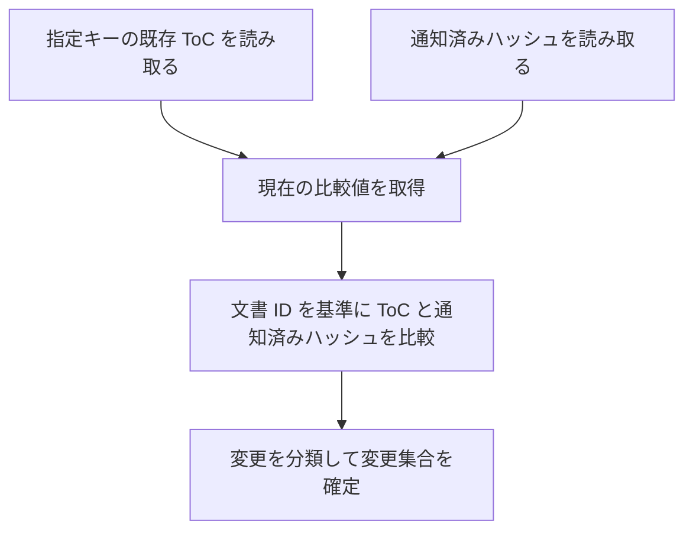
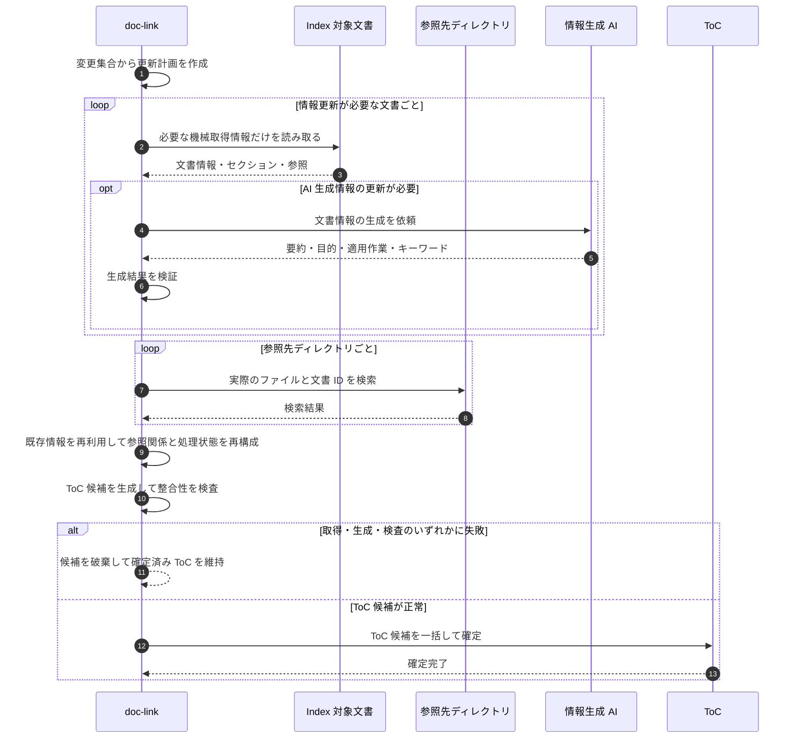

# doc-link 要件定義書 — [ToC]管理

**状態**: 承認済み\
**更新日**: 2026-11-02\
**対象**: Claude Code 用プラグイン `doc-link`（仮称）

[総論][req-001] · [Index 対象と文書 ID][req-002] · [ToC 管理][req-003] · [文書検索][req-004] · [参照と変更通知][req-005]

<a id="sec-7"></a>

## 7. [ToC]と[通知済みハッシュ]の情報要件

本節は、**プラグインが[ToC]と[通知済みハッシュ]で管理すべき情報**を定義する。ユーザーが作成する文書の必須構造や、frontmatter に手動記載するフィールドの一覧ではない。情報間の同一性・関係・版は[論理データモデル][des-003]で扱う。

同じ[文書 ID]を持つ文書の要約、参照関係および所属する[ToC 識別キー]は、論理的に一つの[文書情報]として扱う。一つの文書が複数キーに所属しても、キーごとに別の[文書 ID]や別文書としての要約を生成しない。キーごとの[ToC]は、その[文書情報]を各キーの Index 対象に応じて検索・検査するための索引とし、物理的な保存形式や共有方法は後続設計で定義する。

プラグインが[Index 対象文書]へ記載できるメタデータは[DLID]だけであり、記載できる位置は[§6.2][req-002-sec-6-2]で定める frontmatter の `doc_link_id` と、見出しの行の末尾の[セクション ID]に限る（D-031）。これが doc-link が[Index 対象文書]へ行える唯一の書き込みである。利用者や[情報生成 AI]が[文書 ID]を手動採番することは要求しない。文書間の[正式な参照]は、利用者または[プロジェクト管理 AI]が FR-007 で定める記法で書く。doc-link は参照を書かない（D-042）。タイトル、目的、要約、キーワード、パス、ハッシュ、参照元および検査状態をユーザーが文書内で重複管理することは要求しない。

各[ToC]のメタデータとして、[ToC 識別キー]と、その[ToC]の構築に使用した正規化済みの[Index 対象指定]を保存すること。保存する指定は、次回の検索時に外部から[Index 対象指定]が渡されなくても再解釈し、現在の[Index 対象文書]を列挙できるものでなければならない。[Index 対象指定]のハッシュなど、指定内容を復元できない識別値だけを保存してはならない。外部から新しい[Index 対象指定]が渡された場合は、保存済みの指定と比較して対象範囲の変更を検出できること。

[ToC]の情報は、次のいずれかの方法で取得または生成する。

- **ユーザー記載**: [Index 対象文書]にユーザーが明示的に記載する
- **機械取得**: ファイル走査または構文解析によってスクリプトが決定的に取得する
- **AI 生成**: 文書の内容を基に AI が生成する
- **プラグイン管理**: 処理結果や状態としてプラグインが記録する

<a id="sec-7-1"></a>

### 7.1 [文書情報]

[ToC]内の各[文書情報]は、少なくとも次の情報を管理する。

| 情報               | 取得・生成方法         | ユーザー文書への記載 | 説明                                                                                                                                                                         |
| ------------------ | ---------------------- | -------------------- | ---------------------------------------------------------------------------------------------------------------------------------------------------------------------------- |
| [文書 ID]          | プラグイン発行         | システムが記載       | [文書 ID]管理システムが発行し、[Index 対象文書]の `doc_link_id` へ保存する                                                                                                   |
| 現在の相対パス     | 機械取得               | 不要                 | プロジェクトルートからのファイル走査によって取得する                                                                                                                         |
| タイトル           | 機械取得または AI 生成 | 不要                 | 見出しなどから抽出し、抽出できない場合の扱いは後続設計で定義する                                                                                                             |
| 目的               | AI 生成                | 不要                 | 文書検索に使用する                                                                                                                                                           |
| 内容概要           | AI 生成                | 不要                 | 文書検索に使用する                                                                                                                                                           |
| 適用される作業     | AI 生成                | 不要                 | どのようなタスクで参照すべき文書かを表す                                                                                                                                     |
| 検索用キーワード   | AI 生成                | 不要                 | 文書検索に使用する                                                                                                                                                           |
| 文書単位のハッシュ | 機械取得               | 不要                 | [ToC]に反映した文書内容のハッシュを記録する。[変更影響候補の通知]まで完了した内容のハッシュは別の[通知済みハッシュ]で管理する。算出規則は[§10.1][req-003-sec-10-1]で定義する |
| セクション情報     | 機械取得               | 不要                 | すべての見出しの行の末尾に、DLID 付与操作が[セクション ID]を書く（D-033、D-035）                                                                                             |
| 参照先             | 機械取得               | 参照がある場合のみ   | 文書内の[正式な参照]から抽出する                                                                                                                                             |
| 参照元             | 機械的に逆引き生成     | 不要                 | [Index 対象文書]から抽出した参照先情報を基に生成する                                                                                                                         |
| 最終検査状態       | プラグイン管理         | 不要                 | 検査日時、成功・失敗、未処理などの状態を記録する                                                                                                                             |

<a id="sec-7-2"></a>

### 7.2 セクションエントリ

[ToC]内の各セクションエントリは、少なくとも次の情報を管理する。

| 情報                     | 取得・生成方法 | ユーザー文書への記載 | 説明                                                                             |
| ------------------------ | -------------- | -------------------- | -------------------------------------------------------------------------------- |
| 所属する[文書 ID]        | 機械取得       | 不要                 | セクションを含むファイルの `doc_link_id` から取得する                            |
| [セクション ID]          | プラグイン発行 | すべての見出し       | 見出しの行の末尾に置く[DLID]。[§13.1][req-005-sec-13-1]と D-033 に従う           |
| 見出し                   | 機械取得       | 追加記載不要         | ユーザーが通常の文書本文として記載した見出しから取得する                         |
| 文書内の現在位置         | 機械取得       | 不要                 | 構文解析によって取得し、文書編集のたびに更新し得る                               |
| セクション単位のハッシュ | 機械取得       | 不要                 | セクションの範囲の原文から[§10.1.2][req-003-sec-10-1-2]の規則で算出する（D-039） |

<a id="sec-7-3"></a>

### 7.3 参照エントリ

[ToC]内の各参照エントリは、[Index 対象文書]に記載された[正式な参照]から生成する。ユーザーが参照関係を[ToC]へ別途手入力することは要求しない。

| 情報                  | 取得・生成方法 | ユーザー文書への記載 | 説明                                                                                                                                                |
| --------------------- | -------------- | -------------------- | --------------------------------------------------------------------------------------------------------------------------------------------------- |
| 参照元[文書 ID]       | 機械取得       | 追加記載不要         | 参照を含むファイルの `doc_link_id` から取得する                                                                                                     |
| 参照元[セクション ID] | 機械取得       | 条件付き             | セクション単位で参照元を追跡する場合だけ使用する                                                                                                    |
| 参照先[文書 ID]       | ユーザー記載   | 参照がある場合は必須 | FR-007 の[正式な参照]（リンクの title の[DLID]）から取得する。title の[DLID]は利用者または[プロジェクト管理 AI]が書き、doc-link は書かない（D-042） |
| 参照先[セクション ID] | ユーザー記載   | 条件付き             | 特定セクションを参照する場合だけ使用する。利用者または[プロジェクト管理 AI]が、リンクの title に参照先[セクション ID]を書く（D-032、D-033）         |
| 参照の記載位置        | 機械取得       | 不要                 | 構文解析によってファイル内の位置を取得する                                                                                                          |
| 参照種別              | 機械取得       | 追加記載不要         | 文書全体参照またはセクション参照などを記法から判定する                                                                                              |
| 検査状態              | プラグイン管理 | 不要                 | ディレクトリ検索で確認済み、指定ディレクトリ内に不在、パス不一致などを記録する                                                                      |

<a id="sec-7-4"></a>

### 7.4 [AI 生成フィールド]の上限

[文書情報]のうち、AI が生成する自然言語フィールドには、フィールドごとの上限（文字数または配列の要素数）を定義する。本要件は AI が生成する[AI 生成フィールド]を対象とし、文書本文や機械的に抽出した原文を直接制限するものではない。

対象となるフィールドは、現時点では次のとおりとする。

| フィールド       | 形式   | 制限の単位 | 記述上限 `L` |
| ---------------- | ------ | ---------- | ------------ |
| タイトル         | 文字列 | 制限しない | —            |
| 目的             | 文字列 | 文字数     | 200          |
| 内容概要         | 配列   | 要素数     | 10           |
| 適用される作業   | 配列   | 要素数     | 10           |
| 検索用キーワード | 配列   | 要素数     | 10           |

配列の各要素の文字数は制限しない。タイトルは見出しから取得し、AI が生成する場合も制限しない。上限の値は D-044 で決める。

上限には、次の二つを区別して使用する。

| 名称         | 記号 | 用途                                                       |
| ------------ | ---- | ---------------------------------------------------------- |
| 記述上限     | `L`  | [情報生成 AI]に「最大文字数」として提示する基準値          |
| 内部許容上限 | `H`  | 検証器が受理・拒否を判定するために内部で使用する実際の上限 |

内部許容上限は、フィールドごとに次の式で決定する。

```text
H = floor(L × 1.3)
```

生成結果の文字数が `L` を超えていても `H` 以下であれば受理し、`H` を超えた場合だけ再生成またはエラーの対象とする。

[情報生成 AI]には `L` だけを提示し、`H`、許容係数 `1.3`、および許容余白の存在を提示してはならない。これらを[情報生成 AI]が参照するルール、プロンプト、テンプレート、再試行メッセージまたは検証結果へ記載してはならない。`H` 超過時にも、[情報生成 AI]には `L` 以内へ短縮するよう指示し、実際の拒否境界を通知しない。

この分離は、[情報生成 AI]が実際の拒否境界を目標値として文章を生成し、出力の揺らぎによって境界を再び超過することを防ぐために行う。内部許容上限はセキュリティ上の秘密ではなく、要件・設計・テストおよび検証器の実装には記載できる。ただし、それらを生成処理の入力コンテキストへ渡してはならない。

文字数は Unicode のコードポイント数で数える（D-044）。

<a id="sec-7-5"></a>

### 7.5 [通知済みハッシュ]

最後まで正常に処理した内容のハッシュを[ToC]とは別の一覧で管理する。パスの移動・改名で[通知済みハッシュ]を失わないよう、文書単位では[文書 ID]とハッシュを対応付ける。セクション単位では、[セクション ID]とハッシュを対応付けて同様の[通知済みハッシュ]を管理する（D-033）。物理的なファイル形式と配置は後続設計で定義する。

この一覧が保持するのは[通知済みハッシュ]であり、今回算出した[現在ハッシュ]を別途恒久保存することは要求しない。[現在ハッシュ]は文書から計算し、[ToC]に反映した値は[ToC]のエントリで確認できる。新規文書は必要な処理が完了するまで一覧に登録しない。[通知済みハッシュ]の更新条件は[§10.1.3][req-003-sec-10-1-3]に従う。

この一覧は[ToC 識別キー]に依存しない。文書があるキーの Index 対象から外れても除去しない。どのキーにも所属しなくなった文書の旧ハッシュは除去する（D-046）。対象外にある実体文書は追跡しない。

<a id="sec-10"></a>

## 10. 既存[ToC]との比較による変更検出

### FR-003 文書の移動・改名の認識

同一の[文書 ID]を持つファイルのパスが変わった場合、プラグインは文書の削除と新規追加ではなく、既存文書の移動または改名として認識できること。

内容が変わっていない場合は、要約の再生成や AI による内容の再解析を要求しないこと。

### FR-011 文書全体の変更検出

プラグインは、[ToC]に反映済みのハッシュおよび[通知済みハッシュ]の[通知済みハッシュ]と、現在の文書から算出したハッシュを比較し、[ToC]更新の要否と[未通知の変更]を検出できること。

少なくとも次の変更を区別できることを要件候補とする。

- パスのみの変更
- 本文の変更
- Index 対象からの離脱

### FR-012 セクション単位の変更検出

プラグインは[セクション ID]ごとのハッシュ値を保存し、変更されたセクションを特定できること（D-033）。

セクションの追加、削除、移動、見出し変更および本文変更をどのように区別するかは後続設計で定義する。

<a id="sec-10-1"></a>

### 10.1 変更検出に使用するハッシュ

<a id="sec-10-1-1"></a>

#### 10.1.1 ハッシュの目的

ハッシュ値は、文書またはセクションの内容が、[ToC]に反映した時点および[変更影響候補の通知]まで完了した時点から変化したかを決定論的に判定するために使用する。

<a id="sec-10-1-2"></a>

#### 10.1.2 [内容ハッシュ]

[内容ハッシュ]は、文書またはセクションの原文の SHA-256 とし、正規化も管理用の記述の除去もしない（D-039）。セクションの範囲は D-033 に従う。

frontmatter は固定値の `doc_link_id` だけを持ち、[DLID]は DLID 付与操作が最初の[ToC]の前に書き込むので、[DLID]だけで[内容ハッシュ]が変わることは通常ない。最初の[ToC]の後に見出しを書き足して[DLID]が加わった場合や、[プロジェクト管理 AI]がリンクの title に[DLID]を書いた場合、文書の移動に伴って[プロジェクト管理 AI]がリンク先パスを直した場合も[内容ハッシュ]が変わり、変更として報告する。これは重複・過剰な報告として許す。

<a id="sec-10-1-3"></a>

#### 10.1.3 保存済みハッシュの更新時点

検出しただけの変更を通知済みとして扱わないこと。[§7.5][req-003-sec-7-5]の[通知済みハッシュ]には、必要な要約更新と[変更影響候補の通知]が完了するまで旧ハッシュを残す。新規文書は未登録のままとする。

[ToC]の構築・再構築では、現在の文書から算出したハッシュを、既存[ToC]に記録されたハッシュと比較して索引の更新対象を決める。同時に[通知済みハッシュ]の値とも比較し、[未通知の変更]を識別する。変更前後のハッシュと対象文書またはセクションは、後続の[変更影響候補の通知]が完了するまで識別できる状態を維持する。

[ToC]の要約更新と確定が成功した文書については、[ToC]に[現在ハッシュ]を記録できる。ただし、その成功だけでは[通知済みハッシュ]を進めない。変更と参照元を通知する対象についてだけ、通知と同じ操作で対応する一覧のハッシュを現在の値へ更新する（D-038）。更新できなかった対象は通知せずに旧値を維持し、次回の比較で再検出できること。参照元がない対象も、変更の事実を通知した後に通知済みとしてよい。

Index 対象から外れた文書については、そのキーの[ToC]からエントリを除去しただけでは[通知済みハッシュ]から旧値を除去しない。どのキーにも所属しなくなった文書の旧値は除去する（D-046）。

[ToC]には[現在ハッシュ]が反映済みで、[通知済みハッシュ]だけが旧値の文書を再実行する場合、要約を再生成せず、未完了の[変更影響候補の通知]を続行できること。文書がその間に再び変更された場合は、新たな[現在ハッシュ]を取得して比較する。失敗後の具体的な再実行手順は後続設計で定義する。

<a id="sec-10-2"></a>

### 10.2 変更検出処理

本段階の責務は、最後に正常確定した[ToC]および[通知済みハッシュ]と現在の[Index 対象文書]を比較し、[ToC]へ反映すべき変更と通知が未完了の変更を区別して変更集合を確定することである。ここでは比較と分類だけを行い、要約生成、詳細情報の再取得、[ToC]の更新または[変更影響候補の通知]を行わない。

doc-link は指定された[ToC 識別キー]の既存[ToC]と[通知済みハッシュ]を読み取り、[§9.1][req-002-sec-9-1]の[確定 Index 対象リスト]に含まれる各文書から、変更検出に必要な比較値を機械的に取得する。比較値には少なくとも次を含める。

- [文書 ID]の集合
- 現在の相対パス
- [内容ハッシュ]
- [正式な参照]の内容、または参照情報を比較できるハッシュ
- [セクション ID]ごとのセクション情報とそのハッシュ

比較結果から、少なくとも次の変更を識別する。

| 変更種別             | 判定の基準                                                          |
| -------------------- | ------------------------------------------------------------------- |
| 新規                 | 現在の一覧に[文書 ID]が存在し、既存[ToC]に同じ[文書 ID]が存在しない |
| 本文変更             | 同じ[文書 ID]の[内容ハッシュ]が異なる                               |
| 参照変更             | 同じ[文書 ID]の参照情報が異なる                                     |
| 移動・改名           | 同じ[文書 ID]の現在パスが異なる                                     |
| Index 対象からの離脱 | 既存[ToC]に[文書 ID]が存在し、現在の[Index 対象リスト]に含まれない  |
| 変更なし             | 現在の文書と既存[ToC]の比較対象となる状態に差異がない               |

変更種別は必ずしも排他的ではない。同じ文書が「移動・改名」と「本文変更」の両方に該当する場合など、検出したすべての変更を保持すること。

既存[ToC]が存在しない初回構築では、現在のすべての[Index 対象文書]を新規として扱う。変更集合には、[文書 ID]、変更種別、[ToC]に反映済みか通知が未完了かの区別、比較に用いた変更前後の値、および次段階で必要となる処理の種別を含めること。[ToC]と現在の文書に差がなくても、[通知済みハッシュ]との差が残る場合は、[変更影響候補の通知]対象から除外してはならない。



<a id="sec-11"></a>

## 11. 必要情報の取得と[ToC]の更新

[ToC]は[ToC 識別キー]ごとに保持する論理的な索引であり、検索、逆参照、変更検出および変更影響候補の列挙が参照する、最後に正常確定した索引状態である。各[ToC]は、構築または再構築時にそのキーへ外部から与えられた完全な[Index 対象指定]に従って確定した Markdown 文書と、それらに付与された[文書 ID]を基に構築する。現在の[Index 対象指定]と文書内容を反映しているかは、キーごとの[ToC]の構築・再構築要否の検査結果によって区別する。

[ToC]に入れる文書は[文書 ID]を持つことを前提条件とする。[ToC]の構築・再構築は[文書 ID]を付与しない。[文書 ID]が無い文書と、同じ[文書 ID]を持つ複数の文書は[ToC]に入れずに報告する（D-035、D-036）。

### FR-004 [ToC]の構築と再構築

プラグインは、[ToC 識別キー]ごとに独立した[ToC]を持ち、各[ToC]では[文書 ID]を主キーとして検索・参照・変更検出に必要な情報を集中管理できること。

[ToC]は保存方式にかかわらず、検索、逆参照、変更検出および変更影響候補の列挙が参照する、最後に正常確定した索引状態とする。現在の[Index 対象文書]を反映しているかは、[ToC]の構築・再構築要否の検査結果によって区別する。JSON ファイル、RDB などの物理的な保存方式、スキーマおよび配置場所は後続設計で定義する。いずれを採用しても、書き込み途中の[文書情報]や確定途中の[ToC]を現在状態として公開してはならない。[文書情報]は[文書 ID]ごとに常に最新の一つを持って全キーが共有し、[ToC]（所属、参照関係、[反映済みハッシュ]、検査結果）は各キーの[ToC]の版として管理する。このため、あるキーの[ToC]が古い版のままでも、そのキーから見える[文書情報]は最新の内容となる（D-024）。

プラグインは、指定された[ToC 識別キー]と、外部から与えられたそのキーの完全な[Index 対象指定]を使用すること。[Index 対象指定]に従って確定した現在の[Index 対象文書]を走査し、[文書 ID]、現在のパス、[内容ハッシュ]、セクション情報および参照関係から、そのキーの[ToC]の完全な期待状態を再構築できること。ただし、[文書 ID]が無い文書と[文書 ID]が重複する文書は期待状態に含めない（D-036）。

[ToC]の構築・再構築は、次の順序で行うこと。

1. [§9.1][req-002-sec-9-1]に従って、すべての[Index 対象文書]の[文書 ID]を確認し、[ToC]に入れる文書を確定する
2. [§10][req-003-sec-10]に従って、既存[ToC]と現在の文書を比較して変更集合を生成する
3. 本節に従って、変更集合に基づく必要な情報だけを取得し、[ToC]を更新する

[ToC]の構築・再構築は[Index 対象文書]を書き換えないこと。[文書 ID]が無い文書と[文書 ID]が重複する文書を除いた残りの文書で[ToC]を確定してよい（D-035、D-036）。

既存の[ToC]と現在の対象文書集合を比較し、少なくとも次を反映すること。

- 新規文書: [ToC]にまだ無い[文書 ID]のエントリを追加する
- 更新文書: 同じ[文書 ID]のハッシュ、要約、セクション情報および参照関係を必要に応じて更新する
- 移動・改名文書: 同じ[文書 ID]の現在パスを更新し、内容が変わっていなければ要約を再生成しない
- Index 対象から外れた文書: 現在の対象文書集合に存在しない[文書 ID]のエントリを削除する
- 参照変更: 参照先と参照元を現在の文書内容から再計算する
- Index 対象から外れた文書への参照: キーから外れたことだけでは参照の検査状態を決めず、リンク定義が指定するディレクトリの検索結果に従って判定する

実装は指定されたキーの[ToC]全体の再生成または差分更新のどちらを採用してもよい。ただし、差分更新後の結果は、そのキーの現在の全対象文書から[ToC]全体を再構築した結果と論理的に同一であること。指定されていないキーの[ToC]を更新または削除してはならない。

[ToC]の再構築が完了していない、または失敗した場合は、その結果を新しい現在状態として使用してはならない。更新途中の状態を公開せず、正常に完了した時点で新しい[ToC]を確定すること。

### FR-005 [文書情報]の生成

プラグインは、[Index 対象文書]から検索に使用する[AI 生成フィールド]を生成できること。

[AI 生成フィールド]には、少なくとも次を含める。

- タイトル
- 目的
- 内容概要
- 適用される作業
- 検索用キーワード

既存の要約が存在し、[内容ハッシュ]が変わっていない場合は再生成しないこと。

AI が生成する自然言語フィールドには、[§7.4][req-003-sec-7-4]で定める記述上限 `L` を生成指示として提示すること。[情報生成 AI]に対して、内部許容上限 `H` またはその算出方法を提示してはならない。

### FR-008 参照関係の抽出

プラグインは、規定された参照記法から文書間の参照関係を機械的に抽出できること。

抽出した参照関係から、少なくとも次を取得できること。

- 指定文書が参照している文書
- [Index 対象文書]のうち、指定文書を直接参照している文書

<a id="sec-11-1"></a>

### 11.1 情報ごとの一次情報源

| 情報                   | 一次情報源                            | [ToC]での扱い                                                |
| ---------------------- | ------------------------------------- | ------------------------------------------------------------ |
| [文書 ID]              | Markdown frontmatter の `doc_link_id` | [文書 ID]を主キーとして保存する                              |
| 現在のパス             | ファイルシステム上の実体              | 検出した現在パスを保存する                                   |
| 文書本文               | Markdown 文書                         | 本文自体ではなく、変更検出用ハッシュを保存する               |
| 参照先                 | Markdown 文書内の[正式な参照]         | 抽出した参照を保存する                                       |
| 参照元                 | [Index 対象文書]から抽出した参照先    | 逆参照として生成・保存する                                   |
| 要約・目的・キーワード | AI による文書解析                     | 生成結果を保存する                                           |
| 変更通知の処理状態     | doc-link による変更検出と通知処理     | [未通知の変更]を再検出するための[通知済みハッシュ]を管理する |

<a id="sec-11-2"></a>

### 11.2 情報取得・[ToC]更新処理

本段階の責務は、[§10.2][req-003-sec-10-2]で確定した変更集合に基づいて必要な[文書情報]だけを取得または生成し、その結果から指定された[ToC 識別キー]の[ToC 候補]を構築して確定することである。

[§10.2][req-003-sec-10-2]で取得した[文書 ID]、現在パスおよび各種ハッシュは変更集合から引き継ぎ、同じ比較値を理由なく再計算してはならない。本段階では、それらの比較値だけでは[ToC]エントリを更新できない文書に限って、追加情報を取得または生成する。

変更種別ごとの基本処理は次のとおりとする。

| 変更種別             | 必要な処理                                                                                                                                                             |
| -------------------- | ---------------------------------------------------------------------------------------------------------------------------------------------------------------------- |
| 新規                 | 比較値を引き継ぎ、[文書情報]、セクション情報および参照を取得し、[AI 生成フィールド]を生成する                                                                          |
| 本文変更             | 変更後の[文書情報]とセクション情報を取得し、必要な[AI 生成フィールド]を再生成する                                                                                      |
| 参照変更             | 参照先情報を再取得する。[内容ハッシュ]が変わっていなければ[AI 生成フィールド]は再利用する（文書の移動で相対リンクの解決先だけが変わった場合など）                      |
| 移動・改名           | 現在パスを更新する。本文と参照情報が変わっていなければ、それ以外の既存情報を再利用する                                                                                 |
| Index 対象からの離脱 | 指定キーの[ToC]から[文書情報]を除去する。残存参照の検査状態は参照先ディレクトリの検索結果で決め、キーからの離脱だけでは判定しない。実体文書や別キーの[ToC]は変更しない |
| 変更なし             | 既存[ToC]の[文書情報]、[AI 生成フィールド]および参照記述を再利用し、AI による文書解析を実行しない。参照の検査状態はディレクトリ検索の結果で更新する                    |

複数の変更種別に該当する文書では、該当する処理を統合した更新計画を作成すること。同じ情報を重複して取得または生成してはならない。

<a id="sec-11-2-1"></a>

#### 11.2.1 更新計画の作成

変更集合から、文書ごとに再取得する情報、再生成する AI 生成情報、既存[ToC]から再利用する情報、および削除する情報を決定する。更新計画は、変更されていない全文書を AI に再解析しないように作成すること。

<a id="sec-11-2-2"></a>

#### 11.2.2 [文書情報]の取得と生成

更新計画に従い、対象文書からタイトル、セクション情報および参照先など、変更集合に含まれない機械取得情報を取得する。AI 生成が必要な文書についてだけ、FR-005 と[§7.4][req-003-sec-7-4]に従って目的、内容概要、適用される作業および検索用キーワードを生成・検証する。

既存の[AI 生成フィールド]を再利用できる文書では再生成しない。AI 生成または検証に失敗した場合は、失敗した文書と理由を記録し、不完全な生成結果を新しい[確定 ToC]に含めてはならない。

<a id="sec-11-2-3"></a>

#### 11.2.3 参照関係と処理状態の再構成

変更文書から取得した参照先と、変更されていない文書から引き継いだ参照先を統合し、指定キーの参照元と参照検査状態を再構成する。参照の正しさはリンク定義が指定するディレクトリを実際に検索して判定し、既存[ToC]の記録や参照先のキー所属だけを根拠に確定しない。検索が完了した後、その結果を[ToC 候補]に記録する。

指定されたディレクトリ内で参照先が見つからない、またはリンク定義のパスが検索で確認した実体と一致しない場合も、その参照と検査状態を[ToC 候補]に含める。指定ディレクトリ内での不在を文書の世界全体での不存在と混同してはならず、参照不整合だけを理由に[ToC]の構築・再構築を止めてはならない。ディレクトリを検索できない場合も「指定ディレクトリ内に不在」と記録し、これを理由に[ToC]の構築・再構築を止めない（D-025）。

新規文書または内容が変更された文書については、[通知済みハッシュ]との差から[未通知の変更]を識別する。[ToC]の再構築だけで、[プロジェクト管理 AI]への[変更影響候補の通知]を済ませたものとして扱わない。

[現在ハッシュ]は[ToC 候補]へ記録するが、[§7.5][req-003-sec-7-5]の[通知済みハッシュ]は、[§10.1.3][req-003-sec-10-1-3]に従って[変更影響候補の通知]が完了するまで進めてはならない。[ToC]に同じ[現在ハッシュ]がすでに記録されている場合は、[通知済みハッシュ]に旧値が残っていても[AI 生成フィールド]を再利用する。

<a id="sec-11-2-4"></a>

#### 11.2.4 [ToC 候補]の検査と確定

取得、生成および再利用した情報から[ToC 候補]を構築し、少なくとも[文書 ID]の一意性、対象文書との対応、参照エントリと逆参照の対応、および必要フィールドの充足を検査する。指定ディレクトリ内での参照先不在と参照先のパス不一致は[ToC]に記録すべき検査結果であり、[ToC 候補]の確定失敗として扱わない。

[ToC 候補]の生成または整合性検査に失敗した場合は、候補を現在状態として公開せず、最後に正常確定した[ToC]を維持する。すべての検査に成功した場合だけ、[ToC 候補]を新しい現在状態として一括して確定する。



この処理の終点は、[ToC]の確定と構築・再構築結果および変更集合の返却である。文書検索は[§3.2][req-001-sec-3-2]、[変更影響候補の通知]と[プロジェクト管理 AI]による修正要否の判断は[§3.1][req-001-sec-3-1]で扱う。

## 受け入れ条件案

### AC-001 文書移動

文書を別ディレクトリへ移動しても、同じ[文書 ID]を持つ限り同一文書として認識されること。

### AC-002 パス変更時の再解析抑制

パスだけが変更され、[内容ハッシュ]が変わっていない場合、要約を再生成しないこと。

### AC-010 [AI 生成フィールド]の許容余白

記述上限を `L`、内部許容上限を `H = floor(L × 1.3)` としたとき、文字数が `L + 1` 以上 `H` 以下の生成結果を検証器が受理し、`H + 1` 以上の生成結果を拒否すること。

### AC-011 内部許容上限の非提示

[情報生成 AI]に渡すルール、プロンプト、テンプレートおよび再試行メッセージに、内部許容上限 `H`、許容係数 `1.3`、または許容余白の存在が含まれていないこと。

### AC-017 [ToC]の再構築

Index 対象の Markdown 文書を追加、移動、改名、対象範囲から除外または変更した後に[ToC]を再構築すると、その変更が[ToC]へ反映されること。現在の[Index 対象リスト]から外れた[文書 ID]のエントリが除去されても、その ID への対象内の残存参照はキーからの離脱だけを理由に無効とせず、参照先として指定されたディレクトリの検索結果を記録すること。参照先の指定ディレクトリ内での不在や参照パス不一致があっても[ToC]を確定し、その検査結果を保持すること。再構築完了後の検索および[変更影響候補の通知]が、変更前のパス、ハッシュまたは参照関係を現在状態として返さないこと。

### AC-018 再構築失敗時の現在状態確定防止

[ToC]の再構築が途中で失敗した場合、途中状態を新しい現在状態として確定しないこと。[変更影響候補の通知]を実行しようとした場合は、再構築未完了または失敗を報告し、古い[ToC]を現在状態として正常終了しないこと。既存[ToC]がある場合の文書検索は、FR-006 に従ってユーザーがその[ToC]のまま検索することを明示的に選択した場合に限り実行できるが、その[ToC]を現在状態として扱わないこと。初回構築に失敗して[ToC]が存在しない場合は検索できないこと。

### AC-020 再構築後の未処理変更の保持

[ToC]の構築・再構築で文書またはセクションの変更を検出した場合、[変更影響候補の通知]が未完了の対象については、[ToC 候補]を正常に確定した後も、別の[通知済みハッシュ]に旧値が残り、新規文書は未登録のままであること。比較元のハッシュまたは未登録状態、[現在ハッシュ]および対象箇所を識別できること。変更と把握済みの参照元を通知する前に、再構築の完了だけを理由として[通知済みハッシュ]を現在値へ進めないこと。

[ToC]に[現在ハッシュ]が反映された後、[変更影響候補の通知]前に同じ処理を再実行した場合、要約を再生成せず[未通知の変更]を検出できること。通知しなかった対象は旧ハッシュを維持し、通知した対象だけ[通知済みハッシュ]を進めること。

### AC-026 情報更新前の変更集合確定

既存[ToC]と現在の[Index 対象文書]を比較し、新規、本文変更、参照変更、移動・改名、Index 対象からの離脱および変更なしを識別できること。同じ文書が複数の変更種別に該当する場合は、そのすべてを変更集合に保持すること。

変更集合を確定する前に、AI による要約生成または[ToC]の更新を開始しないこと。既存[ToC]が存在しない場合は、現在の[Index 対象文書]をすべて新規として扱うこと。

### AC-027 変更種別に応じた情報更新

変更なしの文書を AI に再解析せず、既存[ToC]の情報を再利用すること。パスだけが変更された文書では現在パスだけを更新し、本文変更がない限り要約を再生成しないこと。新規または本文変更の文書に限って必要な[AI 生成フィールド]を生成すること。

参照情報だけが変更された文書（[内容ハッシュ]が同じもの）では参照関係を更新し、[AI 生成フィールド]を再利用すること。

[req-001]: REQ-001_overview.md
[req-002]: REQ-002_document-id.md
[req-003]: REQ-003_toc.md
[req-004]: REQ-004_search.md
[req-005]: REQ-005_references.md
[des-003]: ../design/DES-003_data-model.md
[req-002-sec-6-2]: REQ-002_document-id.md#sec-6-2
[req-003-sec-10-1]: REQ-003_toc.md#sec-10-1
[req-005-sec-13-1]: REQ-005_references.md#sec-13-1
[req-003-sec-10-1-3]: REQ-003_toc.md#sec-10-1-3
[req-003-sec-7-5]: REQ-003_toc.md#sec-7-5
[req-002-sec-9-1]: REQ-002_document-id.md#sec-9-1
[req-003-sec-10]: REQ-003_toc.md#sec-10
[req-003-sec-7-4]: REQ-003_toc.md#sec-7-4
[req-003-sec-10-2]: REQ-003_toc.md#sec-10-2
[req-001-sec-3-2]: REQ-001_overview.md#sec-3-2
[req-001-sec-3-1]: REQ-001_overview.md#sec-3-1
[req-003-sec-10-1-2]: REQ-003_toc.md#sec-10-1-2
